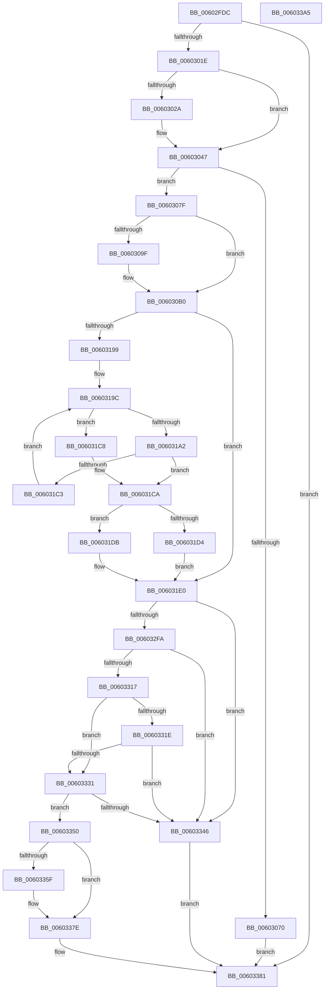

# RtlpHpHeapCreate

- RVA: `0x00602FDC`–`0x006033A6` (길이 `970` bytes)
- VA: `0x0000000140602FDC`
- 실행 섹션: `.text`
- PDB 이름 있음: `예`; PDB Function 태그: `아니요`
- unwind 정보 RVA: `0x000936EC`
- 디코드: `237`개 명령, `970/970` bytes 표시
- 미해석 바이트: `0` (있으면 어셈블리에 `.byte`로 보존)

> 이 문서는 커널 이미지의 기계어와 PDB 기호를 분석해 생성했습니다. 4번과 5번은 함수 원형과 자료형을 바이너리 사용 방식에서 추정한 C 해석이며 원본 소스 복구 결과는 아닙니다.

## 1. Dependencies

- 직접 호출 지점: **18**; 고유 호출 대상: **15**
- 직접 호출자로 확인된 함수: **3**
- RIP 상대 이미지 참조: **13**

### Outgoing calls
- `0x0060300F` → [RtlpHpRegisterEnvironment](RtlpHpRegisterEnvironment_function_006036C0.md) (function, `0x006036C0`)
- `0x0060302A` → [HalQueryMaximumProcessorCount](../4A/HalQueryMaximumProcessorCount_function_004AC9A0.md) (function, `0x004AC9A0`)
- `0x00603063` → [RtlpHpHeapAllocate](RtlpHpHeapAllocate_function_00602D98.md) (function, `0x00602D98`)
- `0x00603075` → [RtlpHpRegisterEnvironment](RtlpHpRegisterEnvironment_function_006036C0.md) (function, `0x006036C0`)
- `0x0060310C` → [RtlpHpSegContextInitialize](RtlpHpSegContextInitialize_function_0060421C.md) (function, `0x0060421C`)
- `0x00603156` → [RtlpHpSegContextInitialize](RtlpHpSegContextInitialize_function_0060421C.md) (function, `0x0060421C`)
- `0x0060316E` → [RtlpHpInitializeLock](../2E/RtlpHpInitializeLock_function_002E8054.md) (function, `0x002E8054`)
- `0x0060318B` → [RtlpHpInitializeLock](../2E/RtlpHpInitializeLock_function_002E8054.md) (function, `0x002E8054`)
- `0x00603254` → [RtlpHpVsContextInitialize](../4D/RtlpHpVsContextInitialize_function_004D4030.md) (function, `0x004D4030`)
- `0x006032C4` → [RtlpHpLfhContextInitialize](RtlpHpLfhContextInitialize_function_00604894.md) (function, `0x00604894`)
- `0x006032CD` → [CmSiRWLockInitialize](../../page/AD/CmSiRWLockInitialize_function_00AD69E0.md) (function, `0x00AD69E0`)
- `0x006032F0` → [guard_dispatch_icall](../6B/guard_dispatch_icall_function_006BAAD0.md) (function, `0x006BAAD0`)
- `0x00603302` → [memset](../6C/memset_function_006C6C40.md) (function, `0x006C6C40`)
- `0x0060330E` → [RtlpHpVsContextStart](RtlpHpVsContextStart_function_006056F0.md) (function, `0x006056F0`)
- `0x00603328` → [RtlpHpLfhContextEnable](RtlpHpLfhContextEnable_function_0060484C.md) (function, `0x0060484C`)
- `0x0060333D` → [RtlpHpSegContextReserve](RtlpHpSegContextReserve_function_00604338.md) (function, `0x00604338`)
- `0x00603349` → [RtlpHpHeapDestroy](RtlpHpHeapDestroy_function_006033AC.md) (function, `0x006033AC`)
- `0x00603379` → [RtlpLogHeapCreateEvent](../5F/RtlpLogHeapCreateEvent_function_005F16B0.md) (function, `0x005F16B0`)

### Direct callers
- [RtlpHpMetadataHeapCreate](RtlpHpMetadataHeapCreate_function_00603680.md) at `0x0060369C`
- [ExCreateHeap](../65/ExCreateHeap_function_0065C1F0.md) at `0x0065C209`
- [ExpPrivatePoolCreate](../../page/7D/ExpPrivatePoolCreate_function_007D5F98.md) at `0x007D60E4`

### Static image references
- `0x0060301E` → RVA `0x00E67B68` (`.data`; read)
- `0x006031A9` → RVA `0x00010880` (`.rdata`; read)
- `0x006031B0` → RVA `0x0048FDC0` (`HalAdjustResourceList`; read)
- `0x006031E5` → RVA `0x002EB320` (`RtlpHpSegVsAllocate`; read)
- `0x006031F7` → RVA `0x002E7DF0` (`RtlpHpSegLfhVsFree`; read)
- `0x0060320D` → RVA `0x00325750` (`RtlpHpSegLfhVsCommit`; read)
- `0x0060321B` → RVA `0x003243F0` (`RtlpHpSegLfhVsDecommit`; read)
- `0x00603226` → RVA `0x004B1EE0` (`RtlpHpSegLfhExtendContext`; read)
- `0x00603238` → RVA `0x00E6BEDC` (`.data`; read)
- `0x00603259` → RVA `0x002EB690` (`RtlpHpSegLfhAllocate`; read)
- `0x00603299` → RVA `0x00604520` (`RtlpHpSegTlsCleanup`; read)
- `0x006032DE` → RVA `0x00E28300` (`.data`; read)
- `0x0060331E` → RVA `0x00E6BED8` (`.data`; read)

## 2. Other-region calls and transfers

- 다른 실행 섹션으로 향하는 call: **1**
  - `0x006032CD` → [CmSiRWLockInitialize](../../page/AD/CmSiRWLockInitialize_function_00AD69E0.md) (`.text` → `PAGE`)
- 별도 외부 분기/꼬리 이동을 확인하지 못했습니다.

## 3. Assembly (complete function range)

```asm
00602FDC  48 8B C4                        mov rax, rsp
00602FDF  48 89 58 08                     mov qword ptr [rax + 8], rbx
00602FE3  48 89 70 10                     mov qword ptr [rax + 0x10], rsi
00602FE7  48 89 78 18                     mov qword ptr [rax + 0x18], rdi
00602FEB  55                              push rbp
00602FEC  41 54                           push r12
00602FEE  41 55                           push r13
00602FF0  41 56                           push r14
00602FF2  41 57                           push r15
00602FF4  48 8D 68 A1                     lea rbp, [rax - 0x5f]
00602FF8  48 81 EC B0 00 00 00            sub rsp, 0xb0
00602FFF  44 8B E1                        mov r12d, ecx
00603002  BB 01 00 00 00                  mov ebx, 1
00603007  8B D3                           mov edx, ebx
00603009  49 8B C9                        mov rcx, r9
0060300C  4D 8B F9                        mov r15, r9
0060300F  E8 AC 06 00 00                  call 0x1406036c0
00603014  33 FF                           xor edi, edi
00603016  85 C0                           test eax, eax
00603018  0F 88 63 03 00 00               js 0x140603381
0060301E  44 8B 35 43 4B 86 00            mov r14d, dword ptr [rip + 0x864b43]
00603025  45 85 F6                        test r14d, r14d
00603028  75 1D                           jne 0x140603047
0060302A  E8 71 99 EA FF                  call 0x1404ac9a0
0060302F  85 C0                           test eax, eax
00603031  44 8B F0                        mov r14d, eax
00603034  44 0F 44 F3                     cmove r14d, ebx
00603038  33 C0                           xor eax, eax
0060303A  F0 44 0F B1 35 25 4B 86 00      lock cmpxchg dword ptr [rip + 0x864b25], r14d
00603043  44 0F 45 F0                     cmovne r14d, eax
00603047  41 0F 10 07                     movups xmm0, xmmword ptr [r15]
0060304B  41 0F BA E4 19                  bt r12d, 0x19
00603050  4C 8D 45 D7                     lea r8, [rbp - 0x29]
00603054  41 8B CC                        mov ecx, r12d
00603057  44 0F 42 F3                     cmovb r14d, ebx
0060305B  41 8B D6                        mov edx, r14d
0060305E  F3 0F 7F 45 D7                  movdqu xmmword ptr [rbp - 0x29], xmm0
00603063  E8 30 FD FF FF                  call 0x140602d98
00603068  48 8B F0                        mov rsi, rax
0060306B  48 85 C0                        test rax, rax
0060306E  75 0F                           jne 0x14060307f
00603070  33 D2                           xor edx, edx
00603072  49 8B CF                        mov rcx, r15
00603075  E8 46 06 00 00                  call 0x1406036c0
0060307A  E9 02 03 00 00                  jmp 0x140603381
0060307F  41 0F 10 07                     movups xmm0, xmmword ptr [r15]
00603083  C7 40 10 EE DD EE DD            mov dword ptr [rax + 0x10], 0xddeeddee
0060308A  8B CF                           mov ecx, edi
0060308C  44 89 60 14                     mov dword ptr [rax + 0x14], r12d
00603090  F3 0F 7F 00                     movdqu xmmword ptr [rax], xmm0
00603094  49 8B 07                        mov rax, qword ptr [r15]
00603097  48 C1 E8 08                     shr rax, 8
0060309B  3C 02                           cmp al, 2
0060309D  72 11                           jb 0x1406030b0
0060309F  49 8B 07                        mov rax, qword ptr [r15]
006030A2  BA 10 00 00 00                  mov edx, 0x10
006030A7  48 C1 E8 08                     shr rax, 8
006030AB  3C 05                           cmp al, 5
006030AD  0F 42 CA                        cmovb ecx, edx
006030B0  8B D9                           mov ebx, ecx
006030B2  48 8D 96 C0 02 00 00            lea rdx, [rsi + 0x2c0]
006030B9  83 CB 04                        or ebx, 4
006030BC  4C 8D 4D E7                     lea r9, [rbp - 0x19]
006030C0  48 8D 86 A8 00 00 00            lea rax, [rsi + 0xa8]
006030C7  41 0F BA E4 1A                  bt r12d, 0x1a
006030CC  4C 8D 86 80 00 00 00            lea r8, [rsi + 0x80]
006030D3  0F 43 D9                        cmovae ebx, ecx
006030D6  4C 8D AE 40 03 00 00            lea r13, [rsi + 0x340]
006030DD  89 5C 24 40                     mov dword ptr [rsp + 0x40], ebx
006030E1  48 8D 8E 40 01 00 00            lea rcx, [rsi + 0x140]
006030E8  4C 89 4C 24 38                  mov qword ptr [rsp + 0x38], r9
006030ED  4D 8B CD                        mov r9, r13
006030F0  48 89 44 24 30                  mov qword ptr [rsp + 0x30], rax
006030F5  4C 89 44 24 28                  mov qword ptr [rsp + 0x28], r8
006030FA  4C 8B C6                        mov r8, rsi
006030FD  48 89 54 24 20                  mov qword ptr [rsp + 0x20], rdx
00603102  BA 00 00 10 00                  mov edx, 0x100000
00603107  F3 0F 7F 45 E7                  movdqu xmmword ptr [rbp - 0x19], xmm0
0060310C  E8 0B 11 00 00                  call 0x14060421c
00603111  41 0F 10 07                     movups xmm0, xmmword ptr [r15]
00603115  89 5C 24 40                     mov dword ptr [rsp + 0x40], ebx
00603119  48 8D 55 F7                     lea rdx, [rbp - 9]
0060311D  48 89 54 24 38                  mov qword ptr [rsp + 0x38], rdx
00603122  48 8D 86 B8 00 00 00            lea rax, [rsi + 0xb8]
00603129  48 89 44 24 30                  mov qword ptr [rsp + 0x30], rax
0060312E  48 8D 9E 80 00 00 00            lea rbx, [rsi + 0x80]
00603135  48 89 5C 24 28                  mov qword ptr [rsp + 0x28], rbx
0060313A  48 8D 8E 00 02 00 00            lea rcx, [rsi + 0x200]
00603141  45 33 C9                        xor r9d, r9d
00603144  48 89 7C 24 20                  mov qword ptr [rsp + 0x20], rdi
00603149  4C 8B C6                        mov r8, rsi
0060314C  BA 00 00 00 01                  mov edx, 0x1000000
00603151  F3 0F 7F 45 F7                  movdqu xmmword ptr [rbp - 9], xmm0
00603156  E8 C1 10 00 00                  call 0x14060421c
0060315B  41 8B 07                        mov eax, dword ptr [r15]
0060315E  48 8D 4E 40                     lea rcx, [rsi + 0x40]
00603162  0F B6 D0                        movzx edx, al
00603165  41 B8 01 00 00 00               mov r8d, 1
0060316B  41 23 D0                        and edx, r8d
0060316E  E8 E1 4E CE FF                  call 0x1402e8054
00603173  41 8B 07                        mov eax, dword ptr [r15]
00603176  48 8D 8E E8 00 00 00            lea rcx, [rsi + 0xe8]
0060317D  0F B6 D0                        movzx edx, al
00603180  41 23 D0                        and edx, r8d
00603183  48 89 7E 48                     mov qword ptr [rsi + 0x48], rdi
00603187  48 89 7E 50                     mov qword ptr [rsi + 0x50], rdi
0060318B  E8 C4 4E CE FF                  call 0x1402e8054
00603190  F7 46 14 00 00 00 20            test dword ptr [rsi + 0x14], 0x20000000
00603197  74 47                           je 0x1406031e0
00603199  0F B7 C7                        movzx eax, di
0060319C  66 41 3B C0                     cmp ax, r8w
006031A0  73 26                           jae 0x1406031c8
006031A2  41 8D 0C 00                     lea ecx, [r8 + rax]
006031A6  0F B7 C0                        movzx eax, ax
006031A9  4C 8D 05 D0 D6 A0 FF            lea r8, [rip - 0x5f2930]
006031B0  48 8D 15 09 CC E8 FF            lea rdx, [rip - 0x1733f7]
006031B7  49 39 14 C0                     cmp qword ptr [r8 + rax*8], rdx
006031BB  41 B8 01 00 00 00               mov r8d, 1
006031C1  74 07                           je 0x1406031ca
006031C3  0F B7 C1                        movzx eax, cx
006031C6  EB D4                           jmp 0x14060319c
006031C8  8B CF                           mov ecx, edi
006031CA  0F B7 C1                        movzx eax, cx
006031CD  89 46 18                        mov dword ptr [rsi + 0x18], eax
006031D0  85 C0                           test eax, eax
006031D2  74 07                           je 0x1406031db
006031D4  F0 83 4E 14 20                  lock or dword ptr [rsi + 0x14], 0x20
006031D9  EB 05                           jmp 0x1406031e0
006031DB  F0 83 66 14 DF                  lock and dword ptr [rsi + 0x14], 0xffffffdf
006031E0  48 89 5C 24 38                  mov qword ptr [rsp + 0x38], rbx
006031E5  48 8D 05 34 81 CE FF            lea rax, [rip - 0x317ecc]
006031EC  48 89 45 07                     mov qword ptr [rbp + 7], rax
006031F0  48 8D 9E 40 01 00 00            lea rbx, [rsi + 0x140]
006031F7  48 8D 05 F2 4B CE FF            lea rax, [rip - 0x31b40e]
006031FE  48 89 7D 2F                     mov qword ptr [rbp + 0x2f], rdi
00603202  48 89 45 0F                     mov qword ptr [rbp + 0xf], rax
00603206  48 8D 8E C0 02 00 00            lea rcx, [rsi + 0x2c0]
0060320D  48 8D 05 3C 25 D2 FF            lea rax, [rip - 0x2ddac4]
00603214  48 8B D3                        mov rdx, rbx
00603217  48 89 45 17                     mov qword ptr [rbp + 0x17], rax
0060321B  48 8D 05 CE 11 D2 FF            lea rax, [rip - 0x2dee32]
00603222  48 89 45 1F                     mov qword ptr [rbp + 0x1f], rax
00603226  48 8D 05 B3 EC EA FF            lea rax, [rip - 0x15134d]
0060322D  48 89 45 27                     mov qword ptr [rbp + 0x27], rax
00603231  41 8B 07                        mov eax, dword ptr [r15]
00603234  44 0F B6 C8                     movzx r9d, al
00603238  48 8D 05 9D 8C 86 00            lea rax, [rip + 0x868c9d]
0060323F  48 89 44 24 30                  mov qword ptr [rsp + 0x30], rax
00603244  45 23 C8                        and r9d, r8d
00603247  89 7C 24 28                     mov dword ptr [rsp + 0x28], edi
0060324B  4C 8D 45 07                     lea r8, [rbp + 7]
0060324F  44 89 74 24 20                  mov dword ptr [rsp + 0x20], r14d
00603254  E8 D7 0D ED FF                  call 0x1404d4030
00603259  48 8D 05 30 84 CE FF            lea rax, [rip - 0x317bd0]
00603260  45 8B C6                        mov r8d, r14d
00603263  48 89 45 07                     mov qword ptr [rbp + 7], rax
00603267  48 8B D3                        mov rdx, rbx
0060326A  48 8D 05 7F 4B CE FF            lea rax, [rip - 0x31b481]
00603271  49 8B CD                        mov rcx, r13
00603274  48 89 45 0F                     mov qword ptr [rbp + 0xf], rax
00603278  48 8D 05 D1 24 D2 FF            lea rax, [rip - 0x2ddb2f]
0060327F  48 89 45 17                     mov qword ptr [rbp + 0x17], rax
00603283  48 8D 05 66 11 D2 FF            lea rax, [rip - 0x2dee9a]
0060328A  48 89 45 1F                     mov qword ptr [rbp + 0x1f], rax
0060328E  48 8D 05 4B EC EA FF            lea rax, [rip - 0x1513b5]
00603295  48 89 45 27                     mov qword ptr [rbp + 0x27], rax
00603299  48 8D 05 80 12 00 00            lea rax, [rip + 0x1280]
006032A0  48 89 45 2F                     mov qword ptr [rbp + 0x2f], rax
006032A4  41 8B 07                        mov eax, dword ptr [r15]
006032A7  44 0F B6 C8                     movzx r9d, al
006032AB  48 8D 86 80 00 00 00            lea rax, [rsi + 0x80]
006032B2  48 89 44 24 28                  mov qword ptr [rsp + 0x28], rax
006032B7  41 83 E1 01                     and r9d, 1
006032BB  48 8D 45 07                     lea rax, [rbp + 7]
006032BF  48 89 44 24 20                  mov qword ptr [rsp + 0x20], rax
006032C4  E8 CB 15 00 00                  call 0x140604894
006032C9  48 8D 4E 70                     lea rcx, [rsi + 0x70]
006032CD  E8 0E 37 4D 00                  call 0x140ad69e0
006032D2  41 0F B6 5D 40                  movzx ebx, byte ptr [r13 + 0x40]
006032D7  49 8B C5                        mov rax, r13
006032DA  49 33 45 28                     xor rax, qword ptr [r13 + 0x28]
006032DE  48 33 05 1B 50 82 00            xor rax, qword ptr [rip + 0x82501b]
006032E5  49 8B 4D 00                     mov rcx, qword ptr [r13]
006032E9  48 C1 E3 08                     shl rbx, 8
006032ED  48 8B D3                        mov rdx, rbx
006032F0  E8 DB 77 0B 00                  call 0x1406baad0
006032F5  48 85 C0                        test rax, rax
006032F8  74 4C                           je 0x140603346
006032FA  4C 8B C3                        mov r8, rbx
006032FD  33 D2                           xor edx, edx
006032FF  48 8B C8                        mov rcx, rax
00603302  E8 39 39 0C 00                  call 0x1406c6c40
00603307  48 8D 8E C0 02 00 00            lea rcx, [rsi + 0x2c0]
0060330E  E8 DD 23 00 00                  call 0x1406056f0
00603313  85 C0                           test eax, eax
00603315  78 2F                           js 0x140603346
00603317  41 0F BA E4 16                  bt r12d, 0x16
0060331C  72 13                           jb 0x140603331
0060331E  48 8D 15 B3 8B 86 00            lea rdx, [rip + 0x868bb3]
00603325  49 8B CD                        mov rcx, r13
00603328  E8 1F 15 00 00                  call 0x14060484c
0060332D  85 C0                           test eax, eax
0060332F  78 15                           js 0x140603346
00603331  45 33 C0                        xor r8d, r8d
00603334  48 8D 8E 40 01 00 00            lea rcx, [rsi + 0x140]
0060333B  33 D2                           xor edx, edx
0060333D  E8 F6 0F 00 00                  call 0x140604338
00603342  85 C0                           test eax, eax
00603344  79 0A                           jns 0x140603350
00603346  48 8B CE                        mov rcx, rsi
00603349  E8 5E 00 00 00                  call 0x1406033ac
0060334E  EB 31                           jmp 0x140603381
00603350  F0 81 66 14 7F FF FF FF         lock and dword ptr [rsi + 0x14], 0xffffff7f
00603358  8B 46 14                        mov eax, dword ptr [rsi + 0x14]
0060335B  84 C0                           test al, al
0060335D  79 1F                           jns 0x14060337e
0060335F  4C 8B 8E F8 00 00 00            mov r9, qword ptr [rsi + 0xf8]
00603366  41 8B D4                        mov edx, r12d
00603369  4C 8B 86 00 01 00 00            mov r8, qword ptr [rsi + 0x100]
00603370  4C 2B CE                        sub r9, rsi
00603373  4C 2B C6                        sub r8, rsi
00603376  48 8B CE                        mov rcx, rsi
00603379  E8 32 E3 FE FF                  call 0x1405f16b0
0060337E  48 8B FE                        mov rdi, rsi
00603381  4C 8D 9C 24 B0 00 00 00         lea r11, [rsp + 0xb0]
00603389  48 8B C7                        mov rax, rdi
0060338C  49 8B 5B 30                     mov rbx, qword ptr [r11 + 0x30]
00603390  49 8B 73 38                     mov rsi, qword ptr [r11 + 0x38]
00603394  49 8B 7B 40                     mov rdi, qword ptr [r11 + 0x40]
00603398  49 8B E3                        mov rsp, r11
0060339B  41 5F                           pop r15
0060339D  41 5E                           pop r14
0060339F  41 5D                           pop r13
006033A1  41 5C                           pop r12
006033A3  5D                              pop rbp
006033A4  C3                              ret
006033A5  CC                              int3
```

## 4. C-style interpretation (structured pseudocode)

```c
__int64 __fastcall RtlpHpHeapCreate(int a1, __int64 a2, __int64 a3, __int64 a4)
{
    __int64 result;
    __int64 v_r14;
    __int64 v_rbx;
    __int64 v_rdi;
    __int64 v_rsp;
    unsigned __int64 v_stack_m28;
    unsigned int v_stack_m98;
    unsigned __int64 v_stack_mA0;
    unsigned __int64 v_stack_mA8;
    unsigned __int64 v_stack_mB0;
    unsigned __int64 v_stack_mB8;

    *(unsigned __int64 *)(v_rsp + 8) = v_rbx;
    *(unsigned __int64 *)(v_rsp + 16) = v_rsi;
    *(unsigned __int64 *)(v_rsp + 24) = v_rdi;
    v_rsp = (v_rsp) - (176);
    result = RtlpHpRegisterEnvironment(a4, 1, a3, a4);
    v_rdi = 0;
    if (sign_flag) goto loc_00603381;
    v_r14 = (unsigned int)(*(unsigned int *)(v_rip + 8801091));
    if ((unsigned int)((unsigned int)(*(unsigned int *)(v_rip + 8801091))) == 0) {
        result = HalQueryMaximumProcessorCount(a4, 1, a3, a4);
        v_r14 = (unsigned int)(result);
        if ((unsigned int)(result) == 0) { v_r14 = 1; }
        result = 0;
        if (condition_is_not_equal) { v_r14 = 0; }
    }
    if (condition_is_below) { v_r14 = 1; }
    *(unsigned __int64 *)(v_rsp - 95 - 41) = v_xmm0;
    result = RtlpHpHeapAllocate((unsigned int)((unsigned int)((unsigned int)(a1))), (unsigned int)((unsigned int)(v_r14)), v_rsp - 95 - 41, a4);
    if (result != 0) goto loc_0060307F;
    a2 = 0;
    result = RtlpHpRegisterEnvironment(a4, a2, v_rsp - 95 - 41, a4);
    goto loc_00603381;
loc_0060307F:
    *(unsigned int *)(result + 16) = 0xDDEEDDEEULL;
    *(unsigned int *)(result + 20) = (unsigned int)((unsigned int)(a1));
    *(unsigned __int64 *)(result) = v_xmm0;
    result = (*(unsigned __int64 *)(a4)) >> (8);
    if (((unsigned __int8)(result)) >= 2) {
        result = *(unsigned __int64 *)(a4);
        a2 = 16;
        result = (result) >> (8);
        a1 = 0;
        if (((unsigned __int8)(result)) < 5) { a1 = (unsigned int)(a2); }
    }
    v_rbx = (unsigned int)(((unsigned int)(a1)) | (4));
    if (condition_is_above_or_equal) { v_rbx = a1; }
    v_stack_m98 = (unsigned int)(v_rbx);
    v_stack_mA0 = v_rsp - 95 - 25;
    v_stack_mA8 = result + 168;
    v_stack_mB0 = result + 128;
    v_stack_mB8 = result + 704;
    *(unsigned __int64 *)(v_rsp - 95 - 25) = v_xmm0;
    result = RtlpHpSegContextInitialize(result + 320, (unsigned int)(0x100000ULL), result, result + 832);
    v_stack_m98 = (unsigned int)(v_rbx);
    v_stack_mA0 = v_rsp - 95 - 9;
    v_stack_mA8 = result + 184;
    v_stack_mB0 = result + 128;
    a4 = 0;
    v_stack_mB8 = 0;
    *(unsigned __int64 *)(v_rsp - 95 - 9) = v_xmm0;
    result = RtlpHpSegContextInitialize(result + 512, (unsigned int)(0x1000000ULL), result, a4);
    a2 = (unsigned int)(((unsigned __int8)((unsigned int)(*(unsigned int *)(a4)))) & (1));
    result = RtlpHpInitializeLock(result + 64, a2, 1, a4);
    a2 = (unsigned int)(((unsigned __int8)((unsigned int)(*(unsigned int *)(a4)))) & (1));
    *(unsigned __int64 *)(result + 72) = 0;
    *(unsigned __int64 *)(result + 80) = 0;
    result = RtlpHpInitializeLock(result + 232, a2, 1, a4);
    if (((*(unsigned int *)(result + 20)) & (0x20000000ULL)) == 0) goto loc_006031E0;
loc_0060319C:
    if (0 >= 1) goto loc_006031C8;
    if ((*(unsigned __int64 *)(v_rip - 6236464 + 0 * 8)) == (v_rip - 1520631)) goto loc_006031CA;
    goto loc_0060319C;
loc_006031C8:
loc_006031CA:
    *(unsigned int *)(result + 24) = 0;
    if (0 == 0) goto loc_006031DB;
    goto loc_006031E0;
loc_006031DB:
loc_006031E0:
    v_stack_mA0 = result + 128;
    *(unsigned __int64 *)(v_rsp - 95 + 7) = v_rip - 3243724;
    *(unsigned __int64 *)(v_rsp - 95 + 47) = 0;
    *(unsigned __int64 *)(v_rsp - 95 + 15) = v_rip - 3257358;
    *(unsigned __int64 *)(v_rsp - 95 + 23) = v_rip - 3005124;
    *(unsigned __int64 *)(v_rsp - 95 + 31) = v_rip - 3010098;
    *(unsigned __int64 *)(v_rsp - 95 + 39) = v_rip - 1381197;
    v_stack_mA8 = v_rip + 8817821;
    a4 = (unsigned int)(((unsigned __int8)((unsigned int)(*(unsigned int *)(a4)))) & (1));
    v_stack_mB0 = 0;
    v_stack_mB8 = (unsigned int)(v_r14);
    result = RtlpHpVsContextInitialize(result + 704, result + 320, v_rsp - 95 + 7, a4);
    *(unsigned __int64 *)(v_rsp - 95 + 7) = v_rip - 3242960;
    *(unsigned __int64 *)(v_rsp - 95 + 15) = v_rip - 3257473;
    *(unsigned __int64 *)(v_rsp - 95 + 23) = v_rip - 3005231;
    *(unsigned __int64 *)(v_rsp - 95 + 31) = v_rip - 3010202;
    *(unsigned __int64 *)(v_rsp - 95 + 39) = v_rip - 1381301;
    *(unsigned __int64 *)(v_rsp - 95 + 47) = v_rip + 4736;
    v_stack_mB0 = result + 128;
    a4 = (unsigned int)(((unsigned __int8)((unsigned int)(*(unsigned int *)(a4)))) & (1));
    v_stack_mB8 = v_rsp - 95 + 7;
    result = RtlpHpLfhContextInitialize(result + 832, result + 320, (unsigned int)((unsigned int)(v_r14)), a4);
    result = CmSiRWLockInitialize(result + 112, result + 320, (unsigned int)((unsigned int)(v_r14)), a4);
    result = (result + 832) ^ (*(unsigned __int64 *)(result + 832 + 40));
    result = (result) ^ (*(unsigned __int64 *)(v_rip + 8540187));
    v_rbx = (*(unsigned __int8 *)(result + 832 + 64)) << (8);
    result = guard_dispatch_icall(*(unsigned __int64 *)(result + 832), v_rbx, (unsigned int)((unsigned int)(v_r14)), a4);
    if (result == 0) goto loc_00603346;
    a2 = 0;
    result = memset(result, a2, v_rbx, a4);
    result = RtlpHpVsContextStart(result + 704, a2, v_rbx, a4);
    if (sign_flag) goto loc_00603346;
    if (condition_is_below) goto loc_00603331;
    result = RtlpHpLfhContextEnable(result + 832, v_rip + 8817587, v_rbx, a4);
    if (sign_flag) goto loc_00603346;
loc_00603331:
    a3 = 0;
    a2 = 0;
    result = RtlpHpSegContextReserve(result + 320, a2, a3, a4);
    if (!sign_flag) goto loc_00603350;
loc_00603346:
    result = RtlpHpHeapDestroy(result, a2, a3, a4);
    goto loc_00603381;
loc_00603350:
    result = (unsigned int)(*(unsigned int *)(result + 20));
    if (sign_flag) {
        a4 = *(unsigned __int64 *)(result + 248);
        a2 = (unsigned int)((unsigned int)(a1));
        a3 = *(unsigned __int64 *)(result + 256);
        a4 = (a4) - (result);
        a3 = (a3) - (result);
        a1 = result;
        result = RtlpLogHeapCreateEvent(a1, a2, a3, a4);
    }
loc_00603381:
    return result;
}
```

## 5. (Beta) C Style

```c
int64_t RtlpHpHeapCreate(int32_t Arg1, int64_t Arg2, int64_t Arg3, void *Arg4)
{
    uint8_t *arg4 = (uint8_t *)Arg4;

    int64_t result;
    int64_t local_r14;
    int64_t local_rbx;
    int64_t local_rdi;
    int64_t local_rsp;
    uint64_t v_stack_m28;
    uint32_t v_stack_m98;
    uint64_t v_stack_mA0;
    uint64_t v_stack_mA8;
    uint64_t v_stack_mB0;
    uint64_t v_stack_mB8;

    *(uint64_t *)(local_rsp + 0x8) = local_rbx;
    *(uint64_t *)(local_rsp + 0x10) = local_rsi;
    *(uint64_t *)(local_rsp + 0x18) = local_rdi;
    local_rsp = (local_rsp) - (176);
    result = RtlpHpRegisterEnvironment(Arg4, 1, Arg3, Arg4);
    local_rdi = 0;
    if (sign_flag) goto loc_00603381;
    local_r14 = (uint32_t)(*(uint32_t *)(v_rip + 0x864B43));
    if ((uint32_t)((uint32_t)(*(uint32_t *)(v_rip + 0x864B43))) == 0) {
        result = HalQueryMaximumProcessorCount(Arg4, 1, Arg3, Arg4);
        local_r14 = (uint32_t)(result);
        if ((uint32_t)(result) == 0) { local_r14 = 1; }
        result = 0;
        if (condition_is_not_equal) { local_r14 = 0; }
    }
    if (condition_is_below) { local_r14 = 1; }
    *(uint64_t *)(local_rsp - 0x5F - 0x29) = v_xmm0;
    result = RtlpHpHeapAllocate((uint32_t)((uint32_t)((uint32_t)(Arg1))), (uint32_t)((uint32_t)(local_r14)), local_rsp - 95 - 41, Arg4);
    if (result != 0) goto loc_0060307F;
    Arg2 = 0;
    result = RtlpHpRegisterEnvironment(Arg4, Arg2, local_rsp - 95 - 41, Arg4);
    goto loc_00603381;
loc_0060307F:
    *(uint32_t *)(result + 0x10) = 0xDDEEDDEEULL;
    *(uint32_t *)(result + 0x14) = (uint32_t)((uint32_t)(Arg1));
    *(uint64_t *)(result) = v_xmm0;
    result = (*(uint64_t *)(arg4)) >> (8);
    if (((uint8_t)(result)) >= 2) {
        result = *(uint64_t *)(arg4);
        Arg2 = 16;
        result = (result) >> (8);
        Arg1 = 0;
        if (((uint8_t)(result)) < 5) { Arg1 = (uint32_t)(Arg2); }
    }
    local_rbx = (uint32_t)(((uint32_t)(Arg1)) | (4));
    if (condition_is_above_or_equal) { local_rbx = Arg1; }
    v_stack_m98 = (uint32_t)(local_rbx);
    v_stack_mA0 = local_rsp - 95 - 25;
    v_stack_mA8 = result + 168;
    v_stack_mB0 = result + 128;
    v_stack_mB8 = result + 704;
    *(uint64_t *)(local_rsp - 0x5F - 0x19) = v_xmm0;
    result = RtlpHpSegContextInitialize(result + 320, (uint32_t)(0x100000ULL), result, result + 832);
    v_stack_m98 = (uint32_t)(local_rbx);
    v_stack_mA0 = local_rsp - 95 - 9;
    v_stack_mA8 = result + 184;
    v_stack_mB0 = result + 128;
    Arg4 = 0;
    v_stack_mB8 = 0;
    *(uint64_t *)(local_rsp - 0x5F - 0x9) = v_xmm0;
    result = RtlpHpSegContextInitialize(result + 512, (uint32_t)(0x1000000ULL), result, Arg4);
    Arg2 = (uint32_t)(((uint8_t)((uint32_t)(*(uint32_t *)(arg4)))) & (1));
    result = RtlpHpInitializeLock(result + 64, Arg2, 1, Arg4);
    Arg2 = (uint32_t)(((uint8_t)((uint32_t)(*(uint32_t *)(arg4)))) & (1));
    *(uint64_t *)(result + 0x48) = 0;
    *(uint64_t *)(result + 0x50) = 0;
    result = RtlpHpInitializeLock(result + 232, Arg2, 1, Arg4);
    if (((*(uint32_t *)(result + 0x14)) & (0x20000000ULL)) == 0) goto loc_006031E0;
loc_0060319C:
    if (0 >= 1) goto loc_006031C8;
    if ((*(uint64_t *)(v_rip - 0x5F2930 + 0x0 * 8)) == (v_rip - 1520631)) goto loc_006031CA;
    goto loc_0060319C;
loc_006031C8:
loc_006031CA:
    *(uint32_t *)(result + 0x18) = 0;
    if (0 == 0) goto loc_006031DB;
    goto loc_006031E0;
loc_006031DB:
loc_006031E0:
    v_stack_mA0 = result + 128;
    *(uint64_t *)(local_rsp - 0x5F + 0x7) = v_rip - 3243724;
    *(uint64_t *)(local_rsp - 0x5F + 0x2F) = 0;
    *(uint64_t *)(local_rsp - 0x5F + 0xF) = v_rip - 3257358;
    *(uint64_t *)(local_rsp - 0x5F + 0x17) = v_rip - 3005124;
    *(uint64_t *)(local_rsp - 0x5F + 0x1F) = v_rip - 3010098;
    *(uint64_t *)(local_rsp - 0x5F + 0x27) = v_rip - 1381197;
    v_stack_mA8 = v_rip + 8817821;
    Arg4 = (uint32_t)(((uint8_t)((uint32_t)(*(uint32_t *)(arg4)))) & (1));
    v_stack_mB0 = 0;
    v_stack_mB8 = (uint32_t)(local_r14);
    result = RtlpHpVsContextInitialize(result + 704, result + 320, local_rsp - 95 + 7, Arg4);
    *(uint64_t *)(local_rsp - 0x5F + 0x7) = v_rip - 3242960;
    *(uint64_t *)(local_rsp - 0x5F + 0xF) = v_rip - 3257473;
    *(uint64_t *)(local_rsp - 0x5F + 0x17) = v_rip - 3005231;
    *(uint64_t *)(local_rsp - 0x5F + 0x1F) = v_rip - 3010202;
    *(uint64_t *)(local_rsp - 0x5F + 0x27) = v_rip - 1381301;
    *(uint64_t *)(local_rsp - 0x5F + 0x2F) = v_rip + 4736;
    v_stack_mB0 = result + 128;
    Arg4 = (uint32_t)(((uint8_t)((uint32_t)(*(uint32_t *)(arg4)))) & (1));
    v_stack_mB8 = local_rsp - 95 + 7;
    result = RtlpHpLfhContextInitialize(result + 832, result + 320, (uint32_t)((uint32_t)(local_r14)), Arg4);
    result = CmSiRWLockInitialize(result + 112, result + 320, (uint32_t)((uint32_t)(local_r14)), Arg4);
    result = (result + 832) ^ (*(uint64_t *)(result + 0x340 + 0x28));
    result = (result) ^ (*(uint64_t *)(v_rip + 0x82501B));
    local_rbx = (*(uint8_t *)(result + 0x340 + 0x40)) << (8);
    result = guard_dispatch_icall(*(uint64_t *)(result + 0x340), local_rbx, (uint32_t)((uint32_t)(local_r14)), Arg4);
    if (result == 0) goto loc_00603346;
    Arg2 = 0;
    result = memset(result, Arg2, local_rbx, Arg4);
    result = RtlpHpVsContextStart(result + 704, Arg2, local_rbx, Arg4);
    if (sign_flag) goto loc_00603346;
    if (condition_is_below) goto loc_00603331;
    result = RtlpHpLfhContextEnable(result + 832, v_rip + 8817587, local_rbx, Arg4);
    if (sign_flag) goto loc_00603346;
loc_00603331:
    Arg3 = 0;
    Arg2 = 0;
    result = RtlpHpSegContextReserve(result + 320, Arg2, Arg3, Arg4);
    if (!sign_flag) goto loc_00603350;
loc_00603346:
    result = RtlpHpHeapDestroy(result, Arg2, Arg3, Arg4);
    goto loc_00603381;
loc_00603350:
    result = (uint32_t)(*(uint32_t *)(result + 0x14));
    if (sign_flag) {
        Arg4 = *(uint64_t *)(result + 0xF8);
        Arg2 = (uint32_t)((uint32_t)(Arg1));
        Arg3 = *(uint64_t *)(result + 0x100);
        Arg4 = (Arg4) - (result);
        Arg3 = (Arg3) - (result);
        Arg1 = result;
        result = RtlpLogHeapCreateEvent(Arg1, Arg2, Arg3, Arg4);
    }
loc_00603381:
    return result;
}
```

### 관측된 메모리 오프셋

구조체 형식이 확인되지 않은 접근은 인자 기준의 오프셋으로만 기록했습니다.

| 기준 인자 | 오프셋 표현 | 폭 (bit) | 접근 |
|---|---:|---:|---|
| `Arg4` | `+ 0x0` | `32` | `R` |
| `Arg4` | `+ 0x0` | `64` | `R` |
| `Arg4` | `+ 0x0` | `128` | `R` |

## 6. Execution-region graph

[열기: 2D/3D 그래프와 함수 탐색 컨트롤 패널](../../../control-panel.html?section=text&rva=0x00602FDC&view=graph)

- 2D 그래프는 위에서 아래로 흐르고, 3D 그래프는 빈 공간을 드래그해 회전합니다. Shift+드래그는 이동, 휠은 확대·축소, 함수 노드 선택은 대상 보고서 이동입니다.

### Static fallback


