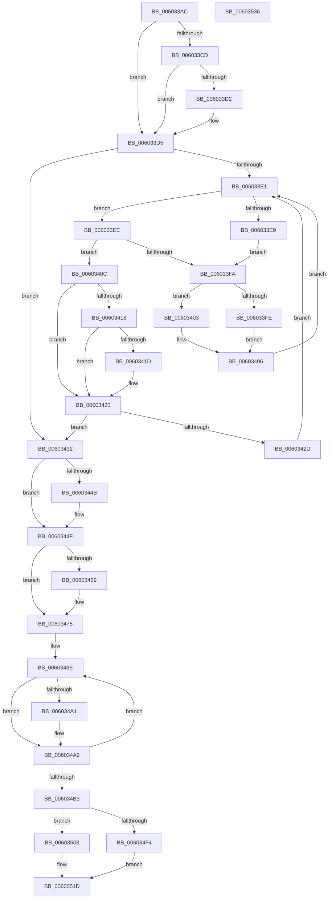

# RtlpHpHeapDestroy

- RVA: `0x006033AC`–`0x00603537` (길이 `395` bytes)
- VA: `0x00000001406033AC`
- 실행 섹션: `.text`
- PDB 이름 있음: `예`; PDB Function 태그: `아니요`
- unwind 정보 RVA: `0x000D0594`
- 디코드: `110`개 명령, `395/395` bytes 표시
- 미해석 바이트: `0` (있으면 어셈블리에 `.byte`로 보존)

> 이 문서는 커널 이미지의 기계어와 PDB 기호를 분석해 생성했습니다. 4번과 5번은 함수 원형과 자료형을 바이너리 사용 방식에서 추정한 C 해석이며 원본 소스 복구 결과는 아닙니다.

## 1. Dependencies

- 직접 호출 지점: **10**; 고유 호출 대상: **9**
- 직접 호출자로 확인된 함수: **2**
- RIP 상대 이미지 참조: **0**

### Outgoing calls
- `0x00603423` → [RtlpHpLargeAllocationDestroy](RtlpHpLargeAllocationDestroy_function_006054D8.md) (function, `0x006054D8`)
- `0x00603456` → [RtlpHpVsContextCleanup](RtlpHpVsContextCleanup_function_00605644.md) (function, `0x00605644`)
- `0x00603470` → [ExSaFree](../43/ExSaFree_function_0043FACC.md) (function, `0x0043FACC`)
- `0x0060347D` → [RtlpHpLfhContextSlotStandbyProcess](../4A/RtlpHpLfhContextSlotStandbyProcess_function_004A7538.md) (function, `0x004A7538`)
- `0x006034A4` → [RtlpHpLfhBucketCleanup](RtlpHpLfhBucketCleanup_function_006046CC.md) (function, `0x006046CC`)
- `0x006034BF` → [RtlpHpSegContextCleanup](RtlpHpSegContextCleanup_function_006041BC.md) (function, `0x006041BC`)
- `0x006034CB` → [RtlpHpSegContextCleanup](RtlpHpSegContextCleanup_function_006041BC.md) (function, `0x006041BC`)
- `0x006034FC` → [RtlpHpMetadataFree](../2E/RtlpHpMetadataFree_function_002ECA64.md) (function, `0x002ECA64`)
- `0x00603518` → [RtlpHpFreeVA](../2C/RtlpHpFreeVA_function_002C0FD4.md) (function, `0x002C0FD4`)
- `0x00603524` → [RtlpHpRegisterEnvironment](RtlpHpRegisterEnvironment_function_006036C0.md) (function, `0x006036C0`)

### Direct callers
- [RtlpHpHeapCreate](RtlpHpHeapCreate_function_00602FDC.md) at `0x00603349`
- [ExpPrivatePoolDestroy](../../page/7D/ExpPrivatePoolDestroy_function_007D61C4.md) at `0x007D6218`

### Static image references
- 디코드된 RIP-relative 메모리 참조가 없습니다.

## 2. Other-region calls and transfers

- 다른 실행 섹션으로 향하는 call: **0**
- 별도 외부 분기/꼬리 이동을 확인하지 못했습니다.

## 3. Assembly (complete function range)

```asm
006033AC  48 89 5C 24 18                  mov qword ptr [rsp + 0x18], rbx
006033B1  48 89 4C 24 08                  mov qword ptr [rsp + 8], rcx
006033B6  55                              push rbp
006033B7  56                              push rsi
006033B8  57                              push rdi
006033B9  48 83 EC 40                     sub rsp, 0x40
006033BD  48 8D 59 48                     lea rbx, [rcx + 0x48]
006033C1  48 8B E9                        mov rbp, rcx
006033C4  F6 43 08 01                     test byte ptr [rbx + 8], 1
006033C8  48 8B 0B                        mov rcx, qword ptr [rbx]
006033CB  74 08                           je 0x1406033d5
006033CD  48 85 C9                        test rcx, rcx
006033D0  74 03                           je 0x1406033d5
006033D2  48 33 CB                        xor rcx, rbx
006033D5  0F B6 73 08                     movzx esi, byte ptr [rbx + 8]
006033D9  83 E6 01                        and esi, 1
006033DC  48 85 C9                        test rcx, rcx
006033DF  74 51                           je 0x140603432
006033E1  48 8B 01                        mov rax, qword ptr [rcx]
006033E4  48 85 C0                        test rax, rax
006033E7  74 05                           je 0x1406033ee
006033E9  48 8B D1                        mov rdx, rcx
006033EC  EB 0C                           jmp 0x1406033fa
006033EE  48 8D 51 08                     lea rdx, [rcx + 8]
006033F2  48 8B 02                        mov rax, qword ptr [rdx]
006033F5  48 85 C0                        test rax, rax
006033F8  74 12                           je 0x14060340c
006033FA  85 F6                           test esi, esi
006033FC  74 05                           je 0x140603403
006033FE  48 33 C8                        xor rcx, rax
00603401  EB 03                           jmp 0x140603406
00603403  48 8B C8                        mov rcx, rax
00603406  48 83 22 00                     and qword ptr [rdx], 0
0060340A  EB D5                           jmp 0x1406033e1
0060340C  48 8B 79 10                     mov rdi, qword ptr [rcx + 0x10]
00603410  48 83 E7 FC                     and rdi, 0xfffffffffffffffc
00603414  85 F6                           test esi, esi
00603416  74 08                           je 0x140603420
00603418  48 85 FF                        test rdi, rdi
0060341B  74 03                           je 0x140603420
0060341D  48 33 F9                        xor rdi, rcx
00603420  48 8B D5                        mov rdx, rbp
00603423  E8 B0 20 00 00                  call 0x1406054d8
00603428  48 85 FF                        test rdi, rdi
0060342B  74 05                           je 0x140603432
0060342D  48 8B CF                        mov rcx, rdi
00603430  EB AF                           jmp 0x1406033e1
00603432  0F B6 43 08                     movzx eax, byte ptr [rbx + 8]
00603436  48 C7 03 00 00 00 00            mov qword ptr [rbx], 0
0060343D  48 C7 43 08 00 00 00 00         mov qword ptr [rbx + 8], 0
00603445  0F BA E0 00                     bt eax, 0
00603449  73 04                           jae 0x14060344f
0060344B  C6 43 08 01                     mov byte ptr [rbx + 8], 1
0060344F  48 8D 8D C0 02 00 00            lea rcx, [rbp + 0x2c0]
00603456  E8 E9 21 00 00                  call 0x140605644
0060345B  48 8D 9D 40 03 00 00            lea rbx, [rbp + 0x340]
00603462  8B 43 4C                        mov eax, dword ptr [rbx + 0x4c]
00603465  85 C0                           test eax, eax
00603467  74 0C                           je 0x140603475
00603469  8B C8                           mov ecx, eax
0060346B  BA 08 00 00 00                  mov edx, 8
00603470  E8 57 C6 E3 FF                  call 0x14043facc
00603475  BA 01 00 00 00                  mov edx, 1
0060347A  48 8B CB                        mov rcx, rbx
0060347D  E8 B6 40 EA FF                  call 0x1404a7538
00603482  48 8D BB C0 01 00 00            lea rdi, [rbx + 0x1c0]
00603489  BE 80 00 00 00                  mov esi, 0x80
0060348E  48 8B 07                        mov rax, qword ptr [rdi]
00603491  BA 00 00 00 00                  mov edx, 0
00603496  A8 01                           test al, 1
00603498  48 0F 44 D0                     cmove rdx, rax
0060349C  48 85 D2                        test rdx, rdx
0060349F  74 08                           je 0x1406034a9
006034A1  48 8B CB                        mov rcx, rbx
006034A4  E8 23 12 00 00                  call 0x1406046cc
006034A9  48 83 C7 08                     add rdi, 8
006034AD  48 83 EE 01                     sub rsi, 1
006034B1  75 DB                           jne 0x14060348e
006034B3  48 8B 5C 24 60                  mov rbx, qword ptr [rsp + 0x60]
006034B8  48 8D 8B 40 01 00 00            lea rcx, [rbx + 0x140]
006034BF  E8 F8 0C 00 00                  call 0x1406041bc
006034C4  48 8D 8B 00 02 00 00            lea rcx, [rbx + 0x200]
006034CB  E8 EC 0C 00 00                  call 0x1406041bc
006034D0  0F 10 03                        movups xmm0, xmmword ptr [rbx]
006034D3  48 8B 83 08 01 00 00            mov rax, qword ptr [rbx + 0x108]
006034DA  48 2B C3                        sub rax, rbx
006034DD  F6 43 1E 01                     test byte ptr [rbx + 0x1e], 1
006034E1  F3 0F 7F 44 24 30               movdqu xmmword ptr [rsp + 0x30], xmm0
006034E7  48 89 44 24 68                  mov qword ptr [rsp + 0x68], rax
006034EC  F3 0F 7F 44 24 20               movdqu xmmword ptr [rsp + 0x20], xmm0
006034F2  74 0F                           je 0x140603503
006034F4  48 8D 54 24 20                  lea rdx, [rsp + 0x20]
006034F9  48 8B CB                        mov rcx, rbx
006034FC  E8 63 95 CE FF                  call 0x1402eca64
00603501  EB 1A                           jmp 0x14060351d
00603503  4C 8D 4C 24 20                  lea r9, [rsp + 0x20]
00603508  41 B8 00 80 00 00               mov r8d, 0x8000
0060350E  48 8D 54 24 68                  lea rdx, [rsp + 0x68]
00603513  48 8D 4C 24 60                  lea rcx, [rsp + 0x60]
00603518  E8 B7 DA CB FF                  call 0x1402c0fd4
0060351D  33 D2                           xor edx, edx
0060351F  48 8D 4C 24 30                  lea rcx, [rsp + 0x30]
00603524  E8 97 01 00 00                  call 0x1406036c0
00603529  48 8B 5C 24 70                  mov rbx, qword ptr [rsp + 0x70]
0060352E  48 83 C4 40                     add rsp, 0x40
00603532  5F                              pop rdi
00603533  5E                              pop rsi
00603534  5D                              pop rbp
00603535  C3                              ret
00603536  CC                              int3
```

## 4. C-style interpretation (structured pseudocode)

```c
__int64 __fastcall RtlpHpHeapDestroy(__int64 a1)
{
    __int64 result;
    __int64 v_rdi;
    __int64 v_rsi;
    __int64 v_rsp;
    unsigned __int64 v_stack_m28;
    unsigned __int64 v_stack_m38;
    unsigned __int64 v_stack_p10;
    unsigned __int64 v_stack_p18;
    unsigned __int64 v_stack_p8;

    v_stack_p18 = v_rbx;
    v_stack_p8 = a1;
    v_rsp = (v_rsp) - (64);
    if (((*(unsigned __int8 *)(a1 + 72 + 8)) & (1)) == 0) goto loc_006033D5;
    if (*(unsigned __int64 *)(a1 + 72) != 0) {
        a1 = (*(unsigned __int64 *)(a1 + 72)) ^ (a1 + 72);
    }
    v_rsi = (unsigned int)((*(unsigned __int8 *)(a1 + 72 + 8)) & (1));
    if (a1 == 0) goto loc_00603432;
loc_006033E1:
    if (*(unsigned __int64 *)(a1) == 0) goto loc_006033EE;
    goto loc_006033FA;
loc_006033EE:
    if (*(unsigned __int64 *)(a1 + 8) == 0) goto loc_0060340C;
loc_006033FA:
    if ((unsigned int)(v_rsi) == 0) goto loc_00603403;
    a1 = (a1) ^ (*(unsigned __int64 *)(a1 + 8));
    goto loc_00603406;
loc_00603403:
loc_00603406:
    goto loc_006033E1;
loc_0060340C:
    v_rdi = (*(unsigned __int64 *)(*(unsigned __int64 *)(a1 + 8) + 16)) & (-4);
    if ((unsigned int)(v_rsi) == 0) goto loc_00603420;
    if (v_rdi != 0) {
        v_rdi = (v_rdi) ^ (*(unsigned __int64 *)(a1 + 8));
    }
    result = RtlpHpLargeAllocationDestroy(*(unsigned __int64 *)(a1 + 8), a1, a3, a4);
    if (v_rdi == 0) goto loc_00603432;
    goto loc_006033E1;
loc_00603432:
    *(unsigned __int64 *)(a1 + 72) = 0;
    *(unsigned __int64 *)(a1 + 72 + 8) = 0;
    if (!(condition_is_above_or_equal)) {
        *(unsigned __int8 *)(a1 + 72 + 8) = 1;
    }
    result = RtlpHpVsContextCleanup(a1 + 704, a1, a3, a4);
    result = (unsigned int)(*(unsigned int *)(a1 + 832 + 76));
    if ((unsigned int)((unsigned int)(*(unsigned int *)(a1 + 832 + 76))) != 0) {
        a1 = (unsigned int)((unsigned int)(*(unsigned int *)(a1 + 832 + 76)));
        a2 = 8;
        result = ExSaFree(a1, a2, a3, a4);
    }
    result = RtlpHpLfhContextSlotStandbyProcess(a1 + 832, 1, a3, a4);
loc_0060348E:
    a2 = 0;
    if ((((unsigned __int8)(*(unsigned __int64 *)(a1 + 832 + 448))) & (1)) == 0) { a2 = *(unsigned __int64 *)(a1 + 832 + 448); }
    result = *(unsigned __int64 *)(a1 + 832 + 448);
    if (a2 != 0) {
        a1 = a1 + 832;
        result = RtlpHpLfhBucketCleanup(a1, a2, a3, a4);
    }
    v_rdi = (a1 + 832 + 448) + (8);
    v_rsi = (128) - (1);
    if (condition_is_not_equal) goto loc_0060348E;
    result = RtlpHpSegContextCleanup(v_stack_p8 + 320, a2, a3, a4);
    result = RtlpHpSegContextCleanup(v_stack_p8 + 512, a2, a3, a4);
    result = (*(unsigned __int64 *)(v_stack_p8 + 264)) - (v_stack_p8);
    v_stack_m28 = v_xmm0;
    v_stack_p10 = result;
    v_stack_m38 = v_xmm0;
    if (((*(unsigned __int8 *)(v_stack_p8 + 30)) & (1)) == 0) goto loc_00603503;
    result = RtlpHpMetadataFree(v_stack_p8, v_stack_m38, a3, a4);
    goto loc_0060351D;
loc_00603503:
    result = RtlpHpFreeVA(v_stack_p8, v_stack_p10, (unsigned int)(0x8000ULL), v_stack_m38);
loc_0060351D:
    a2 = 0;
    result = RtlpHpRegisterEnvironment(v_stack_m28, a2, (unsigned int)(0x8000ULL), v_stack_m38);
    v_rsp = (v_rsp) + (64);
    return result;
}
```

## 5. (Beta) C Style

```c
int64_t RtlpHpHeapDestroy(void *Arg1)
{
    uint8_t *arg1 = (uint8_t *)Arg1;

    int64_t result;
    int64_t local_rdi;
    int64_t local_rsi;
    int64_t local_rsp;
    uint64_t v_stack_m28;
    uint64_t v_stack_m38;
    uint64_t v_stack_p10;
    uint64_t v_stack_p18;
    uint64_t v_stack_p8;

    v_stack_p18 = local_rbx;
    v_stack_p8 = Arg1;
    local_rsp = (local_rsp) - (64);
    if (((*(uint8_t *)(arg1 + 0x48 + 0x8)) & (1)) == 0) goto loc_006033D5;
    if (*(uint64_t *)(arg1 + 0x48) != 0) {
        Arg1 = (*(uint64_t *)(arg1 + 0x48)) ^ (Arg1 + 72);
    }
    local_rsi = (uint32_t)((*(uint8_t *)(arg1 + 0x48 + 0x8)) & (1));
    if (Arg1 == NULL) goto loc_00603432;
loc_006033E1:
    if (*(uint64_t *)(arg1) == 0) goto loc_006033EE;
    goto loc_006033FA;
loc_006033EE:
    if (*(uint64_t *)(arg1 + 0x8) == 0) goto loc_0060340C;
loc_006033FA:
    if ((uint32_t)(local_rsi) == 0) goto loc_00603403;
    Arg1 = (Arg1) ^ (*(uint64_t *)(arg1 + 0x8));
    goto loc_00603406;
loc_00603403:
loc_00603406:
    goto loc_006033E1;
loc_0060340C:
    local_rdi = (*(uint64_t *)(*(uint64_t *)(arg1 + 0x8) + 0x10)) & (-4);
    if ((uint32_t)(local_rsi) == 0) goto loc_00603420;
    if (local_rdi != 0) {
        local_rdi = (local_rdi) ^ (*(uint64_t *)(arg1 + 0x8));
    }
    result = RtlpHpLargeAllocationDestroy(*(uint64_t *)(arg1 + 0x8), Arg1, a3, a4);
    if (local_rdi == 0) goto loc_00603432;
    goto loc_006033E1;
loc_00603432:
    *(uint64_t *)(arg1 + 0x48) = 0;
    *(uint64_t *)(arg1 + 0x48 + 0x8) = 0;
    if (!(condition_is_above_or_equal)) {
        *(uint8_t *)(arg1 + 0x48 + 0x8) = 1;
    }
    result = RtlpHpVsContextCleanup(Arg1 + 704, Arg1, a3, a4);
    result = (uint32_t)(*(uint32_t *)(arg1 + 0x340 + 0x4C));
    if ((uint32_t)((uint32_t)(*(uint32_t *)(arg1 + 0x340 + 0x4C))) != 0) {
        Arg1 = (uint32_t)((uint32_t)(*(uint32_t *)(arg1 + 0x340 + 0x4C)));
        a2 = 8;
        result = ExSaFree(Arg1, a2, a3, a4);
    }
    result = RtlpHpLfhContextSlotStandbyProcess(Arg1 + 832, 1, a3, a4);
loc_0060348E:
    a2 = 0;
    if ((((uint8_t)(*(uint64_t *)(arg1 + 0x340 + 0x1C0))) & (1)) == 0) { a2 = *(uint64_t *)(arg1 + 0x340 + 0x1C0); }
    result = *(uint64_t *)(arg1 + 0x340 + 0x1C0);
    if (a2 != 0) {
        Arg1 = Arg1 + 832;
        result = RtlpHpLfhBucketCleanup(Arg1, a2, a3, a4);
    }
    local_rdi = (Arg1 + 832 + 448) + (8);
    local_rsi = (128) - (1);
    if (condition_is_not_equal) goto loc_0060348E;
    result = RtlpHpSegContextCleanup(v_stack_p8 + 320, a2, a3, a4);
    result = RtlpHpSegContextCleanup(v_stack_p8 + 512, a2, a3, a4);
    result = (*(uint64_t *)(v_stack_p8 + 0x108)) - (v_stack_p8);
    v_stack_m28 = v_xmm0;
    v_stack_p10 = result;
    v_stack_m38 = v_xmm0;
    if (((*(uint8_t *)(v_stack_p8 + 0x1E)) & (1)) == 0) goto loc_00603503;
    result = RtlpHpMetadataFree(v_stack_p8, v_stack_m38, a3, a4);
    goto loc_0060351D;
loc_00603503:
    result = RtlpHpFreeVA(v_stack_p8, v_stack_p10, (uint32_t)(0x8000ULL), v_stack_m38);
loc_0060351D:
    a2 = 0;
    result = RtlpHpRegisterEnvironment(v_stack_m28, a2, (uint32_t)(0x8000ULL), v_stack_m38);
    local_rsp = (local_rsp) + (64);
    return result;
}
```

### 관측된 메모리 오프셋

구조체 형식이 확인되지 않은 접근은 인자 기준의 오프셋으로만 기록했습니다.

| 기준 인자 | 오프셋 표현 | 폭 (bit) | 접근 |
|---|---:|---:|---|
| `Arg1` | `+ 0x0` | `64` | `R` |
| `Arg1` | `+ 0x0` | `64` | `W` |
| `Arg1` | `+ 0x8` | `8` | `R` |
| `Arg1` | `+ 0x8` | `8` | `W` |
| `Arg1` | `+ 0x8` | `64` | `W` |
| `Arg1` | `+ 0x48` | `64` | `R` |
| `Arg1` | `+ 0x4C` | `32` | `R` |
| `Arg1` | `+ 0x1C0` | `64` | `R` |
| `Arg1` | `+ 0x2C0` | `64` | `R` |
| `Arg1` | `+ 0x340` | `64` | `R` |

## 6. Execution-region graph

[열기: 2D/3D 그래프와 함수 탐색 컨트롤 패널](../../../control-panel.html?section=text&rva=0x006033AC&view=graph)

- 2D 그래프는 위에서 아래로 흐르고, 3D 그래프는 빈 공간을 드래그해 회전합니다. Shift+드래그는 이동, 휠은 확대·축소, 함수 노드 선택은 대상 보고서 이동입니다.

### Static fallback


