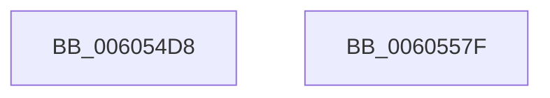

# RtlpHpLargeAllocationDestroy

- RVA: `0x006054D8`–`0x00605580` (길이 `168` bytes)
- VA: `0x00000001406054D8`
- 실행 섹션: `.text`
- PDB 이름 있음: `예`; PDB Function 태그: `아니요`
- unwind 정보 RVA: `0x000ADBB4`
- 디코드: `46`개 명령, `168/168` bytes 표시
- 미해석 바이트: `0` (있으면 어셈블리에 `.byte`로 보존)

> 이 문서는 커널 이미지의 기계어와 PDB 기호를 분석해 생성했습니다. 4번과 5번은 함수 원형과 자료형을 바이너리 사용 방식에서 추정한 C 해석이며 원본 소스 복구 결과는 아닙니다.

## 1. Dependencies

- 직접 호출 지점: **2**; 고유 호출 대상: **2**
- 직접 호출자로 확인된 함수: **1**
- RIP 상대 이미지 참조: **0**

### Outgoing calls
- `0x00605559` → [RtlpHpFreeVA](../2C/RtlpHpFreeVA_function_002C0FD4.md) (function, `0x002C0FD4`)
- `0x0060556F` → [RtlpHpMetadataFree](../2E/RtlpHpMetadataFree_function_002ECA64.md) (function, `0x002ECA64`)

### Direct callers
- [RtlpHpHeapDestroy](RtlpHpHeapDestroy_function_006033AC.md) at `0x00603423`

### Static image references
- 디코드된 RIP-relative 메모리 참조가 없습니다.

## 2. Other-region calls and transfers

- 다른 실행 섹션으로 향하는 call: **0**
- 별도 외부 분기/꼬리 이동을 확인하지 못했습니다.

## 3. Assembly (complete function range)

```asm
006054D8  4C 8B DC                        mov r11, rsp
006054DB  49 89 5B 18                     mov qword ptr [r11 + 0x18], rbx
006054DF  57                              push rdi
006054E0  48 83 EC 30                     sub rsp, 0x30
006054E4  48 8B 41 18                     mov rax, qword ptr [rcx + 0x18]
006054E8  48 8B DA                        mov rbx, rdx
006054EB  48 25 00 00 FF FF               and rax, 0xffffffffffff0000
006054F1  48 8B F9                        mov rdi, rcx
006054F4  49 89 43 10                     mov qword ptr [r11 + 0x10], rax
006054F8  48 8B 49 20                     mov rcx, qword ptr [rcx + 0x20]
006054FC  41 B8 01 00 00 00               mov r8d, 1
00605502  0F 10 02                        movups xmm0, xmmword ptr [rdx]
00605505  4C 8B C9                        mov r9, rcx
00605508  49 8D 53 08                     lea rdx, [r11 + 8]
0060550C  48 8B C1                        mov rax, rcx
0060550F  49 D1 E9                        shr r9, 1
00605512  4D 23 C8                        and r9, r8
00605515  C0 E9 02                        shr cl, 2
00605518  80 E1 3F                        and cl, 0x3f
0060551B  48 C1 E8 0C                     shr rax, 0xc
0060551F  49 D3 E0                        shl r8, cl
00605522  4C 03 C8                        add r9, rax
00605525  49 C1 E1 0C                     shl r9, 0xc
00605529  F3 0F 7F 44 24 20               movdqu xmmword ptr [rsp + 0x20], xmm0
0060552F  49 8D 40 FF                     lea rax, [r8 - 1]
00605533  49 8D 48 FF                     lea rcx, [r8 - 1]
00605537  49 03 C9                        add rcx, r9
0060553A  48 23 C8                        and rcx, rax
0060553D  49 8D 41 FF                     lea rax, [r9 - 1]
00605541  4C 2B C1                        sub r8, rcx
00605544  4D 8D 4B E8                     lea r9, [r11 - 0x18]
00605548  49 03 C0                        add rax, r8
0060554B  49 8D 4B 10                     lea rcx, [r11 + 0x10]
0060554F  41 B8 00 80 00 00               mov r8d, 0x8000
00605555  49 89 43 08                     mov qword ptr [r11 + 8], rax
00605559  E8 76 BA CB FF                  call 0x1402c0fd4
0060555E  0F 10 03                        movups xmm0, xmmword ptr [rbx]
00605561  48 8D 54 24 20                  lea rdx, [rsp + 0x20]
00605566  48 8B CF                        mov rcx, rdi
00605569  F3 0F 7F 44 24 20               movdqu xmmword ptr [rsp + 0x20], xmm0
0060556F  E8 F0 74 CE FF                  call 0x1402eca64
00605574  48 8B 5C 24 50                  mov rbx, qword ptr [rsp + 0x50]
00605579  48 83 C4 30                     add rsp, 0x30
0060557D  5F                              pop rdi
0060557E  C3                              ret
0060557F  CC                              int3
```

## 4. C-style interpretation (structured pseudocode)

```c
__int64 __fastcall RtlpHpLargeAllocationDestroy(__int64 a1, __int64 a2)
{
    __int64 result;
    __int64 v_rsp;
    unsigned __int64 v_stack_m18;
    unsigned __int64 v_stack_p18;

    *(unsigned __int64 *)(v_rsp + 24) = v_rbx;
    v_rsp = (v_rsp) - (48);
    result = (*(unsigned __int64 *)(a1 + 24)) & (0xFFFFFFFFFFFF0000ULL);
    *(unsigned __int64 *)(v_rsp + 16) = result;
    a4 = (*(unsigned __int64 *)(a1 + 32)) >> (1);
    a4 = (a4) & (1);
    a1 = (unsigned __int8)((*(unsigned __int64 *)(a1 + 32)) >> (2));
    a1 = (unsigned __int8)((a1) & (63));
    result = (*(unsigned __int64 *)(a1 + 32)) >> (12);
    a3 = (1) << ((unsigned __int8)(a1));
    a4 = (a4) + (result);
    a4 = (a4) << (12);
    v_stack_m18 = v_xmm0;
    a1 = (a3 - 1) + (a4);
    a1 = (a1) & (a3 - 1);
    a3 = (a3) - (a1);
    result = (a4 - 1) + (a3);
    *(unsigned __int64 *)(v_rsp + 8) = result;
    result = RtlpHpFreeVA(v_rsp + 16, v_rsp + 8, (unsigned int)(0x8000ULL), v_rsp - 24);
    v_stack_m18 = v_xmm0;
    result = RtlpHpMetadataFree(a1, v_stack_m18, (unsigned int)(0x8000ULL), v_rsp - 24);
    v_rsp = (v_rsp) + (48);
    return result;
}
```

## 5. (Beta) C Style

```c
int64_t RtlpHpLargeAllocationDestroy(void *Arg1, void *Arg2)
{
    uint8_t *arg1 = (uint8_t *)Arg1;
    uint8_t *arg2 = (uint8_t *)Arg2;

    int64_t result;
    int64_t local_rsp;
    uint64_t v_stack_m18;
    uint64_t v_stack_p18;

    *(uint64_t *)(local_rsp + 0x18) = local_rbx;
    local_rsp = (local_rsp) - (48);
    result = (*(uint64_t *)(arg1 + 0x18)) & (0xFFFFFFFFFFFF0000ULL);
    *(uint64_t *)(local_rsp + 0x10) = result;
    a4 = (*(uint64_t *)(arg1 + 0x20)) >> (1);
    a4 = (a4) & (1);
    Arg1 = (uint8_t)((*(uint64_t *)(arg1 + 0x20)) >> (2));
    Arg1 = (uint8_t)((Arg1) & (63));
    result = (*(uint64_t *)(arg1 + 0x20)) >> (12);
    a3 = (1) << ((uint8_t)(Arg1));
    a4 = (a4) + (result);
    a4 = (a4) << (12);
    v_stack_m18 = v_xmm0;
    Arg1 = (a3 - 1) + (a4);
    Arg1 = (Arg1) & (a3 - 1);
    a3 = (a3) - (Arg1);
    result = (a4 - 1) + (a3);
    *(uint64_t *)(local_rsp + 0x8) = result;
    result = RtlpHpFreeVA(local_rsp + 16, local_rsp + 8, (uint32_t)(0x8000ULL), local_rsp - 24);
    v_stack_m18 = v_xmm0;
    result = RtlpHpMetadataFree(Arg1, v_stack_m18, (uint32_t)(0x8000ULL), local_rsp - 24);
    local_rsp = (local_rsp) + (48);
    return result;
}
```

### 관측된 메모리 오프셋

구조체 형식이 확인되지 않은 접근은 인자 기준의 오프셋으로만 기록했습니다.

| 기준 인자 | 오프셋 표현 | 폭 (bit) | 접근 |
|---|---:|---:|---|
| `Arg1` | `+ 0x18` | `64` | `R` |
| `Arg1` | `+ 0x20` | `64` | `R` |
| `Arg2` | `+ 0x0` | `128` | `R` |

## 6. Execution-region graph

[열기: 2D/3D 그래프와 함수 탐색 컨트롤 패널](../../../control-panel.html?section=text&rva=0x006054D8&view=graph)

- 2D 그래프는 위에서 아래로 흐르고, 3D 그래프는 빈 공간을 드래그해 회전합니다. Shift+드래그는 이동, 휠은 확대·축소, 함수 노드 선택은 대상 보고서 이동입니다.

### Static fallback


