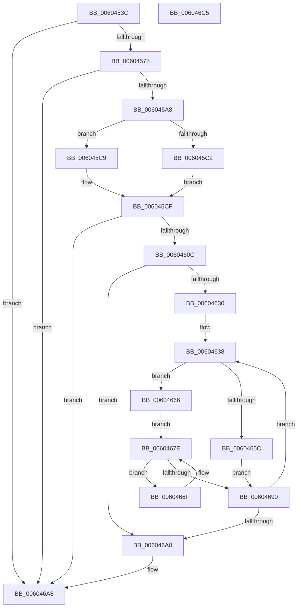

# RtlpHpLfhBucketActivate

- RVA: `0x0060453C`–`0x006046C6` (길이 `394` bytes)
- VA: `0x000000014060453C`
- 실행 섹션: `.text`
- PDB 이름 있음: `예`; PDB Function 태그: `아니요`
- unwind 정보 RVA: `0x0005D79C`
- 디코드: `106`개 명령, `394/394` bytes 표시
- 미해석 바이트: `0` (있으면 어셈블리에 `.byte`로 보존)

> 이 문서는 커널 이미지의 기계어와 PDB 기호를 분석해 생성했습니다. 4번과 5번은 함수 원형과 자료형을 바이너리 사용 방식에서 추정한 C 해석이며 원본 소스 복구 결과는 아닙니다.

## 1. Dependencies

- 직접 호출 지점: **4**; 고유 호출 대상: **4**
- 직접 호출자로 확인된 함수: **1**
- RIP 상대 이미지 참조: **2**

### Outgoing calls
- `0x006045FB` → [guard_dispatch_icall](../6B/guard_dispatch_icall_function_006BAAD0.md) (function, `0x006BAAD0`)
- `0x00604614` → [memset](../6C/memset_function_006C6C40.md) (function, `0x006C6C40`)
- `0x00604622` → [RtlpHpLfhBucketInitialize](RtlpHpLfhBucketInitialize_function_0060475C.md) (function, `0x0060475C`)
- `0x00604641` → [RtlpHpLfhSlotInitialize](../4C/RtlpHpLfhSlotInitialize_function_004CE094.md) (function, `0x004CE094`)

### Direct callers
- [RtlpHpLfhBucketUpdateStats](../4D/RtlpHpLfhBucketUpdateStats_function_004D0320.md) at `0x004D03CB`

### Static image references
- `0x006045A8` → RVA `0x00F059A0` (`.data`; read)
- `0x006045EB` → RVA `0x00E28300` (`.data`; read)

## 2. Other-region calls and transfers

- 다른 실행 섹션으로 향하는 call: **0**
- 별도 외부 분기/꼬리 이동을 확인하지 못했습니다.

## 3. Assembly (complete function range)

```asm
0060453C  48 89 5C 24 10                  mov qword ptr [rsp + 0x10], rbx
00604541  48 89 6C 24 18                  mov qword ptr [rsp + 0x18], rbp
00604546  48 89 74 24 20                  mov qword ptr [rsp + 0x20], rsi
0060454B  57                              push rdi
0060454C  41 54                           push r12
0060454E  41 55                           push r13
00604550  41 56                           push r14
00604552  41 57                           push r15
00604554  48 83 EC 20                     sub rsp, 0x20
00604558  44 8B F2                        mov r14d, edx
0060455B  48 8B D9                        mov rbx, rcx
0060455E  8B FA                           mov edi, edx
00604560  4E 8B 84 F1 C0 01 00 00         mov r8, qword ptr [rcx + r14*8 + 0x1c0]
00604568  41 8A C0                        mov al, r8b
0060456B  24 03                           and al, 3
0060456D  3C 01                           cmp al, 1
0060456F  0F 85 33 01 00 00               jne 0x1406046a8
00604575  41 0F B7 C0                     movzx eax, r8w
00604579  4C 89 44 24 50                  mov qword ptr [rsp + 0x50], r8
0060457E  41 B9 02 00 00 00               mov r9d, 2
00604584  66 41 0B C1                     or ax, r9w
00604588  66 89 44 24 50                  mov word ptr [rsp + 0x50], ax
0060458D  49 8B C0                        mov rax, r8
00604590  48 8B 4C 24 50                  mov rcx, qword ptr [rsp + 0x50]
00604595  F0 4A 0F B1 8C F3 C0 01 00 00   lock cmpxchg qword ptr [rbx + r14*8 + 0x1c0], rcx
0060459F  49 3B C0                        cmp rax, r8
006045A2  0F 85 00 01 00 00               jne 0x1406046a8
006045A8  8B 05 F2 13 90 00               mov eax, dword ptr [rip + 0x9013f2]
006045AE  8B C8                           mov ecx, eax
006045B0  C1 E9 07                        shr ecx, 7
006045B3  83 E1 01                        and ecx, 1
006045B6  49 8D 34 09                     lea rsi, [r9 + rcx]
006045BA  48 C1 E6 06                     shl rsi, 6
006045BE  A8 20                           test al, 0x20
006045C0  74 07                           je 0x1406045c9
006045C2  44 0F B6 7B 40                  movzx r15d, byte ptr [rbx + 0x40]
006045C7  EB 06                           jmp 0x1406045cf
006045C9  41 BF 01 00 00 00               mov r15d, 1
006045CF  8D 41 01                        lea eax, [rcx + 1]
006045D2  45 8B E7                        mov r12d, r15d
006045D5  48 8B 0B                        mov rcx, qword ptr [rbx]
006045D8  C1 E0 06                        shl eax, 6
006045DB  4C 0F AF E0                     imul r12, rax
006045DF  48 89 44 24 50                  mov qword ptr [rsp + 0x50], rax
006045E4  48 8B 43 28                     mov rax, qword ptr [rbx + 0x28]
006045E8  4C 03 E6                        add r12, rsi
006045EB  48 33 05 0E 3D 82 00            xor rax, qword ptr [rip + 0x823d0e]
006045F2  49 8B D4                        mov rdx, r12
006045F5  48 33 C3                        xor rax, rbx
006045F8  45 8B EF                        mov r13d, r15d
006045FB  E8 D0 64 0B 00                  call 0x1406baad0
00604600  48 8B E8                        mov rbp, rax
00604603  48 85 C0                        test rax, rax
00604606  0F 84 9C 00 00 00               je 0x1406046a8
0060460C  4D 8B C4                        mov r8, r12
0060460F  33 D2                           xor edx, edx
00604611  48 8B C8                        mov rcx, rax
00604614  E8 27 26 0C 00                  call 0x1406c6c40
00604619  4C 8B C3                        mov r8, rbx
0060461C  41 8B D6                        mov edx, r14d
0060461F  48 8B CD                        mov rcx, rbp
00604622  E8 35 01 00 00                  call 0x14060475c
00604627  4C 8D 34 2E                     lea r14, [rsi + rbp]
0060462B  45 85 FF                        test r15d, r15d
0060462E  74 70                           je 0x1406046a0
00604630  4C 8B 64 24 50                  mov r12, qword ptr [rsp + 0x50]
00604635  48 8B F3                        mov rsi, rbx
00604638  4C 8B C3                        mov r8, rbx
0060463B  48 8B D5                        mov rdx, rbp
0060463E  49 8B CE                        mov rcx, r14
00604641  E8 4E 9A EC FF                  call 0x1404ce094
00604646  FE 45 01                        inc byte ptr [rbp + 1]
00604649  49 8B CE                        mov rcx, r14
0060464C  0F B6 43 40                     movzx eax, byte ptr [rbx + 0x40]
00604650  48 2B CB                        sub rcx, rbx
00604653  48 C1 E9 06                     shr rcx, 6
00604657  44 3B F8                        cmp r15d, eax
0060465A  75 0A                           jne 0x140604666
0060465C  66 89 8C 7E C0 05 00 00         mov word ptr [rsi + rdi*2 + 0x5c0], cx
00604664  EB 2A                           jmp 0x140604690
00604666  48 8D 93 C0 05 00 00            lea rdx, [rbx + 0x5c0]
0060466D  EB 0F                           jmp 0x14060467e
0060466F  66 89 0C 7A                     mov word ptr [rdx + rdi*2], cx
00604673  48 81 C2 00 01 00 00            add rdx, 0x100
0060467A  0F B6 43 40                     movzx eax, byte ptr [rbx + 0x40]
0060467E  48 C1 E0 08                     shl rax, 8
00604682  48 05 C0 05 00 00               add rax, 0x5c0
00604688  48 03 C3                        add rax, rbx
0060468B  48 3B D0                        cmp rdx, rax
0060468E  72 DF                           jb 0x14060466f
00604690  4D 03 F4                        add r14, r12
00604693  48 81 C6 00 01 00 00            add rsi, 0x100
0060469A  49 83 ED 01                     sub r13, 1
0060469E  75 98                           jne 0x140604638
006046A0  48 89 AC FB C0 01 00 00         mov qword ptr [rbx + rdi*8 + 0x1c0], rbp
006046A8  48 8B 5C 24 58                  mov rbx, qword ptr [rsp + 0x58]
006046AD  48 8B 6C 24 60                  mov rbp, qword ptr [rsp + 0x60]
006046B2  48 8B 74 24 68                  mov rsi, qword ptr [rsp + 0x68]
006046B7  48 83 C4 20                     add rsp, 0x20
006046BB  41 5F                           pop r15
006046BD  41 5E                           pop r14
006046BF  41 5D                           pop r13
006046C1  41 5C                           pop r12
006046C3  5F                              pop rdi
006046C4  C3                              ret
006046C5  CC                              int3
```

## 4. C-style interpretation (structured pseudocode)

```c
__int64 __fastcall RtlpHpLfhBucketActivate(__int64 a1, int a2)
{
    __int64 result;
    __int64 v_r12;
    __int64 v_r13;
    __int64 v_r14;
    __int64 v_rsi;
    __int64 v_rsp;
    unsigned __int64 v_stack_p10;
    unsigned __int64 v_stack_p18;
    unsigned __int64 v_stack_p20;
    unsigned __int64 v_stack_p8;

    v_stack_p10 = v_rbx;
    v_stack_p18 = v_rbp;
    v_stack_p20 = v_rsi;
    v_rsp = (v_rsp) - (32);
    result = (unsigned __int8)(((unsigned __int8)(*(unsigned __int64 *)(a1 + (unsigned int)(a2) * 8 + 448))) & (3));
    if (((unsigned __int8)(result)) != 1) goto loc_006046A8;
    v_stack_p8 = *(unsigned __int64 *)(a1 + (unsigned int)(a2) * 8 + 448);
    result = (unsigned __int16)(((unsigned __int16)(*(unsigned __int64 *)(a1 + (unsigned int)(a2) * 8 + 448))) | (2));
    v_stack_p8 = (unsigned __int16)(result);
    if ((*(unsigned __int64 *)(a1 + (unsigned int)(a2) * 8 + 448)) != (*(unsigned __int64 *)(a1 + (unsigned int)(a2) * 8 + 448))) goto loc_006046A8;
    a1 = (unsigned int)(((unsigned int)((unsigned int)((unsigned int)(*(unsigned int *)(v_rip + 9442290))))) >> (7));
    a1 = (unsigned int)((a1) & (1));
    v_rsi = (2 + a1 * 1) << (6);
    if ((((unsigned __int8)((unsigned int)(*(unsigned int *)(v_rip + 9442290)))) & (32)) == 0) goto loc_006045C9;
    goto loc_006045CF;
loc_006045C9:
loc_006045CF:
    result = (unsigned int)((a1 + 1) << (6));
    v_r12 = (1) * (result);
    v_stack_p8 = result;
    v_r12 = (v_r12) + (v_rsi);
    result = (*(unsigned __int64 *)(a1 + 40)) ^ (*(unsigned __int64 *)(v_rip + 8535310));
    result = (result) ^ (a1);
    result = guard_dispatch_icall(*(unsigned __int64 *)(a1), v_r12, *(unsigned __int64 *)(a1 + (unsigned int)(a2) * 8 + 448), 2);
    if (result == 0) goto loc_006046A8;
    a2 = 0;
    result = memset(result, a2, v_r12, 2);
    result = RtlpHpLfhBucketInitialize(result, (unsigned int)((unsigned int)((unsigned int)(a2))), a1, 2);
    if (1 == 0) goto loc_006046A0;
loc_00604638:
    result = RtlpHpLfhSlotInitialize(v_rsi + result * 1, result, a1, 2);
    a1 = (v_rsi + result * 1) - (a1);
    a1 = (a1) >> (6);
    if (1 != ((unsigned int)(*(unsigned __int8 *)(a1 + 64)))) goto loc_00604666;
    *(unsigned __int16 *)(a1 + (unsigned int)(a2) * 2 + 1472) = (unsigned __int16)(a1);
    goto loc_00604690;
loc_00604666:
    goto loc_0060467E;
loc_0060466F:
    *(unsigned __int16 *)(a1 + 1472 + (unsigned int)(a2) * 2) = (unsigned __int16)(a1);
    a2 = (a1 + 1472) + (256);
loc_0060467E:
    result = (*(unsigned __int8 *)(a1 + 64)) << (8);
    result = (result) + (0x5C0ULL);
    result = (result) + (a1);
    if (a2 < result) goto loc_0060466F;
loc_00604690:
    v_r14 = (v_rsi + result * 1) + (v_stack_p8);
    v_rsi = (a1) + (256);
    v_r13 = (1) - (1);
    if (condition_is_not_equal) goto loc_00604638;
loc_006046A0:
    *(unsigned __int64 *)(a1 + (unsigned int)(a2) * 8 + 448) = result;
loc_006046A8:
    v_rsp = (v_rsp) + (32);
    return result;
}
```

## 5. (Beta) C Style

```c
int64_t RtlpHpLfhBucketActivate(void *Arg1, int32_t Arg2)
{
    uint8_t *arg1 = (uint8_t *)Arg1;

    int64_t result;
    int64_t local_r12;
    int64_t local_r13;
    int64_t local_r14;
    int64_t local_rsi;
    int64_t local_rsp;
    uint64_t v_stack_p10;
    uint64_t v_stack_p18;
    uint64_t v_stack_p20;
    uint64_t v_stack_p8;

    v_stack_p10 = local_rbx;
    v_stack_p18 = local_rbp;
    v_stack_p20 = local_rsi;
    local_rsp = (local_rsp) - (32);
    result = (uint8_t)(((uint8_t)(*(uint64_t *)(arg1 + (uint32_t)(Arg2) * 8 + 0x1C0))) & (3));
    if (((uint8_t)(result)) != 1) goto loc_006046A8;
    v_stack_p8 = *(uint64_t *)(arg1 + (uint32_t)(Arg2) * 8 + 0x1C0);
    result = (uint16_t)(((uint16_t)(*(uint64_t *)(arg1 + (uint32_t)(Arg2) * 8 + 0x1C0))) | (2));
    v_stack_p8 = (uint16_t)(result);
    if ((*(uint64_t *)(arg1 + (uint32_t)(Arg2) * 8 + 0x1C0)) != (*(uint64_t *)(arg1 + (uint32_t)(Arg2) * 8 + 0x1C0))) goto loc_006046A8;
    Arg1 = (uint32_t)(((uint32_t)((uint32_t)((uint32_t)(*(uint32_t *)(v_rip + 0x9013F2))))) >> (7));
    Arg1 = (uint32_t)((Arg1) & (1));
    local_rsi = (2 + Arg1 * 1) << (6);
    if ((((uint8_t)((uint32_t)(*(uint32_t *)(v_rip + 0x9013F2)))) & (32)) == 0) goto loc_006045C9;
    goto loc_006045CF;
loc_006045C9:
loc_006045CF:
    result = (uint32_t)((Arg1 + 1) << (6));
    local_r12 = (1) * (result);
    v_stack_p8 = result;
    local_r12 = (local_r12) + (local_rsi);
    result = (*(uint64_t *)(arg1 + 0x28)) ^ (*(uint64_t *)(v_rip + 0x823D0E));
    result = (result) ^ (Arg1);
    result = guard_dispatch_icall(*(uint64_t *)(arg1), local_r12, *(uint64_t *)(arg1 + (uint32_t)(Arg2) * 8 + 0x1C0), 2);
    if (result == 0) goto loc_006046A8;
    Arg2 = 0;
    result = memset(result, Arg2, local_r12, 2);
    result = RtlpHpLfhBucketInitialize(result, (uint32_t)((uint32_t)((uint32_t)(Arg2))), Arg1, 2);
    if (1 == 0) goto loc_006046A0;
loc_00604638:
    result = RtlpHpLfhSlotInitialize(local_rsi + result * 1, result, Arg1, 2);
    Arg1 = (local_rsi + result * 1) - (Arg1);
    Arg1 = (Arg1) >> (6);
    if (1 != ((uint32_t)(*(uint8_t *)(arg1 + 0x40)))) goto loc_00604666;
    *(uint16_t *)(arg1 + (uint32_t)(Arg2) * 2 + 0x5C0) = (uint16_t)(Arg1);
    goto loc_00604690;
loc_00604666:
    goto loc_0060467E;
loc_0060466F:
    *(uint16_t *)(arg1 + 0x5C0 + (uint32_t)(Arg2) * 2) = (uint16_t)(Arg1);
    Arg2 = (Arg1 + 1472) + (256);
loc_0060467E:
    result = (*(uint8_t *)(arg1 + 0x40)) << (8);
    result = (result) + (0x5C0ULL);
    result = (result) + (Arg1);
    if (Arg2 < result) goto loc_0060466F;
loc_00604690:
    local_r14 = (local_rsi + result * 1) + (v_stack_p8);
    local_rsi = (Arg1) + (256);
    local_r13 = (1) - (1);
    if (condition_is_not_equal) goto loc_00604638;
loc_006046A0:
    *(uint64_t *)(arg1 + (uint32_t)(Arg2) * 8 + 0x1C0) = result;
loc_006046A8:
    local_rsp = (local_rsp) + (32);
    return result;
}
```

### 관측된 메모리 오프셋

구조체 형식이 확인되지 않은 접근은 인자 기준의 오프셋으로만 기록했습니다.

| 기준 인자 | 오프셋 표현 | 폭 (bit) | 접근 |
|---|---:|---:|---|
| `Arg1` | `+ 0x0` | `64` | `R` |
| `Arg1` | `+ 0x28` | `64` | `R` |
| `Arg1` | `+ 0x40` | `8` | `R` |
| `Arg1` | `+ 0x1C0 + r14*8` | `64` | `R` |
| `Arg1` | `+ 0x1C0 + rdi*8` | `64` | `W` |
| `Arg1` | `+ 0x5C0` | `64` | `R` |
| `Arg1` | `+ 0x5C0 + rdi*2` | `16` | `W` |

## 6. Execution-region graph

[열기: 2D/3D 그래프와 함수 탐색 컨트롤 패널](../../../control-panel.html?section=text&rva=0x0060453C&view=graph)

- 2D 그래프는 위에서 아래로 흐르고, 3D 그래프는 빈 공간을 드래그해 회전합니다. Shift+드래그는 이동, 휠은 확대·축소, 함수 노드 선택은 대상 보고서 이동입니다.

### Static fallback


