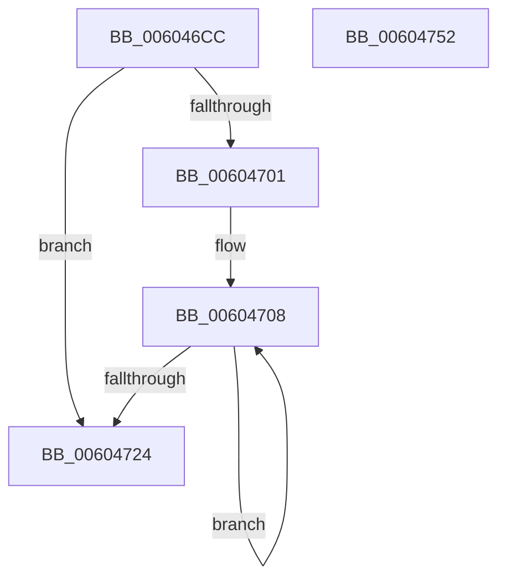

# RtlpHpLfhBucketCleanup

- RVA: `0x006046CC`–`0x00604753` (길이 `135` bytes)
- VA: `0x00000001406046CC`
- 실행 섹션: `.text`
- PDB 이름 있음: `예`; PDB Function 태그: `아니요`
- unwind 정보 RVA: `0x000D0600`
- 디코드: `37`개 명령, `135/135` bytes 표시
- 미해석 바이트: `0` (있으면 어셈블리에 `.byte`로 보존)

> 이 문서는 커널 이미지의 기계어와 PDB 기호를 분석해 생성했습니다. 4번과 5번은 함수 원형과 자료형을 바이너리 사용 방식에서 추정한 C 해석이며 원본 소스 복구 결과는 아닙니다.

## 1. Dependencies

- 직접 호출 지점: **4**; 고유 호출 대상: **3**
- 직접 호출자로 확인된 함수: **1**
- RIP 상대 이미지 참조: **1**

### Outgoing calls
- `0x006046F8` → [RtlpHpLfhBucketGetSlotInfo](../2E/RtlpHpLfhBucketGetSlotInfo_function_002E7B34.md) (function, `0x002E7B34`)
- `0x00604715` → [RtlpHpLfhOwnerCleanup](RtlpHpLfhOwnerCleanup_function_00604C78.md) (function, `0x00604C78`)
- `0x0060472A` → [RtlpHpLfhOwnerCleanup](RtlpHpLfhOwnerCleanup_function_00604C78.md) (function, `0x00604C78`)
- `0x0060473A` → [_security_check_cookie](../6A/_security_check_cookie_function_006AC640.md) (function, `0x006AC640`)

### Direct callers
- [RtlpHpHeapDestroy](RtlpHpHeapDestroy_function_006033AC.md) at `0x006034A4`

### Static image references
- `0x006046DB` → RVA `0x00E0A740` (`.data`; read)

## 2. Other-region calls and transfers

- 다른 실행 섹션으로 향하는 call: **0**
- 별도 외부 분기/꼬리 이동을 확인하지 못했습니다.

## 3. Assembly (complete function range)

```asm
006046CC  48 89 5C 24 18                  mov qword ptr [rsp + 0x18], rbx
006046D1  55                              push rbp
006046D2  56                              push rsi
006046D3  57                              push rdi
006046D4  48 81 EC 30 01 00 00            sub rsp, 0x130
006046DB  48 8B 05 5E 60 80 00            mov rax, qword ptr [rip + 0x80605e]
006046E2  48 33 C4                        xor rax, rsp
006046E5  48 89 84 24 20 01 00 00         mov qword ptr [rsp + 0x120], rax
006046ED  4C 8D 44 24 20                  lea r8, [rsp + 0x20]
006046F2  48 8B EA                        mov rbp, rdx
006046F5  48 8B D9                        mov rbx, rcx
006046F8  E8 37 34 CE FF                  call 0x1402e7b34
006046FD  85 C0                           test eax, eax
006046FF  74 23                           je 0x140604724
00604701  48 8D 7C 24 20                  lea rdi, [rsp + 0x20]
00604706  8B F0                           mov esi, eax
00604708  0F B7 17                        movzx edx, word ptr [rdi]
0060470B  48 8B CB                        mov rcx, rbx
0060470E  48 C1 E2 06                     shl rdx, 6
00604712  48 03 D3                        add rdx, rbx
00604715  E8 5E 05 00 00                  call 0x140604c78
0060471A  48 8D 7F 04                     lea rdi, [rdi + 4]
0060471E  48 83 EE 01                     sub rsi, 1
00604722  75 E4                           jne 0x140604708
00604724  48 8B D5                        mov rdx, rbp
00604727  48 8B CB                        mov rcx, rbx
0060472A  E8 49 05 00 00                  call 0x140604c78
0060472F  48 8B 8C 24 20 01 00 00         mov rcx, qword ptr [rsp + 0x120]
00604737  48 33 CC                        xor rcx, rsp
0060473A  E8 01 7F 0A 00                  call 0x1406ac640
0060473F  48 8B 9C 24 60 01 00 00         mov rbx, qword ptr [rsp + 0x160]
00604747  48 81 C4 30 01 00 00            add rsp, 0x130
0060474E  5F                              pop rdi
0060474F  5E                              pop rsi
00604750  5D                              pop rbp
00604751  C3                              ret
00604752  CC                              int3
```

## 4. C-style interpretation (structured pseudocode)

```c
__int64 __fastcall RtlpHpLfhBucketCleanup(__int64 a1, __int64 a2)
{
    __int64 result;
    __int64 v_rsi;
    __int64 v_rsp;
    unsigned __int64 v_stack_m128;
    unsigned __int64 v_stack_m28;
    unsigned __int64 v_stack_p18;

    v_stack_p18 = v_rbx;
    v_rsp = (v_rsp) - (304);
    result = (*(unsigned __int64 *)(v_rip + 8413278)) ^ (v_rsp);
    v_stack_m28 = result;
    result = RtlpHpLfhBucketGetSlotInfo(a1, a2, v_stack_m128, a4);
    if ((unsigned int)(result) == 0) goto loc_00604724;
loc_00604708:
    a2 = (*(unsigned __int16 *)(v_stack_m128)) << (6);
    a2 = (a2) + (a1);
    result = RtlpHpLfhOwnerCleanup(a1, a2, v_stack_m128, a4);
    v_rsi = ((unsigned int)((unsigned int)(result))) - (1);
    if (condition_is_not_equal) goto loc_00604708;
loc_00604724:
    result = RtlpHpLfhOwnerCleanup(a1, a2, v_stack_m128, a4);
    a1 = (v_stack_m28) ^ (v_rsp);
    result = _security_check_cookie(a1, a2, v_stack_m128, a4);
    v_rsp = (v_rsp) + (304);
    return result;
}
```

## 5. (Beta) C Style

```c
int64_t RtlpHpLfhBucketCleanup(int64_t Arg1, int64_t Arg2)
{
    int64_t result;
    int64_t local_rsi;
    int64_t local_rsp;
    uint64_t v_stack_m128;
    uint64_t v_stack_m28;
    uint64_t v_stack_p18;

    v_stack_p18 = local_rbx;
    local_rsp = (local_rsp) - (304);
    result = (*(uint64_t *)(v_rip + 0x80605E)) ^ (local_rsp);
    v_stack_m28 = result;
    result = RtlpHpLfhBucketGetSlotInfo(Arg1, Arg2, v_stack_m128, a4);
    if ((uint32_t)(result) == 0) goto loc_00604724;
loc_00604708:
    Arg2 = (*(uint16_t *)(v_stack_m128)) << (6);
    Arg2 = (Arg2) + (Arg1);
    result = RtlpHpLfhOwnerCleanup(Arg1, Arg2, v_stack_m128, a4);
    local_rsi = ((uint32_t)((uint32_t)(result))) - (1);
    if (condition_is_not_equal) goto loc_00604708;
loc_00604724:
    result = RtlpHpLfhOwnerCleanup(Arg1, Arg2, v_stack_m128, a4);
    Arg1 = (v_stack_m28) ^ (local_rsp);
    result = _security_check_cookie(Arg1, Arg2, v_stack_m128, a4);
    local_rsp = (local_rsp) + (304);
    return result;
}
```

## 6. Execution-region graph

[열기: 2D/3D 그래프와 함수 탐색 컨트롤 패널](../../../control-panel.html?section=text&rva=0x006046CC&view=graph)

- 2D 그래프는 위에서 아래로 흐르고, 3D 그래프는 빈 공간을 드래그해 회전합니다. Shift+드래그는 이동, 휠은 확대·축소, 함수 노드 선택은 대상 보고서 이동입니다.

### Static fallback


