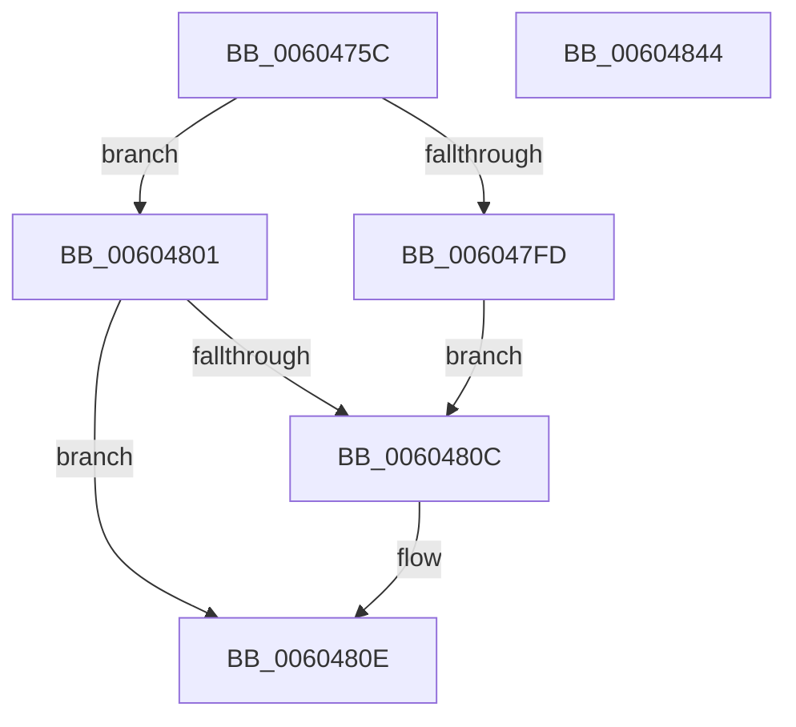

# RtlpHpLfhBucketInitialize

- RVA: `0x0060475C`–`0x00604845` (길이 `233` bytes)
- VA: `0x000000014060475C`
- 실행 섹션: `.text`
- PDB 이름 있음: `예`; PDB Function 태그: `아니요`
- unwind 정보 RVA: `0x0005C788`
- 디코드: `62`개 명령, `233/233` bytes 표시
- 미해석 바이트: `0` (있으면 어셈블리에 `.byte`로 보존)

> 이 문서는 커널 이미지의 기계어와 PDB 기호를 분석해 생성했습니다. 4번과 5번은 함수 원형과 자료형을 바이너리 사용 방식에서 추정한 C 해석이며 원본 소스 복구 결과는 아닙니다.

## 1. Dependencies

- 직접 호출 지점: **2**; 고유 호출 대상: **2**
- 직접 호출자로 확인된 함수: **1**
- RIP 상대 이미지 참조: **2**

### Outgoing calls
- `0x0060476C` → [RtlpHpLfhOwnerInitialize](../4C/RtlpHpLfhOwnerInitialize_function_004CE0F4.md) (function, `0x004CE0F4`)
- `0x00604780` → [RtlpHpInitializeLock](../2E/RtlpHpInitializeLock_function_002E8054.md) (function, `0x002E8054`)

### Direct callers
- [RtlpHpLfhBucketActivate](RtlpHpLfhBucketActivate_function_0060453C.md) at `0x00604622`

### Static image references
- `0x00604789` → RVA `0x0001C3C0` (`.rdata`; read)
- `0x006047BA` → RVA `0x00F059A0` (`.data`; read)

## 2. Other-region calls and transfers

- 다른 실행 섹션으로 향하는 call: **0**
- 별도 외부 분기/꼬리 이동을 확인하지 못했습니다.

## 3. Assembly (complete function range)

```asm
0060475C  48 83 EC 28                     sub rsp, 0x28
00604760  4D 8B C8                        mov r9, r8
00604763  4C 8B D9                        mov r11, rcx
00604766  41 B8 01 00 00 00               mov r8d, 1
0060476C  E8 83 99 EC FF                  call 0x1404ce0f4
00604771  33 C0                           xor eax, eax
00604773  49 8D 4B 50                     lea rcx, [r11 + 0x50]
00604777  41 89 43 58                     mov dword ptr [r11 + 0x58], eax
0060477B  41 0F B6 51 41                  movzx edx, byte ptr [r9 + 0x41]
00604780  E8 CF 38 CE FF                  call 0x1402e8054
00604785  41 0F B6 13                     movzx edx, byte ptr [r11]
00604789  48 8D 0D 30 7C A1 FF            lea rcx, [rip - 0x5e83d0]
00604790  D1 EA                           shr edx, 1
00604792  B8 FF FF FF FF                  mov eax, 0xffffffff
00604797  FF C2                           inc edx
00604799  41 B9 00 00 08 00               mov r9d, 0x80000
0060479F  44 0F B7 04 51                  movzx r8d, word ptr [rcx + rdx*2]
006047A4  33 D2                           xor edx, edx
006047A6  49 03 C0                        add rax, r8
006047A9  49 F7 F0                        div r8
006047AC  41 89 43 48                     mov dword ptr [r11 + 0x48], eax
006047B0  48 B8 11 40 00 01 04 10 40 00   movabs rax, 0x40100401004011
006047BA  8B 0D E0 11 90 00               mov ecx, dword ptr [rip + 0x9011e0]
006047C0  C1 E9 0E                        shr ecx, 0xe
006047C3  83 E1 03                        and ecx, 3
006047C6  41 D3 E1                        shl r9d, cl
006047C9  41 8D 48 F0                     lea ecx, [r8 - 0x10]
006047CD  41 81 E9 00 00 01 00            sub r9d, 0x10000
006047D4  4C 0F AF C9                     imul r9, rcx
006047D8  49 F7 E1                        mul r9
006047DB  4C 2B CA                        sub r9, rdx
006047DE  49 D1 E9                        shr r9, 1
006047E1  4A 8D 04 0A                     lea rax, [rdx + r9]
006047E5  33 D2                           xor edx, edx
006047E7  48 C1 E8 0D                     shr rax, 0xd
006047EB  48 05 00 00 01 00               add rax, 0x10000
006047F1  49 F7 F0                        div r8
006047F4  BA FF FF 00 00                  mov edx, 0xffff
006047F9  3B C2                           cmp eax, edx
006047FB  72 04                           jb 0x140604801
006047FD  8B C2                           mov eax, edx
006047FF  EB 0B                           jmp 0x14060480c
00604801  8D 0C 85 00 00 00 00            lea ecx, [rax*4]
00604808  3B CA                           cmp ecx, edx
0060480A  72 02                           jb 0x14060480e
0060480C  8B CA                           mov ecx, edx
0060480E  66 41 89 4B 4E                  mov word ptr [r11 + 0x4e], cx
00604813  0F 57 C0                        xorps xmm0, xmm0
00604816  66 41 89 43 4C                  mov word ptr [r11 + 0x4c], ax
0060481B  8B 15 7F 11 90 00               mov edx, dword ptr [rip + 0x90117f]
00604821  41 0F 11 43 68                  movups xmmword ptr [r11 + 0x68], xmm0
00604826  41 8A 43 6B                     mov al, byte ptr [r11 + 0x6b]
0060482A  C1 EA 06                        shr edx, 6
0060482D  8A C8                           mov cl, al
0060482F  32 CA                           xor cl, dl
00604831  41 C6 43 6A 10                  mov byte ptr [r11 + 0x6a], 0x10
00604836  80 E1 01                        and cl, 1
00604839  32 C8                           xor cl, al
0060483B  41 88 4B 6B                     mov byte ptr [r11 + 0x6b], cl
0060483F  48 83 C4 28                     add rsp, 0x28
00604843  C3                              ret
00604844  CC                              int3
```

## 4. C-style interpretation (structured pseudocode)

```c
__int64 __fastcall RtlpHpLfhBucketInitialize(__int64 a1, __int64 a2, __int64 a3)
{
    __int64 result;
    __int64 v_rsp;

    v_rsp = (v_rsp) - (40);
    result = RtlpHpLfhOwnerInitialize(a1, a2, 1, a3);
    result = 0;
    *(unsigned int *)(a1 + 88) = 0;
    result = RtlpHpInitializeLock(a1 + 80, *(unsigned __int8 *)(a3 + 65), 1, a3);
    a2 = (unsigned int)((*(unsigned __int8 *)(a1)) >> (1));
    a2 = (unsigned int)((a2) + 1);
    a2 = 0;
    result = ((unsigned int)(0xFFFFFFFFULL)) + (*(unsigned __int16 *)(v_rip - 6194128 + a2 * 2));
    *(unsigned int *)(a1 + 72) = (unsigned int)(result);
    a1 = (unsigned int)(((unsigned int)(*(unsigned int *)(v_rip + 9441760))) >> (14));
    a1 = (unsigned int)((a1) & (3));
    a4 = (unsigned int)(((unsigned int)(0x80000ULL)) << ((unsigned __int8)(a1)));
    a4 = (unsigned int)((a4) - (0x10000ULL));
    a4 = (a4) * (*(unsigned __int16 *)(v_rip - 6194128 + a2 * 2) - 16);
    a4 = (a4) - (0);
    a4 = (a4) >> (1);
    a2 = 0;
    result = (a2 + a4 * 1) >> (13);
    result = (result) + (0x10000ULL);
    if (((unsigned int)(result)) < ((unsigned int)((unsigned int)(0xFFFFULL)))) goto loc_00604801;
    goto loc_0060480C;
loc_00604801:
    if (((unsigned int)((unsigned int)((unsigned int)((unsigned int)(0xFFFFULL))) * 4)) >= ((unsigned int)((unsigned int)(0xFFFFULL)))) {
        a1 = (unsigned int)((unsigned int)(0xFFFFULL));
    }
    *(unsigned __int16 *)(a1 + 78) = (unsigned __int16)(a1);
    *(unsigned __int16 *)(a1 + 76) = (unsigned __int16)((unsigned int)((unsigned int)((unsigned int)(0xFFFFULL))));
    *(unsigned __int64 *)(a1 + 104) = v_xmm0;
    a2 = (unsigned int)(((unsigned int)(*(unsigned int *)(v_rip + 9441663))) >> (6));
    a1 = (unsigned __int8)(((unsigned __int8)(*(unsigned __int8 *)(a1 + 107))) ^ ((unsigned __int8)(a2)));
    *(unsigned __int8 *)(a1 + 106) = 16;
    a1 = (unsigned __int8)((a1) & (1));
    a1 = (unsigned __int8)((a1) ^ ((unsigned __int8)(*(unsigned __int8 *)(a1 + 107))));
    *(unsigned __int8 *)(a1 + 107) = (unsigned __int8)(a1);
    v_rsp = (v_rsp) + (40);
    return *(unsigned __int8 *)(a1 + 107);
}
```

## 5. (Beta) C Style

```c
int64_t RtlpHpLfhBucketInitialize(int64_t Arg1, int64_t Arg2, int64_t Arg3)
{
    int64_t result;
    int64_t local_rsp;

    local_rsp = (local_rsp) - (40);
    result = RtlpHpLfhOwnerInitialize(Arg1, Arg2, 1, Arg3);
    result = 0;
    *(uint32_t *)(Arg1 + 0x58) = 0;
    result = RtlpHpInitializeLock(Arg1 + 80, *(uint8_t *)(Arg3 + 0x41), 1, Arg3);
    Arg2 = (uint32_t)((*(uint8_t *)(Arg1)) >> (1));
    Arg2 = (uint32_t)((Arg2) + 1);
    Arg2 = 0;
    result = ((uint32_t)(0xFFFFFFFFULL)) + (*(uint16_t *)(v_rip - 0x5E83D0 + Arg2 * 2));
    *(uint32_t *)(Arg1 + 0x48) = (uint32_t)(result);
    Arg1 = (uint32_t)(((uint32_t)(*(uint32_t *)(v_rip + 0x9011E0))) >> (14));
    Arg1 = (uint32_t)((Arg1) & (3));
    a4 = (uint32_t)(((uint32_t)(0x80000ULL)) << ((uint8_t)(Arg1)));
    a4 = (uint32_t)((a4) - (0x10000ULL));
    a4 = (a4) * (*(uint16_t *)(v_rip - 0x5E83D0 + Arg2 * 2) - 16);
    a4 = (a4) - (0);
    a4 = (a4) >> (1);
    Arg2 = 0;
    result = (Arg2 + a4 * 1) >> (13);
    result = (result) + (0x10000ULL);
    if (((uint32_t)(result)) < ((uint32_t)((uint32_t)(0xFFFFULL)))) goto loc_00604801;
    goto loc_0060480C;
loc_00604801:
    if (((uint32_t)((uint32_t)((uint32_t)((uint32_t)(0xFFFFULL))) * 4)) >= ((uint32_t)((uint32_t)(0xFFFFULL)))) {
        Arg1 = (uint32_t)((uint32_t)(0xFFFFULL));
    }
    *(uint16_t *)(Arg1 + 0x4E) = (uint16_t)(Arg1);
    *(uint16_t *)(Arg1 + 0x4C) = (uint16_t)((uint32_t)((uint32_t)((uint32_t)(0xFFFFULL))));
    *(uint64_t *)(Arg1 + 0x68) = v_xmm0;
    Arg2 = (uint32_t)(((uint32_t)(*(uint32_t *)(v_rip + 0x90117F))) >> (6));
    Arg1 = (uint8_t)(((uint8_t)(*(uint8_t *)(Arg1 + 0x6B))) ^ ((uint8_t)(Arg2)));
    *(uint8_t *)(Arg1 + 0x6A) = 16;
    Arg1 = (uint8_t)((Arg1) & (1));
    Arg1 = (uint8_t)((Arg1) ^ ((uint8_t)(*(uint8_t *)(Arg1 + 0x6B))));
    *(uint8_t *)(Arg1 + 0x6B) = (uint8_t)(Arg1);
    local_rsp = (local_rsp) + (40);
    return *(uint8_t *)(Arg1 + 0x6B);
}
```

## 6. Execution-region graph

[열기: 2D/3D 그래프와 함수 탐색 컨트롤 패널](../../../control-panel.html?section=text&rva=0x0060475C&view=graph)

- 2D 그래프는 위에서 아래로 흐르고, 3D 그래프는 빈 공간을 드래그해 회전합니다. Shift+드래그는 이동, 휠은 확대·축소, 함수 노드 선택은 대상 보고서 이동입니다.

### Static fallback


