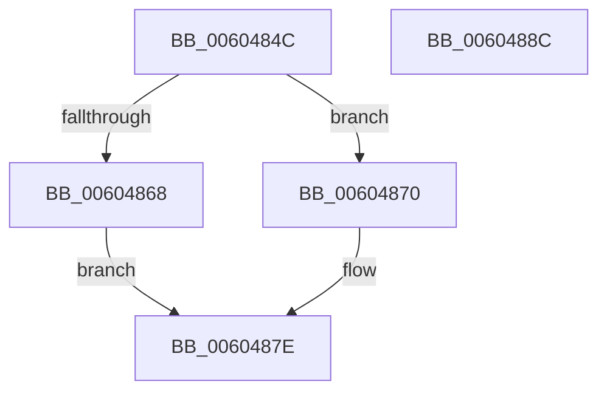

# RtlpHpLfhContextEnable

- RVA: `0x0060484C`–`0x0060488D` (길이 `65` bytes)
- VA: `0x000000014060484C`
- 실행 섹션: `.text`
- PDB 이름 있음: `예`; PDB Function 태그: `아니요`
- unwind 정보 RVA: `0x0005CAAC`
- 디코드: `21`개 명령, `65/65` bytes 표시
- 미해석 바이트: `0` (있으면 어셈블리에 `.byte`로 보존)

> 이 문서는 커널 이미지의 기계어와 PDB 기호를 분석해 생성했습니다. 4번과 5번은 함수 원형과 자료형을 바이너리 사용 방식에서 추정한 C 해석이며 원본 소스 복구 결과는 아닙니다.

## 1. Dependencies

- 직접 호출 지점: **2**; 고유 호출 대상: **2**
- 직접 호출자로 확인된 함수: **2**
- RIP 상대 이미지 참조: **0**

### Outgoing calls
- `0x0060485C` → [RtlpHpEnvTlsAlloc](RtlpHpEnvTlsAlloc_function_0060411C.md) (function, `0x0060411C`)
- `0x00604879` → [RtlpHpLfhContextUpdateConfig](RtlpHpLfhContextUpdateConfig_function_00604C3C.md) (function, `0x00604C3C`)

### Direct callers
- [RtlpHpHeapCreate](RtlpHpHeapCreate_function_00602FDC.md) at `0x00603328`
- [ExpHeapInitLfhStartCallback](../65/ExpHeapInitLfhStartCallback_function_0065C850.md) at `0x0065C872`

### Static image references
- 디코드된 RIP-relative 메모리 참조가 없습니다.

## 2. Other-region calls and transfers

- 다른 실행 섹션으로 향하는 call: **0**
- 별도 외부 분기/꼬리 이동을 확인하지 못했습니다.

## 3. Assembly (complete function range)

```asm
0060484C  48 89 5C 24 08                  mov qword ptr [rsp + 8], rbx
00604851  57                              push rdi
00604852  48 83 EC 20                     sub rsp, 0x20
00604856  48 8B FA                        mov rdi, rdx
00604859  48 8B D9                        mov rbx, rcx
0060485C  E8 BB F8 FF FF                  call 0x14060411c
00604861  45 33 C0                        xor r8d, r8d
00604864  85 C0                           test eax, eax
00604866  75 08                           jne 0x140604870
00604868  41 B8 9A 00 00 C0               mov r8d, 0xc000009a
0060486E  EB 0E                           jmp 0x14060487e
00604870  48 8B D7                        mov rdx, rdi
00604873  89 43 4C                        mov dword ptr [rbx + 0x4c], eax
00604876  48 8B CB                        mov rcx, rbx
00604879  E8 BE 03 00 00                  call 0x140604c3c
0060487E  48 8B 5C 24 30                  mov rbx, qword ptr [rsp + 0x30]
00604883  41 8B C0                        mov eax, r8d
00604886  48 83 C4 20                     add rsp, 0x20
0060488A  5F                              pop rdi
0060488B  C3                              ret
0060488C  CC                              int3
```

## 4. C-style interpretation (structured pseudocode)

```c
__int64 __fastcall RtlpHpLfhContextEnable(__int64 a1, __int64 a2, int a3)
{
    __int64 result;
    __int64 v_rsp;
    unsigned __int64 v_stack_p8;

    v_stack_p8 = v_rbx;
    v_rsp = (v_rsp) - (32);
    result = RtlpHpEnvTlsAlloc(a1, a2, a3, a4);
    a3 = 0;
    if ((unsigned int)(result) != 0) goto loc_00604870;
    goto loc_0060487E;
loc_00604870:
    *(unsigned int *)(a1 + 76) = (unsigned int)(result);
    result = RtlpHpLfhContextUpdateConfig(a1, a2, (unsigned int)(0xC000009AULL), a4);
loc_0060487E:
    v_rsp = (v_rsp) + (32);
    return (unsigned int)((unsigned int)((unsigned int)(0xC000009AULL)));
}
```

## 5. (Beta) C Style

```c
int64_t RtlpHpLfhContextEnable(void *Arg1, int64_t Arg2, int32_t Arg3)
{
    uint8_t *arg1 = (uint8_t *)Arg1;

    int64_t result;
    int64_t local_rsp;
    uint64_t v_stack_p8;

    v_stack_p8 = local_rbx;
    local_rsp = (local_rsp) - (32);
    result = RtlpHpEnvTlsAlloc(Arg1, Arg2, Arg3, a4);
    Arg3 = 0;
    if ((uint32_t)(result) != 0) goto loc_00604870;
    goto loc_0060487E;
loc_00604870:
    *(uint32_t *)(arg1 + 0x4C) = (uint32_t)(result);
    result = RtlpHpLfhContextUpdateConfig(Arg1, Arg2, (uint32_t)(0xC000009AULL), a4);
loc_0060487E:
    local_rsp = (local_rsp) + (32);
    return (uint32_t)((uint32_t)((uint32_t)(0xC000009AULL)));
}
```

### 관측된 메모리 오프셋

구조체 형식이 확인되지 않은 접근은 인자 기준의 오프셋으로만 기록했습니다.

| 기준 인자 | 오프셋 표현 | 폭 (bit) | 접근 |
|---|---:|---:|---|
| `Arg1` | `+ 0x4C` | `32` | `W` |

## 6. Execution-region graph

[열기: 2D/3D 그래프와 함수 탐색 컨트롤 패널](../../../control-panel.html?section=text&rva=0x0060484C&view=graph)

- 2D 그래프는 위에서 아래로 흐르고, 3D 그래프는 빈 공간을 드래그해 회전합니다. Shift+드래그는 이동, 휠은 확대·축소, 함수 노드 선택은 대상 보고서 이동입니다.

### Static fallback


