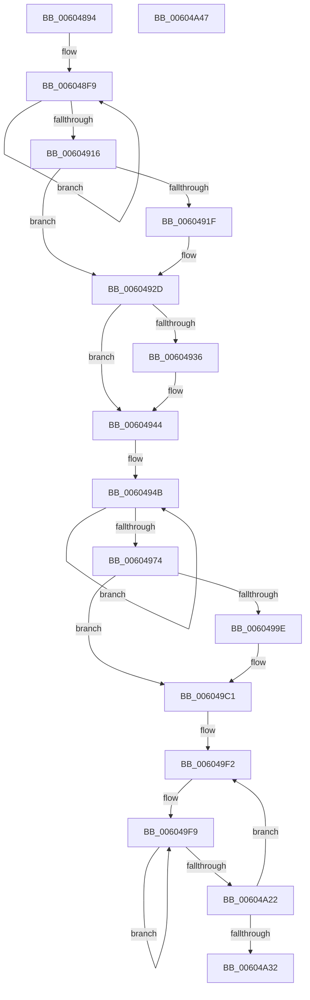

# RtlpHpLfhContextInitialize

- RVA: `0x00604894`–`0x00604A48` (길이 `436` bytes)
- VA: `0x0000000140604894`
- 실행 섹션: `.text`
- PDB 이름 있음: `예`; PDB Function 태그: `아니요`
- unwind 정보 RVA: `0x0005C954`
- 디코드: `112`개 명령, `436/436` bytes 표시
- 미해석 바이트: `0` (있으면 어셈블리에 `.byte`로 보존)

> 이 문서는 커널 이미지의 기계어와 PDB 기호를 분석해 생성했습니다. 4번과 5번은 함수 원형과 자료형을 바이너리 사용 방식에서 추정한 C 해석이며 원본 소스 복구 결과는 아닙니다.

## 1. Dependencies

- 직접 호출 지점: **1**; 고유 호출 대상: **1**
- 직접 호출자로 확인된 함수: **1**
- RIP 상대 이미지 참조: **4**

### Outgoing calls
- `0x006048BC` → [memset](../6C/memset_function_006C6C40.md) (function, `0x006C6C40`)

### Direct callers
- [RtlpHpHeapCreate](RtlpHpHeapCreate_function_00602FDC.md) at `0x006032C4`

### Static image references
- `0x006048FE` → RVA `0x00E28300` (`.data`; read)
- `0x00604944` → RVA `0x00E28340` (`.data`; read)
- `0x006049B0` → RVA `0x00037020` (`.rdata`; read)
- `0x006049E5` → RVA `0x00F058A0` (`.data`; read)

## 2. Other-region calls and transfers

- 다른 실행 섹션으로 향하는 call: **0**
- 별도 외부 분기/꼬리 이동을 확인하지 못했습니다.

## 3. Assembly (complete function range)

```asm
00604894  48 89 5C 24 08                  mov qword ptr [rsp + 8], rbx
00604899  48 89 6C 24 10                  mov qword ptr [rsp + 0x10], rbp
0060489E  48 89 74 24 18                  mov qword ptr [rsp + 0x18], rsi
006048A3  57                              push rdi
006048A4  48 83 EC 20                     sub rsp, 0x20
006048A8  41 8B E8                        mov ebp, r8d
006048AB  48 8B FA                        mov rdi, rdx
006048AE  33 D2                           xor edx, edx
006048B0  41 B8 C0 06 00 00               mov r8d, 0x6c0
006048B6  41 8B D9                        mov ebx, r9d
006048B9  48 8B F1                        mov rsi, rcx
006048BC  E8 7F 23 0C 00                  call 0x1406c6c40
006048C1  48 8B 44 24 50                  mov rax, qword ptr [rsp + 0x50]
006048C6  48 89 3E                        mov qword ptr [rsi], rdi
006048C9  88 5E 41                        mov byte ptr [rsi + 0x41], bl
006048CC  0F 10 00                        movups xmm0, xmmword ptr [rax]
006048CF  0F 10 48 10                     movups xmm1, xmmword ptr [rax + 0x10]
006048D3  0F 11 46 08                     movups xmmword ptr [rsi + 8], xmm0
006048D7  0F 10 40 20                     movups xmm0, xmmword ptr [rax + 0x20]
006048DB  0F B7 44 24 58                  movzx eax, word ptr [rsp + 0x58]
006048E0  66 2B C6                        sub ax, si
006048E3  45 33 C0                        xor r8d, r8d
006048E6  66 89 46 42                     mov word ptr [rsi + 0x42], ax
006048EA  0F 11 4E 18                     movups xmmword ptr [rsi + 0x18], xmm1
006048EE  41 8B C8                        mov ecx, r8d
006048F1  0F 11 46 28                     movups xmmword ptr [rsi + 0x28], xmm0
006048F5  45 8D 48 01                     lea r9d, [r8 + 1]
006048F9  48 8B 44 CE 08                  mov rax, qword ptr [rsi + rcx*8 + 8]
006048FE  48 33 05 FB 39 82 00            xor rax, qword ptr [rip + 0x8239fb]
00604905  48 33 C6                        xor rax, rsi
00604908  48 89 44 CE 08                  mov qword ptr [rsi + rcx*8 + 8], rax
0060490D  49 03 C9                        add rcx, r9
00604910  48 83 F9 04                     cmp rcx, 4
00604914  7C E3                           jl 0x1406048f9
00604916  48 8B 46 28                     mov rax, qword ptr [rsi + 0x28]
0060491A  48 85 C0                        test rax, rax
0060491D  74 0E                           je 0x14060492d
0060491F  48 33 05 DA 39 82 00            xor rax, qword ptr [rip + 0x8239da]
00604926  48 33 C6                        xor rax, rsi
00604929  48 89 46 28                     mov qword ptr [rsi + 0x28], rax
0060492D  48 8B 46 30                     mov rax, qword ptr [rsi + 0x30]
00604931  48 85 C0                        test rax, rax
00604934  74 0E                           je 0x140604944
00604936  48 33 05 C3 39 82 00            xor rax, qword ptr [rip + 0x8239c3]
0060493D  48 33 C6                        xor rax, rsi
00604940  48 89 46 30                     mov qword ptr [rsi + 0x30], rax
00604944  48 8B 05 F5 39 82 00            mov rax, qword ptr [rip + 0x8239f5]
0060494B  48 8B D0                        mov rdx, rax
0060494E  48 C1 EA 0C                     shr rdx, 0xc
00604952  48 33 D0                        xor rdx, rax
00604955  48 8B CA                        mov rcx, rdx
00604958  48 C1 E1 19                     shl rcx, 0x19
0060495C  48 33 D1                        xor rdx, rcx
0060495F  48 8B CA                        mov rcx, rdx
00604962  48 C1 E9 1B                     shr rcx, 0x1b
00604966  48 33 D1                        xor rdx, rcx
00604969  F0 48 0F B1 15 CE 39 82 00      lock cmpxchg qword ptr [rip + 0x8239ce], rdx
00604972  75 D7                           jne 0x14060494b
00604974  49 BA 1D DD 6C 4F 91 F4 45 25   movabs r10, 0x2545f4914f6cdd1d
0060497E  40 0F B6 C5                     movzx eax, bpl
00604982  49 0F AF D2                     imul rdx, r10
00604986  48 89 56 50                     mov qword ptr [rsi + 0x50], rdx
0060498A  BA 40 00 00 00                  mov edx, 0x40
0060498F  3B EA                           cmp ebp, edx
00604991  8B CA                           mov ecx, edx
00604993  0F 46 C8                        cmovbe ecx, eax
00604996  88 4E 40                        mov byte ptr [rsi + 0x40], cl
00604999  41 3A C9                        cmp cl, r9b
0060499C  76 23                           jbe 0x1406049c1
0060499E  0F B6 C1                        movzx eax, cl
006049A1  B9 3E 00 00 00                  mov ecx, 0x3e
006049A6  2B D0                           sub edx, eax
006049A8  2B CA                           sub ecx, edx
006049AA  8D 42 3D                        lea eax, [rdx + 0x3d]
006049AD  0F AF C1                        imul eax, ecx
006049B0  48 8D 0D 69 26 A3 FF            lea rcx, [rip - 0x5cd997]
006049B7  48 D1 E8                        shr rax, 1
006049BA  48 03 C1                        add rax, rcx
006049BD  48 89 46 38                     mov qword ptr [rsi + 0x38], rax
006049C1  4C 89 44 24 50                  mov qword ptr [rsp + 0x50], r8
006049C6  48 8D BE C0 01 00 00            lea rdi, [rsi + 0x1c0]
006049CD  66 44 89 4C 24 50               mov word ptr [rsp + 0x50], r9w
006049D3  B9 80 00 00 00                  mov ecx, 0x80
006049D8  48 8B 44 24 50                  mov rax, qword ptr [rsp + 0x50]
006049DD  F3 48 AB                        rep stosq qword ptr [rdi], rax
006049E0  66 44 89 46 44                  mov word ptr [rsi + 0x44], r8w
006049E5  48 8D 3D B4 0E 90 00            lea rdi, [rip + 0x900eb4]
006049EC  41 B8 20 00 00 00               mov r8d, 0x20
006049F2  48 8B 05 47 39 82 00            mov rax, qword ptr [rip + 0x823947]
006049F9  48 8B D0                        mov rdx, rax
006049FC  48 C1 EA 0C                     shr rdx, 0xc
00604A00  48 33 D0                        xor rdx, rax
00604A03  48 8B CA                        mov rcx, rdx
00604A06  48 C1 E1 19                     shl rcx, 0x19
00604A0A  48 33 D1                        xor rdx, rcx
00604A0D  48 8B CA                        mov rcx, rdx
00604A10  48 C1 E9 1B                     shr rcx, 0x1b
00604A14  48 33 D1                        xor rdx, rcx
00604A17  F0 48 0F B1 15 20 39 82 00      lock cmpxchg qword ptr [rip + 0x823920], rdx
00604A20  75 D7                           jne 0x1406049f9
00604A22  49 0F AF D2                     imul rdx, r10
00604A26  48 89 17                        mov qword ptr [rdi], rdx
00604A29  48 83 C7 08                     add rdi, 8
00604A2D  4D 2B C1                        sub r8, r9
00604A30  75 C0                           jne 0x1406049f2
00604A32  48 8B 5C 24 30                  mov rbx, qword ptr [rsp + 0x30]
00604A37  48 8B 6C 24 38                  mov rbp, qword ptr [rsp + 0x38]
00604A3C  48 8B 74 24 40                  mov rsi, qword ptr [rsp + 0x40]
00604A41  48 83 C4 20                     add rsp, 0x20
00604A45  5F                              pop rdi
00604A46  C3                              ret
00604A47  CC                              int3
```

## 4. C-style interpretation (structured pseudocode)

```c
__int64 __fastcall RtlpHpLfhContextInitialize(__int64 a1, __int64 a2, int a3, int a4, __int64 a5, unsigned __int16 a6)
{
    __int64 result;
    __int64 v_rdi;
    __int64 v_rsp;
    unsigned __int64 v_stack_p10;
    unsigned __int64 v_stack_p18;
    unsigned __int64 v_stack_p28;
    unsigned __int64 v_stack_p8;

    v_stack_p8 = v_rbx;
    v_stack_p10 = v_rbp;
    v_stack_p18 = v_rsi;
    v_rsp = (v_rsp) - (32);
    a2 = 0;
    result = memset(a1, a2, (unsigned int)(0x6C0ULL), a4);
    *(unsigned __int64 *)(a1) = 0;
    *(unsigned __int8 *)(a1 + 65) = (unsigned __int8)((unsigned int)(a4));
    *(unsigned __int64 *)(a1 + 8) = v_xmm0;
    result = (unsigned __int16)((a6) - ((unsigned __int16)(a1)));
    a3 = 0;
    *(unsigned __int16 *)(a1 + 66) = (unsigned __int16)(result);
    *(unsigned __int64 *)(a1 + 24) = v_xmm1;
    *(unsigned __int64 *)(a1 + 40) = v_xmm0;
loc_006048F9:
    result = (*(unsigned __int64 *)(a1 + 0 * 8 + 8)) ^ (*(unsigned __int64 *)(v_rip + 8534523));
    result = (result) ^ (a1);
    *(unsigned __int64 *)(a1 + 0 * 8 + 8) = result;
    a1 = (0) + (a3 + 1);
    if (a1 < 4) goto loc_006048F9;
    result = *(unsigned __int64 *)(a1 + 40);
    if (*(unsigned __int64 *)(a1 + 40) != 0) {
        result = (*(unsigned __int64 *)(a1 + 40)) ^ (*(unsigned __int64 *)(v_rip + 8534490));
        result = (result) ^ (a1);
        *(unsigned __int64 *)(a1 + 40) = result;
    }
    result = *(unsigned __int64 *)(a1 + 48);
    if (*(unsigned __int64 *)(a1 + 48) != 0) {
        result = (*(unsigned __int64 *)(a1 + 48)) ^ (*(unsigned __int64 *)(v_rip + 8534467));
        result = (result) ^ (a1);
        *(unsigned __int64 *)(a1 + 48) = result;
    }
loc_0060494B:
    a2 = (*(unsigned __int64 *)(v_rip + 8534517)) >> (12);
    a2 = (a2) ^ (*(unsigned __int64 *)(v_rip + 8534517));
    a1 = (a2) << (25);
    a2 = (a2) ^ (a1);
    a1 = (a2) >> (27);
    a2 = (a2) ^ (a1);
    if (condition_is_not_equal) goto loc_0060494B;
    a2 = (a2) * (v_r10);
    *(unsigned __int64 *)(a1 + 80) = a2;
    a1 = 64;
    if (((unsigned int)((unsigned int)(a3))) <= 64) { a1 = (unsigned int)((unsigned __int8)((unsigned int)(a3))); }
    *(unsigned __int8 *)(a1 + 64) = (unsigned __int8)(a1);
    result = (unsigned __int8)((unsigned int)(a3));
    if (((unsigned __int8)(a1)) >= = ((unsigned __int8)(a3 + 1))) {
        result = (unsigned __int8)(a1);
        a1 = 62;
        a2 = (unsigned int)((64) - ((unsigned int)(result)));
        a1 = (unsigned int)((a1) - ((unsigned int)(a2)));
        result = a2 + 61;
        result = (unsigned int)((result) * ((unsigned int)(a1)));
        a1 = v_rip - 6085015;
        result = (result) >> (1);
        result = (result) + (a1);
        *(unsigned __int64 *)(a1 + 56) = result;
    }
    v_stack_p28 = 0;
    v_stack_p28 = (unsigned __int16)(a3 + 1);
    *(unsigned __int16 *)(a1 + 68) = 0;
loc_006049F2:
loc_006049F9:
    a2 = (*(unsigned __int64 *)(v_rip + 8534343)) >> (12);
    a2 = (a2) ^ (*(unsigned __int64 *)(v_rip + 8534343));
    a1 = (a2) << (25);
    a2 = (a2) ^ (a1);
    a1 = (a2) >> (27);
    a2 = (a2) ^ (a1);
    if (condition_is_not_equal) goto loc_006049F9;
    a2 = (a2) * (v_r10);
    *(unsigned __int64 *)(v_rip + 9440948) = a2;
    v_rdi = (v_rip + 9440948) + (8);
    a3 = (32) - (a3 + 1);
    if (condition_is_not_equal) goto loc_006049F2;
    v_rsp = (v_rsp) + (32);
    return *(unsigned __int64 *)(v_rip + 8534343);
}
```

## 5. (Beta) C Style

```c
int64_t RtlpHpLfhContextInitialize(void *Arg1, int64_t Arg2, int32_t Arg3, int32_t Arg4, void *Arg5, uint16_t Arg6)
{
    uint8_t *arg1 = (uint8_t *)Arg1;
    uint8_t *arg5 = (uint8_t *)Arg5;

    int64_t result;
    int64_t local_rdi;
    int64_t local_rsp;
    uint64_t v_stack_p10;
    uint64_t v_stack_p18;
    uint64_t v_stack_p28;
    uint64_t v_stack_p8;

    v_stack_p8 = local_rbx;
    v_stack_p10 = local_rbp;
    v_stack_p18 = local_rsi;
    local_rsp = (local_rsp) - (32);
    Arg2 = 0;
    result = memset(Arg1, Arg2, (uint32_t)(0x6C0ULL), Arg4);
    *(uint64_t *)(arg1) = 0;
    *(uint8_t *)(arg1 + 0x41) = (uint8_t)((uint32_t)(Arg4));
    *(uint64_t *)(arg1 + 0x8) = v_xmm0;
    result = (uint16_t)((Arg6) - ((uint16_t)(Arg1)));
    Arg3 = 0;
    *(uint16_t *)(arg1 + 0x42) = (uint16_t)(result);
    *(uint64_t *)(arg1 + 0x18) = v_xmm1;
    *(uint64_t *)(arg1 + 0x28) = v_xmm0;
loc_006048F9:
    result = (*(uint64_t *)(arg1 + 0x0 * 8 + 0x8)) ^ (*(uint64_t *)(v_rip + 0x8239FB));
    result = (result) ^ (Arg1);
    *(uint64_t *)(arg1 + 0x0 * 8 + 0x8) = result;
    Arg1 = (0) + (Arg3 + 1);
    if (Arg1 < 4) goto loc_006048F9;
    result = *(uint64_t *)(arg1 + 0x28);
    if (*(uint64_t *)(arg1 + 0x28) != 0) {
        result = (*(uint64_t *)(arg1 + 0x28)) ^ (*(uint64_t *)(v_rip + 0x8239DA));
        result = (result) ^ (Arg1);
        *(uint64_t *)(arg1 + 0x28) = result;
    }
    result = *(uint64_t *)(arg1 + 0x30);
    if (*(uint64_t *)(arg1 + 0x30) != 0) {
        result = (*(uint64_t *)(arg1 + 0x30)) ^ (*(uint64_t *)(v_rip + 0x8239C3));
        result = (result) ^ (Arg1);
        *(uint64_t *)(arg1 + 0x30) = result;
    }
loc_0060494B:
    Arg2 = (*(uint64_t *)(v_rip + 0x8239F5)) >> (12);
    Arg2 = (Arg2) ^ (*(uint64_t *)(v_rip + 0x8239F5));
    Arg1 = (Arg2) << (25);
    Arg2 = (Arg2) ^ (Arg1);
    Arg1 = (Arg2) >> (27);
    Arg2 = (Arg2) ^ (Arg1);
    if (condition_is_not_equal) goto loc_0060494B;
    Arg2 = (Arg2) * (local_r10);
    *(uint64_t *)(arg1 + 0x50) = Arg2;
    Arg1 = 64;
    if (((uint32_t)((uint32_t)(Arg3))) <= 64) { Arg1 = (uint32_t)((uint8_t)((uint32_t)(Arg3))); }
    *(uint8_t *)(arg1 + 0x40) = (uint8_t)(Arg1);
    result = (uint8_t)((uint32_t)(Arg3));
    if (((uint8_t)(Arg1)) >= = ((uint8_t)(Arg3 + 1))) {
        result = (uint8_t)(Arg1);
        Arg1 = 62;
        Arg2 = (uint32_t)((64) - ((uint32_t)(result)));
        Arg1 = (uint32_t)((Arg1) - ((uint32_t)(Arg2)));
        result = Arg2 + 61;
        result = (uint32_t)((result) * ((uint32_t)(Arg1)));
        Arg1 = v_rip - 6085015;
        result = (result) >> (1);
        result = (result) + (Arg1);
        *(uint64_t *)(arg1 + 0x38) = result;
    }
    v_stack_p28 = 0;
    v_stack_p28 = (uint16_t)(Arg3 + 1);
    *(uint16_t *)(arg1 + 0x44) = 0;
loc_006049F2:
loc_006049F9:
    Arg2 = (*(uint64_t *)(v_rip + 0x823947)) >> (12);
    Arg2 = (Arg2) ^ (*(uint64_t *)(v_rip + 0x823947));
    Arg1 = (Arg2) << (25);
    Arg2 = (Arg2) ^ (Arg1);
    Arg1 = (Arg2) >> (27);
    Arg2 = (Arg2) ^ (Arg1);
    if (condition_is_not_equal) goto loc_006049F9;
    Arg2 = (Arg2) * (local_r10);
    *(uint64_t *)(v_rip + 0x900EB4) = Arg2;
    local_rdi = (v_rip + 9440948) + (8);
    Arg3 = (32) - (Arg3 + 1);
    if (condition_is_not_equal) goto loc_006049F2;
    local_rsp = (local_rsp) + (32);
    return *(uint64_t *)(v_rip + 0x823947);
}
```

### 관측된 메모리 오프셋

구조체 형식이 확인되지 않은 접근은 인자 기준의 오프셋으로만 기록했습니다.

| 기준 인자 | 오프셋 표현 | 폭 (bit) | 접근 |
|---|---:|---:|---|
| `Arg1` | `+ 0x0` | `64` | `W` |
| `Arg1` | `+ 0x8` | `128` | `R` |
| `Arg1` | `+ 0x8 + rcx*8` | `64` | `R` |
| `Arg1` | `+ 0x8 + rcx*8` | `64` | `W` |
| `Arg1` | `+ 0x18` | `128` | `R` |
| `Arg1` | `+ 0x28` | `64` | `R` |
| `Arg1` | `+ 0x28` | `64` | `W` |
| `Arg1` | `+ 0x28` | `128` | `R` |
| `Arg1` | `+ 0x30` | `64` | `R` |
| `Arg1` | `+ 0x30` | `64` | `W` |
| `Arg1` | `+ 0x38` | `64` | `W` |
| `Arg1` | `+ 0x40` | `8` | `W` |
| `Arg1` | `+ 0x41` | `8` | `W` |
| `Arg1` | `+ 0x42` | `16` | `W` |
| `Arg1` | `+ 0x44` | `16` | `W` |
| `Arg1` | `+ 0x50` | `64` | `W` |
| `Arg1` | `+ 0x1C0` | `64` | `R` |
| `Arg5` | `+ 0x0` | `128` | `R` |
| `Arg5` | `+ 0x10` | `128` | `R` |
| `Arg5` | `+ 0x20` | `128` | `R` |

## 6. Execution-region graph

[열기: 2D/3D 그래프와 함수 탐색 컨트롤 패널](../../../control-panel.html?section=text&rva=0x00604894&view=graph)

- 2D 그래프는 위에서 아래로 흐르고, 3D 그래프는 빈 공간을 드래그해 회전합니다. Shift+드래그는 이동, 휠은 확대·축소, 함수 노드 선택은 대상 보고서 이동입니다.

### Static fallback


