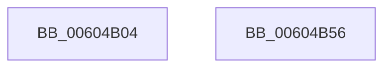

# RtlpHpLfhContextMetadataFree

- RVA: `0x00604B04`–`0x00604B57` (길이 `83` bytes)
- VA: `0x0000000140604B04`
- 실행 섹션: `.text`
- PDB 이름 있음: `예`; PDB Function 태그: `아니요`
- unwind 정보 RVA: `0x00060BC4`
- 디코드: `22`개 명령, `83/83` bytes 표시
- 미해석 바이트: `0` (있으면 어셈블리에 `.byte`로 보존)

> 이 문서는 커널 이미지의 기계어와 PDB 기호를 분석해 생성했습니다. 4번과 5번은 함수 원형과 자료형을 바이너리 사용 방식에서 추정한 C 해석이며 원본 소스 복구 결과는 아닙니다.

## 1. Dependencies

- 직접 호출 지점: **2**; 고유 호출 대상: **2**
- 직접 호출자로 확인된 함수: **6**
- RIP 상대 이미지 참조: **0**

### Outgoing calls
- `0x00604B24` → [RtlpHpLfhContextLockExtension](RtlpHpLfhContextLockExtension_function_00604A50.md) (function, `0x00604A50`)
- `0x00604B41` → [RtlpHpLfhContextUnlockExtension](RtlpHpLfhContextUnlockExtension_function_00604C1C.md) (function, `0x00604C1C`)

### Direct callers
- [RtlpHpLfhContextSlotAllocate](../4C/RtlpHpLfhContextSlotAllocate_function_004C45BC.md) at `0x004C4692`
- [RtlpHpLfhContextTlsCleanup](RtlpHpLfhContextTlsCleanup_function_00604B60.md) at `0x00604B94`
- [RtlpHpLfhContextTlsCleanup](RtlpHpLfhContextTlsCleanup_function_00604B60.md) at `0x00604BFB`
- [RtlpHpLfhPrivateSlotCreate](RtlpHpLfhPrivateSlotCreate_function_00604D50.md) at `0x00604EF3`
- [RtlpHpLfhPrivateSlotShutdown](RtlpHpLfhPrivateSlotShutdown_function_0060502C.md) at `0x0060520E`
- [sub_006DE040](../6D/Unknown_function_006DE040.md) at `0x006DE108`
- [sub_006DE040](../6D/Unknown_function_006DE040.md) at `0x006DE1CC`
- [sub_006F9A96](../6F/Unknown_function_006F9A96.md) at `0x006F9B36`

### Static image references
- 디코드된 RIP-relative 메모리 참조가 없습니다.

## 2. Other-region calls and transfers

- 다른 실행 섹션으로 향하는 call: **0**
- 별도 외부 분기/꼬리 이동을 확인하지 못했습니다.

## 3. Assembly (complete function range)

```asm
00604B04  48 89 5C 24 08                  mov qword ptr [rsp + 8], rbx
00604B09  48 89 74 24 10                  mov qword ptr [rsp + 0x10], rsi
00604B0E  57                              push rdi
00604B0F  48 83 EC 20                     sub rsp, 0x20
00604B13  49 63 F8                        movsxd rdi, r8d
00604B16  48 8D 5A 10                     lea rbx, [rdx + 0x10]
00604B1A  83 FF 03                        cmp edi, 3
00604B1D  48 8B F1                        mov rsi, rcx
00604B20  48 0F 45 DA                     cmovne rbx, rdx
00604B24  E8 27 FF FF FF                  call 0x140604a50
00604B29  48 8B 94 FE 88 00 00 00         mov rdx, qword ptr [rsi + rdi*8 + 0x88]
00604B31  48 8B CE                        mov rcx, rsi
00604B34  48 89 13                        mov qword ptr [rbx], rdx
00604B37  8A D0                           mov dl, al
00604B39  48 89 9C FE 88 00 00 00         mov qword ptr [rsi + rdi*8 + 0x88], rbx
00604B41  E8 D6 00 00 00                  call 0x140604c1c
00604B46  48 8B 5C 24 30                  mov rbx, qword ptr [rsp + 0x30]
00604B4B  48 8B 74 24 38                  mov rsi, qword ptr [rsp + 0x38]
00604B50  48 83 C4 20                     add rsp, 0x20
00604B54  5F                              pop rdi
00604B55  C3                              ret
00604B56  CC                              int3
```

## 4. C-style interpretation (structured pseudocode)

```c
__int64 __fastcall RtlpHpLfhContextMetadataFree(__int64 a1, __int64 a2, int a3)
{
    __int64 result;
    __int64 v_rbx;
    __int64 v_rsp;
    unsigned __int64 v_stack_p10;
    unsigned __int64 v_stack_p8;

    v_stack_p8 = v_rbx;
    v_stack_p10 = v_rsi;
    v_rsp = (v_rsp) - (32);
    v_rbx = a2 + 16;
    if (((unsigned int)((int)(a3))) != 3) { v_rbx = a2; }
    result = RtlpHpLfhContextLockExtension(a1, a2, a3, a4);
    *(unsigned __int64 *)(v_rbx) = *(unsigned __int64 *)(a1 + (int)(a3) * 8 + 136);
    *(unsigned __int64 *)(a1 + (int)(a3) * 8 + 136) = v_rbx;
    result = RtlpHpLfhContextUnlockExtension(a1, (unsigned __int8)(result), a3, a4);
    v_rsp = (v_rsp) + (32);
    return result;
}
```

## 5. (Beta) C Style

```c
int64_t RtlpHpLfhContextMetadataFree(void *Arg1, void *Arg2, int32_t Arg3)
{
    uint8_t *arg1 = (uint8_t *)Arg1;
    uint8_t *arg2 = (uint8_t *)Arg2;

    int64_t result;
    int64_t local_rbx;
    int64_t local_rsp;
    uint64_t v_stack_p10;
    uint64_t v_stack_p8;

    v_stack_p8 = local_rbx;
    v_stack_p10 = local_rsi;
    local_rsp = (local_rsp) - (32);
    local_rbx = Arg2 + 16;
    if (((uint32_t)((int32_t)(Arg3))) != 3) { local_rbx = Arg2; }
    result = RtlpHpLfhContextLockExtension(Arg1, Arg2, Arg3, a4);
    *(uint64_t *)(local_rbx) = *(uint64_t *)(arg1 + (int32_t)(Arg3) * 8 + 0x88);
    *(uint64_t *)(arg1 + (int32_t)(Arg3) * 8 + 0x88) = local_rbx;
    result = RtlpHpLfhContextUnlockExtension(Arg1, (uint8_t)(result), Arg3, a4);
    local_rsp = (local_rsp) + (32);
    return result;
}
```

### 관측된 메모리 오프셋

구조체 형식이 확인되지 않은 접근은 인자 기준의 오프셋으로만 기록했습니다.

| 기준 인자 | 오프셋 표현 | 폭 (bit) | 접근 |
|---|---:|---:|---|
| `Arg1` | `+ 0x88 + rdi*8` | `64` | `R` |
| `Arg1` | `+ 0x88 + rdi*8` | `64` | `W` |
| `Arg2` | `+ 0x10` | `64` | `R` |

## 6. Execution-region graph

[열기: 2D/3D 그래프와 함수 탐색 컨트롤 패널](../../../control-panel.html?section=text&rva=0x00604B04&view=graph)

- 2D 그래프는 위에서 아래로 흐르고, 3D 그래프는 빈 공간을 드래그해 회전합니다. Shift+드래그는 이동, 휠은 확대·축소, 함수 노드 선택은 대상 보고서 이동입니다.

### Static fallback


