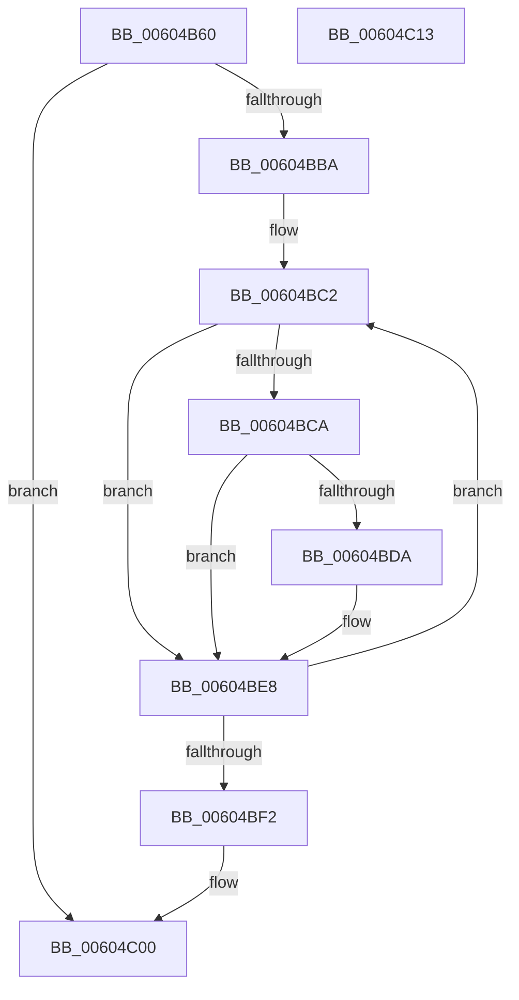

# RtlpHpLfhContextTlsCleanup

- RVA: `0x00604B60`–`0x00604C14` (길이 `180` bytes)
- VA: `0x0000000140604B60`
- 실행 섹션: `.text`
- PDB 이름 있음: `예`; PDB Function 태그: `아니요`
- unwind 정보 RVA: `0x000D0620`
- 디코드: `54`개 명령, `180/180` bytes 표시
- 미해석 바이트: `0` (있으면 어셈블리에 `.byte`로 보존)

> 이 문서는 커널 이미지의 기계어와 PDB 기호를 분석해 생성했습니다. 4번과 5번은 함수 원형과 자료형을 바이너리 사용 방식에서 추정한 C 해석이며 원본 소스 복구 결과는 아닙니다.

## 1. Dependencies

- 직접 호출 지점: **3**; 고유 호출 대상: **2**
- 직접 호출자로 확인된 함수: **1**
- RIP 상대 이미지 참조: **0**

### Outgoing calls
- `0x00604B94` → [RtlpHpLfhContextMetadataFree](RtlpHpLfhContextMetadataFree_function_00604B04.md) (function, `0x00604B04`)
- `0x00604BE3` → [RtlpHpLfhPrivateSlotShutdown](RtlpHpLfhPrivateSlotShutdown_function_0060502C.md) (function, `0x0060502C`)
- `0x00604BFB` → [RtlpHpLfhContextMetadataFree](RtlpHpLfhContextMetadataFree_function_00604B04.md) (function, `0x00604B04`)

### Direct callers
- [RtlpHpSegTlsCleanup](RtlpHpSegTlsCleanup_function_00604520.md) at `0x00604528`

### Static image references
- 디코드된 RIP-relative 메모리 참조가 없습니다.

## 2. Other-region calls and transfers

- 다른 실행 섹션으로 향하는 call: **0**
- 별도 외부 분기/꼬리 이동을 확인하지 못했습니다.

## 3. Assembly (complete function range)

```asm
00604B60  48 89 5C 24 08                  mov qword ptr [rsp + 8], rbx
00604B65  48 89 6C 24 18                  mov qword ptr [rsp + 0x18], rbp
00604B6A  48 89 54 24 10                  mov qword ptr [rsp + 0x10], rdx
00604B6F  56                              push rsi
00604B70  57                              push rdi
00604B71  41 56                           push r14
00604B73  48 83 EC 20                     sub rsp, 0x20
00604B77  48 8B C2                        mov rax, rdx
00604B7A  4C 8B F2                        mov r14, rdx
00604B7D  48 C1 E8 10                     shr rax, 0x10
00604B81  41 B8 01 00 00 00               mov r8d, 1
00604B87  0F B7 D0                        movzx edx, ax
00604B8A  48 8B D9                        mov rbx, rcx
00604B8D  48 C1 E2 06                     shl rdx, 6
00604B91  48 03 D1                        add rdx, rcx
00604B94  E8 6B FF FF FF                  call 0x140604b04
00604B99  0F B6 44 24 4C                  movzx eax, byte ptr [rsp + 0x4c]
00604B9E  48 C1 E0 08                     shl rax, 8
00604BA2  41 0F B7 F6                     movzx esi, r14w
00604BA6  48 05 C0 05 00 00               add rax, 0x5c0
00604BAC  C1 E6 06                        shl esi, 6
00604BAF  48 03 C3                        add rax, rbx
00604BB2  48 03 F3                        add rsi, rbx
00604BB5  48 3B F0                        cmp rsi, rax
00604BB8  74 46                           je 0x140604c00
00604BBA  48 8B FE                        mov rdi, rsi
00604BBD  BD 80 00 00 00                  mov ebp, 0x80
00604BC2  0F B7 07                        movzx eax, word ptr [rdi]
00604BC5  66 85 C0                        test ax, ax
00604BC8  74 1E                           je 0x140604be8
00604BCA  8B D0                           mov edx, eax
00604BCC  48 C1 E2 06                     shl rdx, 6
00604BD0  48 03 D3                        add rdx, rbx
00604BD3  66 83 7A 04 00                  cmp word ptr [rdx + 4], 0
00604BD8  74 0E                           je 0x140604be8
00604BDA  45 33 C9                        xor r9d, r9d
00604BDD  4D 8B C6                        mov r8, r14
00604BE0  48 8B CB                        mov rcx, rbx
00604BE3  E8 44 04 00 00                  call 0x14060502c
00604BE8  48 83 C7 02                     add rdi, 2
00604BEC  48 83 ED 01                     sub rbp, 1
00604BF0  75 D0                           jne 0x140604bc2
00604BF2  45 33 C0                        xor r8d, r8d
00604BF5  48 8B D6                        mov rdx, rsi
00604BF8  48 8B CB                        mov rcx, rbx
00604BFB  E8 04 FF FF FF                  call 0x140604b04
00604C00  48 8B 5C 24 40                  mov rbx, qword ptr [rsp + 0x40]
00604C05  48 8B 6C 24 50                  mov rbp, qword ptr [rsp + 0x50]
00604C0A  48 83 C4 20                     add rsp, 0x20
00604C0E  41 5E                           pop r14
00604C10  5F                              pop rdi
00604C11  5E                              pop rsi
00604C12  C3                              ret
00604C13  CC                              int3
```

## 4. C-style interpretation (structured pseudocode)

```c
__int64 __fastcall RtlpHpLfhContextTlsCleanup(__int64 a1, __int64 a2, __int64 a3, int a4)
{
    __int64 result;
    __int64 v_rbp;
    __int64 v_rdi;
    __int64 v_rsi;
    __int64 v_rsp;
    unsigned __int64 v_stack_p10;
    unsigned __int8 v_stack_p14;
    unsigned __int64 v_stack_p18;
    unsigned __int64 v_stack_p8;

    v_stack_p8 = v_rbx;
    v_stack_p18 = v_rbp;
    v_stack_p10 = a2;
    v_rsp = (v_rsp) - (32);
    result = (a2) >> (16);
    a2 = ((unsigned __int16)(result)) << (6);
    a2 = (a2) + (a1);
    result = RtlpHpLfhContextMetadataFree(a1, a2, 1, a4);
    result = (v_stack_p14) << (8);
    result = (result) + (0x5C0ULL);
    v_rsi = (unsigned int)(((unsigned __int16)(a2)) << (6));
    result = (result) + (a1);
    v_rsi = (v_rsi) + (a1);
    if (v_rsi == result) goto loc_00604C00;
loc_00604BC2:
    if ((unsigned __int16)(*(unsigned __int16 *)(v_rsi)) == 0) goto loc_00604BE8;
    a2 = ((unsigned int)((unsigned int)(*(unsigned __int16 *)(v_rsi)))) << (6);
    a2 = (a2) + (a1);
    result = *(unsigned __int16 *)(v_rsi);
    if ((*(unsigned __int16 *)(a2 + 4)) != 0) {
        a4 = 0;
        a3 = a2;
        a1 = a1;
        result = RtlpHpLfhPrivateSlotShutdown(a1, a2, a3, a4);
    }
    v_rdi = (v_rsi) + (2);
    v_rbp = (128) - (1);
    if (condition_is_not_equal) goto loc_00604BC2;
    a3 = 0;
    result = RtlpHpLfhContextMetadataFree(a1, v_rsi, a3, a4);
loc_00604C00:
    v_rsp = (v_rsp) + (32);
    return result;
}
```

## 5. (Beta) C Style

```c
int64_t RtlpHpLfhContextTlsCleanup(int64_t Arg1, int64_t Arg2, int64_t Arg3, int32_t Arg4)
{
    int64_t result;
    int64_t local_rbp;
    int64_t local_rdi;
    int64_t local_rsi;
    int64_t local_rsp;
    uint64_t v_stack_p10;
    uint8_t v_stack_p14;
    uint64_t v_stack_p18;
    uint64_t v_stack_p8;

    v_stack_p8 = local_rbx;
    v_stack_p18 = local_rbp;
    v_stack_p10 = Arg2;
    local_rsp = (local_rsp) - (32);
    result = (Arg2) >> (16);
    Arg2 = ((uint16_t)(result)) << (6);
    Arg2 = (Arg2) + (Arg1);
    result = RtlpHpLfhContextMetadataFree(Arg1, Arg2, 1, Arg4);
    result = (v_stack_p14) << (8);
    result = (result) + (0x5C0ULL);
    local_rsi = (uint32_t)(((uint16_t)(Arg2)) << (6));
    result = (result) + (Arg1);
    local_rsi = (local_rsi) + (Arg1);
    if (local_rsi == result) goto loc_00604C00;
loc_00604BC2:
    if ((uint16_t)(*(uint16_t *)(local_rsi)) == 0) goto loc_00604BE8;
    Arg2 = ((uint32_t)((uint32_t)(*(uint16_t *)(local_rsi)))) << (6);
    Arg2 = (Arg2) + (Arg1);
    result = *(uint16_t *)(local_rsi);
    if ((*(uint16_t *)(Arg2 + 0x4)) != 0) {
        Arg4 = 0;
        Arg3 = Arg2;
        Arg1 = Arg1;
        result = RtlpHpLfhPrivateSlotShutdown(Arg1, Arg2, Arg3, Arg4);
    }
    local_rdi = (local_rsi) + (2);
    local_rbp = (128) - (1);
    if (condition_is_not_equal) goto loc_00604BC2;
    Arg3 = 0;
    result = RtlpHpLfhContextMetadataFree(Arg1, local_rsi, Arg3, Arg4);
loc_00604C00:
    local_rsp = (local_rsp) + (32);
    return result;
}
```

## 6. Execution-region graph

[열기: 2D/3D 그래프와 함수 탐색 컨트롤 패널](../../../control-panel.html?section=text&rva=0x00604B60&view=graph)

- 2D 그래프는 위에서 아래로 흐르고, 3D 그래프는 빈 공간을 드래그해 회전합니다. Shift+드래그는 이동, 휠은 확대·축소, 함수 노드 선택은 대상 보고서 이동입니다.

### Static fallback


