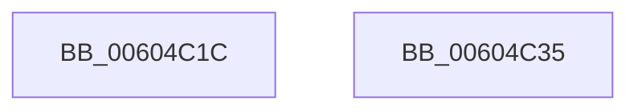

# RtlpHpLfhContextUnlockExtension

- RVA: `0x00604C1C`–`0x00604C36` (길이 `26` bytes)
- VA: `0x0000000140604C1C`
- 실행 섹션: `.text`
- PDB 이름 있음: `예`; PDB Function 태그: `아니요`
- unwind 정보 RVA: `0x0005C788`
- 디코드: `8`개 명령, `26/26` bytes 표시
- 미해석 바이트: `0` (있으면 어셈블리에 `.byte`로 보존)

> 이 문서는 커널 이미지의 기계어와 PDB 기호를 분석해 생성했습니다. 4번과 5번은 함수 원형과 자료형을 바이너리 사용 방식에서 추정한 C 해석이며 원본 소스 복구 결과는 아닙니다.

## 1. Dependencies

- 직접 호출 지점: **1**; 고유 호출 대상: **1**
- 직접 호출자로 확인된 함수: **5**
- RIP 상대 이미지 참조: **0**

### Outgoing calls
- `0x00604C2B` → [RtlpHpReleaseLockExclusive](../32/RtlpHpReleaseLockExclusive_function_00324230.md) (function, `0x00324230`)

### Direct callers
- [RtlpHpLfhContextSlotAllocate](../4C/RtlpHpLfhContextSlotAllocate_function_004C45BC.md) at `0x004C461C`
- [RtlpHpLfhContextSlotAllocate](../4C/RtlpHpLfhContextSlotAllocate_function_004C45BC.md) at `0x004C46DE`
- [RtlpHpLfhContextMetadataAllocate](../4C/RtlpHpLfhContextMetadataAllocate_function_004C472C.md) at `0x004C479F`
- [RtlpHpLfhContextMetadataFree](RtlpHpLfhContextMetadataFree_function_00604B04.md) at `0x00604B41`
- [sub_006DE040](../6D/Unknown_function_006DE040.md) at `0x006DE154`
- [sub_006DE040](../6D/Unknown_function_006DE040.md) at `0x006DE224`
- [sub_006F9A96](../6F/Unknown_function_006F9A96.md) at `0x006F9AB9`
- [sub_006F9A96](../6F/Unknown_function_006F9A96.md) at `0x006F9B86`

### Static image references
- 디코드된 RIP-relative 메모리 참조가 없습니다.

## 2. Other-region calls and transfers

- 다른 실행 섹션으로 향하는 call: **0**
- 별도 외부 분기/꼬리 이동을 확인하지 못했습니다.

## 3. Assembly (complete function range)

```asm
00604C1C  48 83 EC 28                     sub rsp, 0x28
00604C20  44 8A C2                        mov r8b, dl
00604C23  0F B6 51 41                     movzx edx, byte ptr [rcx + 0x41]
00604C27  48 83 E9 80                     sub rcx, -0x80
00604C2B  E8 00 F6 D1 FF                  call 0x140324230
00604C30  48 83 C4 28                     add rsp, 0x28
00604C34  C3                              ret
00604C35  CC                              int3
```

## 4. C-style interpretation (structured pseudocode)

```c
__int64 __fastcall RtlpHpLfhContextUnlockExtension(__int64 a1, unsigned __int8 a2)
{
    __int64 result;
    __int64 v_rsp;

    v_rsp = (v_rsp) - (40);
    a1 = (a1) - (-128);
    result = RtlpHpReleaseLockExclusive(a1, *(unsigned __int8 *)(a1 + 65), a2, a4);
    v_rsp = (v_rsp) + (40);
    return result;
}
```

## 5. (Beta) C Style

```c
int64_t RtlpHpLfhContextUnlockExtension(void *Arg1, uint8_t Arg2)
{
    uint8_t *arg1 = (uint8_t *)Arg1;

    int64_t result;
    int64_t local_rsp;

    local_rsp = (local_rsp) - (40);
    Arg1 = (Arg1) - (-128);
    result = RtlpHpReleaseLockExclusive(Arg1, *(uint8_t *)(arg1 + 0x41), Arg2, a4);
    local_rsp = (local_rsp) + (40);
    return result;
}
```

### 관측된 메모리 오프셋

구조체 형식이 확인되지 않은 접근은 인자 기준의 오프셋으로만 기록했습니다.

| 기준 인자 | 오프셋 표현 | 폭 (bit) | 접근 |
|---|---:|---:|---|
| `Arg1` | `+ 0x41` | `8` | `R` |

## 6. Execution-region graph

[열기: 2D/3D 그래프와 함수 탐색 컨트롤 패널](../../../control-panel.html?section=text&rva=0x00604C1C&view=graph)

- 2D 그래프는 위에서 아래로 흐르고, 3D 그래프는 빈 공간을 드래그해 회전합니다. Shift+드래그는 이동, 휠은 확대·축소, 함수 노드 선택은 대상 보고서 이동입니다.

### Static fallback


