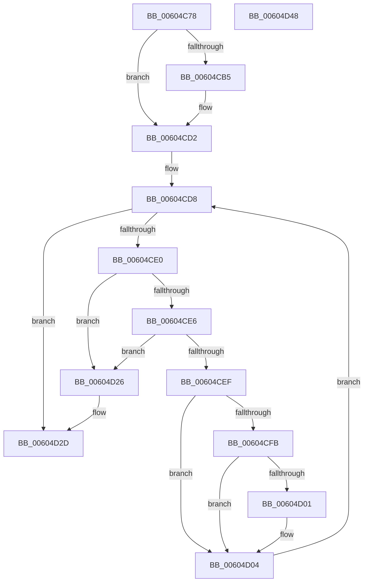

# RtlpHpLfhOwnerCleanup

- RVA: `0x00604C78`–`0x00604D49` (길이 `209` bytes)
- VA: `0x0000000140604C78`
- 실행 섹션: `.text`
- PDB 이름 있음: `예`; PDB Function 태그: `아니요`
- unwind 정보 RVA: `0x0005E6B4`
- 디코드: `60`개 명령, `209/209` bytes 표시
- 미해석 바이트: `0` (있으면 어셈블리에 `.byte`로 보존)

> 이 문서는 커널 이미지의 기계어와 PDB 기호를 분석해 생성했습니다. 4번과 5번은 함수 원형과 자료형을 바이너리 사용 방식에서 추정한 C 해석이며 원본 소스 복구 결과는 아닙니다.

## 1. Dependencies

- 직접 호출 지점: **1**; 고유 호출 대상: **1**
- 직접 호출자로 확인된 함수: **1**
- RIP 상대 이미지 참조: **0**

### Outgoing calls
- `0x00604D1F` → [RtlpHpLfhSubsegmentFree](../2E/RtlpHpLfhSubsegmentFree_function_002E7CA0.md) (function, `0x002E7CA0`)

### Direct callers
- [RtlpHpLfhBucketCleanup](RtlpHpLfhBucketCleanup_function_006046CC.md) at `0x00604715`
- [RtlpHpLfhBucketCleanup](RtlpHpLfhBucketCleanup_function_006046CC.md) at `0x0060472A`

### Static image references
- 디코드된 RIP-relative 메모리 참조가 없습니다.

## 2. Other-region calls and transfers

- 다른 실행 섹션으로 향하는 call: **0**
- 별도 외부 분기/꼬리 이동을 확인하지 못했습니다.

## 3. Assembly (complete function range)

```asm
00604C78  48 8B C4                        mov rax, rsp
00604C7B  48 89 58 08                     mov qword ptr [rax + 8], rbx
00604C7F  48 89 68 10                     mov qword ptr [rax + 0x10], rbp
00604C83  48 89 70 18                     mov qword ptr [rax + 0x18], rsi
00604C87  48 89 78 20                     mov qword ptr [rax + 0x20], rdi
00604C8B  41 56                           push r14
00604C8D  48 83 EC 20                     sub rsp, 0x20
00604C91  0F B6 02                        movzx eax, byte ptr [rdx]
00604C94  4C 8D 42 28                     lea r8, [rdx + 0x28]
00604C98  48 D1 E8                        shr rax, 1
00604C9B  48 8D 5A 18                     lea rbx, [rdx + 0x18]
00604C9F  48 8B FA                        mov rdi, rdx
00604CA2  48 8B F1                        mov rsi, rcx
00604CA5  48 8B AC C1 C0 01 00 00         mov rbp, qword ptr [rcx + rax*8 + 0x1c0]
00604CAD  49 8B 00                        mov rax, qword ptr [r8]
00604CB0  49 3B C0                        cmp rax, r8
00604CB3  74 1D                           je 0x140604cd2
00604CB5  48 8B 53 08                     mov rdx, qword ptr [rbx + 8]
00604CB9  48 89 02                        mov qword ptr [rdx], rax
00604CBC  49 8B 40 08                     mov rax, qword ptr [r8 + 8]
00604CC0  48 89 43 08                     mov qword ptr [rbx + 8], rax
00604CC4  49 8B 40 08                     mov rax, qword ptr [r8 + 8]
00604CC8  48 89 18                        mov qword ptr [rax], rbx
00604CCB  49 8B 00                        mov rax, qword ptr [r8]
00604CCE  48 89 50 08                     mov qword ptr [rax + 8], rdx
00604CD2  41 BE 01 00 00 00               mov r14d, 1
00604CD8  48 8B 13                        mov rdx, qword ptr [rbx]
00604CDB  48 3B D3                        cmp rdx, rbx
00604CDE  74 4D                           je 0x140604d2d
00604CE0  48 39 5A 08                     cmp qword ptr [rdx + 8], rbx
00604CE4  75 40                           jne 0x140604d26
00604CE6  48 8B 02                        mov rax, qword ptr [rdx]
00604CE9  48 39 50 08                     cmp qword ptr [rax + 8], rdx
00604CED  75 37                           jne 0x140604d26
00604CEF  48 89 03                        mov qword ptr [rbx], rax
00604CF2  48 89 58 08                     mov qword ptr [rax + 8], rbx
00604CF6  44 84 37                        test byte ptr [rdi], r14b
00604CF9  75 09                           jne 0x140604d04
00604CFB  80 7A 16 00                     cmp byte ptr [rdx + 0x16], 0
00604CFF  75 03                           jne 0x140604d04
00604D01  FE 4F 01                        dec byte ptr [rdi + 1]
00604D04  0F B7 42 22                     movzx eax, word ptr [rdx + 0x22]
00604D08  4C 8B C5                        mov r8, rbp
00604D0B  66 89 42 20                     mov word ptr [rdx + 0x20], ax
00604D0F  48 8B CE                        mov rcx, rsi
00604D12  0F B6 42 18                     movzx eax, byte ptr [rdx + 0x18]
00604D16  C6 42 16 03                     mov byte ptr [rdx + 0x16], 3
00604D1A  66 44 89 34 C2                  mov word ptr [rdx + rax*8], r14w
00604D1F  E8 7C 2F CE FF                  call 0x1402e7ca0
00604D24  EB B2                           jmp 0x140604cd8
00604D26  B9 03 00 00 00                  mov ecx, 3
00604D2B  CD 29                           int 0x29
00604D2D  48 8B 5C 24 30                  mov rbx, qword ptr [rsp + 0x30]
00604D32  48 8B 6C 24 38                  mov rbp, qword ptr [rsp + 0x38]
00604D37  48 8B 74 24 40                  mov rsi, qword ptr [rsp + 0x40]
00604D3C  48 8B 7C 24 48                  mov rdi, qword ptr [rsp + 0x48]
00604D41  48 83 C4 20                     add rsp, 0x20
00604D45  41 5E                           pop r14
00604D47  C3                              ret
00604D48  CC                              int3
```

## 4. C-style interpretation (structured pseudocode)

```c
__int64 __fastcall RtlpHpLfhOwnerCleanup(__int64 a1, __int64 a2)
{
    __int64 result;
    __int64 v_rsp;
    unsigned __int64 v_stack_p10;
    unsigned __int64 v_stack_p18;
    unsigned __int64 v_stack_p20;
    unsigned __int64 v_stack_p8;

    *(unsigned __int64 *)(v_rsp + 8) = v_rbx;
    *(unsigned __int64 *)(v_rsp + 16) = v_rbp;
    *(unsigned __int64 *)(v_rsp + 24) = v_rsi;
    *(unsigned __int64 *)(v_rsp + 32) = v_rdi;
    v_rsp = (v_rsp) - (32);
    result = (*(unsigned __int8 *)(a2)) >> (1);
    result = *(unsigned __int64 *)(a2 + 40);
    if ((*(unsigned __int64 *)(a2 + 40)) != (a2 + 40)) {
        a2 = *(unsigned __int64 *)(a2 + 24 + 8);
        *(unsigned __int64 *)(a2) = *(unsigned __int64 *)(a2 + 40);
        result = *(unsigned __int64 *)(a2 + 40 + 8);
        *(unsigned __int64 *)(a2 + 24 + 8) = result;
        result = *(unsigned __int64 *)(a2 + 40 + 8);
        *(unsigned __int64 *)(result) = a2 + 24;
        result = *(unsigned __int64 *)(a2 + 40);
        *(unsigned __int64 *)(result + 8) = a2;
    }
loc_00604CD8:
    if ((*(unsigned __int64 *)(a2 + 24)) == (a2 + 24)) goto loc_00604D2D;
    if ((*(unsigned __int64 *)(*(unsigned __int64 *)(a2 + 24) + 8)) != (a2 + 24)) goto loc_00604D26;
    if ((*(unsigned __int64 *)(*(unsigned __int64 *)(*(unsigned __int64 *)(a2 + 24)) + 8)) != (*(unsigned __int64 *)(a2 + 24))) goto loc_00604D26;
    *(unsigned __int64 *)(a2 + 24) = *(unsigned __int64 *)(*(unsigned __int64 *)(a2 + 24));
    *(unsigned __int64 *)(*(unsigned __int64 *)(*(unsigned __int64 *)(a2 + 24)) + 8) = a2 + 24;
    if (((*(unsigned __int8 *)(a2)) & (1)) != 0) goto loc_00604D04;
    if ((*(unsigned __int8 *)(*(unsigned __int64 *)(a2 + 24) + 22)) == 0) {
    }
    *(unsigned __int16 *)(*(unsigned __int64 *)(a2 + 24) + 32) = (unsigned __int16)(*(unsigned __int16 *)(*(unsigned __int64 *)(a2 + 24) + 34));
    *(unsigned __int8 *)(*(unsigned __int64 *)(a2 + 24) + 22) = 3;
    *(unsigned __int16 *)(*(unsigned __int64 *)(a2 + 24) + *(unsigned __int8 *)(*(unsigned __int64 *)(a2 + 24) + 24) * 8) = 1;
    result = RtlpHpLfhSubsegmentFree(a1, *(unsigned __int64 *)(a2 + 24), *(unsigned __int64 *)(a1 + result * 8 + 448), a4);
    goto loc_00604CD8;
loc_00604D26:
loc_00604D2D:
    v_rsp = (v_rsp) + (32);
    return result;
}
```

## 5. (Beta) C Style

```c
int64_t RtlpHpLfhOwnerCleanup(void *Arg1, void *Arg2)
{
    uint8_t *arg1 = (uint8_t *)Arg1;
    uint8_t *arg2 = (uint8_t *)Arg2;

    int64_t result;
    int64_t local_rsp;
    uint64_t v_stack_p10;
    uint64_t v_stack_p18;
    uint64_t v_stack_p20;
    uint64_t v_stack_p8;

    *(uint64_t *)(local_rsp + 0x8) = local_rbx;
    *(uint64_t *)(local_rsp + 0x10) = local_rbp;
    *(uint64_t *)(local_rsp + 0x18) = local_rsi;
    *(uint64_t *)(local_rsp + 0x20) = local_rdi;
    local_rsp = (local_rsp) - (32);
    result = (*(uint8_t *)(arg2)) >> (1);
    result = *(uint64_t *)(arg2 + 0x28);
    if ((*(uint64_t *)(arg2 + 0x28)) != (Arg2 + 40)) {
        Arg2 = *(uint64_t *)(arg2 + 0x18 + 0x8);
        *(uint64_t *)(arg2) = *(uint64_t *)(arg2 + 0x28);
        result = *(uint64_t *)(arg2 + 0x28 + 0x8);
        *(uint64_t *)(arg2 + 0x18 + 0x8) = result;
        result = *(uint64_t *)(arg2 + 0x28 + 0x8);
        *(void **)(result) = Arg2 + 24;
        result = *(uint64_t *)(arg2 + 0x28);
        *(void **)(result + 0x8) = Arg2;
    }
loc_00604CD8:
    if ((*(uint64_t *)(arg2 + 0x18)) == (Arg2 + 24)) goto loc_00604D2D;
    if ((*(uint64_t *)(*(uint64_t *)(arg2 + 0x18) + 0x8)) != (Arg2 + 24)) goto loc_00604D26;
    if ((*(uint64_t *)(*(uint64_t *)(*(uint64_t *)(arg2 + 0x18)) + 0x8)) != (*(uint64_t *)(arg2 + 0x18))) goto loc_00604D26;
    *(uint64_t *)(arg2 + 0x18) = *(uint64_t *)(*(uint64_t *)(arg2 + 0x18));
    *(void **)(*(uint64_t *)(*(uint64_t *)(arg2 + 0x18)) + 0x8) = Arg2 + 24;
    if (((*(uint8_t *)(arg2)) & (1)) != 0) goto loc_00604D04;
    if ((*(uint8_t *)(*(uint64_t *)(arg2 + 0x18) + 0x16)) == 0) {
    }
    *(uint16_t *)(*(uint64_t *)(arg2 + 0x18) + 0x20) = (uint16_t)(*(uint16_t *)(*(uint64_t *)(arg2 + 0x18) + 0x22));
    *(uint8_t *)(*(uint64_t *)(arg2 + 0x18) + 0x16) = 3;
    *(uint16_t *)(*(uint64_t *)(arg2 + 0x18) + *(uint8_t *)(*(uint64_t *)(arg2 + 0x18) + 0x18) * 8) = 1;
    result = RtlpHpLfhSubsegmentFree(Arg1, *(uint64_t *)(arg2 + 0x18), *(uint64_t *)(arg1 + result * 8 + 0x1C0), a4);
    goto loc_00604CD8;
loc_00604D26:
loc_00604D2D:
    local_rsp = (local_rsp) + (32);
    return result;
}
```

### 관측된 메모리 오프셋

구조체 형식이 확인되지 않은 접근은 인자 기준의 오프셋으로만 기록했습니다.

| 기준 인자 | 오프셋 표현 | 폭 (bit) | 접근 |
|---|---:|---:|---|
| `Arg1` | `+ 0x1C0 + rax*8` | `64` | `R` |
| `Arg2` | `+ 0x0` | `8` | `R` |
| `Arg2` | `+ 0x0` | `64` | `R` |
| `Arg2` | `+ 0x0` | `64` | `W` |
| `Arg2` | `+ 0x1` | `8` | `R/W` |
| `Arg2` | `+ 0x8` | `64` | `R` |
| `Arg2` | `+ 0x8` | `64` | `W` |
| `Arg2` | `+ 0x18` | `64` | `R` |
| `Arg2` | `+ 0x28` | `64` | `R` |

## 6. Execution-region graph

[열기: 2D/3D 그래프와 함수 탐색 컨트롤 패널](../../../control-panel.html?section=text&rva=0x00604C78&view=graph)

- 2D 그래프는 위에서 아래로 흐르고, 3D 그래프는 빈 공간을 드래그해 회전합니다. Shift+드래그는 이동, 휠은 확대·축소, 함수 노드 선택은 대상 보고서 이동입니다.

### Static fallback


