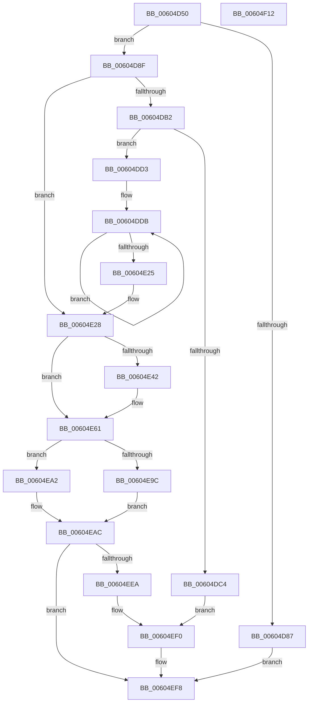

# RtlpHpLfhPrivateSlotCreate

- RVA: `0x00604D50`–`0x00604F13` (길이 `451` bytes)
- VA: `0x0000000140604D50`
- 실행 섹션: `.text`
- PDB 이름 있음: `예`; PDB Function 태그: `아니요`
- unwind 정보 RVA: `0x000D05E4`
- 디코드: `128`개 명령, `451/451` bytes 표시
- 미해석 바이트: `0` (있으면 어셈블리에 `.byte`로 보존)

> 이 문서는 커널 이미지의 기계어와 PDB 기호를 분석해 생성했습니다. 4번과 5번은 함수 원형과 자료형을 바이너리 사용 방식에서 추정한 C 해석이며 원본 소스 복구 결과는 아닙니다.

## 1. Dependencies

- 직접 호출 지점: **6**; 고유 호출 대상: **6**
- 직접 호출자로 확인된 함수: **1**
- RIP 상대 이미지 참조: **0**

### Outgoing calls
- `0x00604D7A` → [RtlpHpLfhContextSlotAllocate](../4C/RtlpHpLfhContextSlotAllocate_function_004C45BC.md) (function, `0x004C45BC`)
- `0x00604DB7` → [RtlpHpLfhContextMetadataAllocate](../4C/RtlpHpLfhContextMetadataAllocate_function_004C472C.md) (function, `0x004C472C`)
- `0x00604E59` → [RtlpHpEnvTlsSetValue](../4F/RtlpHpEnvTlsSetValue_function_004F63AC.md) (function, `0x004F63AC`)
- `0x00604E8B` → [RtlpHpAcquireLockExclusive](../32/RtlpHpAcquireLockExclusive_function_003246B0.md) (function, `0x003246B0`)
- `0x00604EDD` → [RtlpHpReleaseLockExclusive](../32/RtlpHpReleaseLockExclusive_function_00324230.md) (function, `0x00324230`)
- `0x00604EF3` → [RtlpHpLfhContextMetadataFree](RtlpHpLfhContextMetadataFree_function_00604B04.md) (function, `0x00604B04`)

### Direct callers
- [RtlpHpLfhSlotAllocateSlow](../2E/RtlpHpLfhSlotAllocateSlow_function_002E8FBC.md) at `0x002E9793`

### Static image references
- 디코드된 RIP-relative 메모리 참조가 없습니다.

## 2. Other-region calls and transfers

- 다른 실행 섹션으로 향하는 call: **0**
- 별도 외부 분기/꼬리 이동을 확인하지 못했습니다.

## 3. Assembly (complete function range)

```asm
00604D50  48 89 5C 24 08                  mov qword ptr [rsp + 8], rbx
00604D55  48 89 6C 24 18                  mov qword ptr [rsp + 0x18], rbp
00604D5A  48 89 54 24 10                  mov qword ptr [rsp + 0x10], rdx
00604D5F  56                              push rsi
00604D60  57                              push rdi
00604D61  41 54                           push r12
00604D63  41 56                           push r14
00604D65  41 57                           push r15
00604D67  48 83 EC 20                     sub rsp, 0x20
00604D6B  45 33 E4                        xor r12d, r12d
00604D6E  49 8B D0                        mov rdx, r8
00604D71  41 8B FC                        mov edi, r12d
00604D74  4D 8B F8                        mov r15, r8
00604D77  48 8B D9                        mov rbx, rcx
00604D7A  E8 3D F8 EB FF                  call 0x1404c45bc
00604D7F  4C 8B F0                        mov r14, rax
00604D82  48 85 C0                        test rax, rax
00604D85  75 08                           jne 0x140604d8f
00604D87  41 8B F4                        mov esi, r12d
00604D8A  E9 69 01 00 00                  jmp 0x140604ef8
00604D8F  0F B7 6C 24 58                  movzx ebp, word ptr [rsp + 0x58]
00604D94  0F B6 43 40                     movzx eax, byte ptr [rbx + 0x40]
00604D98  8B F5                           mov esi, ebp
00604D9A  48 C1 E0 08                     shl rax, 8
00604D9E  C1 E6 06                        shl esi, 6
00604DA1  48 05 C0 05 00 00               add rax, 0x5c0
00604DA7  48 03 F3                        add rsi, rbx
00604DAA  48 03 C3                        add rax, rbx
00604DAD  48 3B F0                        cmp rsi, rax
00604DB0  73 76                           jae 0x140604e28
00604DB2  33 D2                           xor edx, edx
00604DB4  48 8B CB                        mov rcx, rbx
00604DB7  E8 70 F9 EB FF                  call 0x1404c472c
00604DBC  48 8B F8                        mov rdi, rax
00604DBF  48 85 C0                        test rax, rax
00604DC2  75 0F                           jne 0x140604dd3
00604DC4  49 8B F4                        mov rsi, r12
00604DC7  44 8D 40 02                     lea r8d, [rax + 2]
00604DCB  49 8B D6                        mov rdx, r14
00604DCE  E9 1D 01 00 00                  jmp 0x140604ef0
00604DD3  B9 02 00 00 00                  mov ecx, 2
00604DD8  8D 51 7E                        lea edx, [rcx + 0x7e]
00604DDB  0F 10 06                        movups xmm0, xmmword ptr [rsi]
00604DDE  0F 11 00                        movups xmmword ptr [rax], xmm0
00604DE1  0F 10 4E 10                     movups xmm1, xmmword ptr [rsi + 0x10]
00604DE5  0F 11 48 10                     movups xmmword ptr [rax + 0x10], xmm1
00604DE9  0F 10 46 20                     movups xmm0, xmmword ptr [rsi + 0x20]
00604DED  0F 11 40 20                     movups xmmword ptr [rax + 0x20], xmm0
00604DF1  0F 10 4E 30                     movups xmm1, xmmword ptr [rsi + 0x30]
00604DF5  0F 11 48 30                     movups xmmword ptr [rax + 0x30], xmm1
00604DF9  0F 10 46 40                     movups xmm0, xmmword ptr [rsi + 0x40]
00604DFD  0F 11 40 40                     movups xmmword ptr [rax + 0x40], xmm0
00604E01  0F 10 4E 50                     movups xmm1, xmmword ptr [rsi + 0x50]
00604E05  0F 11 48 50                     movups xmmword ptr [rax + 0x50], xmm1
00604E09  0F 10 46 60                     movups xmm0, xmmword ptr [rsi + 0x60]
00604E0D  0F 11 40 60                     movups xmmword ptr [rax + 0x60], xmm0
00604E11  48 03 C2                        add rax, rdx
00604E14  0F 10 4E 70                     movups xmm1, xmmword ptr [rsi + 0x70]
00604E18  48 03 F2                        add rsi, rdx
00604E1B  0F 11 48 F0                     movups xmmword ptr [rax - 0x10], xmm1
00604E1F  48 83 E9 01                     sub rcx, 1
00604E23  75 B6                           jne 0x140604ddb
00604E25  48 8B F7                        mov rsi, rdi
00604E28  41 0F B6 07                     movzx eax, byte ptr [r15]
00604E2C  49 8B CE                        mov rcx, r14
00604E2F  48 2B CB                        sub rcx, rbx
00604E32  48 D1 E8                        shr rax, 1
00604E35  48 C1 E9 06                     shr rcx, 6
00604E39  66 89 0C 46                     mov word ptr [rsi + rax*2], cx
00604E3D  48 85 FF                        test rdi, rdi
00604E40  74 1F                           je 0x140604e61
00604E42  8B 4B 4C                        mov ecx, dword ptr [rbx + 0x4c]
00604E45  48 2B FB                        sub rdi, rbx
00604E48  48 8B EF                        mov rbp, rdi
00604E4B  48 C1 ED 06                     shr rbp, 6
00604E4F  66 89 6C 24 58                  mov word ptr [rsp + 0x58], bp
00604E54  48 8B 54 24 58                  mov rdx, qword ptr [rsp + 0x58]
00604E59  E8 4E 15 EF FF                  call 0x1404f63ac
00604E5E  49 8B FC                        mov rdi, r12
00604E61  0F B7 44 24 5A                  movzx eax, word ptr [rsp + 0x5a]
00604E66  66 41 89 46 06                  mov word ptr [r14 + 6], ax
00604E6B  66 41 89 6E 04                  mov word ptr [r14 + 4], bp
00604E70  65 48 8B 04 25 88 01 00 00      mov rax, qword ptr gs:[0x188]
00604E79  8B 88 10 05 00 00               mov ecx, dword ptr [rax + 0x510]
00604E7F  41 89 4E 14                     mov dword ptr [r14 + 0x14], ecx
00604E83  49 8D 4F 50                     lea rcx, [r15 + 0x50]
00604E87  0F B6 53 41                     movzx edx, byte ptr [rbx + 0x41]
00604E8B  E8 20 F8 D1 FF                  call 0x1403246b0
00604E90  41 0F B7 4F 5A                  movzx ecx, word ptr [r15 + 0x5a]
00604E95  44 8A C0                        mov r8b, al
00604E98  85 C9                           test ecx, ecx
00604E9A  75 06                           jne 0x140604ea2
00604E9C  49 8D 4F 58                     lea rcx, [r15 + 0x58]
00604EA0  EB 0A                           jmp 0x140604eac
00604EA2  C1 E1 06                        shl ecx, 6
00604EA5  48 83 C1 10                     add rcx, 0x10
00604EA9  48 03 CB                        add rcx, rbx
00604EAC  49 8D 46 10                     lea rax, [r14 + 0x10]
00604EB0  48 2B C3                        sub rax, rbx
00604EB3  48 83 E8 10                     sub rax, 0x10
00604EB7  48 C1 E8 06                     shr rax, 6
00604EBB  66 89 01                        mov word ptr [rcx], ax
00604EBE  66 45 89 66 10                  mov word ptr [r14 + 0x10], r12w
00604EC3  41 0F B7 47 5A                  movzx eax, word ptr [r15 + 0x5a]
00604EC8  66 41 89 46 12                  mov word ptr [r14 + 0x12], ax
00604ECD  0F B7 01                        movzx eax, word ptr [rcx]
00604ED0  49 8D 4F 50                     lea rcx, [r15 + 0x50]
00604ED4  66 41 89 47 5A                  mov word ptr [r15 + 0x5a], ax
00604ED9  0F B6 53 41                     movzx edx, byte ptr [rbx + 0x41]
00604EDD  E8 4E F3 D1 FF                  call 0x140324230
00604EE2  49 8B F6                        mov rsi, r14
00604EE5  48 85 FF                        test rdi, rdi
00604EE8  74 0E                           je 0x140604ef8
00604EEA  45 33 C0                        xor r8d, r8d
00604EED  48 8B D7                        mov rdx, rdi
00604EF0  48 8B CB                        mov rcx, rbx
00604EF3  E8 0C FC FF FF                  call 0x140604b04
00604EF8  48 8B 5C 24 50                  mov rbx, qword ptr [rsp + 0x50]
00604EFD  48 8B C6                        mov rax, rsi
00604F00  48 8B 6C 24 60                  mov rbp, qword ptr [rsp + 0x60]
00604F05  48 83 C4 20                     add rsp, 0x20
00604F09  41 5F                           pop r15
00604F0B  41 5E                           pop r14
00604F0D  41 5C                           pop r12
00604F0F  5F                              pop rdi
00604F10  5E                              pop rsi
00604F11  C3                              ret
00604F12  CC                              int3
```

## 4. C-style interpretation (structured pseudocode)

```c
__int64 __fastcall RtlpHpLfhPrivateSlotCreate(__int64 a1, __int64 a2, __int64 a3)
{
    __int64 result;
    __int64 v_r12;
    __int64 v_rbp;
    __int64 v_rdi;
    __int64 v_rsi;
    __int64 v_rsp;
    unsigned __int64 v_stack_p10;
    unsigned __int16 v_stack_p12;
    unsigned __int64 v_stack_p18;
    unsigned __int64 v_stack_p8;

    v_stack_p8 = v_rbx;
    v_stack_p18 = v_rbp;
    v_stack_p10 = a2;
    v_rsp = (v_rsp) - (32);
    v_r12 = 0;
    result = RtlpHpLfhContextSlotAllocate(a1, a3, a3, a4);
    if (result != 0) goto loc_00604D8F;
    goto loc_00604EF8;
loc_00604D8F:
    result = (*(unsigned __int8 *)(a1 + 64)) << (8);
    v_rsi = (unsigned int)(((unsigned int)((unsigned int)(v_stack_p10))) << (6));
    result = (result) + (0x5C0ULL);
    v_rsi = (v_rsi) + (a1);
    result = (result) + (a1);
    if (v_rsi >= result) goto loc_00604E28;
    a2 = 0;
    result = RtlpHpLfhContextMetadataAllocate(a1, a2, a3, a4);
    if (result != 0) goto loc_00604DD3;
    goto loc_00604EF0;
loc_00604DD3:
loc_00604DDB:
    *(unsigned __int64 *)(result) = v_xmm0;
    *(unsigned __int64 *)(result + 16) = v_xmm1;
    *(unsigned __int64 *)(result + 32) = v_xmm0;
    *(unsigned __int64 *)(result + 48) = v_xmm1;
    *(unsigned __int64 *)(result + 64) = v_xmm0;
    *(unsigned __int64 *)(result + 80) = v_xmm1;
    *(unsigned __int64 *)(result + 96) = v_xmm0;
    result = (result) + (2 + 126);
    v_rsi = (0) + (2 + 126);
    *(unsigned __int64 *)(result - 16) = v_xmm1;
    a1 = (2) - (1);
    if (condition_is_not_equal) goto loc_00604DDB;
loc_00604E28:
    a1 = (result) - (a1);
    result = (*(unsigned __int8 *)(a3)) >> (1);
    a1 = (a1) >> (6);
    *(unsigned __int16 *)(result + result * 2) = (unsigned __int16)(a1);
    v_rdi = result;
    v_rbp = v_stack_p10;
    if (result != 0) {
        a1 = *(unsigned int *)(a1 + 76);
        v_rdi = (result) - (a1);
        v_rbp = v_rdi;
        v_rbp = (v_rbp) >> (6);
        v_stack_p10 = (unsigned __int16)(v_rbp);
        a2 = v_stack_p10;
        result = RtlpHpEnvTlsSetValue(a1, a2, result + 2, a4);
        v_rdi = 0;
    }
    *(unsigned __int16 *)(result + 6) = (unsigned __int16)(v_stack_p12);
    *(unsigned __int16 *)(result + 4) = (unsigned __int16)(v_rbp);
    *(unsigned int *)(result + 20) = (unsigned int)((unsigned int)(*(unsigned int *)(*(unsigned __int64 *)(gs_base + (0 + 392)) + 1296)));
    result = RtlpHpAcquireLockExclusive(a3 + 80, *(unsigned __int8 *)(a1 + 65), result + 2, a4);
    if ((unsigned int)(*(unsigned __int16 *)(a3 + 90)) != 0) goto loc_00604EA2;
    goto loc_00604EAC;
loc_00604EA2:
    a1 = (unsigned int)((a3 + 88) << (6));
    a1 = (a1) + (16);
    a1 = (a1) + (a1);
loc_00604EAC:
    result = (result + 16) - (a1);
    result = (result) - (16);
    result = (result) >> (6);
    *(unsigned __int16 *)(a1) = (unsigned __int16)(result);
    *(unsigned __int16 *)(result + 16) = 0;
    *(unsigned __int16 *)(result + 18) = (unsigned __int16)(*(unsigned __int16 *)(a3 + 90));
    *(unsigned __int16 *)(a3 + 90) = (unsigned __int16)(*(unsigned __int16 *)(a1));
    result = RtlpHpReleaseLockExclusive(a3 + 80, *(unsigned __int8 *)(a1 + 65), (unsigned __int8)(result), a4);
    if (v_rdi == 0) goto loc_00604EF8;
    a3 = 0;
loc_00604EF0:
    result = RtlpHpLfhContextMetadataFree(a1, v_rdi, a3, a4);
loc_00604EF8:
    v_rsp = (v_rsp) + (32);
    return result;
}
```

## 5. (Beta) C Style

```c
int64_t RtlpHpLfhPrivateSlotCreate(void *Arg1, int64_t Arg2, void *Arg3)
{
    uint8_t *arg1 = (uint8_t *)Arg1;
    uint8_t *arg3 = (uint8_t *)Arg3;

    int64_t result;
    int64_t local_r12;
    int64_t local_rbp;
    int64_t local_rdi;
    int64_t local_rsi;
    int64_t local_rsp;
    uint64_t v_stack_p10;
    uint16_t v_stack_p12;
    uint64_t v_stack_p18;
    uint64_t v_stack_p8;

    v_stack_p8 = local_rbx;
    v_stack_p18 = local_rbp;
    v_stack_p10 = Arg2;
    local_rsp = (local_rsp) - (32);
    local_r12 = 0;
    result = RtlpHpLfhContextSlotAllocate(Arg1, Arg3, Arg3, a4);
    if (result != 0) goto loc_00604D8F;
    goto loc_00604EF8;
loc_00604D8F:
    result = (*(uint8_t *)(arg1 + 0x40)) << (8);
    local_rsi = (uint32_t)(((uint32_t)((uint32_t)(v_stack_p10))) << (6));
    result = (result) + (0x5C0ULL);
    local_rsi = (local_rsi) + (Arg1);
    result = (result) + (Arg1);
    if (local_rsi >= result) goto loc_00604E28;
    Arg2 = 0;
    result = RtlpHpLfhContextMetadataAllocate(Arg1, Arg2, Arg3, a4);
    if (result != 0) goto loc_00604DD3;
    goto loc_00604EF0;
loc_00604DD3:
loc_00604DDB:
    *(uint64_t *)(result) = v_xmm0;
    *(uint64_t *)(result + 0x10) = v_xmm1;
    *(uint64_t *)(result + 0x20) = v_xmm0;
    *(uint64_t *)(result + 0x30) = v_xmm1;
    *(uint64_t *)(result + 0x40) = v_xmm0;
    *(uint64_t *)(result + 0x50) = v_xmm1;
    *(uint64_t *)(result + 0x60) = v_xmm0;
    result = (result) + (2 + 126);
    local_rsi = (0) + (2 + 126);
    *(uint64_t *)(result - 0x10) = v_xmm1;
    Arg1 = (2) - (1);
    if (condition_is_not_equal) goto loc_00604DDB;
loc_00604E28:
    Arg1 = (result) - (Arg1);
    result = (*(uint8_t *)(arg3)) >> (1);
    Arg1 = (Arg1) >> (6);
    *(uint16_t *)(result + result * 2) = (uint16_t)(Arg1);
    local_rdi = result;
    local_rbp = v_stack_p10;
    if (result != 0) {
        Arg1 = *(uint32_t *)(arg1 + 0x4C);
        local_rdi = (result) - (Arg1);
        local_rbp = local_rdi;
        local_rbp = (local_rbp) >> (6);
        v_stack_p10 = (uint16_t)(local_rbp);
        Arg2 = v_stack_p10;
        result = RtlpHpEnvTlsSetValue(Arg1, Arg2, result + 2, a4);
        local_rdi = 0;
    }
    *(uint16_t *)(result + 0x6) = (uint16_t)(v_stack_p12);
    *(uint16_t *)(result + 0x4) = (uint16_t)(local_rbp);
    *(uint32_t *)(result + 0x14) = (uint32_t)((uint32_t)(*(uint32_t *)(*(uint64_t *)(gs_base + (0 + 0x188)) + 0x510)));
    result = RtlpHpAcquireLockExclusive(Arg3 + 80, *(uint8_t *)(arg1 + 0x41), result + 2, a4);
    if ((uint32_t)(*(uint16_t *)(arg3 + 0x5A)) != 0) goto loc_00604EA2;
    goto loc_00604EAC;
loc_00604EA2:
    Arg1 = (uint32_t)((Arg3 + 88) << (6));
    Arg1 = (Arg1) + (16);
    Arg1 = (Arg1) + (Arg1);
loc_00604EAC:
    result = (result + 16) - (Arg1);
    result = (result) - (16);
    result = (result) >> (6);
    *(uint16_t *)(arg1) = (uint16_t)(result);
    *(uint16_t *)(result + 0x10) = 0;
    *(uint16_t *)(result + 0x12) = (uint16_t)(*(uint16_t *)(arg3 + 0x5A));
    *(uint16_t *)(arg3 + 0x5A) = (uint16_t)(*(uint16_t *)(arg1));
    result = RtlpHpReleaseLockExclusive(Arg3 + 80, *(uint8_t *)(arg1 + 0x41), (uint8_t)(result), a4);
    if (local_rdi == 0) goto loc_00604EF8;
    Arg3 = 0;
loc_00604EF0:
    result = RtlpHpLfhContextMetadataFree(Arg1, local_rdi, Arg3, a4);
loc_00604EF8:
    local_rsp = (local_rsp) + (32);
    return result;
}
```

### 관측된 메모리 오프셋

구조체 형식이 확인되지 않은 접근은 인자 기준의 오프셋으로만 기록했습니다.

| 기준 인자 | 오프셋 표현 | 폭 (bit) | 접근 |
|---|---:|---:|---|
| `Arg1` | `+ 0x40` | `8` | `R` |
| `Arg1` | `+ 0x41` | `8` | `R` |
| `Arg1` | `+ 0x4C` | `32` | `R` |
| `Arg3` | `+ 0x0` | `8` | `R` |
| `Arg3` | `+ 0x50` | `64` | `R` |
| `Arg3` | `+ 0x58` | `64` | `R` |
| `Arg3` | `+ 0x5A` | `16` | `R` |
| `Arg3` | `+ 0x5A` | `16` | `W` |

## 6. Execution-region graph

[열기: 2D/3D 그래프와 함수 탐색 컨트롤 패널](../../../control-panel.html?section=text&rva=0x00604D50&view=graph)

- 2D 그래프는 위에서 아래로 흐르고, 3D 그래프는 빈 공간을 드래그해 회전합니다. Shift+드래그는 이동, 휠은 확대·축소, 함수 노드 선택은 대상 보고서 이동입니다.

### Static fallback


