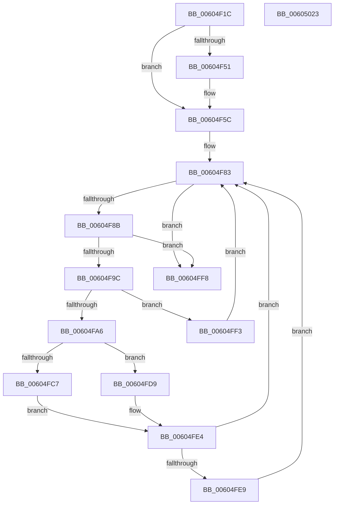

# RtlpHpLfhPrivateSlotListCompact

- RVA: `0x00604F1C`–`0x00605024` (길이 `264` bytes)
- VA: `0x0000000140604F1C`
- 실행 섹션: `.text`
- PDB 이름 있음: `예`; PDB Function 태그: `아니요`
- unwind 정보 RVA: `0x00060284`
- 디코드: `83`개 명령, `264/264` bytes 표시
- 미해석 바이트: `0` (있으면 어셈블리에 `.byte`로 보존)

> 이 문서는 커널 이미지의 기계어와 PDB 기호를 분석해 생성했습니다. 4번과 5번은 함수 원형과 자료형을 바이너리 사용 방식에서 추정한 C 해석이며 원본 소스 복구 결과는 아닙니다.

## 1. Dependencies

- 직접 호출 지점: **7**; 고유 호출 대상: **7**
- 직접 호출자로 확인된 함수: **1**
- RIP 상대 이미지 참조: **0**

### Outgoing calls
- `0x00604F44` → [RtlpHpEnvTlsGetValue](../2E/RtlpHpEnvTlsGetValue_function_002E9850.md) (function, `0x002E9850`)
- `0x00604F54` → [RtlpHpLfhThreadDataInitializeSet](../4F/RtlpHpLfhThreadDataInitializeSet_function_004F6334.md) (function, `0x004F6334`)
- `0x00604F6C` → [RtlpHpAcquireLockExclusive](../32/RtlpHpAcquireLockExclusive_function_003246B0.md) (function, `0x003246B0`)
- `0x00604FB7` → [RtlpHpLfhHeatMapQuery](../2E/RtlpHpLfhHeatMapQuery_function_002E7790.md) (function, `0x002E7790`)
- `0x00604FD0` → [RtlpHpLfhPrivateSlotShutdown](RtlpHpLfhPrivateSlotShutdown_function_0060502C.md) (function, `0x0060502C`)
- `0x00604FDC` → [RtlpHpLfhOwnerCompact](../2E/RtlpHpLfhOwnerCompact_function_002E785C.md) (function, `0x002E785C`)
- `0x00605006` → [RtlpHpReleaseLockExclusive](../32/RtlpHpReleaseLockExclusive_function_00324230.md) (function, `0x00324230`)

### Direct callers
- [RtlpHpLfhPrivateSlotsCompact](RtlpHpLfhPrivateSlotsCompact_function_00605264.md) at `0x006052BB`

### Static image references
- 디코드된 RIP-relative 메모리 참조가 없습니다.

## 2. Other-region calls and transfers

- 다른 실행 섹션으로 향하는 call: **0**
- 별도 외부 분기/꼬리 이동을 확인하지 못했습니다.

## 3. Assembly (complete function range)

```asm
00604F1C  48 89 5C 24 18                  mov qword ptr [rsp + 0x18], rbx
00604F21  55                              push rbp
00604F22  56                              push rsi
00604F23  57                              push rdi
00604F24  41 54                           push r12
00604F26  41 55                           push r13
00604F28  41 56                           push r14
00604F2A  41 57                           push r15
00604F2C  48 83 EC 30                     sub rsp, 0x30
00604F30  48 8B F9                        mov rdi, rcx
00604F33  0F 57 C0                        xorps xmm0, xmm0
00604F36  8B 49 4C                        mov ecx, dword ptr [rcx + 0x4c]
00604F39  49 8B F0                        mov rsi, r8
00604F3C  0F 11 44 24 20                  movups xmmword ptr [rsp + 0x20], xmm0
00604F41  4C 8B F2                        mov r14, rdx
00604F44  E8 07 49 CE FF                  call 0x1402e9850
00604F49  48 8B D8                        mov rbx, rax
00604F4C  48 85 C0                        test rax, rax
00604F4F  75 0B                           jne 0x140604f5c
00604F51  48 8B CF                        mov rcx, rdi
00604F54  E8 DB 13 EF FF                  call 0x1404f6334
00604F59  48 8B D8                        mov rbx, rax
00604F5C  0F B6 57 41                     movzx edx, byte ptr [rdi + 0x41]
00604F60  4D 8D 66 50                     lea r12, [r14 + 0x50]
00604F64  49 8B CC                        mov rcx, r12
00604F67  4C 89 64 24 78                  mov qword ptr [rsp + 0x78], r12
00604F6C  E8 3F F7 D1 FF                  call 0x1403246b0
00604F71  45 0F B7 7E 58                  movzx r15d, word ptr [r14 + 0x58]
00604F76  4D 8D 66 58                     lea r12, [r14 + 0x58]
00604F7A  4C 8B 6C 24 20                  mov r13, qword ptr [rsp + 0x20]
00604F7F  88 44 24 70                     mov byte ptr [rsp + 0x70], al
00604F83  41 0F B7 CF                     movzx ecx, r15w
00604F87  85 C9                           test ecx, ecx
00604F89  74 6D                           je 0x140604ff8
00604F8B  C1 E1 06                        shl ecx, 6
00604F8E  8B E9                           mov ebp, ecx
00604F90  48 03 EF                        add rbp, rdi
00604F93  48 8D 45 10                     lea rax, [rbp + 0x10]
00604F97  49 3B C4                        cmp rax, r12
00604F9A  74 5C                           je 0x140604ff8
00604F9C  44 0F B7 38                     movzx r15d, word ptr [rax]
00604FA0  66 3B 5D 04                     cmp bx, word ptr [rbp + 4]
00604FA4  75 4D                           jne 0x140604ff3
00604FA6  0F B7 55 06                     movzx edx, word ptr [rbp + 6]
00604FAA  4D 8B C6                        mov r8, r14
00604FAD  48 C1 E2 06                     shl rdx, 6
00604FB1  48 8B CF                        mov rcx, rdi
00604FB4  48 03 D7                        add rdx, rdi
00604FB7  E8 D4 27 CE FF                  call 0x1402e7790
00604FBC  48 8B D5                        mov rdx, rbp
00604FBF  48 8B CF                        mov rcx, rdi
00604FC2  83 F8 02                        cmp eax, 2
00604FC5  7D 12                           jge 0x140604fd9
00604FC7  41 B9 01 00 00 00               mov r9d, 1
00604FCD  4C 8B C3                        mov r8, rbx
00604FD0  E8 57 00 00 00                  call 0x14060502c
00604FD5  FF 06                           inc dword ptr [rsi]
00604FD7  EB 0B                           jmp 0x140604fe4
00604FD9  44 8B C0                        mov r8d, eax
00604FDC  E8 7B 28 CE FF                  call 0x1402e785c
00604FE1  FF 46 04                        inc dword ptr [rsi + 4]
00604FE4  4D 85 ED                        test r13, r13
00604FE7  74 9A                           je 0x140604f83
00604FE9  0F 57 C0                        xorps xmm0, xmm0
00604FEC  66 49 0F 7E C5                  movq r13, xmm0
00604FF1  EB 90                           jmp 0x140604f83
00604FF3  FF 46 08                        inc dword ptr [rsi + 8]
00604FF6  EB 8B                           jmp 0x140604f83
00604FF8  0F B6 57 41                     movzx edx, byte ptr [rdi + 0x41]
00604FFC  44 8A 44 24 70                  mov r8b, byte ptr [rsp + 0x70]
00605001  48 8B 4C 24 78                  mov rcx, qword ptr [rsp + 0x78]
00605006  E8 25 F2 D1 FF                  call 0x140324230
0060500B  48 8B 9C 24 80 00 00 00         mov rbx, qword ptr [rsp + 0x80]
00605013  48 83 C4 30                     add rsp, 0x30
00605017  41 5F                           pop r15
00605019  41 5E                           pop r14
0060501B  41 5D                           pop r13
0060501D  41 5C                           pop r12
0060501F  5F                              pop rdi
00605020  5E                              pop rsi
00605021  5D                              pop rbp
00605022  C3                              ret
00605023  CC                              int3
```

## 4. C-style interpretation (structured pseudocode)

```c
__int64 __fastcall RtlpHpLfhPrivateSlotListCompact(__int64 a1, __int64 a2, __int64 a3)
{
    __int64 result;
    __int64 v_rbp;
    __int64 v_rbx;
    __int64 v_rsp;
    unsigned __int64 v_stack_m48;
    unsigned __int64 v_stack_p10;
    unsigned __int64 v_stack_p18;
    unsigned __int8 v_stack_p8;

    v_stack_p18 = v_rbx;
    v_rsp = (v_rsp) - (48);
    v_stack_m48 = v_xmm0;
    result = RtlpHpEnvTlsGetValue((unsigned int)(*(unsigned int *)(a1 + 76)), a2, a3, a4);
    v_rbx = result;
    if (result == 0) {
        a1 = a1;
        result = RtlpHpLfhThreadDataInitializeSet(a1, a2, a3, a4);
        v_rbx = result;
    }
    v_stack_p10 = a2 + 80;
    result = RtlpHpAcquireLockExclusive(a2 + 80, *(unsigned __int8 *)(a1 + 65), a3, a4);
    v_stack_p8 = (unsigned __int8)(result);
loc_00604F83:
    if ((unsigned int)((unsigned __int16)(*(unsigned __int16 *)(a2 + 88))) == 0) goto loc_00604FF8;
    a1 = (unsigned int)(((unsigned __int16)(*(unsigned __int16 *)(a2 + 88))) << (6));
    v_rbp = ((unsigned int)((unsigned int)(a1))) + (a1);
    if ((v_rbp + 16) == (a2 + 88)) goto loc_00604FF8;
    if (((unsigned __int16)(v_rbx)) != (*(unsigned __int16 *)(v_rbp + 4))) goto loc_00604FF3;
    a2 = (*(unsigned __int16 *)(v_rbp + 6)) << (6);
    a2 = (a2) + (a1);
    result = RtlpHpLfhHeatMapQuery(a1, a2, a2, a4);
    if (((unsigned int)(result)) >= 2) goto loc_00604FD9;
    result = RtlpHpLfhPrivateSlotShutdown(a1, v_rbp, v_rbx, 1);
    goto loc_00604FE4;
loc_00604FD9:
    result = RtlpHpLfhOwnerCompact(a1, v_rbp, (unsigned int)((unsigned int)(result)), 1);
loc_00604FE4:
    if (v_stack_m48 == 0) goto loc_00604F83;
    goto loc_00604F83;
loc_00604FF3:
    goto loc_00604F83;
loc_00604FF8:
    result = RtlpHpReleaseLockExclusive(v_stack_p10, *(unsigned __int8 *)(a1 + 65), v_stack_p8, 1);
    v_rsp = (v_rsp) + (48);
    return result;
}
```

## 5. (Beta) C Style

```c
int64_t RtlpHpLfhPrivateSlotListCompact(void *Arg1, void *Arg2, void *Arg3)
{
    uint8_t *arg1 = (uint8_t *)Arg1;
    uint8_t *arg2 = (uint8_t *)Arg2;
    uint8_t *arg3 = (uint8_t *)Arg3;

    int64_t result;
    int64_t local_rbp;
    int64_t local_rbx;
    int64_t local_rsp;
    uint64_t v_stack_m48;
    uint64_t v_stack_p10;
    uint64_t v_stack_p18;
    uint8_t v_stack_p8;

    v_stack_p18 = local_rbx;
    local_rsp = (local_rsp) - (48);
    v_stack_m48 = v_xmm0;
    result = RtlpHpEnvTlsGetValue((uint32_t)(*(uint32_t *)(arg1 + 0x4C)), Arg2, Arg3, a4);
    local_rbx = result;
    if (result == 0) {
        Arg1 = Arg1;
        result = RtlpHpLfhThreadDataInitializeSet(Arg1, Arg2, Arg3, a4);
        local_rbx = result;
    }
    v_stack_p10 = Arg2 + 80;
    result = RtlpHpAcquireLockExclusive(Arg2 + 80, *(uint8_t *)(arg1 + 0x41), Arg3, a4);
    v_stack_p8 = (uint8_t)(result);
loc_00604F83:
    if ((uint32_t)((uint16_t)(*(uint16_t *)(arg2 + 0x58))) == 0) goto loc_00604FF8;
    Arg1 = (uint32_t)(((uint16_t)(*(uint16_t *)(arg2 + 0x58))) << (6));
    local_rbp = ((uint32_t)((uint32_t)(Arg1))) + (Arg1);
    if ((local_rbp + 16) == (Arg2 + 88)) goto loc_00604FF8;
    if (((uint16_t)(local_rbx)) != (*(uint16_t *)(local_rbp + 0x4))) goto loc_00604FF3;
    Arg2 = (*(uint16_t *)(local_rbp + 0x6)) << (6);
    Arg2 = (Arg2) + (Arg1);
    result = RtlpHpLfhHeatMapQuery(Arg1, Arg2, Arg2, a4);
    if (((uint32_t)(result)) >= 2) goto loc_00604FD9;
    result = RtlpHpLfhPrivateSlotShutdown(Arg1, local_rbp, local_rbx, 1);
    goto loc_00604FE4;
loc_00604FD9:
    result = RtlpHpLfhOwnerCompact(Arg1, local_rbp, (uint32_t)((uint32_t)(result)), 1);
loc_00604FE4:
    if (v_stack_m48 == 0) goto loc_00604F83;
    goto loc_00604F83;
loc_00604FF3:
    goto loc_00604F83;
loc_00604FF8:
    result = RtlpHpReleaseLockExclusive(v_stack_p10, *(uint8_t *)(arg1 + 0x41), v_stack_p8, 1);
    local_rsp = (local_rsp) + (48);
    return result;
}
```

### 관측된 메모리 오프셋

구조체 형식이 확인되지 않은 접근은 인자 기준의 오프셋으로만 기록했습니다.

| 기준 인자 | 오프셋 표현 | 폭 (bit) | 접근 |
|---|---:|---:|---|
| `Arg1` | `+ 0x41` | `8` | `R` |
| `Arg1` | `+ 0x4C` | `32` | `R` |
| `Arg2` | `+ 0x50` | `64` | `R` |
| `Arg2` | `+ 0x58` | `16` | `R` |
| `Arg2` | `+ 0x58` | `64` | `R` |
| `Arg3` | `+ 0x0` | `32` | `R/W` |
| `Arg3` | `+ 0x4` | `32` | `R/W` |
| `Arg3` | `+ 0x8` | `32` | `R/W` |

## 6. Execution-region graph

[열기: 2D/3D 그래프와 함수 탐색 컨트롤 패널](../../../control-panel.html?section=text&rva=0x00604F1C&view=graph)

- 2D 그래프는 위에서 아래로 흐르고, 3D 그래프는 빈 공간을 드래그해 회전합니다. Shift+드래그는 이동, 휠은 확대·축소, 함수 노드 선택은 대상 보고서 이동입니다.

### Static fallback


