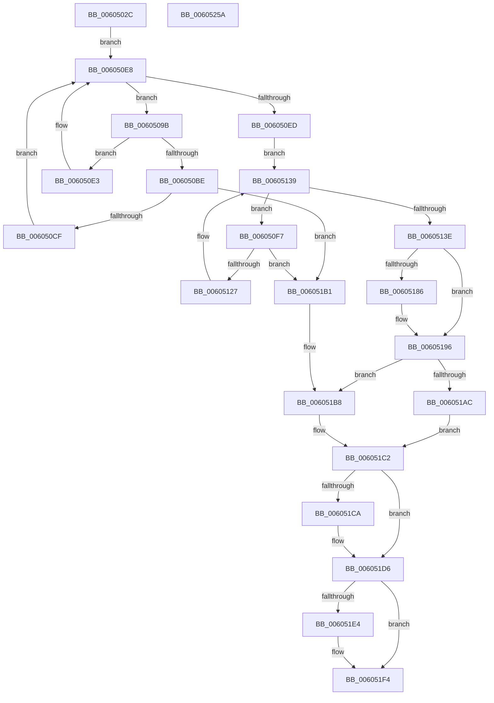

# RtlpHpLfhPrivateSlotShutdown

- RVA: `0x0060502C`–`0x0060525B` (길이 `559` bytes)
- VA: `0x000000014060502C`
- 실행 섹션: `.text`
- PDB 이름 있음: `예`; PDB Function 태그: `아니요`
- unwind 정보 RVA: `0x000D05C8`
- 디코드: `158`개 명령, `559/559` bytes 표시
- 미해석 바이트: `0` (있으면 어셈블리에 `.byte`로 보존)

> 이 문서는 커널 이미지의 기계어와 PDB 기호를 분석해 생성했습니다. 4번과 5번은 함수 원형과 자료형을 바이너리 사용 방식에서 추정한 C 해석이며 원본 소스 복구 결과는 아닙니다.

## 1. Dependencies

- 직접 호출 지점: **9**; 고유 호출 대상: **8**
- 직접 호출자로 확인된 함수: **3**
- RIP 상대 이미지 참조: **0**

### Outgoing calls
- `0x00605075` → [RtlpHpLfhSlotActiveSubsegmentReset](../47/RtlpHpLfhSlotActiveSubsegmentReset_function_00471A1C.md) (function, `0x00471A1C`)
- `0x0060508A` → [RtlpHpLfhOwnerRunMaintenance](../2E/RtlpHpLfhOwnerRunMaintenance_function_002E8980.md) (function, `0x002E8980`)
- `0x006050B5` → [RtlpHpLfhOwnerMoveSubsegment](../2E/RtlpHpLfhOwnerMoveSubsegment_function_002E85CC.md) (function, `0x002E85CC`)
- `0x00605111` → [RtlpHpLfhOwnerMoveSubsegment](../2E/RtlpHpLfhOwnerMoveSubsegment_function_002E85CC.md) (function, `0x002E85CC`)
- `0x00605153` → [RtlpHpLfhHeatMapQuery](../2E/RtlpHpLfhHeatMapQuery_function_002E7790.md) (function, `0x002E7790`)
- `0x00605179` → [RtlpHpLfhBucketAddSubsegment](../2E/RtlpHpLfhBucketAddSubsegment_function_002E8CD8.md) (function, `0x002E8CD8`)
- `0x0060518E` → [RtlpHpAcquireLockExclusive](../32/RtlpHpAcquireLockExclusive_function_003246B0.md) (function, `0x003246B0`)
- `0x006051EF` → [RtlpHpReleaseLockExclusive](../32/RtlpHpReleaseLockExclusive_function_00324230.md) (function, `0x00324230`)
- `0x0060520E` → [RtlpHpLfhContextMetadataFree](RtlpHpLfhContextMetadataFree_function_00604B04.md) (function, `0x00604B04`)

### Direct callers
- [RtlpHpLfhSlotAllocateSlow](../2E/RtlpHpLfhSlotAllocateSlow_function_002E8FBC.md) at `0x002E97B8`
- [RtlpHpLfhContextTlsCleanup](RtlpHpLfhContextTlsCleanup_function_00604B60.md) at `0x00604BE3`
- [RtlpHpLfhPrivateSlotListCompact](RtlpHpLfhPrivateSlotListCompact_function_00604F1C.md) at `0x00604FD0`

### Static image references
- 디코드된 RIP-relative 메모리 참조가 없습니다.

## 2. Other-region calls and transfers

- 다른 실행 섹션으로 향하는 call: **0**
- 별도 외부 분기/꼬리 이동을 확인하지 못했습니다.

## 3. Assembly (complete function range)

```asm
0060502C  48 89 5C 24 08                  mov qword ptr [rsp + 8], rbx
00605031  44 89 4C 24 20                  mov dword ptr [rsp + 0x20], r9d
00605036  4C 89 44 24 18                  mov qword ptr [rsp + 0x18], r8
0060503B  55                              push rbp
0060503C  56                              push rsi
0060503D  57                              push rdi
0060503E  41 54                           push r12
00605040  41 55                           push r13
00605042  41 56                           push r14
00605044  41 57                           push r15
00605046  48 8B EC                        mov rbp, rsp
00605049  48 83 EC 40                     sub rsp, 0x40
0060504D  44 0F B7 6A 02                  movzx r13d, word ptr [rdx + 2]
00605052  48 8D 45 F0                     lea rax, [rbp - 0x10]
00605056  48 89 45 F8                     mov qword ptr [rbp - 8], rax
0060505A  48 8B F9                        mov rdi, rcx
0060505D  48 8D 45 F0                     lea rax, [rbp - 0x10]
00605061  49 C1 E5 06                     shl r13, 6
00605065  4C 03 E9                        add r13, rcx
00605068  48 89 45 F0                     mov qword ptr [rbp - 0x10], rax
0060506C  48 8B CA                        mov rcx, rdx
0060506F  49 8B D8                        mov rbx, r8
00605072  4C 8B FA                        mov r15, rdx
00605075  E8 A2 C9 E6 FF                  call 0x140471a1c
0060507A  4C 8D 45 F0                     lea r8, [rbp - 0x10]
0060507E  49 8B D7                        mov rdx, r15
00605081  48 8B CF                        mov rcx, rdi
00605084  41 B9 02 00 00 00               mov r9d, 2
0060508A  E8 F1 38 CE FF                  call 0x1402e8980
0060508F  4D 8D 67 28                     lea r12, [r15 + 0x28]
00605093  33 F6                           xor esi, esi
00605095  4D 8B 34 24                     mov r14, qword ptr [r12]
00605099  EB 4D                           jmp 0x1406050e8
0060509B  4D 8B C6                        mov r8, r14
0060509E  C7 44 24 20 03 00 00 00         mov dword ptr [rsp + 0x20], 3
006050A6  4D 8B 36                        mov r14, qword ptr [r14]
006050A9  41 B9 03 00 00 00               mov r9d, 3
006050AF  49 8B D7                        mov rdx, r15
006050B2  48 8B CF                        mov rcx, rdi
006050B5  E8 12 35 CE FF                  call 0x1402e85cc
006050BA  85 C0                           test eax, eax
006050BC  74 25                           je 0x1406050e3
006050BE  48 8B 45 F8                     mov rax, qword ptr [rbp - 8]
006050C2  48 8D 4D F0                     lea rcx, [rbp - 0x10]
006050C6  48 39 08                        cmp qword ptr [rax], rcx
006050C9  0F 85 E2 00 00 00               jne 0x1406051b1
006050CF  49 89 40 08                     mov qword ptr [r8 + 8], rax
006050D3  48 8D 4D F0                     lea rcx, [rbp - 0x10]
006050D7  49 89 08                        mov qword ptr [r8], rcx
006050DA  4C 89 00                        mov qword ptr [rax], r8
006050DD  4C 89 45 F8                     mov qword ptr [rbp - 8], r8
006050E1  EB 05                           jmp 0x1406050e8
006050E3  66 41 89 70 2E                  mov word ptr [r8 + 0x2e], si
006050E8  4D 3B F4                        cmp r14, r12
006050EB  75 AE                           jne 0x14060509b
006050ED  4D 8D 67 18                     lea r12, [r15 + 0x18]
006050F1  4D 8B 34 24                     mov r14, qword ptr [r12]
006050F5  EB 42                           jmp 0x140605139
006050F7  4D 8B C6                        mov r8, r14
006050FA  C7 44 24 20 02 00 00 00         mov dword ptr [rsp + 0x20], 2
00605102  4D 8B 36                        mov r14, qword ptr [r14]
00605105  41 B9 03 00 00 00               mov r9d, 3
0060510B  49 8B D7                        mov rdx, r15
0060510E  48 8B CF                        mov rcx, rdi
00605111  E8 B6 34 CE FF                  call 0x1402e85cc
00605116  48 8B 45 F8                     mov rax, qword ptr [rbp - 8]
0060511A  48 8D 4D F0                     lea rcx, [rbp - 0x10]
0060511E  48 39 08                        cmp qword ptr [rax], rcx
00605121  0F 85 8A 00 00 00               jne 0x1406051b1
00605127  49 89 40 08                     mov qword ptr [r8 + 8], rax
0060512B  48 8D 4D F0                     lea rcx, [rbp - 0x10]
0060512F  49 89 08                        mov qword ptr [r8], rcx
00605132  4C 89 00                        mov qword ptr [rax], r8
00605135  4C 89 45 F8                     mov qword ptr [rbp - 8], r8
00605139  4D 3B F4                        cmp r14, r12
0060513C  75 B9                           jne 0x1406050f7
0060513E  44 8B 75 58                     mov r14d, dword ptr [rbp + 0x58]
00605142  48 8D 97 C0 00 00 00            lea rdx, [rdi + 0xc0]
00605149  4D 8B C5                        mov r8, r13
0060514C  48 8B CF                        mov rcx, rdi
0060514F  41 83 E6 01                     and r14d, 1
00605153  E8 38 26 CE FF                  call 0x1402e7790
00605158  B9 04 00 00 00                  mov ecx, 4
0060515D  4C 8D 45 F0                     lea r8, [rbp - 0x10]
00605161  83 F8 01                        cmp eax, 1
00605164  49 8B D5                        mov rdx, r13
00605167  43 8D 04 36                     lea eax, [r14 + r14]
0060516B  44 8D 49 04                     lea r9d, [rcx + 4]
0060516F  44 0F 4C C9                     cmovl r9d, ecx
00605173  48 8B CF                        mov rcx, rdi
00605176  44 0B C8                        or r9d, eax
00605179  E8 5A 3B CE FF                  call 0x1402e8cd8
0060517E  44 8A D6                        mov r10b, sil
00605181  45 85 F6                        test r14d, r14d
00605184  75 10                           jne 0x140605196
00605186  0F B6 57 41                     movzx edx, byte ptr [rdi + 0x41]
0060518A  49 8D 4D 50                     lea rcx, [r13 + 0x50]
0060518E  E8 1D F5 D1 FF                  call 0x1403246b0
00605193  44 8A D0                        mov r10b, al
00605196  45 0F B7 4F 10                  movzx r9d, word ptr [r15 + 0x10]
0060519B  49 8D 55 58                     lea rdx, [r13 + 0x58]
0060519F  45 0F B7 47 12                  movzx r8d, word ptr [r15 + 0x12]
006051A4  41 8B C9                        mov ecx, r9d
006051A7  45 85 C9                        test r9d, r9d
006051AA  75 0C                           jne 0x1406051b8
006051AC  48 8B CA                        mov rcx, rdx
006051AF  EB 11                           jmp 0x1406051c2
006051B1  B9 03 00 00 00                  mov ecx, 3
006051B6  CD 29                           int 0x29
006051B8  C1 E1 06                        shl ecx, 6
006051BB  48 83 C1 10                     add rcx, 0x10
006051BF  48 03 CF                        add rcx, rdi
006051C2  41 8B C0                        mov eax, r8d
006051C5  45 85 C0                        test r8d, r8d
006051C8  74 0C                           je 0x1406051d6
006051CA  C1 E0 06                        shl eax, 6
006051CD  8B D0                           mov edx, eax
006051CF  48 83 C2 10                     add rdx, 0x10
006051D3  48 03 D7                        add rdx, rdi
006051D6  66 44 89 0A                     mov word ptr [rdx], r9w
006051DA  66 44 89 41 02                  mov word ptr [rcx + 2], r8w
006051DF  45 85 F6                        test r14d, r14d
006051E2  75 10                           jne 0x1406051f4
006051E4  0F B6 57 41                     movzx edx, byte ptr [rdi + 0x41]
006051E8  49 8D 4D 50                     lea rcx, [r13 + 0x50]
006051EC  45 8A C2                        mov r8b, r10b
006051EF  E8 3C F0 D1 FF                  call 0x140324230
006051F4  49 8D 47 28                     lea rax, [r15 + 0x28]
006051F8  41 C6 47 01 FF                  mov byte ptr [r15 + 1], 0xff
006051FD  48 39 00                        cmp qword ptr [rax], rax
00605200  49 8B D7                        mov rdx, r15
00605203  48 8B CF                        mov rcx, rdi
00605206  40 0F 95 C6                     setne sil
0060520A  44 8D 46 02                     lea r8d, [rsi + 2]
0060520E  E8 F1 F8 FF FF                  call 0x140604b04
00605213  41 0F B6 4D 00                  movzx ecx, byte ptr [r13]
00605218  0F B6 45 54                     movzx eax, byte ptr [rbp + 0x54]
0060521C  48 C1 E0 07                     shl rax, 7
00605220  48 D1 E9                        shr rcx, 1
00605223  0F B7 D3                        movzx edx, bx
00605226  48 03 C1                        add rax, rcx
00605229  48 8B 9C 24 80 00 00 00         mov rbx, qword ptr [rsp + 0x80]
00605231  C1 E2 06                        shl edx, 6
00605234  48 03 D7                        add rdx, rdi
00605237  0F B7 84 47 C0 05 00 00         movzx eax, word ptr [rdi + rax*2 + 0x5c0]
0060523F  66 89 04 4A                     mov word ptr [rdx + rcx*2], ax
00605243  48 C1 E0 06                     shl rax, 6
00605247  48 03 C7                        add rax, rdi
0060524A  48 83 C4 40                     add rsp, 0x40
0060524E  41 5F                           pop r15
00605250  41 5E                           pop r14
00605252  41 5D                           pop r13
00605254  41 5C                           pop r12
00605256  5F                              pop rdi
00605257  5E                              pop rsi
00605258  5D                              pop rbp
00605259  C3                              ret
0060525A  CC                              int3
```

## 4. C-style interpretation (structured pseudocode)

```c
__int64 __fastcall RtlpHpLfhPrivateSlotShutdown(__int64 a1, __int64 a2, __int64 a3, int a4)
{
    __int64 result;
    __int64 v_r10;
    __int64 v_r13;
    __int64 v_r14;
    __int64 v_rsi;
    __int64 v_rsp;
    unsigned __int64 v_stack_m40;
    unsigned __int64 v_stack_m48;
    unsigned int v_stack_m58;
    unsigned __int64 v_stack_p18;
    unsigned __int8 v_stack_p1C;
    unsigned int v_stack_p20;
    unsigned __int64 v_stack_p8;

    v_stack_p8 = v_rbx;
    v_stack_p20 = a4;
    v_stack_p18 = a3;
    v_rsp = (v_rsp) - (64);
    v_stack_m40 = v_stack_m48;
    v_r13 = (*(unsigned __int16 *)(a2 + 2)) << (6);
    v_r13 = (v_r13) + (a1);
    v_stack_m48 = v_stack_m48;
    result = RtlpHpLfhSlotActiveSubsegmentReset(a2, a2, a3, a4);
    result = RtlpHpLfhOwnerRunMaintenance(a1, a2, v_stack_m48, 2);
    v_rsi = 0;
    goto loc_006050E8;
loc_0060509B:
    v_stack_m58 = 3;
    result = RtlpHpLfhOwnerMoveSubsegment(a1, a2, *(unsigned __int64 *)(a2 + 40), 3);
    if ((unsigned int)(result) == 0) goto loc_006050E3;
    if ((*(unsigned __int64 *)(v_stack_m40)) != v_stack_m48) goto loc_006051B1;
    *(unsigned __int64 *)(*(unsigned __int64 *)(a2 + 40) + 8) = v_stack_m40;
    *(unsigned __int64 *)(*(unsigned __int64 *)(a2 + 40)) = v_stack_m48;
    *(unsigned __int64 *)(v_stack_m40) = *(unsigned __int64 *)(a2 + 40);
    v_stack_m40 = *(unsigned __int64 *)(a2 + 40);
    goto loc_006050E8;
loc_006050E3:
    *(unsigned __int16 *)(*(unsigned __int64 *)(a2 + 40) + 46) = 0;
loc_006050E8:
    if ((*(unsigned __int64 *)(*(unsigned __int64 *)(a2 + 40))) != (a2 + 40)) goto loc_0060509B;
    goto loc_00605139;
loc_006050F7:
    v_stack_m58 = 2;
    result = RtlpHpLfhOwnerMoveSubsegment(a1, a2, *(unsigned __int64 *)(a2 + 24), 3);
    if ((*(unsigned __int64 *)(v_stack_m40)) != v_stack_m48) goto loc_006051B1;
    *(unsigned __int64 *)(*(unsigned __int64 *)(a2 + 24) + 8) = v_stack_m40;
    *(unsigned __int64 *)(*(unsigned __int64 *)(a2 + 24)) = v_stack_m48;
    *(unsigned __int64 *)(v_stack_m40) = *(unsigned __int64 *)(a2 + 24);
    v_stack_m40 = *(unsigned __int64 *)(a2 + 24);
loc_00605139:
    if ((*(unsigned __int64 *)(*(unsigned __int64 *)(a2 + 24))) != (a2 + 24)) goto loc_006050F7;
    v_r14 = (unsigned int)(((unsigned int)(v_stack_p20)) & (1));
    result = RtlpHpLfhHeatMapQuery(a1, a1 + 192, v_r13, 3);
    a4 = 4 + 4;
    if (((unsigned int)(result)) < 1) { a4 = 4; }
    a4 = (unsigned int)((a4) | ((unsigned int)(v_r14 + v_r14 * 1)));
    result = RtlpHpLfhBucketAddSubsegment(a1, v_r13, v_stack_m48, a4);
    v_r10 = 0;
    if ((unsigned int)(v_r14) == 0) {
        a2 = *(unsigned __int8 *)(a1 + 65);
        a1 = v_r13 + 80;
        result = RtlpHpAcquireLockExclusive(a1, a2, v_stack_m48, a4);
        v_r10 = (unsigned __int8)(result);
    }
    if ((unsigned int)(*(unsigned __int16 *)(a2 + 16)) != 0) goto loc_006051B8;
    goto loc_006051C2;
loc_006051B1:
loc_006051B8:
    a1 = (unsigned int)((3) << (6));
    a1 = (a1) + (16);
    a1 = (a1) + (a1);
loc_006051C2:
    result = (unsigned int)((unsigned int)(*(unsigned __int16 *)(a2 + 18)));
    if ((unsigned int)(*(unsigned __int16 *)(a2 + 18)) != 0) {
        result = (unsigned int)(((unsigned int)((unsigned int)(*(unsigned __int16 *)(a2 + 18)))) << (6));
        a2 = (unsigned int)(result);
        a2 = (a2) + (16);
        a2 = (a2) + (a1);
    }
    *(unsigned __int16 *)(a2) = (unsigned __int16)(*(unsigned __int16 *)(a2 + 16));
    *(unsigned __int16 *)(a1 + 2) = (unsigned __int16)(*(unsigned __int16 *)(a2 + 18));
    if ((unsigned int)(v_r14) == 0) {
        a2 = *(unsigned __int8 *)(a1 + 65);
        a1 = v_r13 + 80;
        a3 = (unsigned __int8)(v_r10);
        result = RtlpHpReleaseLockExclusive(a1, a2, a3, *(unsigned __int16 *)(a2 + 16));
    }
    *(unsigned __int8 *)(a2 + 1) = 255;
    v_rsi = ((*(unsigned __int64 *)(a2 + 40)) != (a2 + 40)) ? 1 : 0;
    result = RtlpHpLfhContextMetadataFree(a1, a2, v_rsi + 2, *(unsigned __int16 *)(a2 + 16));
    result = (v_stack_p1C) << (7);
    a1 = (*(unsigned __int8 *)(v_r13)) >> (1);
    result = (result) + (a1);
    a2 = (unsigned int)(((unsigned __int16)(a3)) << (6));
    a2 = (a2) + (a1);
    *(unsigned __int16 *)(a2 + a1 * 2) = (unsigned __int16)(*(unsigned __int16 *)(a1 + result * 2 + 1472));
    result = (*(unsigned __int16 *)(a1 + result * 2 + 1472)) << (6);
    result = (result) + (a1);
    v_rsp = (v_rsp) + (64);
    return result;
}
```

## 5. (Beta) C Style

```c
int64_t RtlpHpLfhPrivateSlotShutdown(void *Arg1, void *Arg2, int64_t Arg3, int32_t Arg4)
{
    uint8_t *arg1 = (uint8_t *)Arg1;
    uint8_t *arg2 = (uint8_t *)Arg2;

    int64_t result;
    int64_t local_r10;
    int64_t local_r13;
    int64_t local_r14;
    int64_t local_rsi;
    int64_t local_rsp;
    uint64_t v_stack_m40;
    uint64_t v_stack_m48;
    uint32_t v_stack_m58;
    uint64_t v_stack_p18;
    uint8_t v_stack_p1C;
    uint32_t v_stack_p20;
    uint64_t v_stack_p8;

    v_stack_p8 = local_rbx;
    v_stack_p20 = Arg4;
    v_stack_p18 = Arg3;
    local_rsp = (local_rsp) - (64);
    v_stack_m40 = v_stack_m48;
    local_r13 = (*(uint16_t *)(arg2 + 0x2)) << (6);
    local_r13 = (local_r13) + (Arg1);
    v_stack_m48 = v_stack_m48;
    result = RtlpHpLfhSlotActiveSubsegmentReset(Arg2, Arg2, Arg3, Arg4);
    result = RtlpHpLfhOwnerRunMaintenance(Arg1, Arg2, v_stack_m48, 2);
    local_rsi = 0;
    goto loc_006050E8;
loc_0060509B:
    v_stack_m58 = 3;
    result = RtlpHpLfhOwnerMoveSubsegment(Arg1, Arg2, *(uint64_t *)(arg2 + 0x28), 3);
    if ((uint32_t)(result) == 0) goto loc_006050E3;
    if ((*(uint64_t *)(v_stack_m40)) != v_stack_m48) goto loc_006051B1;
    *(uint64_t *)(*(uint64_t *)(arg2 + 0x28) + 0x8) = v_stack_m40;
    *(uint64_t *)(*(uint64_t *)(arg2 + 0x28)) = v_stack_m48;
    *(uint64_t *)(v_stack_m40) = *(uint64_t *)(arg2 + 0x28);
    v_stack_m40 = *(uint64_t *)(arg2 + 0x28);
    goto loc_006050E8;
loc_006050E3:
    *(uint16_t *)(*(uint64_t *)(arg2 + 0x28) + 0x2E) = 0;
loc_006050E8:
    if ((*(uint64_t *)(*(uint64_t *)(arg2 + 0x28))) != (Arg2 + 40)) goto loc_0060509B;
    goto loc_00605139;
loc_006050F7:
    v_stack_m58 = 2;
    result = RtlpHpLfhOwnerMoveSubsegment(Arg1, Arg2, *(uint64_t *)(arg2 + 0x18), 3);
    if ((*(uint64_t *)(v_stack_m40)) != v_stack_m48) goto loc_006051B1;
    *(uint64_t *)(*(uint64_t *)(arg2 + 0x18) + 0x8) = v_stack_m40;
    *(uint64_t *)(*(uint64_t *)(arg2 + 0x18)) = v_stack_m48;
    *(uint64_t *)(v_stack_m40) = *(uint64_t *)(arg2 + 0x18);
    v_stack_m40 = *(uint64_t *)(arg2 + 0x18);
loc_00605139:
    if ((*(uint64_t *)(*(uint64_t *)(arg2 + 0x18))) != (Arg2 + 24)) goto loc_006050F7;
    local_r14 = (uint32_t)(((uint32_t)(v_stack_p20)) & (1));
    result = RtlpHpLfhHeatMapQuery(Arg1, Arg1 + 192, local_r13, 3);
    Arg4 = 4 + 4;
    if (((uint32_t)(result)) < 1) { Arg4 = 4; }
    Arg4 = (uint32_t)((Arg4) | ((uint32_t)(local_r14 + local_r14 * 1)));
    result = RtlpHpLfhBucketAddSubsegment(Arg1, local_r13, v_stack_m48, Arg4);
    local_r10 = 0;
    if ((uint32_t)(local_r14) == 0) {
        Arg2 = *(uint8_t *)(arg1 + 0x41);
        Arg1 = local_r13 + 80;
        result = RtlpHpAcquireLockExclusive(Arg1, Arg2, v_stack_m48, Arg4);
        local_r10 = (uint8_t)(result);
    }
    if ((uint32_t)(*(uint16_t *)(arg2 + 0x10)) != 0) goto loc_006051B8;
    goto loc_006051C2;
loc_006051B1:
loc_006051B8:
    Arg1 = (uint32_t)((3) << (6));
    Arg1 = (Arg1) + (16);
    Arg1 = (Arg1) + (Arg1);
loc_006051C2:
    result = (uint32_t)((uint32_t)(*(uint16_t *)(arg2 + 0x12)));
    if ((uint32_t)(*(uint16_t *)(arg2 + 0x12)) != 0) {
        result = (uint32_t)(((uint32_t)((uint32_t)(*(uint16_t *)(arg2 + 0x12)))) << (6));
        Arg2 = (uint32_t)(result);
        Arg2 = (Arg2) + (16);
        Arg2 = (Arg2) + (Arg1);
    }
    *(uint16_t *)(arg2) = (uint16_t)(*(uint16_t *)(arg2 + 0x10));
    *(uint16_t *)(arg1 + 0x2) = (uint16_t)(*(uint16_t *)(arg2 + 0x12));
    if ((uint32_t)(local_r14) == 0) {
        Arg2 = *(uint8_t *)(arg1 + 0x41);
        Arg1 = local_r13 + 80;
        Arg3 = (uint8_t)(local_r10);
        result = RtlpHpReleaseLockExclusive(Arg1, Arg2, Arg3, *(uint16_t *)(arg2 + 0x10));
    }
    *(uint8_t *)(arg2 + 0x1) = 255;
    local_rsi = ((*(uint64_t *)(arg2 + 0x28)) != (Arg2 + 40)) ? 1 : 0;
    result = RtlpHpLfhContextMetadataFree(Arg1, Arg2, local_rsi + 2, *(uint16_t *)(arg2 + 0x10));
    result = (v_stack_p1C) << (7);
    Arg1 = (*(uint8_t *)(local_r13)) >> (1);
    result = (result) + (Arg1);
    Arg2 = (uint32_t)(((uint16_t)(Arg3)) << (6));
    Arg2 = (Arg2) + (Arg1);
    *(uint16_t *)(arg2 + arg1 * 2) = (uint16_t)(*(uint16_t *)(arg1 + result * 2 + 0x5C0));
    result = (*(uint16_t *)(arg1 + result * 2 + 0x5C0)) << (6);
    result = (result) + (Arg1);
    local_rsp = (local_rsp) + (64);
    return result;
}
```

### 관측된 메모리 오프셋

구조체 형식이 확인되지 않은 접근은 인자 기준의 오프셋으로만 기록했습니다.

| 기준 인자 | 오프셋 표현 | 폭 (bit) | 접근 |
|---|---:|---:|---|
| `Arg1` | `+ 0x41` | `8` | `R` |
| `Arg1` | `+ 0xC0` | `64` | `R` |
| `Arg1` | `+ 0x5C0 + rax*2` | `16` | `R` |
| `Arg2` | `+ 0x0` | `64` | `R` |
| `Arg2` | `+ 0x1` | `8` | `W` |
| `Arg2` | `+ 0x2` | `16` | `R` |
| `Arg2` | `+ 0x10` | `16` | `R` |
| `Arg2` | `+ 0x12` | `16` | `R` |
| `Arg2` | `+ 0x18` | `64` | `R` |
| `Arg2` | `+ 0x28` | `64` | `R` |

## 6. Execution-region graph

[열기: 2D/3D 그래프와 함수 탐색 컨트롤 패널](../../../control-panel.html?section=text&rva=0x0060502C&view=graph)

- 2D 그래프는 위에서 아래로 흐르고, 3D 그래프는 빈 공간을 드래그해 회전합니다. Shift+드래그는 이동, 휠은 확대·축소, 함수 노드 선택은 대상 보고서 이동입니다.

### Static fallback


