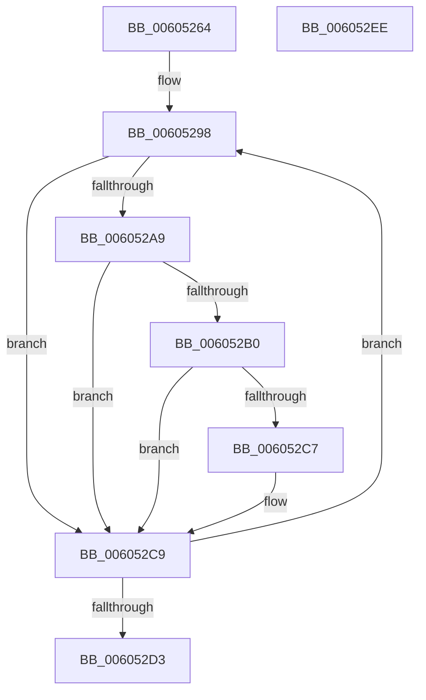

# RtlpHpLfhPrivateSlotsCompact

- RVA: `0x00605264`–`0x006052EF` (길이 `139` bytes)
- VA: `0x0000000140605264`
- 실행 섹션: `.text`
- PDB 이름 있음: `예`; PDB Function 태그: `아니요`
- unwind 정보 RVA: `0x00084C9C`
- 디코드: `43`개 명령, `139/139` bytes 표시
- 미해석 바이트: `0` (있으면 어셈블리에 `.byte`로 보존)

> 이 문서는 커널 이미지의 기계어와 PDB 기호를 분석해 생성했습니다. 4번과 5번은 함수 원형과 자료형을 바이너리 사용 방식에서 추정한 C 해석이며 원본 소스 복구 결과는 아닙니다.

## 1. Dependencies

- 직접 호출 지점: **1**; 고유 호출 대상: **1**
- 직접 호출자로 확인된 함수: **1**
- RIP 상대 이미지 참조: **0**

### Outgoing calls
- `0x006052BB` → [RtlpHpLfhPrivateSlotListCompact](RtlpHpLfhPrivateSlotListCompact_function_00604F1C.md) (function, `0x00604F1C`)

### Direct callers
- [RtlpHpLfhContextCompact](../2E/RtlpHpLfhContextCompact_function_002E769C.md) at `0x002E777B`

### Static image references
- 디코드된 RIP-relative 메모리 참조가 없습니다.

## 2. Other-region calls and transfers

- 다른 실행 섹션으로 향하는 call: **0**
- 별도 외부 분기/꼬리 이동을 확인하지 못했습니다.

## 3. Assembly (complete function range)

```asm
00605264  48 8B C4                        mov rax, rsp
00605267  48 89 58 08                     mov qword ptr [rax + 8], rbx
0060526B  48 89 68 10                     mov qword ptr [rax + 0x10], rbp
0060526F  48 89 70 18                     mov qword ptr [rax + 0x18], rsi
00605273  57                              push rdi
00605274  41 56                           push r14
00605276  41 57                           push r15
00605278  48 83 EC 30                     sub rsp, 0x30
0060527C  0F 57 C0                        xorps xmm0, xmm0
0060527F  48 8D B1 C0 01 00 00            lea rsi, [rcx + 0x1c0]
00605286  45 33 FF                        xor r15d, r15d
00605289  4C 8B F1                        mov r14, rcx
0060528C  0F 11 40 D8                     movups xmmword ptr [rax - 0x28], xmm0
00605290  41 8B DF                        mov ebx, r15d
00605293  BD 80 00 00 00                  mov ebp, 0x80
00605298  48 8B 06                        mov rax, qword ptr [rsi]
0060529B  49 8B FF                        mov rdi, r15
0060529E  A8 01                           test al, 1
006052A0  48 0F 44 F8                     cmove rdi, rax
006052A4  48 85 FF                        test rdi, rdi
006052A7  74 20                           je 0x1406052c9
006052A9  66 44 39 7F 58                  cmp word ptr [rdi + 0x58], r15w
006052AE  74 19                           je 0x1406052c9
006052B0  4C 8D 44 24 20                  lea r8, [rsp + 0x20]
006052B5  48 8B D7                        mov rdx, rdi
006052B8  49 8B CE                        mov rcx, r14
006052BB  E8 5C FC FF FF                  call 0x140604f1c
006052C0  66 44 39 7F 58                  cmp word ptr [rdi + 0x58], r15w
006052C5  74 02                           je 0x1406052c9
006052C7  FF C3                           inc ebx
006052C9  48 83 C6 08                     add rsi, 8
006052CD  48 83 ED 01                     sub rbp, 1
006052D1  75 C5                           jne 0x140605298
006052D3  48 8B 6C 24 58                  mov rbp, qword ptr [rsp + 0x58]
006052D8  8B C3                           mov eax, ebx
006052DA  48 8B 5C 24 50                  mov rbx, qword ptr [rsp + 0x50]
006052DF  48 8B 74 24 60                  mov rsi, qword ptr [rsp + 0x60]
006052E4  48 83 C4 30                     add rsp, 0x30
006052E8  41 5F                           pop r15
006052EA  41 5E                           pop r14
006052EC  5F                              pop rdi
006052ED  C3                              ret
006052EE  CC                              int3
```

## 4. C-style interpretation (structured pseudocode)

```c
__int64 __fastcall RtlpHpLfhPrivateSlotsCompact(__int64 a1)
{
    __int64 result;
    __int64 v_r15;
    __int64 v_rbp;
    __int64 v_rbx;
    __int64 v_rdi;
    __int64 v_rsi;
    __int64 v_rsp;
    unsigned __int64 v_stack_m28;
    unsigned __int64 v_stack_p10;
    unsigned __int64 v_stack_p18;
    unsigned __int64 v_stack_p8;

    *(unsigned __int64 *)(v_rsp + 8) = v_rbx;
    *(unsigned __int64 *)(v_rsp + 16) = v_rbp;
    *(unsigned __int64 *)(v_rsp + 24) = v_rsi;
    v_rsp = (v_rsp) - (48);
    v_r15 = 0;
    *(unsigned __int64 *)(v_rsp - 40) = v_xmm0;
loc_00605298:
    v_rdi = 0;
    if ((((unsigned __int8)(*(unsigned __int64 *)(a1 + 448))) & (1)) == 0) { v_rdi = *(unsigned __int64 *)(a1 + 448); }
    if (v_rdi == 0) goto loc_006052C9;
    if ((*(unsigned __int16 *)(v_rdi + 88)) == 0) goto loc_006052C9;
    result = RtlpHpLfhPrivateSlotListCompact(a1, v_rdi, v_stack_m28, a4);
    v_rbx = 0;
    if ((*(unsigned __int16 *)(v_rdi + 88)) != 0) {
        v_rbx = (unsigned int)((0) + 1);
    }
    v_rsi = (a1 + 448) + (8);
    v_rbp = (128) - (1);
    if (condition_is_not_equal) goto loc_00605298;
    v_rsp = (v_rsp) + (48);
    return (unsigned int)((unsigned int)(v_rbx));
}
```

## 5. (Beta) C Style

```c
int64_t RtlpHpLfhPrivateSlotsCompact(void *Arg1)
{
    uint8_t *arg1 = (uint8_t *)Arg1;

    int64_t result;
    int64_t local_r15;
    int64_t local_rbp;
    int64_t local_rbx;
    int64_t local_rdi;
    int64_t local_rsi;
    int64_t local_rsp;
    uint64_t v_stack_m28;
    uint64_t v_stack_p10;
    uint64_t v_stack_p18;
    uint64_t v_stack_p8;

    *(uint64_t *)(local_rsp + 0x8) = local_rbx;
    *(uint64_t *)(local_rsp + 0x10) = local_rbp;
    *(uint64_t *)(local_rsp + 0x18) = local_rsi;
    local_rsp = (local_rsp) - (48);
    local_r15 = 0;
    *(uint64_t *)(local_rsp - 0x28) = v_xmm0;
loc_00605298:
    local_rdi = 0;
    if ((((uint8_t)(*(uint64_t *)(arg1 + 0x1C0))) & (1)) == 0) { local_rdi = *(uint64_t *)(arg1 + 0x1C0); }
    if (local_rdi == 0) goto loc_006052C9;
    if ((*(uint16_t *)(local_rdi + 0x58)) == 0) goto loc_006052C9;
    result = RtlpHpLfhPrivateSlotListCompact(Arg1, local_rdi, v_stack_m28, a4);
    local_rbx = 0;
    if ((*(uint16_t *)(local_rdi + 0x58)) != 0) {
        local_rbx = (uint32_t)((0) + 1);
    }
    local_rsi = (Arg1 + 448) + (8);
    local_rbp = (128) - (1);
    if (condition_is_not_equal) goto loc_00605298;
    local_rsp = (local_rsp) + (48);
    return (uint32_t)((uint32_t)(local_rbx));
}
```

### 관측된 메모리 오프셋

구조체 형식이 확인되지 않은 접근은 인자 기준의 오프셋으로만 기록했습니다.

| 기준 인자 | 오프셋 표현 | 폭 (bit) | 접근 |
|---|---:|---:|---|
| `Arg1` | `+ 0x0` | `64` | `R` |
| `Arg1` | `+ 0x1C0` | `64` | `R` |

## 6. Execution-region graph

[열기: 2D/3D 그래프와 함수 탐색 컨트롤 패널](../../../control-panel.html?section=text&rva=0x00605264&view=graph)

- 2D 그래프는 위에서 아래로 흐르고, 3D 그래프는 빈 공간을 드래그해 회전합니다. Shift+드래그는 이동, 휠은 확대·축소, 함수 노드 선택은 대상 보고서 이동입니다.

### Static fallback


