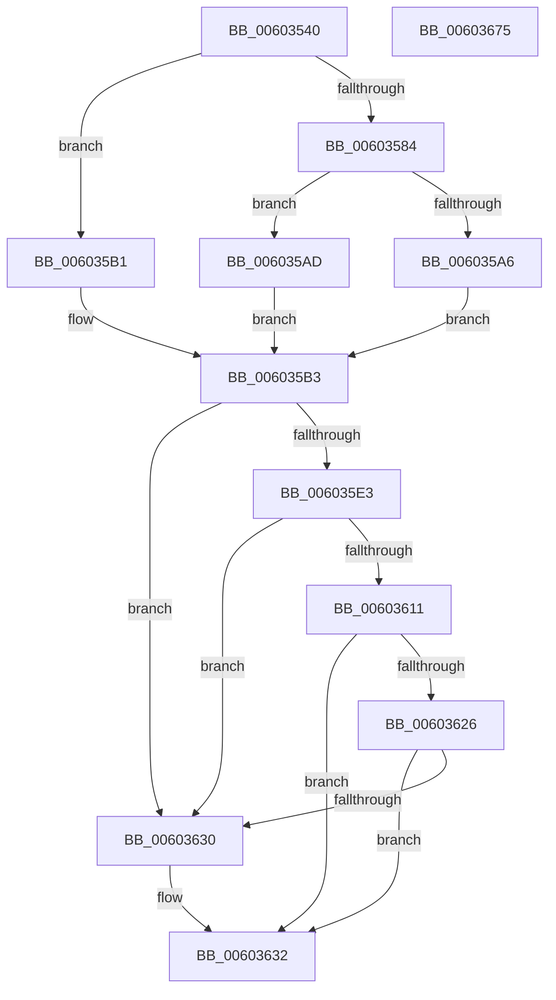

# RtlpHpMetadataCommit

- RVA: `0x00603540`–`0x00603676` (길이 `310` bytes)
- VA: `0x0000000140603540`
- 실행 섹션: `.text`
- PDB 이름 있음: `예`; PDB Function 태그: `아니요`
- unwind 정보 RVA: `0x00066400`
- 디코드: `89`개 명령, `310/310` bytes 표시
- 미해석 바이트: `0` (있으면 어셈블리에 `.byte`로 보존)

> 이 문서는 커널 이미지의 기계어와 PDB 기호를 분석해 생성했습니다. 4번과 5번은 함수 원형과 자료형을 바이너리 사용 방식에서 추정한 C 해석이며 원본 소스 복구 결과는 아닙니다.

## 1. Dependencies

- 직접 호출 지점: **2**; 고유 호출 대상: **2**
- 직접 호출자로 확인된 함수: **2**
- RIP 상대 이미지 참조: **5**

### Outgoing calls
- `0x0060359C` → [RtlCSparseBitmapBitmaskRead](../36/RtlCSparseBitmapBitmaskRead_function_0036190C.md) (function, `0x0036190C`)
- `0x0060365B` → [RtlpHpSegPageRangeCommit](../32/RtlpHpSegPageRangeCommit_function_00325D0C.md) (function, `0x00325D0C`)

### Direct callers
- [RtlpHpHeapExtendContext](../4B/RtlpHpHeapExtendContext_function_004B1EFC.md) at `0x004B1FF2`
- [RtlpHpHeapAllocate](RtlpHpHeapAllocate_function_00602D98.md) at `0x00602E9B`

### Static image references
- `0x0060355E` → RVA `0x0001EA28` (`.rdata`; read)
- `0x00603571` → RVA `0x00E6BE98` (`.data`; read)
- `0x00603587` → RVA `0x00E68610` (`.data`; read)
- `0x0060358E` → RVA `0x00E68608` (`.data`; read)
- `0x006035D7` → RVA `0x00E28300` (`.data`; read)

## 2. Other-region calls and transfers

- 다른 실행 섹션으로 향하는 call: **0**
- 별도 외부 분기/꼬리 이동을 확인하지 못했습니다.

## 3. Assembly (complete function range)

```asm
00603540  48 89 5C 24 08                  mov qword ptr [rsp + 8], rbx
00603545  48 89 6C 24 10                  mov qword ptr [rsp + 0x10], rbp
0060354A  48 89 74 24 18                  mov qword ptr [rsp + 0x18], rsi
0060354F  57                              push rdi
00603550  48 83 EC 30                     sub rsp, 0x30
00603554  49 8B 01                        mov rax, qword ptr [r9]
00603557  48 8B D9                        mov rbx, rcx
0060355A  48 C1 E8 08                     shr rax, 8
0060355E  48 8D 0D C3 B4 A1 FF            lea rcx, [rip - 0x5e4b3d]
00603565  0F B6 C0                        movzx eax, al
00603568  49 8B E8                        mov rbp, r8
0060356B  48 8B F2                        mov rsi, rdx
0060356E  8B 3C 81                        mov edi, dword ptr [rcx + rax*4]
00603571  48 8D 05 20 89 86 00            lea rax, [rip + 0x868920]
00603578  48 C1 E7 04                     shl rdi, 4
0060357C  48 03 F8                        add rdi, rax
0060357F  66 85 DB                        test bx, bx
00603582  75 2D                           jne 0x1406035b1
00603584  48 8B D3                        mov rdx, rbx
00603587  48 8D 0D 82 50 86 00            lea rcx, [rip + 0x865082]
0060358E  48 2B 15 73 50 86 00            sub rdx, qword ptr [rip + 0x865073]
00603595  48 C1 EA 14                     shr rdx, 0x14
00603599  48 03 D2                        add rdx, rdx
0060359C  E8 6B E3 D5 FF                  call 0x14036190c
006035A1  48 85 C0                        test rax, rax
006035A4  75 07                           jne 0x1406035ad
006035A6  B8 02 00 00 00                  mov eax, 2
006035AB  EB 06                           jmp 0x1406035b3
006035AD  FF C8                           dec eax
006035AF  EB 02                           jmp 0x1406035b3
006035B1  33 C0                           xor eax, eax
006035B3  4C 8B 17                        mov r10, qword ptr [rdi]
006035B6  4C 8B C3                        mov r8, rbx
006035B9  48 98                           cdqe
006035BB  49 81 C2 40 01 00 00            add r10, 0x140
006035C2  48 8D 0C 40                     lea rcx, [rax + rax*2]
006035C6  48 C1 E1 06                     shl rcx, 6
006035CA  4C 03 D1                        add r10, rcx
006035CD  4D 23 02                        and r8, qword ptr [r10]
006035D0  49 8B C0                        mov rax, r8
006035D3  49 33 40 10                     xor rax, qword ptr [r8 + 0x10]
006035D7  48 33 05 22 4D 82 00            xor rax, qword ptr [rip + 0x824d22]
006035DE  49 3B C2                        cmp rax, r10
006035E1  75 4D                           jne 0x140603630
006035E3  41 8A 4A 08                     mov cl, byte ptr [r10 + 8]
006035E7  8B D3                           mov edx, ebx
006035E9  41 2B D0                        sub edx, r8d
006035EC  48 D3 EA                        shr rdx, cl
006035EF  48 C1 E2 05                     shl rdx, 5
006035F3  49 03 D0                        add rdx, r8
006035F6  0F B6 42 1A                     movzx eax, byte ptr [rdx + 0x1a]
006035FA  48 F7 D8                        neg rax
006035FD  48 C1 E0 05                     shl rax, 5
00603601  48 03 D0                        add rdx, rax
00603604  44 8A 4A 18                     mov r9b, byte ptr [rdx + 0x18]
00603608  41 8A C1                        mov al, r9b
0060360B  24 03                           and al, 3
0060360D  3C 03                           cmp al, 3
0060360F  75 1F                           jne 0x140603630
00603611  48 8B C2                        mov rax, rdx
00603614  49 2B C0                        sub rax, r8
00603617  48 C1 F8 05                     sar rax, 5
0060361B  48 D3 E0                        shl rax, cl
0060361E  49 03 C0                        add rax, r8
00603621  48 3B C3                        cmp rax, rbx
00603624  74 0C                           je 0x140603632
00603626  41 80 E1 0C                     and r9b, 0xc
0060362A  41 80 F9 08                     cmp r9b, 8
0060362E  73 02                           jae 0x140603632
00603630  33 D2                           xor edx, edx
00603632  48 C1 ED 0C                     shr rbp, 0xc
00603636  49 8B CA                        mov rcx, r10
00603639  44 8B CD                        mov r9d, ebp
0060363C  41 F7 D9                        neg r9d
0060363F  83 7C 24 60 00                  cmp dword ptr [rsp + 0x60], 0
00603644  44 0F 45 CD                     cmovne r9d, ebp
00603648  48 83 64 24 28 00               and qword ptr [rsp + 0x28], 0
0060364E  83 64 24 20 00                  and dword ptr [rsp + 0x20], 0
00603653  2B F3                           sub esi, ebx
00603655  C1 EE 0C                        shr esi, 0xc
00603658  44 8B C6                        mov r8d, esi
0060365B  E8 AC 26 D2 FF                  call 0x140325d0c
00603660  48 8B 5C 24 40                  mov rbx, qword ptr [rsp + 0x40]
00603665  48 8B 6C 24 48                  mov rbp, qword ptr [rsp + 0x48]
0060366A  48 8B 74 24 50                  mov rsi, qword ptr [rsp + 0x50]
0060366F  48 83 C4 30                     add rsp, 0x30
00603673  5F                              pop rdi
00603674  C3                              ret
00603675  CC                              int3
```

## 4. C-style interpretation (structured pseudocode)

```c
__int64 __fastcall RtlpHpMetadataCommit(__int64 a1, __int64 a2, __int64 a3, __int64 a4, unsigned int a5)
{
    __int64 result;
    __int64 v_r10;
    __int64 v_rbp;
    __int64 v_rdi;
    __int64 v_rsi;
    __int64 v_rsp;
    unsigned __int64 v_stack_m10;
    unsigned int v_stack_m18;
    unsigned __int64 v_stack_p10;
    unsigned __int64 v_stack_p18;
    unsigned __int64 v_stack_p8;

    v_stack_p8 = v_rbx;
    v_stack_p10 = v_rbp;
    v_stack_p18 = v_rsi;
    v_rsp = (v_rsp) - (48);
    result = (*(unsigned __int64 *)(a4)) >> (8);
    v_rdi = ((unsigned int)(*(unsigned int *)(v_rip - 6179645 + (unsigned __int8)(result) * 4))) << (4);
    v_rdi = (v_rdi) + (v_rip + 8816928);
    if ((unsigned __int16)(a1) != 0) goto loc_006035B1;
    a2 = (a1) - (*(unsigned __int64 *)(v_rip + 8802419));
    a2 = (a2) >> (20);
    a2 = (a2) + (a2);
    result = RtlCSparseBitmapBitmaskRead(v_rip + 8802434, a2, a3, a4);
    if (result != 0) goto loc_006035AD;
    goto loc_006035B3;
loc_006035AD:
    result = (unsigned int)((2) - 1);
    goto loc_006035B3;
loc_006035B1:
    result = 0;
loc_006035B3:
    v_r10 = (*(unsigned __int64 *)(v_rdi)) + (320);
    a1 = (result + result * 2) << (6);
    v_r10 = (v_r10) + (a1);
    a3 = (a1) & (*(unsigned __int64 *)(v_r10));
    result = (a3) ^ (*(unsigned __int64 *)(a3 + 16));
    result = (result) ^ (*(unsigned __int64 *)(v_rip + 8539426));
    if (result != v_r10) goto loc_00603630;
    a2 = (unsigned int)(((unsigned int)((unsigned int)(a1))) - ((unsigned int)(a3)));
    a2 = (a2) >> ((unsigned __int8)(*(unsigned __int8 *)(v_r10 + 8)));
    a2 = (a2) << (5);
    a2 = (a2) + (a3);
    result = -(*(unsigned __int8 *)(a2 + 26));
    result = (result) << (5);
    a2 = (a2) + (result);
    result = (unsigned __int8)(((unsigned __int8)(*(unsigned __int8 *)(a2 + 24))) & (3));
    if (((unsigned __int8)(result)) != 3) goto loc_00603630;
    result = (a2) - (a3);
    result = (result) >> (5);
    result = (result) << ((unsigned __int8)(*(unsigned __int8 *)(v_r10 + 8)));
    result = (result) + (a3);
    if (result == a1) goto loc_00603632;
    a4 = (unsigned __int8)((*(unsigned __int8 *)(a2 + 24)) & (12));
    if (((unsigned __int8)(a4)) < 8) {
        a2 = 0;
    }
    v_rbp = (a3) >> (12);
    a4 = (unsigned int)(-((unsigned int)((unsigned int)(v_rbp))));
    if (a5 != 0) { a4 = (unsigned int)(v_rbp); }
    v_rsi = (unsigned int)((a2) - ((unsigned int)(a1)));
    v_rsi = (unsigned int)((v_rsi) >> (12));
    result = RtlpHpSegPageRangeCommit(v_r10, a2, (unsigned int)((unsigned int)(v_rsi)), a4);
    v_rsp = (v_rsp) + (48);
    return result;
}
```

## 5. (Beta) C Style

```c
int64_t RtlpHpMetadataCommit(int64_t Arg1, int64_t Arg2, int64_t Arg3, void *Arg4, uint32_t Arg5)
{
    uint8_t *arg4 = (uint8_t *)Arg4;

    int64_t result;
    int64_t local_r10;
    int64_t local_rbp;
    int64_t local_rdi;
    int64_t local_rsi;
    int64_t local_rsp;
    uint64_t v_stack_m10;
    uint32_t v_stack_m18;
    uint64_t v_stack_p10;
    uint64_t v_stack_p18;
    uint64_t v_stack_p8;

    v_stack_p8 = local_rbx;
    v_stack_p10 = local_rbp;
    v_stack_p18 = local_rsi;
    local_rsp = (local_rsp) - (48);
    result = (*(uint64_t *)(arg4)) >> (8);
    local_rdi = ((uint32_t)(*(uint32_t *)(v_rip - 0x5E4B3D + (uint8_t)(result) * 4))) << (4);
    local_rdi = (local_rdi) + (v_rip + 8816928);
    if ((uint16_t)(Arg1) != 0) goto loc_006035B1;
    Arg2 = (Arg1) - (*(uint64_t *)(v_rip + 0x865073));
    Arg2 = (Arg2) >> (20);
    Arg2 = (Arg2) + (Arg2);
    result = RtlCSparseBitmapBitmaskRead(v_rip + 8802434, Arg2, Arg3, Arg4);
    if (result != 0) goto loc_006035AD;
    goto loc_006035B3;
loc_006035AD:
    result = (uint32_t)((2) - 1);
    goto loc_006035B3;
loc_006035B1:
    result = 0;
loc_006035B3:
    local_r10 = (*(uint64_t *)(local_rdi)) + (320);
    Arg1 = (result + result * 2) << (6);
    local_r10 = (local_r10) + (Arg1);
    Arg3 = (Arg1) & (*(uint64_t *)(local_r10));
    result = (Arg3) ^ (*(uint64_t *)(Arg3 + 0x10));
    result = (result) ^ (*(uint64_t *)(v_rip + 0x824D22));
    if (result != local_r10) goto loc_00603630;
    Arg2 = (uint32_t)(((uint32_t)((uint32_t)(Arg1))) - ((uint32_t)(Arg3)));
    Arg2 = (Arg2) >> ((uint8_t)(*(uint8_t *)(local_r10 + 0x8)));
    Arg2 = (Arg2) << (5);
    Arg2 = (Arg2) + (Arg3);
    result = -(*(uint8_t *)(Arg2 + 0x1A));
    result = (result) << (5);
    Arg2 = (Arg2) + (result);
    result = (uint8_t)(((uint8_t)(*(uint8_t *)(Arg2 + 0x18))) & (3));
    if (((uint8_t)(result)) != 3) goto loc_00603630;
    result = (Arg2) - (Arg3);
    result = (result) >> (5);
    result = (result) << ((uint8_t)(*(uint8_t *)(local_r10 + 0x8)));
    result = (result) + (Arg3);
    if (result == Arg1) goto loc_00603632;
    Arg4 = (uint8_t)((*(uint8_t *)(Arg2 + 0x18)) & (12));
    if (((uint8_t)(Arg4)) < 8) {
        Arg2 = 0;
    }
    local_rbp = (Arg3) >> (12);
    Arg4 = (uint32_t)(-((uint32_t)((uint32_t)(local_rbp))));
    if (Arg5 != 0) { Arg4 = (uint32_t)(local_rbp); }
    local_rsi = (uint32_t)((Arg2) - ((uint32_t)(Arg1)));
    local_rsi = (uint32_t)((local_rsi) >> (12));
    result = RtlpHpSegPageRangeCommit(local_r10, Arg2, (uint32_t)((uint32_t)(local_rsi)), Arg4);
    local_rsp = (local_rsp) + (48);
    return result;
}
```

### 관측된 메모리 오프셋

구조체 형식이 확인되지 않은 접근은 인자 기준의 오프셋으로만 기록했습니다.

| 기준 인자 | 오프셋 표현 | 폭 (bit) | 접근 |
|---|---:|---:|---|
| `Arg4` | `+ 0x0` | `64` | `R` |

## 6. Execution-region graph

[열기: 2D/3D 그래프와 함수 탐색 컨트롤 패널](../../../control-panel.html?section=text&rva=0x00603540&view=graph)

- 2D 그래프는 위에서 아래로 흐르고, 3D 그래프는 빈 공간을 드래그해 회전합니다. Shift+드래그는 이동, 휠은 확대·축소, 함수 노드 선택은 대상 보고서 이동입니다.

### Static fallback


