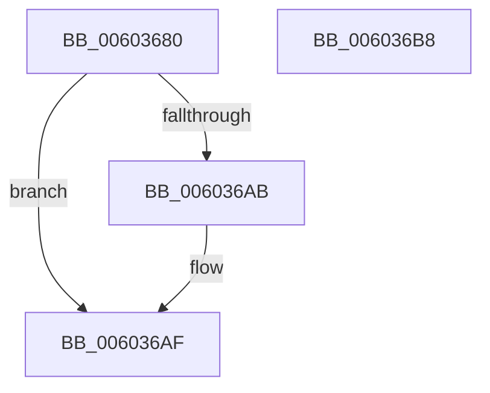

# RtlpHpMetadataHeapCreate

- RVA: `0x00603680`–`0x006036B9` (길이 `57` bytes)
- VA: `0x0000000140603680`
- 실행 섹션: `.text`
- PDB 이름 있음: `예`; PDB Function 태그: `아니요`
- unwind 정보 RVA: `0x00064C80`
- 디코드: `18`개 명령, `57/57` bytes 표시
- 미해석 바이트: `0` (있으면 어셈블리에 `.byte`로 보존)

> 이 문서는 커널 이미지의 기계어와 PDB 기호를 분석해 생성했습니다. 4번과 5번은 함수 원형과 자료형을 바이너리 사용 방식에서 추정한 C 해석이며 원본 소스 복구 결과는 아닙니다.

## 1. Dependencies

- 직접 호출 지점: **1**; 고유 호출 대상: **1**
- 직접 호출자로 확인된 함수: **1**
- RIP 상대 이미지 참조: **0**

### Outgoing calls
- `0x0060369C` → [RtlpHpHeapCreate](RtlpHpHeapCreate_function_00602FDC.md) (function, `0x00602FDC`)

### Direct callers
- [RtlHpKInitializeHeapManager](../65/RtlHpKInitializeHeapManager_function_0065C9A0.md) at `0x0065CA58`

### Static image references
- 디코드된 RIP-relative 메모리 참조가 없습니다.

## 2. Other-region calls and transfers

- 다른 실행 섹션으로 향하는 call: **0**
- 별도 외부 분기/꼬리 이동을 확인하지 못했습니다.

## 3. Assembly (complete function range)

```asm
00603680  40 53                           push rbx
00603682  48 83 EC 30                     sub rsp, 0x30
00603686  0F 10 02                        movups xmm0, xmmword ptr [rdx]
00603689  48 8B D9                        mov rbx, rcx
0060368C  4C 8D 4C 24 20                  lea r9, [rsp + 0x20]
00603691  B9 00 00 40 02                  mov ecx, 0x2400000
00603696  66 0F 7F 44 24 20               movdqa xmmword ptr [rsp + 0x20], xmm0
0060369C  E8 3B F9 FF FF                  call 0x140602fdc
006036A1  48 8B D0                        mov rdx, rax
006036A4  33 C0                           xor eax, eax
006036A6  48 85 D2                        test rdx, rdx
006036A9  74 04                           je 0x1406036af
006036AB  48 89 53 F8                     mov qword ptr [rbx - 8], rdx
006036AF  0F 95 C0                        setne al
006036B2  48 83 C4 30                     add rsp, 0x30
006036B6  5B                              pop rbx
006036B7  C3                              ret
006036B8  CC                              int3
```

## 4. C-style interpretation (structured pseudocode)

```c
__int64 __fastcall RtlpHpMetadataHeapCreate(__int64 a1, __int64 a2)
{
    __int64 result;
    __int64 v_rsp;
    unsigned __int64 v_stack_m18;

    v_rsp = (v_rsp) - (48);
    v_stack_m18 = v_xmm0;
    result = RtlpHpHeapCreate((unsigned int)(0x2400000ULL), a2, a3, v_stack_m18);
    result = 0;
    if (0 != 0) {
        *(unsigned __int64 *)(a1 - 8) = 0;
    }
    result = (0 != 0) ? 1 : 0;
    v_rsp = (v_rsp) + (48);
    return result;
}
```

## 5. (Beta) C Style

```c
int64_t RtlpHpMetadataHeapCreate(void *Arg1, void *Arg2)
{
    uint8_t *arg1 = (uint8_t *)Arg1;
    uint8_t *arg2 = (uint8_t *)Arg2;

    int64_t result;
    int64_t local_rsp;
    uint64_t v_stack_m18;

    local_rsp = (local_rsp) - (48);
    v_stack_m18 = v_xmm0;
    result = RtlpHpHeapCreate((uint32_t)(0x2400000ULL), Arg2, a3, v_stack_m18);
    result = 0;
    if (0 != 0) {
        *(uint64_t *)(arg1 - 0x8) = 0;
    }
    result = (0 != 0) ? 1 : 0;
    local_rsp = (local_rsp) + (48);
    return result;
}
```

### 관측된 메모리 오프셋

구조체 형식이 확인되지 않은 접근은 인자 기준의 오프셋으로만 기록했습니다.

| 기준 인자 | 오프셋 표현 | 폭 (bit) | 접근 |
|---|---:|---:|---|
| `Arg1` | `- 0x8` | `64` | `W` |
| `Arg2` | `+ 0x0` | `128` | `R` |

## 6. Execution-region graph

[열기: 2D/3D 그래프와 함수 탐색 컨트롤 패널](../../../control-panel.html?section=text&rva=0x00603680&view=graph)

- 2D 그래프는 위에서 아래로 흐르고, 3D 그래프는 빈 공간을 드래그해 회전합니다. Shift+드래그는 이동, 휠은 확대·축소, 함수 노드 선택은 대상 보고서 이동입니다.

### Static fallback


