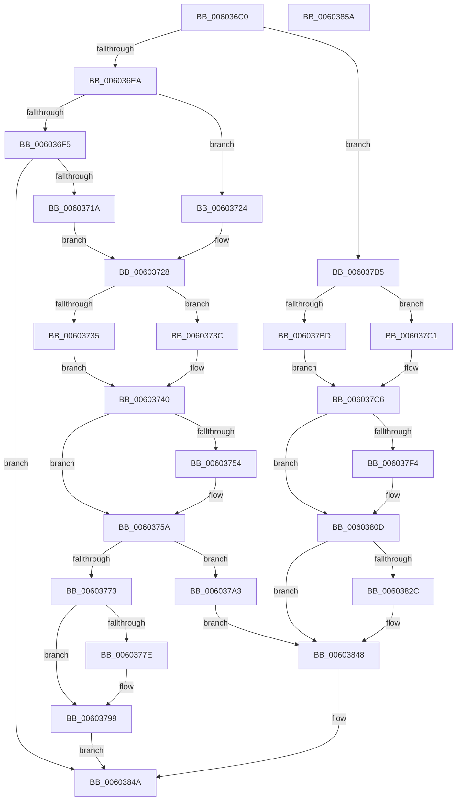

# RtlpHpRegisterEnvironment

- RVA: `0x006036C0`–`0x0060385B` (길이 `411` bytes)
- VA: `0x00000001406036C0`
- 실행 섹션: `.text`
- PDB 이름 있음: `예`; PDB Function 태그: `아니요`
- unwind 정보 RVA: `0x000D0580`
- 디코드: `110`개 명령, `411/411` bytes 표시
- 미해석 바이트: `0` (있으면 어셈블리에 `.byte`로 보존)

> 이 문서는 커널 이미지의 기계어와 PDB 기호를 분석해 생성했습니다. 4번과 5번은 함수 원형과 자료형을 바이너리 사용 방식에서 추정한 C 해석이며 원본 소스 복구 결과는 아닙니다.

## 1. Dependencies

- 직접 호출 지점: **6**; 고유 호출 대상: **5**
- 직접 호출자로 확인된 함수: **2**
- RIP 상대 이미지 참조: **5**

### Outgoing calls
- `0x0060370D` → [RtlpHpCustomVaCallbacksRegistrarRegister](RtlpHpCustomVaCallbacksRegistrarRegister_function_00602804.md) (function, `0x00602804`)
- `0x00603769` → [RtlpHpVaMgrCtxAllocatorReference](RtlpHpVaMgrCtxAllocatorReference_function_00603BC0.md) (function, `0x00603BC0`)
- `0x00603794` → [RtlpHpCustomVaCallbacksRegistrarUnregister](RtlpHpCustomVaCallbacksRegistrarUnregister_function_00602B9C.md) (function, `0x00602B9C`)
- `0x006037E4` → [RtlpHpAcquireLockExclusive](../32/RtlpHpAcquireLockExclusive_function_003246B0.md) (function, `0x003246B0`)
- `0x0060381C` → [RtlpHpReleaseLockExclusive](../32/RtlpHpReleaseLockExclusive_function_00324230.md) (function, `0x00324230`)
- `0x00603843` → [RtlpHpCustomVaCallbacksRegistrarUnregister](RtlpHpCustomVaCallbacksRegistrarUnregister_function_00602B9C.md) (function, `0x00602B9C`)

### Direct callers
- [RtlpHpHeapCreate](RtlpHpHeapCreate_function_00602FDC.md) at `0x0060300F`
- [RtlpHpHeapCreate](RtlpHpHeapCreate_function_00602FDC.md) at `0x00603075`
- [RtlpHpHeapDestroy](RtlpHpHeapDestroy_function_006033AC.md) at `0x00603524`

### Static image references
- `0x00603701` → RVA `0x00F059C0` (`.data`; read)
- `0x00603762` → RVA `0x00E68658` (`.data`; read)
- `0x006037CF` → RVA `0x00E68EC8` (`.data`; read)
- `0x006037DA` → RVA `0x00E68EB8` (`.data`; read)
- `0x00603807` → RVA `0x00E68EC4` (`.data`; read/write)

## 2. Other-region calls and transfers

- 다른 실행 섹션으로 향하는 call: **0**
- 별도 외부 분기/꼬리 이동을 확인하지 못했습니다.

## 3. Assembly (complete function range)

```asm
006036C0  48 89 5C 24 10                  mov qword ptr [rsp + 0x10], rbx
006036C5  48 89 7C 24 18                  mov qword ptr [rsp + 0x18], rdi
006036CA  55                              push rbp
006036CB  48 8B EC                        mov rbp, rsp
006036CE  48 83 EC 50                     sub rsp, 0x50
006036D2  0F 10 01                        movups xmm0, xmmword ptr [rcx]
006036D5  48 83 65 10 00                  and qword ptr [rbp + 0x10], 0
006036DA  48 8B D9                        mov rbx, rcx
006036DD  F3 0F 7F 45 D0                  movdqu xmmword ptr [rbp - 0x30], xmm0
006036E2  85 D2                           test edx, edx
006036E4  0F 84 CB 00 00 00               je 0x1406037b5
006036EA  48 8B 01                        mov rax, qword ptr [rcx]
006036ED  48 C1 E8 08                     shr rax, 8
006036F1  3C 05                           cmp al, 5
006036F3  75 2F                           jne 0x140603724
006036F5  48 8B 55 D8                     mov rdx, qword ptr [rbp - 0x28]
006036F9  4C 8D 4D E0                     lea r9, [rbp - 0x20]
006036FD  4C 8D 45 10                     lea r8, [rbp + 0x10]
00603701  48 8D 0D B8 22 90 00            lea rcx, [rip + 0x9022b8]
00603708  F3 0F 7F 45 E0                  movdqu xmmword ptr [rbp - 0x20], xmm0
0060370D  E8 F2 F0 FF FF                  call 0x140602804
00603712  85 C0                           test eax, eax
00603714  0F 88 30 01 00 00               js 0x14060384a
0060371A  48 8B 7D 10                     mov rdi, qword ptr [rbp + 0x10]
0060371E  48 89 7D D8                     mov qword ptr [rbp - 0x28], rdi
00603722  EB 04                           jmp 0x140603728
00603724  48 8B 7D D8                     mov rdi, qword ptr [rbp - 0x28]
00603728  0F B6 45 D3                     movzx eax, byte ptr [rbp - 0x2d]
0060372C  33 C9                           xor ecx, ecx
0060372E  89 4D EC                        mov dword ptr [rbp - 0x14], ecx
00603731  84 C0                           test al, al
00603733  74 07                           je 0x14060373c
00603735  FF C8                           dec eax
00603737  89 45 E0                        mov dword ptr [rbp - 0x20], eax
0060373A  EB 04                           jmp 0x140603740
0060373C  83 4D E0 FF                     or dword ptr [rbp - 0x20], 0xffffffff
00603740  F6 45 D0 08                     test byte ptr [rbp - 0x30], 8
00603744  0F B6 45 D1                     movzx eax, byte ptr [rbp - 0x2f]
00603748  89 45 E4                        mov dword ptr [rbp - 0x1c], eax
0060374B  0F B6 45 D2                     movzx eax, byte ptr [rbp - 0x2e]
0060374F  89 45 E8                        mov dword ptr [rbp - 0x18], eax
00603752  74 06                           je 0x14060375a
00603754  83 C9 01                        or ecx, 1
00603757  89 4D EC                        mov dword ptr [rbp - 0x14], ecx
0060375A  48 8D 55 E0                     lea rdx, [rbp - 0x20]
0060375E  48 89 7D F0                     mov qword ptr [rbp - 0x10], rdi
00603762  48 8D 0D EF 4E 86 00            lea rcx, [rip + 0x864eef]
00603769  E8 52 04 00 00                  call 0x140603bc0
0060376E  83 F8 FF                        cmp eax, -1
00603771  75 30                           jne 0x1406037a3
00603773  48 8B 03                        mov rax, qword ptr [rbx]
00603776  48 C1 E8 08                     shr rax, 8
0060377A  3C 05                           cmp al, 5
0060377C  75 1B                           jne 0x140603799
0060377E  0F 10 03                        movups xmm0, xmmword ptr [rbx]
00603781  4C 8D 45 E0                     lea r8, [rbp - 0x20]
00603785  48 8B D7                        mov rdx, rdi
00603788  48 8D 0D 31 22 90 00            lea rcx, [rip + 0x902231]
0060378F  F3 0F 7F 45 E0                  movdqu xmmword ptr [rbp - 0x20], xmm0
00603794  E8 03 F4 FF FF                  call 0x140602b9c
00603799  B8 9A 00 00 C0                  mov eax, 0xc000009a
0060379E  E9 A7 00 00 00                  jmp 0x14060384a
006037A3  FE C0                           inc al
006037A5  88 45 D3                        mov byte ptr [rbp - 0x2d], al
006037A8  0F 10 45 D0                     movups xmm0, xmmword ptr [rbp - 0x30]
006037AC  F3 0F 7F 03                     movdqu xmmword ptr [rbx], xmm0
006037B0  E9 93 00 00 00                  jmp 0x140603848
006037B5  0F B6 45 D3                     movzx eax, byte ptr [rbp - 0x2d]
006037B9  84 C0                           test al, al
006037BB  74 04                           je 0x1406037c1
006037BD  FF C8                           dec eax
006037BF  EB 05                           jmp 0x1406037c6
006037C1  B8 FF FF FF FF                  mov eax, 0xffffffff
006037C6  48 8D 3C 40                     lea rdi, [rax + rax*2]
006037CA  BA 01 00 00 00                  mov edx, 1
006037CF  48 8D 05 F2 56 86 00            lea rax, [rip + 0x8656f2]
006037D6  48 C1 E7 04                     shl rdi, 4
006037DA  48 8D 0D D7 56 86 00            lea rcx, [rip + 0x8656d7]
006037E1  48 03 F8                        add rdi, rax
006037E4  E8 C7 0E D2 FF                  call 0x1403246b0
006037E9  B9 FF FF 00 00                  mov ecx, 0xffff
006037EE  66 01 4F 2A                     add word ptr [rdi + 0x2a], cx
006037F2  75 19                           jne 0x14060380d
006037F4  0F 57 C0                        xorps xmm0, xmm0
006037F7  0F 11 07                        movups xmmword ptr [rdi], xmm0
006037FA  0F 11 47 10                     movups xmmword ptr [rdi + 0x10], xmm0
006037FE  0F 11 47 20                     movups xmmword ptr [rdi + 0x20], xmm0
00603802  48 83 67 10 00                  and qword ptr [rdi + 0x10], 0
00603807  FF 0D B7 56 86 00               dec dword ptr [rip + 0x8656b7]
0060380D  44 8A C0                        mov r8b, al
00603810  48 8D 0D A1 56 86 00            lea rcx, [rip + 0x8656a1]
00603817  BA 01 00 00 00                  mov edx, 1
0060381C  E8 0F 0A D2 FF                  call 0x140324230
00603821  48 8B 03                        mov rax, qword ptr [rbx]
00603824  48 C1 E8 08                     shr rax, 8
00603828  3C 05                           cmp al, 5
0060382A  75 1C                           jne 0x140603848
0060382C  0F 10 03                        movups xmm0, xmmword ptr [rbx]
0060382F  48 8B 55 D8                     mov rdx, qword ptr [rbp - 0x28]
00603833  4C 8D 45 E0                     lea r8, [rbp - 0x20]
00603837  48 8D 0D 82 21 90 00            lea rcx, [rip + 0x902182]
0060383E  F3 0F 7F 45 E0                  movdqu xmmword ptr [rbp - 0x20], xmm0
00603843  E8 54 F3 FF FF                  call 0x140602b9c
00603848  33 C0                           xor eax, eax
0060384A  48 8B 5C 24 68                  mov rbx, qword ptr [rsp + 0x68]
0060384F  48 8B 7C 24 70                  mov rdi, qword ptr [rsp + 0x70]
00603854  48 83 C4 50                     add rsp, 0x50
00603858  5D                              pop rbp
00603859  C3                              ret
0060385A  CC                              int3
```

## 4. C-style interpretation (structured pseudocode)

```c
__int64 __fastcall RtlpHpRegisterEnvironment(__int64 a1, int a2)
{
    __int64 result;
    __int64 v_rdi;
    __int64 v_rsp;
    unsigned __int64 v_stack_m18;
    unsigned int v_stack_m1C;
    unsigned int v_stack_m20;
    unsigned int v_stack_m24;
    unsigned __int64 v_stack_m28;
    unsigned __int64 v_stack_m30;
    unsigned __int8 v_stack_m35;
    unsigned __int8 v_stack_m36;
    unsigned __int8 v_stack_m37;
    unsigned __int64 v_stack_m38;
    unsigned __int64 v_stack_p10;
    unsigned __int64 v_stack_p18;
    unsigned __int64 v_stack_p8;

    v_stack_p10 = v_rbx;
    v_stack_p18 = v_rdi;
    v_rsp = (v_rsp) - (80);
    v_stack_m38 = v_xmm0;
    if (a2 == 0) goto loc_006037B5;
    result = (*(unsigned __int64 *)(a1)) >> (8);
    if (((unsigned __int8)(result)) != 5) goto loc_00603724;
    v_stack_m28 = v_xmm0;
    result = RtlpHpCustomVaCallbacksRegistrarRegister(v_rip + 9446072, v_stack_m30, v_stack_p8, v_stack_m28);
    if (sign_flag) goto loc_0060384A;
    v_stack_m30 = v_stack_p8;
    goto loc_00603728;
loc_00603724:
loc_00603728:
    a1 = 0;
    v_stack_m1C = 0;
    if ((unsigned __int8)(v_stack_m35) == 0) goto loc_0060373C;
    result = (unsigned int)((v_stack_m35) - 1);
    v_stack_m28 = (unsigned int)(result);
    goto loc_00603740;
loc_0060373C:
loc_00603740:
    v_stack_m24 = (unsigned int)(v_stack_m37);
    v_stack_m20 = (unsigned int)(v_stack_m36);
    if (((v_stack_m38) & (8)) != 0) {
        a1 = (unsigned int)((a1) | (1));
        v_stack_m1C = (unsigned int)(a1);
    }
    v_stack_m18 = v_stack_m30;
    result = RtlpHpVaMgrCtxAllocatorReference(v_rip + 8802031, v_stack_m28, v_stack_p8, v_stack_m28);
    if (((unsigned int)(result)) != -1) goto loc_006037A3;
    result = (*(unsigned __int64 *)(a1)) >> (8);
    if (((unsigned __int8)(result)) == 5) {
        a3 = v_stack_m28;
        a2 = v_stack_m30;
        a1 = v_rip + 9445937;
        v_stack_m28 = v_xmm0;
        result = RtlpHpCustomVaCallbacksRegistrarUnregister(a1, a2, a3, v_stack_m28);
    }
    goto loc_0060384A;
loc_006037A3:
    result = (unsigned __int8)(((unsigned int)(0xC000009AULL)) + 1);
    v_stack_m35 = (unsigned __int8)(result);
    *(unsigned __int64 *)(a1) = v_xmm0;
    goto loc_00603848;
loc_006037B5:
    if ((unsigned __int8)(v_stack_m35) == 0) goto loc_006037C1;
    result = (unsigned int)((v_stack_m35) - 1);
    goto loc_006037C6;
loc_006037C1:
loc_006037C6:
    v_rdi = ((unsigned int)(0xFFFFFFFFULL) + (unsigned int)(0xFFFFFFFFULL) * 2) << (4);
    v_rdi = (v_rdi) + (v_rip + 8804082);
    result = RtlpHpAcquireLockExclusive(v_rip + 8804055, 1, a3, v_stack_m28);
    if (!(condition_is_not_equal)) {
        *(unsigned __int64 *)(v_rdi) = v_xmm0;
        *(unsigned __int64 *)(v_rdi + 16) = v_xmm0;
        *(unsigned __int64 *)(v_rdi + 32) = v_xmm0;
    }
    result = RtlpHpReleaseLockExclusive(v_rip + 8804001, 1, (unsigned __int8)(result), v_stack_m28);
    result = (*(unsigned __int64 *)(a1)) >> (8);
    if (((unsigned __int8)(result)) == 5) {
        a2 = v_stack_m30;
        a3 = v_stack_m28;
        a1 = v_rip + 9445762;
        v_stack_m28 = v_xmm0;
        result = RtlpHpCustomVaCallbacksRegistrarUnregister(a1, a2, a3, v_stack_m28);
    }
    result = 0;
loc_0060384A:
    v_rsp = (v_rsp) + (80);
    return result;
}
```

## 5. (Beta) C Style

```c
int64_t RtlpHpRegisterEnvironment(void *Arg1, int32_t Arg2)
{
    uint8_t *arg1 = (uint8_t *)Arg1;

    int64_t result;
    int64_t local_rdi;
    int64_t local_rsp;
    uint64_t v_stack_m18;
    uint32_t v_stack_m1C;
    uint32_t v_stack_m20;
    uint32_t v_stack_m24;
    uint64_t v_stack_m28;
    uint64_t v_stack_m30;
    uint8_t v_stack_m35;
    uint8_t v_stack_m36;
    uint8_t v_stack_m37;
    uint64_t v_stack_m38;
    uint64_t v_stack_p10;
    uint64_t v_stack_p18;
    uint64_t v_stack_p8;

    v_stack_p10 = local_rbx;
    v_stack_p18 = local_rdi;
    local_rsp = (local_rsp) - (80);
    v_stack_m38 = v_xmm0;
    if (Arg2 == 0) goto loc_006037B5;
    result = (*(uint64_t *)(arg1)) >> (8);
    if (((uint8_t)(result)) != 5) goto loc_00603724;
    v_stack_m28 = v_xmm0;
    result = RtlpHpCustomVaCallbacksRegistrarRegister(v_rip + 9446072, v_stack_m30, v_stack_p8, v_stack_m28);
    if (sign_flag) goto loc_0060384A;
    v_stack_m30 = v_stack_p8;
    goto loc_00603728;
loc_00603724:
loc_00603728:
    Arg1 = 0;
    v_stack_m1C = 0;
    if ((uint8_t)(v_stack_m35) == 0) goto loc_0060373C;
    result = (uint32_t)((v_stack_m35) - 1);
    v_stack_m28 = (uint32_t)(result);
    goto loc_00603740;
loc_0060373C:
loc_00603740:
    v_stack_m24 = (uint32_t)(v_stack_m37);
    v_stack_m20 = (uint32_t)(v_stack_m36);
    if (((v_stack_m38) & (8)) != 0) {
        Arg1 = (uint32_t)((Arg1) | (1));
        v_stack_m1C = (uint32_t)(Arg1);
    }
    v_stack_m18 = v_stack_m30;
    result = RtlpHpVaMgrCtxAllocatorReference(v_rip + 8802031, v_stack_m28, v_stack_p8, v_stack_m28);
    if (((uint32_t)(result)) != -1) goto loc_006037A3;
    result = (*(uint64_t *)(arg1)) >> (8);
    if (((uint8_t)(result)) == 5) {
        a3 = v_stack_m28;
        Arg2 = v_stack_m30;
        Arg1 = v_rip + 9445937;
        v_stack_m28 = v_xmm0;
        result = RtlpHpCustomVaCallbacksRegistrarUnregister(Arg1, Arg2, a3, v_stack_m28);
    }
    goto loc_0060384A;
loc_006037A3:
    result = (uint8_t)(((uint32_t)(0xC000009AULL)) + 1);
    v_stack_m35 = (uint8_t)(result);
    *(uint64_t *)(arg1) = v_xmm0;
    goto loc_00603848;
loc_006037B5:
    if ((uint8_t)(v_stack_m35) == 0) goto loc_006037C1;
    result = (uint32_t)((v_stack_m35) - 1);
    goto loc_006037C6;
loc_006037C1:
loc_006037C6:
    local_rdi = ((uint32_t)(0xFFFFFFFFULL) + (uint32_t)(0xFFFFFFFFULL) * 2) << (4);
    local_rdi = (local_rdi) + (v_rip + 8804082);
    result = RtlpHpAcquireLockExclusive(v_rip + 8804055, 1, a3, v_stack_m28);
    if (!(condition_is_not_equal)) {
        *(uint64_t *)(local_rdi) = v_xmm0;
        *(uint64_t *)(local_rdi + 0x10) = v_xmm0;
        *(uint64_t *)(local_rdi + 0x20) = v_xmm0;
    }
    result = RtlpHpReleaseLockExclusive(v_rip + 8804001, 1, (uint8_t)(result), v_stack_m28);
    result = (*(uint64_t *)(arg1)) >> (8);
    if (((uint8_t)(result)) == 5) {
        Arg2 = v_stack_m30;
        a3 = v_stack_m28;
        Arg1 = v_rip + 9445762;
        v_stack_m28 = v_xmm0;
        result = RtlpHpCustomVaCallbacksRegistrarUnregister(Arg1, Arg2, a3, v_stack_m28);
    }
    result = 0;
loc_0060384A:
    local_rsp = (local_rsp) + (80);
    return result;
}
```

### 관측된 메모리 오프셋

구조체 형식이 확인되지 않은 접근은 인자 기준의 오프셋으로만 기록했습니다.

| 기준 인자 | 오프셋 표현 | 폭 (bit) | 접근 |
|---|---:|---:|---|
| `Arg1` | `+ 0x0` | `64` | `R` |
| `Arg1` | `+ 0x0` | `128` | `R` |
| `Arg1` | `+ 0x0` | `128` | `W` |

## 6. Execution-region graph

[열기: 2D/3D 그래프와 함수 탐색 컨트롤 패널](../../../control-panel.html?section=text&rva=0x006036C0&view=graph)

- 2D 그래프는 위에서 아래로 흐르고, 3D 그래프는 빈 공간을 드래그해 회전합니다. Shift+드래그는 이동, 휠은 확대·축소, 함수 노드 선택은 대상 보고서 이동입니다.

### Static fallback


