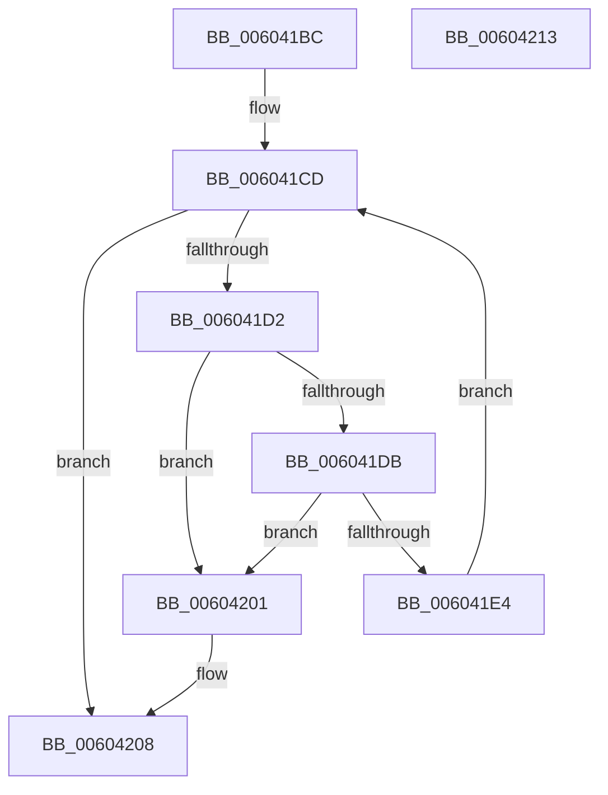

# RtlpHpSegContextCleanup

- RVA: `0x006041BC`–`0x00604214` (길이 `88` bytes)
- VA: `0x00000001406041BC`
- 실행 섹션: `.text`
- PDB 이름 있음: `예`; PDB Function 태그: `아니요`
- unwind 정보 RVA: `0x0005CAAC`
- 디코드: `27`개 명령, `88/88` bytes 표시
- 미해석 바이트: `0` (있으면 어셈블리에 `.byte`로 보존)

> 이 문서는 커널 이미지의 기계어와 PDB 기호를 분석해 생성했습니다. 4번과 5번은 함수 원형과 자료형을 바이너리 사용 방식에서 추정한 C 해석이며 원본 소스 복구 결과는 아닙니다.

## 1. Dependencies

- 직접 호출 지점: **1**; 고유 호출 대상: **1**
- 직접 호출자로 확인된 함수: **1**
- RIP 상대 이미지 참조: **0**

### Outgoing calls
- `0x006041FA` → [RtlpHpSegSegmentFree](../47/RtlpHpSegSegmentFree_function_00471328.md) (function, `0x00471328`)

### Direct callers
- [RtlpHpHeapDestroy](RtlpHpHeapDestroy_function_006033AC.md) at `0x006034BF`
- [RtlpHpHeapDestroy](RtlpHpHeapDestroy_function_006033AC.md) at `0x006034CB`

### Static image references
- 디코드된 RIP-relative 메모리 참조가 없습니다.

## 2. Other-region calls and transfers

- 다른 실행 섹션으로 향하는 call: **0**
- 별도 외부 분기/꼬리 이동을 확인하지 못했습니다.

## 3. Assembly (complete function range)

```asm
006041BC  48 89 5C 24 08                  mov qword ptr [rsp + 8], rbx
006041C1  57                              push rdi
006041C2  48 83 EC 20                     sub rsp, 0x20
006041C6  48 8B F9                        mov rdi, rcx
006041C9  48 8D 59 48                     lea rbx, [rcx + 0x48]
006041CD  48 39 1B                        cmp qword ptr [rbx], rbx
006041D0  74 36                           je 0x140604208
006041D2  48 8B 53 08                     mov rdx, qword ptr [rbx + 8]
006041D6  48 39 1A                        cmp qword ptr [rdx], rbx
006041D9  75 26                           jne 0x140604201
006041DB  48 8B 42 08                     mov rax, qword ptr [rdx + 8]
006041DF  48 39 10                        cmp qword ptr [rax], rdx
006041E2  75 1D                           jne 0x140604201
006041E4  48 89 43 08                     mov qword ptr [rbx + 8], rax
006041E8  41 B9 01 00 00 00               mov r9d, 1
006041EE  41 B8 FF FF FF 7F               mov r8d, 0x7fffffff
006041F4  48 89 18                        mov qword ptr [rax], rbx
006041F7  48 8B CF                        mov rcx, rdi
006041FA  E8 29 D1 E6 FF                  call 0x140471328
006041FF  EB CC                           jmp 0x1406041cd
00604201  B9 03 00 00 00                  mov ecx, 3
00604206  CD 29                           int 0x29
00604208  48 8B 5C 24 30                  mov rbx, qword ptr [rsp + 0x30]
0060420D  48 83 C4 20                     add rsp, 0x20
00604211  5F                              pop rdi
00604212  C3                              ret
00604213  CC                              int3
```

## 4. C-style interpretation (structured pseudocode)

```c
__int64 __fastcall RtlpHpSegContextCleanup(__int64 a1)
{
    __int64 result;
    __int64 v_rsp;
    unsigned __int64 v_stack_p8;

    v_stack_p8 = v_rbx;
    v_rsp = (v_rsp) - (32);
loc_006041CD:
    if ((*(unsigned __int64 *)(a1 + 72)) == (a1 + 72)) goto loc_00604208;
    if ((*(unsigned __int64 *)(*(unsigned __int64 *)(a1 + 72 + 8))) != (a1 + 72)) goto loc_00604201;
    if ((*(unsigned __int64 *)(*(unsigned __int64 *)(*(unsigned __int64 *)(a1 + 72 + 8) + 8))) != (*(unsigned __int64 *)(a1 + 72 + 8))) goto loc_00604201;
    *(unsigned __int64 *)(a1 + 72 + 8) = *(unsigned __int64 *)(*(unsigned __int64 *)(a1 + 72 + 8) + 8);
    *(unsigned __int64 *)(*(unsigned __int64 *)(*(unsigned __int64 *)(a1 + 72 + 8) + 8)) = a1 + 72;
    result = RtlpHpSegSegmentFree(a1, *(unsigned __int64 *)(a1 + 72 + 8), (unsigned int)(0x7FFFFFFFULL), 1);
    goto loc_006041CD;
loc_00604201:
loc_00604208:
    v_rsp = (v_rsp) + (32);
    return result;
}
```

## 5. (Beta) C Style

```c
int64_t RtlpHpSegContextCleanup(void *Arg1)
{
    uint8_t *arg1 = (uint8_t *)Arg1;

    int64_t result;
    int64_t local_rsp;
    uint64_t v_stack_p8;

    v_stack_p8 = local_rbx;
    local_rsp = (local_rsp) - (32);
loc_006041CD:
    if ((*(uint64_t *)(arg1 + 0x48)) == (Arg1 + 72)) goto loc_00604208;
    if ((*(uint64_t *)(*(uint64_t *)(arg1 + 0x48 + 0x8))) != (Arg1 + 72)) goto loc_00604201;
    if ((*(uint64_t *)(*(uint64_t *)(*(uint64_t *)(arg1 + 0x48 + 0x8) + 0x8))) != (*(uint64_t *)(arg1 + 0x48 + 0x8))) goto loc_00604201;
    *(uint64_t *)(arg1 + 0x48 + 0x8) = *(uint64_t *)(*(uint64_t *)(arg1 + 0x48 + 0x8) + 0x8);
    *(void **)(*(uint64_t *)(*(uint64_t *)(arg1 + 0x48 + 0x8) + 0x8)) = Arg1 + 72;
    result = RtlpHpSegSegmentFree(Arg1, *(uint64_t *)(arg1 + 0x48 + 0x8), (uint32_t)(0x7FFFFFFFULL), 1);
    goto loc_006041CD;
loc_00604201:
loc_00604208:
    local_rsp = (local_rsp) + (32);
    return result;
}
```

### 관측된 메모리 오프셋

구조체 형식이 확인되지 않은 접근은 인자 기준의 오프셋으로만 기록했습니다.

| 기준 인자 | 오프셋 표현 | 폭 (bit) | 접근 |
|---|---:|---:|---|
| `Arg1` | `+ 0x0` | `64` | `R` |
| `Arg1` | `+ 0x8` | `64` | `R` |
| `Arg1` | `+ 0x8` | `64` | `W` |
| `Arg1` | `+ 0x48` | `64` | `R` |

## 6. Execution-region graph

[열기: 2D/3D 그래프와 함수 탐색 컨트롤 패널](../../../control-panel.html?section=text&rva=0x006041BC&view=graph)

- 2D 그래프는 위에서 아래로 흐르고, 3D 그래프는 빈 공간을 드래그해 회전합니다. Shift+드래그는 이동, 휠은 확대·축소, 함수 노드 선택은 대상 보고서 이동입니다.

### Static fallback


