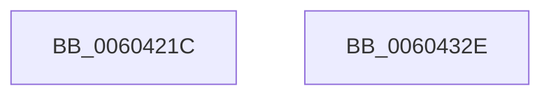

# RtlpHpSegContextInitialize

- RVA: `0x0060421C`–`0x0060432F` (길이 `275` bytes)
- VA: `0x000000014060421C`
- 실행 섹션: `.text`
- PDB 이름 있음: `예`; PDB Function 태그: `아니요`
- unwind 정보 RVA: `0x000B6A1C`
- 디코드: `79`개 명령, `275/275` bytes 표시
- 미해석 바이트: `0` (있으면 어셈블리에 `.byte`로 보존)

> 이 문서는 커널 이미지의 기계어와 PDB 기호를 분석해 생성했습니다. 4번과 5번은 함수 원형과 자료형을 바이너리 사용 방식에서 추정한 C 해석이며 원본 소스 복구 결과는 아닙니다.

## 1. Dependencies

- 직접 호출 지점: **2**; 고유 호출 대상: **2**
- 직접 호출자로 확인된 함수: **1**
- RIP 상대 이미지 참조: **1**

### Outgoing calls
- `0x00604243` → [memset](../6C/memset_function_006C6C40.md) (function, `0x006C6C40`)
- `0x006042CD` → [RtlpHpInitializeLock](../2E/RtlpHpInitializeLock_function_002E8054.md) (function, `0x002E8054`)

### Direct callers
- [RtlpHpHeapCreate](RtlpHpHeapCreate_function_00602FDC.md) at `0x0060310C`
- [RtlpHpHeapCreate](RtlpHpHeapCreate_function_00602FDC.md) at `0x00603156`

### Static image references
- `0x006042A9` → RVA `0x00F059A0` (`.data`; read)

## 2. Other-region calls and transfers

- 다른 실행 섹션으로 향하는 call: **0**
- 별도 외부 분기/꼬리 이동을 확인하지 못했습니다.

## 3. Assembly (complete function range)

```asm
0060421C  48 89 5C 24 08                  mov qword ptr [rsp + 8], rbx
00604221  48 89 6C 24 18                  mov qword ptr [rsp + 0x18], rbp
00604226  48 89 74 24 20                  mov qword ptr [rsp + 0x20], rsi
0060422B  57                              push rdi
0060422C  48 83 EC 20                     sub rsp, 0x20
00604230  49 8B E8                        mov rbp, r8
00604233  8B DA                           mov ebx, edx
00604235  33 D2                           xor edx, edx
00604237  41 B8 C0 00 00 00               mov r8d, 0xc0
0060423D  49 8B F9                        mov rdi, r9
00604240  48 8B F1                        mov rsi, rcx
00604243  E8 F8 29 0C 00                  call 0x1406c6c40
00604248  4C 8B 44 24 68                  mov r8, qword ptr [rsp + 0x68]
0060424D  48 8D 43 FF                     lea rax, [rbx - 1]
00604251  48 F7 D0                        not rax
00604254  C1 EB 08                        shr ebx, 8
00604257  48 89 06                        mov qword ptr [rsi], rax
0060425A  33 D2                           xor edx, edx
0060425C  0F BD C3                        bsr eax, ebx
0060425F  C6 46 0B 07                     mov byte ptr [rsi + 0xb], 7
00604263  88 46 08                        mov byte ptr [rsi + 8], al
00604266  8B C3                           mov eax, ebx
00604268  C1 E8 0C                        shr eax, 0xc
0060426B  0F BC C8                        bsf ecx, eax
0060426E  48 8D 83 FF 1F 00 00            lea rax, [rbx + 0x1fff]
00604275  88 4E 09                        mov byte ptr [rsi + 9], cl
00604278  8B CB                           mov ecx, ebx
0060427A  48 F7 F1                        div rcx
0060427D  8D 4B FF                        lea ecx, [rbx - 1]
00604280  88 46 0A                        mov byte ptr [rsi + 0xa], al
00604283  8D 93 FF 1F 00 00               lea edx, [rbx + 0x1fff]
00604289  8B 06                           mov eax, dword ptr [rsi]
0060428B  23 D1                           and edx, ecx
0060428D  F7 D0                           not eax
0060428F  03 D0                           add edx, eax
00604291  2B D3                           sub edx, ebx
00604293  81 EA FE 1F 00 00               sub edx, 0x1ffe
00604299  D1 EA                           shr edx, 1
0060429B  8B C2                           mov eax, edx
0060429D  23 C1                           and eax, ecx
0060429F  2B D0                           sub edx, eax
006042A1  B8 03 00 00 00                  mov eax, 3
006042A6  89 56 10                        mov dword ptr [rsi + 0x10], edx
006042A9  8B 0D F1 16 90 00               mov ecx, dword ptr [rip + 0x9016f1]
006042AF  C1 E9 0A                        shr ecx, 0xa
006042B2  22 C8                           and cl, al
006042B4  2A C1                           sub al, cl
006042B6  48 8D 4E 40                     lea rcx, [rsi + 0x40]
006042BA  88 46 0C                        mov byte ptr [rsi + 0xc], al
006042BD  8A 44 24 70                     mov al, byte ptr [rsp + 0x70]
006042C1  88 46 0D                        mov byte ptr [rsi + 0xd], al
006042C4  41 8B 00                        mov eax, dword ptr [r8]
006042C7  0F B6 D0                        movzx edx, al
006042CA  83 E2 01                        and edx, 1
006042CD  E8 82 3D CE FF                  call 0x1402e8054
006042D2  0F B7 44 24 60                  movzx eax, word ptr [rsp + 0x60]
006042D7  48 8D 4E 48                     lea rcx, [rsi + 0x48]
006042DB  41 0F 28 00                     movaps xmm0, xmmword ptr [r8]
006042DF  66 2B C6                        sub ax, si
006042E2  48 8B 5C 24 30                  mov rbx, qword ptr [rsp + 0x30]
006042E7  48 89 49 08                     mov qword ptr [rcx + 8], rcx
006042EB  48 89 09                        mov qword ptr [rcx], rcx
006042EE  48 83 66 60 00                  and qword ptr [rsi + 0x60], 0
006042F3  48 83 66 68 00                  and qword ptr [rsi + 0x68], 0
006042F8  66 89 46 14                     mov word ptr [rsi + 0x14], ax
006042FC  0F B7 44 24 58                  movzx eax, word ptr [rsp + 0x58]
00604301  66 2B C6                        sub ax, si
00604304  48 89 6E 38                     mov qword ptr [rsi + 0x38], rbp
00604308  48 8B 6C 24 40                  mov rbp, qword ptr [rsp + 0x40]
0060430D  66 89 46 16                     mov word ptr [rsi + 0x16], ax
00604311  48 8B 44 24 50                  mov rax, qword ptr [rsp + 0x50]
00604316  48 89 46 20                     mov qword ptr [rsi + 0x20], rax
0060431A  48 89 7E 18                     mov qword ptr [rsi + 0x18], rdi
0060431E  F3 0F 7F 46 28                  movdqu xmmword ptr [rsi + 0x28], xmm0
00604323  48 8B 74 24 48                  mov rsi, qword ptr [rsp + 0x48]
00604328  48 83 C4 20                     add rsp, 0x20
0060432C  5F                              pop rdi
0060432D  C3                              ret
0060432E  CC                              int3
```

## 4. C-style interpretation (structured pseudocode)

```c
__int64 __fastcall RtlpHpSegContextInitialize(__int64 a1, int a2, __int64 a3, __int64 a4, __int64 a5, unsigned __int16 a6, unsigned __int16 a7, __int64 a8, unsigned __int8 a9)
{
    __int64 result;
    __int64 v_rbx;
    __int64 v_rsp;
    unsigned __int64 v_stack_p18;
    unsigned __int64 v_stack_p20;
    unsigned __int64 v_stack_p8;

    v_stack_p8 = v_rbx;
    v_stack_p18 = v_rbp;
    v_stack_p20 = v_rsi;
    v_rsp = (v_rsp) - (32);
    a2 = 0;
    result = memset(a1, a2, 192, a4);
    result = ~((unsigned int)(a2) - 1);
    v_rbx = (unsigned int)(((unsigned int)(a2)) >> (8));
    *(unsigned __int64 *)(a1) = result;
    a2 = 0;
    *(unsigned __int8 *)(a1 + 11) = 7;
    *(unsigned __int8 *)(a1 + 8) = (unsigned __int8)(result);
    result = (unsigned int)(((unsigned int)((unsigned int)(v_rbx))) >> (12));
    *(unsigned __int8 *)(a1 + 9) = (unsigned __int8)(a1);
    *(unsigned __int8 *)(a1 + 10) = (unsigned __int8)(v_rbx + 8191);
    a2 = (unsigned int)((v_rbx + 8191) & ((unsigned int)(v_rbx - 1)));
    result = (unsigned int)(~((unsigned int)(*(unsigned int *)(a1))));
    a2 = (unsigned int)((a2) + ((unsigned int)(result)));
    a2 = (unsigned int)((a2) - ((unsigned int)(v_rbx)));
    a2 = (unsigned int)((a2) - (0x1FFEULL));
    a2 = (unsigned int)((a2) >> (1));
    result = (unsigned int)(((unsigned int)(a2)) & ((unsigned int)(v_rbx - 1)));
    a2 = (unsigned int)((a2) - ((unsigned int)(result)));
    *(unsigned int *)(a1 + 16) = a2;
    a1 = (unsigned int)(((unsigned int)(*(unsigned int *)(v_rip + 9443057))) >> (10));
    a1 = (unsigned __int8)((a1) & (3));
    result = (unsigned __int8)((3) - ((unsigned __int8)(a1)));
    *(unsigned __int8 *)(a1 + 12) = (unsigned __int8)(result);
    *(unsigned __int8 *)(a1 + 13) = a9;
    a2 = (unsigned int)(((unsigned __int8)((unsigned int)(*(unsigned int *)(a8)))) & (1));
    result = RtlpHpInitializeLock(a1 + 64, a2, a8, a4);
    result = (unsigned __int16)((a7) - ((unsigned __int16)(a1)));
    *(unsigned __int64 *)(a1 + 72 + 8) = a1 + 72;
    *(unsigned __int64 *)(a1 + 72) = a1 + 72;
    *(unsigned __int16 *)(a1 + 20) = (unsigned __int16)(result);
    result = (unsigned __int16)((a6) - ((unsigned __int16)(a1)));
    *(unsigned __int64 *)(a1 + 56) = a3;
    *(unsigned __int16 *)(a1 + 22) = (unsigned __int16)(result);
    *(unsigned __int64 *)(a1 + 32) = a5;
    *(unsigned __int64 *)(a1 + 24) = a4;
    *(unsigned __int64 *)(a1 + 40) = v_xmm0;
    v_rsp = (v_rsp) + (32);
    return a5;
}
```

## 5. (Beta) C Style

```c
int64_t RtlpHpSegContextInitialize(void *Arg1, void *Arg2, int64_t Arg3, int64_t Arg4, int64_t Arg5, uint16_t Arg6, uint16_t Arg7, void *Arg8, uint8_t Arg9)
{
    uint8_t *arg1 = (uint8_t *)Arg1;
    uint8_t *arg2 = (uint8_t *)Arg2;
    uint8_t *arg8 = (uint8_t *)Arg8;

    int64_t result;
    int64_t local_rbx;
    int64_t local_rsp;
    uint64_t v_stack_p18;
    uint64_t v_stack_p20;
    uint64_t v_stack_p8;

    v_stack_p8 = local_rbx;
    v_stack_p18 = local_rbp;
    v_stack_p20 = local_rsi;
    local_rsp = (local_rsp) - (32);
    Arg2 = 0;
    result = memset(Arg1, Arg2, 192, Arg4);
    result = ~((uint32_t)(Arg2) - 1);
    local_rbx = (uint32_t)(((uint32_t)(Arg2)) >> (8));
    *(uint64_t *)(arg1) = result;
    Arg2 = 0;
    *(uint8_t *)(arg1 + 0xB) = 7;
    *(uint8_t *)(arg1 + 0x8) = (uint8_t)(result);
    result = (uint32_t)(((uint32_t)((uint32_t)(local_rbx))) >> (12));
    *(uint8_t *)(arg1 + 0x9) = (uint8_t)(Arg1);
    *(uint8_t *)(arg1 + 0xA) = (uint8_t)(local_rbx + 8191);
    Arg2 = (uint32_t)((local_rbx + 8191) & ((uint32_t)(local_rbx - 1)));
    result = (uint32_t)(~((uint32_t)(*(uint32_t *)(arg1))));
    Arg2 = (uint32_t)((Arg2) + ((uint32_t)(result)));
    Arg2 = (uint32_t)((Arg2) - ((uint32_t)(local_rbx)));
    Arg2 = (uint32_t)((Arg2) - (0x1FFEULL));
    Arg2 = (uint32_t)((Arg2) >> (1));
    result = (uint32_t)(((uint32_t)(Arg2)) & ((uint32_t)(local_rbx - 1)));
    Arg2 = (uint32_t)((Arg2) - ((uint32_t)(result)));
    *(uint32_t *)(arg1 + 0x10) = Arg2;
    Arg1 = (uint32_t)(((uint32_t)(*(uint32_t *)(v_rip + 0x9016F1))) >> (10));
    Arg1 = (uint8_t)((Arg1) & (3));
    result = (uint8_t)((3) - ((uint8_t)(Arg1)));
    *(uint8_t *)(arg1 + 0xC) = (uint8_t)(result);
    *(uint8_t *)(arg1 + 0xD) = Arg9;
    Arg2 = (uint32_t)(((uint8_t)((uint32_t)(*(uint32_t *)(arg8)))) & (1));
    result = RtlpHpInitializeLock(Arg1 + 64, Arg2, Arg8, Arg4);
    result = (uint16_t)((Arg7) - ((uint16_t)(Arg1)));
    *(void **)(arg1 + 0x48 + 0x8) = Arg1 + 72;
    *(void **)(arg1 + 0x48) = Arg1 + 72;
    *(uint16_t *)(arg1 + 0x14) = (uint16_t)(result);
    result = (uint16_t)((Arg6) - ((uint16_t)(Arg1)));
    *(uint64_t *)(arg1 + 0x38) = Arg3;
    *(uint16_t *)(arg1 + 0x16) = (uint16_t)(result);
    *(uint64_t *)(arg1 + 0x20) = Arg5;
    *(uint64_t *)(arg1 + 0x18) = Arg4;
    *(uint64_t *)(arg1 + 0x28) = v_xmm0;
    local_rsp = (local_rsp) + (32);
    return Arg5;
}
```

### 관측된 메모리 오프셋

구조체 형식이 확인되지 않은 접근은 인자 기준의 오프셋으로만 기록했습니다.

| 기준 인자 | 오프셋 표현 | 폭 (bit) | 접근 |
|---|---:|---:|---|
| `Arg1` | `+ 0x0` | `32` | `R` |
| `Arg1` | `+ 0x0` | `64` | `W` |
| `Arg1` | `+ 0x8` | `8` | `W` |
| `Arg1` | `+ 0x8` | `64` | `W` |
| `Arg1` | `+ 0x9` | `8` | `W` |
| `Arg1` | `+ 0xA` | `8` | `W` |
| `Arg1` | `+ 0xB` | `8` | `W` |
| `Arg1` | `+ 0xC` | `8` | `W` |
| `Arg1` | `+ 0xD` | `8` | `W` |
| `Arg1` | `+ 0x10` | `32` | `W` |
| `Arg1` | `+ 0x14` | `16` | `W` |
| `Arg1` | `+ 0x16` | `16` | `W` |
| `Arg1` | `+ 0x18` | `64` | `W` |
| `Arg1` | `+ 0x20` | `64` | `W` |
| `Arg1` | `+ 0x28` | `128` | `W` |
| `Arg1` | `+ 0x38` | `64` | `W` |
| `Arg1` | `+ 0x40` | `64` | `R` |
| `Arg1` | `+ 0x48` | `64` | `R` |
| `Arg1` | `+ 0x60` | `64` | `R/W` |
| `Arg1` | `+ 0x68` | `64` | `R/W` |
| `Arg2` | `- 0x1` | `64` | `R` |
| `Arg8` | `+ 0x0` | `32` | `R` |

## 6. Execution-region graph

[열기: 2D/3D 그래프와 함수 탐색 컨트롤 패널](../../../control-panel.html?section=text&rva=0x0060421C&view=graph)

- 2D 그래프는 위에서 아래로 흐르고, 3D 그래프는 빈 공간을 드래그해 회전합니다. Shift+드래그는 이동, 휠은 확대·축소, 함수 노드 선택은 대상 보고서 이동입니다.

### Static fallback


