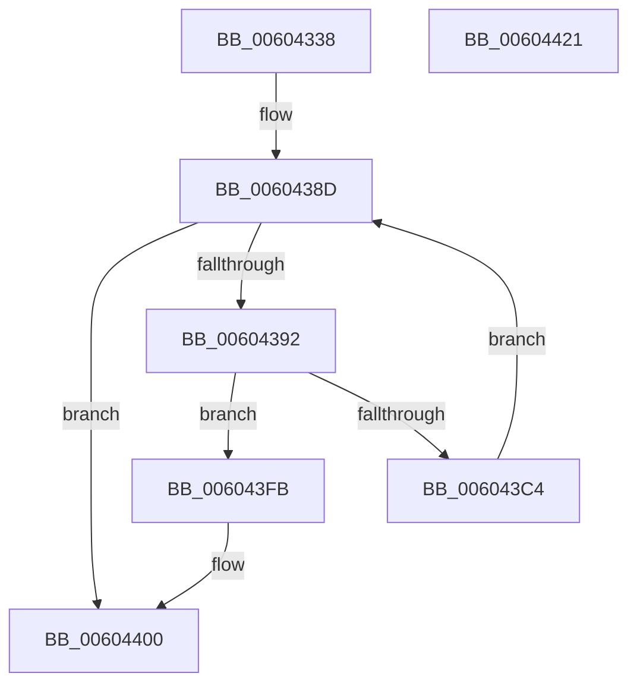

# RtlpHpSegContextReserve

- RVA: `0x00604338`–`0x00604422` (길이 `234` bytes)
- VA: `0x0000000140604338`
- 실행 섹션: `.text`
- PDB 이름 있음: `예`; PDB Function 태그: `아니요`
- unwind 정보 RVA: `0x0005FEF8`
- 디코드: `70`개 명령, `234/234` bytes 표시
- 미해석 바이트: `0` (있으면 어셈블리에 `.byte`로 보존)

> 이 문서는 커널 이미지의 기계어와 PDB 기호를 분석해 생성했습니다. 4번과 5번은 함수 원형과 자료형을 바이너리 사용 방식에서 추정한 C 해석이며 원본 소스 복구 결과는 아닙니다.

## 1. Dependencies

- 직접 호출 지점: **4**; 고유 호출 대상: **4**
- 직접 호출자로 확인된 함수: **1**
- RIP 상대 이미지 참조: **0**

### Outgoing calls
- `0x006043B7` → [RtlpHpSegSegmentAllocate](../32/RtlpHpSegSegmentAllocate_function_00326A78.md) (function, `0x00326A78`)
- `0x006043CD` → [RtlpHpSegSegmentInitialize](../47/RtlpHpSegSegmentInitialize_function_00478EB0.md) (function, `0x00478EB0`)
- `0x006043E6` → [RtlpHpSegFreeRangeInsert](../2E/RtlpHpSegFreeRangeInsert_function_002E4380.md) (function, `0x002E4380`)
- `0x006043F1` → [RtlpHpSegHeapAddSegment](../49/RtlpHpSegHeapAddSegment_function_00491970.md) (function, `0x00491970`)

### Direct callers
- [RtlpHpHeapCreate](RtlpHpHeapCreate_function_00602FDC.md) at `0x0060333D`

### Static image references
- 디코드된 RIP-relative 메모리 참조가 없습니다.

## 2. Other-region calls and transfers

- 다른 실행 섹션으로 향하는 call: **0**
- 별도 외부 분기/꼬리 이동을 확인하지 못했습니다.

## 3. Assembly (complete function range)

```asm
00604338  48 8B C4                        mov rax, rsp
0060433B  48 89 58 08                     mov qword ptr [rax + 8], rbx
0060433F  48 89 68 10                     mov qword ptr [rax + 0x10], rbp
00604343  48 89 70 18                     mov qword ptr [rax + 0x18], rsi
00604347  48 89 78 20                     mov qword ptr [rax + 0x20], rdi
0060434B  41 54                           push r12
0060434D  41 56                           push r14
0060434F  41 57                           push r15
00604351  48 83 EC 20                     sub rsp, 0x20
00604355  44 8B 09                        mov r9d, dword ptr [rcx]
00604358  48 8D 42 FF                     lea rax, [rdx - 1]
0060435C  41 F7 D9                        neg r9d
0060435F  49 8D B0 FF 0F 00 00            lea rsi, [r8 + 0xfff]
00604366  33 D2                           xor edx, edx
00604368  48 C1 EE 0C                     shr rsi, 0xc
0060436C  49 03 C1                        add rax, r9
0060436F  41 BF 00 01 00 00               mov r15d, 0x100
00604375  49 F7 F1                        div r9
00604378  0F B6 51 0A                     movzx edx, byte ptr [rcx + 0xa]
0060437C  48 8B F9                        mov rdi, rcx
0060437F  8A 49 09                        mov cl, byte ptr [rcx + 9]
00604382  44 2B FA                        sub r15d, edx
00604385  41 D3 E7                        shl r15d, cl
00604388  48 8B E8                        mov rbp, rax
0060438B  33 DB                           xor ebx, ebx
0060438D  48 85 ED                        test rbp, rbp
00604390  74 6E                           je 0x140604400
00604392  41 8B CF                        mov ecx, r15d
00604395  44 8B E6                        mov r12d, esi
00604398  48 3B F1                        cmp rsi, rcx
0060439B  48 8B C6                        mov rax, rsi
0060439E  45 0F 47 E7                     cmova r12d, r15d
006043A2  48 2B C1                        sub rax, rcx
006043A5  48 3B CE                        cmp rcx, rsi
006043A8  41 8B D4                        mov edx, r12d
006043AB  48 8B CF                        mov rcx, rdi
006043AE  48 1B F6                        sbb rsi, rsi
006043B1  45 33 C0                        xor r8d, r8d
006043B4  48 23 F0                        and rsi, rax
006043B7  E8 BC 26 D2 FF                  call 0x140326a78
006043BC  4C 8B F0                        mov r14, rax
006043BF  48 85 C0                        test rax, rax
006043C2  74 37                           je 0x1406043fb
006043C4  45 8B C4                        mov r8d, r12d
006043C7  48 8B D0                        mov rdx, rax
006043CA  48 8B CF                        mov rcx, rdi
006043CD  E8 DE 4A E7 FF                  call 0x140478eb0
006043D2  0F B6 57 0A                     movzx edx, byte ptr [rdi + 0xa]
006043D6  41 B8 01 00 00 00               mov r8d, 1
006043DC  48 C1 E2 05                     shl rdx, 5
006043E0  48 8B CF                        mov rcx, rdi
006043E3  49 03 D6                        add rdx, r14
006043E6  E8 95 FF CD FF                  call 0x1402e4380
006043EB  49 8B D6                        mov rdx, r14
006043EE  48 8B CF                        mov rcx, rdi
006043F1  E8 7A D5 E8 FF                  call 0x140491970
006043F6  48 FF CD                        dec rbp
006043F9  EB 92                           jmp 0x14060438d
006043FB  BB 9A 00 00 C0                  mov ebx, 0xc000009a
00604400  48 8B 6C 24 48                  mov rbp, qword ptr [rsp + 0x48]
00604405  8B C3                           mov eax, ebx
00604407  48 8B 5C 24 40                  mov rbx, qword ptr [rsp + 0x40]
0060440C  48 8B 74 24 50                  mov rsi, qword ptr [rsp + 0x50]
00604411  48 8B 7C 24 58                  mov rdi, qword ptr [rsp + 0x58]
00604416  48 83 C4 20                     add rsp, 0x20
0060441A  41 5F                           pop r15
0060441C  41 5E                           pop r14
0060441E  41 5C                           pop r12
00604420  C3                              ret
00604421  CC                              int3
```

## 4. C-style interpretation (structured pseudocode)

```c
__int64 __fastcall RtlpHpSegContextReserve(__int64 a1, __int64 a2, __int64 a3)
{
    __int64 result;
    __int64 v_r12;
    __int64 v_r15;
    __int64 v_rbp;
    __int64 v_rbx;
    __int64 v_rsi;
    __int64 v_rsp;
    unsigned __int64 v_stack_p10;
    unsigned __int64 v_stack_p18;
    unsigned __int64 v_stack_p20;
    unsigned __int64 v_stack_p8;

    *(unsigned __int64 *)(v_rsp + 8) = v_rbx;
    *(unsigned __int64 *)(v_rsp + 16) = v_rbp;
    *(unsigned __int64 *)(v_rsp + 24) = v_rsi;
    *(unsigned __int64 *)(v_rsp + 32) = v_rdi;
    v_rsp = (v_rsp) - (32);
    a4 = (unsigned int)(-((unsigned int)(*(unsigned int *)(a1))));
    a2 = 0;
    v_rsi = (a3 + 4095) >> (12);
    result = (a2 - 1) + (a4);
    v_r15 = (unsigned int)((256) - ((unsigned int)(*(unsigned __int8 *)(a1 + 10))));
    v_r15 = (unsigned int)((v_r15) << ((unsigned __int8)(*(unsigned __int8 *)(a1 + 9))));
    v_rbx = 0;
loc_0060438D:
    if (result == 0) goto loc_00604400;
    v_r12 = (unsigned int)((unsigned int)(v_rsi));
    if (v_rsi > ((unsigned int)((unsigned int)(v_r15)))) { v_r12 = (unsigned int)(v_r15); }
    result = (v_rsi) - ((unsigned int)((unsigned int)(v_r15)));
    a3 = 0;
    v_rsi = (v_rsi) & (result);
    result = RtlpHpSegSegmentAllocate(a1, (unsigned int)((unsigned int)(v_r12)), a3, a4);
    if (result == 0) goto loc_006043FB;
    result = RtlpHpSegSegmentInitialize(a1, result, (unsigned int)((unsigned int)(v_r12)), a4);
    a2 = (*(unsigned __int8 *)(a1 + 10)) << (5);
    a2 = (a2) + (result);
    result = RtlpHpSegFreeRangeInsert(a1, a2, 1, a4);
    result = RtlpHpSegHeapAddSegment(a1, result, 1, a4);
    v_rbp = (result) - 1;
    goto loc_0060438D;
loc_006043FB:
loc_00604400:
    v_rsp = (v_rsp) + (32);
    return (unsigned int)((unsigned int)((unsigned int)(0xC000009AULL)));
}
```

## 5. (Beta) C Style

```c
int64_t RtlpHpSegContextReserve(void *Arg1, void *Arg2, void *Arg3)
{
    uint8_t *arg1 = (uint8_t *)Arg1;
    uint8_t *arg2 = (uint8_t *)Arg2;
    uint8_t *arg3 = (uint8_t *)Arg3;

    int64_t result;
    int64_t local_r12;
    int64_t local_r15;
    int64_t local_rbp;
    int64_t local_rbx;
    int64_t local_rsi;
    int64_t local_rsp;
    uint64_t v_stack_p10;
    uint64_t v_stack_p18;
    uint64_t v_stack_p20;
    uint64_t v_stack_p8;

    *(uint64_t *)(local_rsp + 0x8) = local_rbx;
    *(uint64_t *)(local_rsp + 0x10) = local_rbp;
    *(uint64_t *)(local_rsp + 0x18) = local_rsi;
    *(uint64_t *)(local_rsp + 0x20) = local_rdi;
    local_rsp = (local_rsp) - (32);
    a4 = (uint32_t)(-((uint32_t)(*(uint32_t *)(arg1))));
    Arg2 = 0;
    local_rsi = (Arg3 + 4095) >> (12);
    result = (Arg2 - 1) + (a4);
    local_r15 = (uint32_t)((256) - ((uint32_t)(*(uint8_t *)(arg1 + 0xA))));
    local_r15 = (uint32_t)((local_r15) << ((uint8_t)(*(uint8_t *)(arg1 + 0x9))));
    local_rbx = 0;
loc_0060438D:
    if (result == 0) goto loc_00604400;
    local_r12 = (uint32_t)((uint32_t)(local_rsi));
    if (local_rsi > ((uint32_t)((uint32_t)(local_r15)))) { local_r12 = (uint32_t)(local_r15); }
    result = (local_rsi) - ((uint32_t)((uint32_t)(local_r15)));
    Arg3 = 0;
    local_rsi = (local_rsi) & (result);
    result = RtlpHpSegSegmentAllocate(Arg1, (uint32_t)((uint32_t)(local_r12)), Arg3, a4);
    if (result == 0) goto loc_006043FB;
    result = RtlpHpSegSegmentInitialize(Arg1, result, (uint32_t)((uint32_t)(local_r12)), a4);
    Arg2 = (*(uint8_t *)(arg1 + 0xA)) << (5);
    Arg2 = (Arg2) + (result);
    result = RtlpHpSegFreeRangeInsert(Arg1, Arg2, 1, a4);
    result = RtlpHpSegHeapAddSegment(Arg1, result, 1, a4);
    local_rbp = (result) - 1;
    goto loc_0060438D;
loc_006043FB:
loc_00604400:
    local_rsp = (local_rsp) + (32);
    return (uint32_t)((uint32_t)((uint32_t)(0xC000009AULL)));
}
```

### 관측된 메모리 오프셋

구조체 형식이 확인되지 않은 접근은 인자 기준의 오프셋으로만 기록했습니다.

| 기준 인자 | 오프셋 표현 | 폭 (bit) | 접근 |
|---|---:|---:|---|
| `Arg1` | `+ 0x0` | `32` | `R` |
| `Arg1` | `+ 0x9` | `8` | `R` |
| `Arg1` | `+ 0xA` | `8` | `R` |
| `Arg2` | `- 0x1` | `64` | `R` |
| `Arg3` | `+ 0xFFF` | `64` | `R` |

## 6. Execution-region graph

[열기: 2D/3D 그래프와 함수 탐색 컨트롤 패널](../../../control-panel.html?section=text&rva=0x00604338&view=graph)

- 2D 그래프는 위에서 아래로 흐르고, 3D 그래프는 빈 공간을 드래그해 회전합니다. Shift+드래그는 이동, 휠은 확대·축소, 함수 노드 선택은 대상 보고서 이동입니다.

### Static fallback


