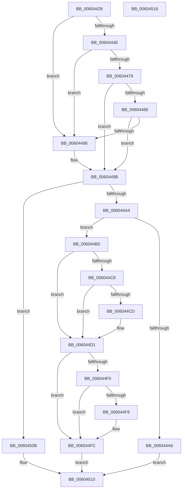

# RtlpHpSegSetExtraPresent

- RVA: `0x00604428`–`0x00604517` (길이 `239` bytes)
- VA: `0x0000000140604428`
- 실행 섹션: `.text`
- PDB 이름 있음: `예`; PDB Function 태그: `아니요`
- unwind 정보 RVA: `0x00071750`
- 디코드: `75`개 명령, `239/239` bytes 표시
- 미해석 바이트: `0` (있으면 어셈블리에 `.byte`로 보존)

> 이 문서는 커널 이미지의 기계어와 PDB 기호를 분석해 생성했습니다. 4번과 5번은 함수 원형과 자료형을 바이너리 사용 방식에서 추정한 C 해석이며 원본 소스 복구 결과는 아닙니다.

## 1. Dependencies

- 직접 호출 지점: **0**; 고유 호출 대상: **0**
- 직접 호출자로 확인된 함수: **1**
- RIP 상대 이미지 참조: **2**

### Outgoing calls
- 직접 디코드된 call 명령이 없습니다.

### Direct callers
- [RtlpHpExtrasSetPresent](RtlpHpExtrasSetPresent_function_00602CF4.md) at `0x00602D7A`

### Static image references
- `0x0060443F` → RVA `0x00E28300` (`.data`; read)
- `0x006044DC` → RVA `0x00E28302` (`.data`; read)

## 2. Other-region calls and transfers

- 다른 실행 섹션으로 향하는 call: **0**
- 별도 외부 분기/꼬리 이동을 확인하지 못했습니다.

## 3. Assembly (complete function range)

```asm
00604428  48 89 5C 24 08                  mov qword ptr [rsp + 8], rbx
0060442D  4C 8B CA                        mov r9, rdx
00604430  33 DB                           xor ebx, ebx
00604432  4C 23 09                        and r9, qword ptr [rcx]
00604435  4C 8B C2                        mov r8, rdx
00604438  4C 8B D9                        mov r11, rcx
0060443B  49 8B 41 10                     mov rax, qword ptr [r9 + 0x10]
0060443F  48 33 05 BA 3E 82 00            xor rax, qword ptr [rip + 0x823eba]
00604446  49 33 C1                        xor rax, r9
00604449  48 3B C1                        cmp rax, rcx
0060444C  75 4A                           jne 0x140604498
0060444E  8A 49 08                        mov cl, byte ptr [rcx + 8]
00604451  41 2B D1                        sub edx, r9d
00604454  48 D3 EA                        shr rdx, cl
00604457  48 C1 E2 05                     shl rdx, 5
0060445B  49 03 D1                        add rdx, r9
0060445E  0F B6 42 1A                     movzx eax, byte ptr [rdx + 0x1a]
00604462  48 F7 D8                        neg rax
00604465  48 C1 E0 05                     shl rax, 5
00604469  48 03 D0                        add rdx, rax
0060446C  44 8A 52 18                     mov r10b, byte ptr [rdx + 0x18]
00604470  41 8A C2                        mov al, r10b
00604473  24 03                           and al, 3
00604475  3C 03                           cmp al, 3
00604477  75 1F                           jne 0x140604498
00604479  48 8B C2                        mov rax, rdx
0060447C  49 2B C1                        sub rax, r9
0060447F  48 C1 F8 05                     sar rax, 5
00604483  48 D3 E0                        shl rax, cl
00604486  49 03 C1                        add rax, r9
00604489  49 3B C0                        cmp rax, r8
0060448C  74 0D                           je 0x14060449b
0060448E  41 80 E2 0C                     and r10b, 0xc
00604492  41 80 FA 08                     cmp r10b, 8
00604496  73 03                           jae 0x14060449b
00604498  48 8B D3                        mov rdx, rbx
0060449B  8A 42 18                        mov al, byte ptr [rdx + 0x18]
0060449E  24 0C                           and al, 0xc
006044A0  3C 08                           cmp al, 8
006044A2  72 67                           jb 0x14060450b
006044A4  75 0A                           jne 0x1406044b0
006044A6  B9 00 40 00 00                  mov ecx, 0x4000
006044AB  66 09 0B                        or word ptr [rbx], cx
006044AE  EB 60                           jmp 0x140604510
006044B0  49 8B 43 20                     mov rax, qword ptr [r11 + 0x20]
006044B4  49 8D 50 F0                     lea rdx, [r8 - 0x10]
006044B8  41 BA FF 0F 00 00               mov r10d, 0xfff
006044BE  44 8A 48 04                     mov r9b, byte ptr [rax + 4]
006044C2  41 80 E1 01                     and r9b, 1
006044C6  74 09                           je 0x1406044d1
006044C8  4D 85 C2                        test r10, r8
006044CB  75 04                           jne 0x1406044d1
006044CD  48 83 C2 F0                     add rdx, -0x10
006044D1  0F B7 4A 02                     movzx ecx, word ptr [rdx + 2]
006044D5  8B C2                           mov eax, edx
006044D7  C1 E8 10                        shr eax, 0x10
006044DA  33 C8                           xor ecx, eax
006044DC  0F B7 05 1F 3E 82 00            movzx eax, word ptr [rip + 0x823e1f]
006044E3  33 C8                           xor ecx, eax
006044E5  C1 E1 04                        shl ecx, 4
006044E8  83 E9 10                        sub ecx, 0x10
006044EB  45 84 C9                        test r9b, r9b
006044EE  74 0C                           je 0x1406044fc
006044F0  48 8D 42 20                     lea rax, [rdx + 0x20]
006044F4  49 85 C2                        test r10, rax
006044F7  75 03                           jne 0x1406044fc
006044F9  83 C1 F0                        add ecx, -0x10
006044FC  8B C1                           mov eax, ecx
006044FE  B9 00 40 00 00                  mov ecx, 0x4000
00604503  66 42 09 4C 00 FE               or word ptr [rax + r8 - 2], cx
00604509  EB 05                           jmp 0x140604510
0060450B  66 83 4A 08 01                  or word ptr [rdx + 8], 1
00604510  48 8B 5C 24 08                  mov rbx, qword ptr [rsp + 8]
00604515  C3                              ret
00604516  CC                              int3
```

## 4. C-style interpretation (structured pseudocode)

```c
__int64 __fastcall RtlpHpSegSetExtraPresent(__int64 a1, __int64 a2)
{
    __int64 result;
    __int64 v_r10;
    __int64 v_rbx;
    unsigned __int64 v_stack_p8;

    v_stack_p8 = v_rbx;
    v_rbx = 0;
    a4 = (a2) & (*(unsigned __int64 *)(a1));
    result = (*(unsigned __int64 *)(a4 + 16)) ^ (*(unsigned __int64 *)(v_rip + 8535738));
    result = (result) ^ (a4);
    if (result != a1) goto loc_00604498;
    a2 = (unsigned int)((a2) - ((unsigned int)(a4)));
    a2 = (a2) >> ((unsigned __int8)(*(unsigned __int8 *)(a1 + 8)));
    a2 = (a2) << (5);
    a2 = (a2) + (a4);
    result = -(*(unsigned __int8 *)(a2 + 26));
    result = (result) << (5);
    a2 = (a2) + (result);
    result = (unsigned __int8)(((unsigned __int8)(*(unsigned __int8 *)(a2 + 24))) & (3));
    if (((unsigned __int8)(result)) != 3) goto loc_00604498;
    result = (a2) - (a4);
    result = (result) >> (5);
    result = (result) << ((unsigned __int8)(*(unsigned __int8 *)(a1 + 8)));
    result = (result) + (a4);
    if (result == a2) goto loc_0060449B;
    v_r10 = (unsigned __int8)((*(unsigned __int8 *)(a2 + 24)) & (12));
    if (((unsigned __int8)(v_r10)) < 8) {
        a2 = 0;
    }
    result = (unsigned __int8)((*(unsigned __int8 *)(a2 + 24)) & (12));
    if (((unsigned __int8)(result)) < 8) goto loc_0060450B;
    if (((unsigned __int8)(result)) != 8) goto loc_006044B0;
    goto loc_00604510;
loc_006044B0:
    a4 = (unsigned __int8)((*(unsigned __int8 *)(*(unsigned __int64 *)(a1 + 32) + 4)) & (1));
    if (condition_is_equal) goto loc_006044D1;
    if ((((unsigned int)(0xFFFULL)) & (a2)) == 0) {
        a2 = (a2 - 16) + (-16);
    }
    result = (unsigned int)(((unsigned int)((unsigned int)(a2))) >> (16));
    a1 = (unsigned int)((*(unsigned __int16 *)(a2 + 2)) ^ ((unsigned int)(result)));
    a1 = (unsigned int)((a1) ^ ((unsigned int)(*(unsigned __int16 *)(v_rip + 8535583))));
    a1 = (unsigned int)((a1) << (4));
    a1 = (unsigned int)((a1) - (16));
    if ((unsigned __int8)(a4) == 0) goto loc_006044FC;
    if ((((unsigned int)(0xFFFULL)) & (a2 + 32)) == 0) {
        a1 = (unsigned int)((a1) + (-16));
    }
    goto loc_00604510;
loc_0060450B:
loc_00604510:
    return (unsigned int)((unsigned int)(a1));
}
```

## 5. (Beta) C Style

```c
int64_t RtlpHpSegSetExtraPresent(void *Arg1, void *Arg2)
{
    uint8_t *arg1 = (uint8_t *)Arg1;
    uint8_t *arg2 = (uint8_t *)Arg2;

    int64_t result;
    int64_t local_r10;
    int64_t local_rbx;
    uint64_t v_stack_p8;

    v_stack_p8 = local_rbx;
    local_rbx = 0;
    a4 = (Arg2) & (*(uint64_t *)(arg1));
    result = (*(uint64_t *)(a4 + 0x10)) ^ (*(uint64_t *)(v_rip + 0x823EBA));
    result = (result) ^ (a4);
    if (result != Arg1) goto loc_00604498;
    Arg2 = (uint32_t)((Arg2) - ((uint32_t)(a4)));
    Arg2 = (Arg2) >> ((uint8_t)(*(uint8_t *)(arg1 + 0x8)));
    Arg2 = (Arg2) << (5);
    Arg2 = (Arg2) + (a4);
    result = -(*(uint8_t *)(arg2 + 0x1A));
    result = (result) << (5);
    Arg2 = (Arg2) + (result);
    result = (uint8_t)(((uint8_t)(*(uint8_t *)(arg2 + 0x18))) & (3));
    if (((uint8_t)(result)) != 3) goto loc_00604498;
    result = (Arg2) - (a4);
    result = (result) >> (5);
    result = (result) << ((uint8_t)(*(uint8_t *)(arg1 + 0x8)));
    result = (result) + (a4);
    if (result == Arg2) goto loc_0060449B;
    local_r10 = (uint8_t)((*(uint8_t *)(arg2 + 0x18)) & (12));
    if (((uint8_t)(local_r10)) < 8) {
        Arg2 = 0;
    }
    result = (uint8_t)((*(uint8_t *)(arg2 + 0x18)) & (12));
    if (((uint8_t)(result)) < 8) goto loc_0060450B;
    if (((uint8_t)(result)) != 8) goto loc_006044B0;
    goto loc_00604510;
loc_006044B0:
    a4 = (uint8_t)((*(uint8_t *)(*(uint64_t *)(arg1 + 0x20) + 0x4)) & (1));
    if (condition_is_equal) goto loc_006044D1;
    if ((((uint32_t)(0xFFFULL)) & (Arg2)) == 0) {
        Arg2 = (Arg2 - 16) + (-16);
    }
    result = (uint32_t)(((uint32_t)((uint32_t)(Arg2))) >> (16));
    Arg1 = (uint32_t)((*(uint16_t *)(arg2 + 0x2)) ^ ((uint32_t)(result)));
    Arg1 = (uint32_t)((Arg1) ^ ((uint32_t)(*(uint16_t *)(v_rip + 0x823E1F))));
    Arg1 = (uint32_t)((Arg1) << (4));
    Arg1 = (uint32_t)((Arg1) - (16));
    if ((uint8_t)(a4) == 0) goto loc_006044FC;
    if ((((uint32_t)(0xFFFULL)) & (Arg2 + 32)) == 0) {
        Arg1 = (uint32_t)((Arg1) + (-16));
    }
    goto loc_00604510;
loc_0060450B:
loc_00604510:
    return (uint32_t)((uint32_t)(Arg1));
}
```

### 관측된 메모리 오프셋

구조체 형식이 확인되지 않은 접근은 인자 기준의 오프셋으로만 기록했습니다.

| 기준 인자 | 오프셋 표현 | 폭 (bit) | 접근 |
|---|---:|---:|---|
| `Arg1` | `+ 0x0` | `64` | `R` |
| `Arg1` | `+ 0x8` | `8` | `R` |
| `Arg1` | `+ 0x20` | `64` | `R` |
| `Arg2` | `- 0x10` | `64` | `R` |
| `Arg2` | `+ 0x2` | `16` | `R` |
| `Arg2` | `+ 0x10` | `64` | `R` |
| `Arg2` | `+ 0x20` | `64` | `R` |

## 6. Execution-region graph

[열기: 2D/3D 그래프와 함수 탐색 컨트롤 패널](../../../control-panel.html?section=text&rva=0x00604428&view=graph)

- 2D 그래프는 위에서 아래로 흐르고, 3D 그래프는 빈 공간을 드래그해 회전합니다. Shift+드래그는 이동, 휠은 확대·축소, 함수 노드 선택은 대상 보고서 이동입니다.

### Static fallback


