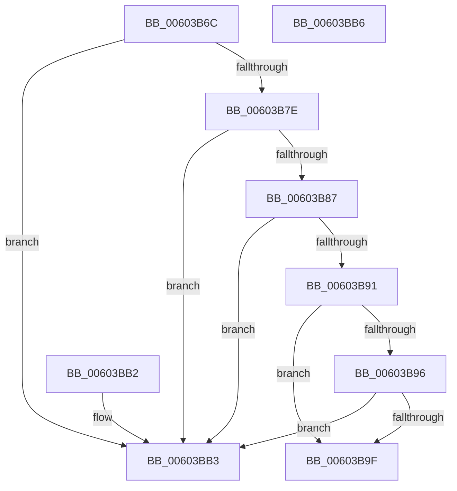

# RtlpHpVaMgrCtxAllocatorCompare

- RVA: `0x00603B6C`–`0x00603BB7` (길이 `75` bytes)
- VA: `0x0000000140603B6C`
- 실행 섹션: `.text`
- PDB 이름 있음: `예`; PDB Function 태그: `아니요`
- unwind 정보 RVA: `0x000DB714`
- 디코드: `28`개 명령, `75/75` bytes 표시
- 미해석 바이트: `0` (있으면 어셈블리에 `.byte`로 보존)

> 이 문서는 커널 이미지의 기계어와 PDB 기호를 분석해 생성했습니다. 4번과 5번은 함수 원형과 자료형을 바이너리 사용 방식에서 추정한 C 해석이며 원본 소스 복구 결과는 아닙니다.

## 1. Dependencies

- 직접 호출 지점: **0**; 고유 호출 대상: **0**
- 직접 호출자로 확인된 함수: **1**
- RIP 상대 이미지 참조: **0**

### Outgoing calls
- 직접 디코드된 call 명령이 없습니다.

### Direct callers
- [RtlpHpVaMgrCtxAllocatorFind](../4F/RtlpHpVaMgrCtxAllocatorFind_function_004FA484.md) at `0x004FA4CF`

### Static image references
- 디코드된 RIP-relative 메모리 참조가 없습니다.

## 2. Other-region calls and transfers

- 다른 실행 섹션으로 향하는 call: **0**
- 별도 외부 분기/꼬리 이동을 확인하지 못했습니다.

## 3. Assembly (complete function range)

```asm
00603B6C  44 0F B6 49 2E                  movzx r9d, byte ptr [rcx + 0x2e]
00603B71  41 8B C1                        mov eax, r9d
00603B74  D1 E8                           shr eax, 1
00603B76  83 E0 07                        and eax, 7
00603B79  3B 42 04                        cmp eax, dword ptr [rdx + 4]
00603B7C  75 35                           jne 0x140603bb3
00603B7E  0F B6 41 2D                     movzx eax, byte ptr [rcx + 0x2d]
00603B82  3B 42 08                        cmp eax, dword ptr [rdx + 8]
00603B85  75 2C                           jne 0x140603bb3
00603B87  48 8B 42 10                     mov rax, qword ptr [rdx + 0x10]
00603B8B  48 39 41 20                     cmp qword ptr [rcx + 0x20], rax
00603B8F  75 22                           jne 0x140603bb3
00603B91  45 85 C0                        test r8d, r8d
00603B94  74 09                           je 0x140603b9f
00603B96  0F B7 41 28                     movzx eax, word ptr [rcx + 0x28]
00603B9A  41 3B C0                        cmp eax, r8d
00603B9D  75 14                           jne 0x140603bb3
00603B9F  0F B6 4A 0C                     movzx ecx, byte ptr [rdx + 0xc]
00603BA3  41 C0 E9 04                     shr r9b, 4
00603BA7  41 8A C1                        mov al, r9b
00603BAA  F6 D0                           not al
00603BAC  33 C1                           xor eax, ecx
00603BAE  83 E0 01                        and eax, 1
00603BB1  C3                              ret
00603BB2  CC                              int3
00603BB3  33 C0                           xor eax, eax
00603BB5  C3                              ret
00603BB6  CC                              int3
```

## 4. C-style interpretation (structured pseudocode)

```c
__int64 __fastcall RtlpHpVaMgrCtxAllocatorCompare(__int64 a1, __int64 a2, int a3)
{
    __int64 result;

    result = (unsigned int)(((unsigned int)((unsigned int)(*(unsigned __int8 *)(a1 + 46)))) >> (1));
    result = (unsigned int)((result) & (7));
    if (((unsigned int)(result)) != (*(unsigned int *)(a2 + 4))) goto loc_00603BB3;
    if (((unsigned int)(*(unsigned __int8 *)(a1 + 45))) != (*(unsigned int *)(a2 + 8))) goto loc_00603BB3;
    if ((*(unsigned __int64 *)(a1 + 32)) != (*(unsigned __int64 *)(a2 + 16))) goto loc_00603BB3;
    if (a3 == 0) goto loc_00603B9F;
    if (((unsigned int)(*(unsigned __int16 *)(a1 + 40))) != a3) goto loc_00603BB3;
loc_00603B9F:
    a4 = (unsigned __int8)((*(unsigned __int8 *)(a1 + 46)) >> (4));
    result = (unsigned __int8)(~((unsigned __int8)(a4)));
    result = (unsigned int)((result) ^ ((unsigned int)(*(unsigned __int8 *)(a2 + 12))));
    result = (unsigned int)((result) & (1));
    return result;
loc_00603BB3:
    result = 0;
    return result;
}
```

## 5. (Beta) C Style

```c
int64_t RtlpHpVaMgrCtxAllocatorCompare(void *Arg1, void *Arg2, int32_t Arg3)
{
    uint8_t *arg1 = (uint8_t *)Arg1;
    uint8_t *arg2 = (uint8_t *)Arg2;

    int64_t result;

    result = (uint32_t)(((uint32_t)((uint32_t)(*(uint8_t *)(arg1 + 0x2E)))) >> (1));
    result = (uint32_t)((result) & (7));
    if (((uint32_t)(result)) != (*(uint32_t *)(arg2 + 0x4))) goto loc_00603BB3;
    if (((uint32_t)(*(uint8_t *)(arg1 + 0x2D))) != (*(uint32_t *)(arg2 + 0x8))) goto loc_00603BB3;
    if ((*(uint64_t *)(arg1 + 0x20)) != (*(uint64_t *)(arg2 + 0x10))) goto loc_00603BB3;
    if (Arg3 == 0) goto loc_00603B9F;
    if (((uint32_t)(*(uint16_t *)(arg1 + 0x28))) != Arg3) goto loc_00603BB3;
loc_00603B9F:
    a4 = (uint8_t)((*(uint8_t *)(arg1 + 0x2E)) >> (4));
    result = (uint8_t)(~((uint8_t)(a4)));
    result = (uint32_t)((result) ^ ((uint32_t)(*(uint8_t *)(arg2 + 0xC))));
    result = (uint32_t)((result) & (1));
    return result;
loc_00603BB3:
    result = 0;
    return result;
}
```

### 관측된 메모리 오프셋

구조체 형식이 확인되지 않은 접근은 인자 기준의 오프셋으로만 기록했습니다.

| 기준 인자 | 오프셋 표현 | 폭 (bit) | 접근 |
|---|---:|---:|---|
| `Arg1` | `+ 0x20` | `64` | `R` |
| `Arg1` | `+ 0x28` | `16` | `R` |
| `Arg1` | `+ 0x2D` | `8` | `R` |
| `Arg1` | `+ 0x2E` | `8` | `R` |
| `Arg2` | `+ 0x4` | `32` | `R` |
| `Arg2` | `+ 0x8` | `32` | `R` |
| `Arg2` | `+ 0xC` | `8` | `R` |
| `Arg2` | `+ 0x10` | `64` | `R` |

## 6. Execution-region graph

[열기: 2D/3D 그래프와 함수 탐색 컨트롤 패널](../../../control-panel.html?section=text&rva=0x00603B6C&view=graph)

- 2D 그래프는 위에서 아래로 흐르고, 3D 그래프는 빈 공간을 드래그해 회전합니다. Shift+드래그는 이동, 휠은 확대·축소, 함수 노드 선택은 대상 보고서 이동입니다.

### Static fallback


