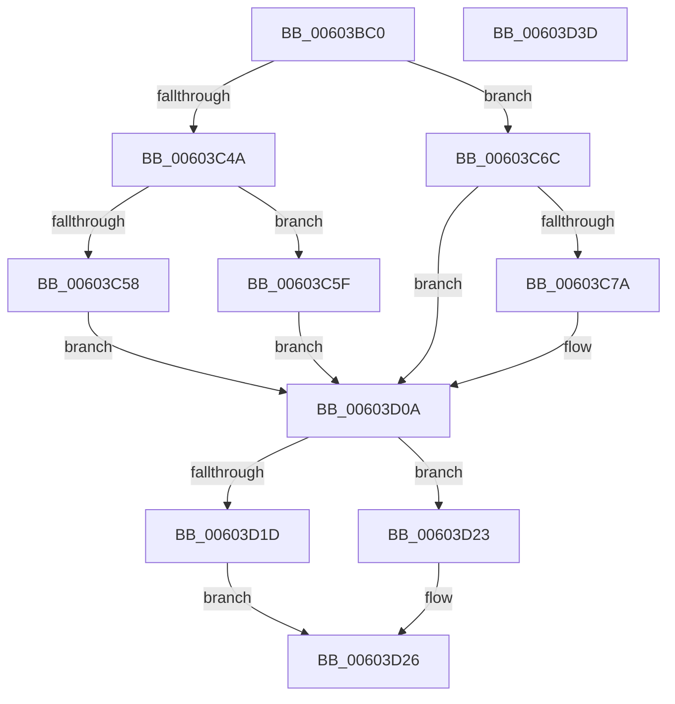

# RtlpHpVaMgrCtxAllocatorReference

- RVA: `0x00603BC0`–`0x00603D3E` (길이 `382` bytes)
- VA: `0x0000000140603BC0`
- 실행 섹션: `.text`
- PDB 이름 있음: `예`; PDB Function 태그: `아니요`
- unwind 정보 RVA: `0x00083688`
- 디코드: `106`개 명령, `382/382` bytes 표시
- 미해석 바이트: `0` (있으면 어셈블리에 `.byte`로 보존)

> 이 문서는 커널 이미지의 기계어와 PDB 기호를 분석해 생성했습니다. 4번과 5번은 함수 원형과 자료형을 바이너리 사용 방식에서 추정한 C 해석이며 원본 소스 복구 결과는 아닙니다.

## 1. Dependencies

- 직접 호출 지점: **4**; 고유 호출 대상: **4**
- 직접 호출자로 확인된 함수: **2**
- RIP 상대 이미지 참조: **1**

### Outgoing calls
- `0x00603C23` → [RtlpHpAcquireLockExclusive](../32/RtlpHpAcquireLockExclusive_function_003246B0.md) (function, `0x003246B0`)
- `0x00603C3D` → [RtlpHpVaMgrCtxAllocatorFind](../4F/RtlpHpVaMgrCtxAllocatorFind_function_004FA484.md) (function, `0x004FA484`)
- `0x00603C8B` → [RtlpHpInitializeLock](../2E/RtlpHpInitializeLock_function_002E8054.md) (function, `0x002E8054`)
- `0x00603D13` → [RtlpHpReleaseLockExclusive](../32/RtlpHpReleaseLockExclusive_function_00324230.md) (function, `0x00324230`)

### Direct callers
- [RtlpHpRegisterEnvironment](RtlpHpRegisterEnvironment_function_006036C0.md) at `0x00603769`
- [RtlpHpVaMgrCtxStart](RtlpHpVaMgrCtxStart_function_00603E2C.md) at `0x00603ED4`

### Static image references
- `0x00603BDA` → RVA `0x0001A920` (`.rdata`; read)

## 2. Other-region calls and transfers

- 다른 실행 섹션으로 향하는 call: **0**
- 별도 외부 분기/꼬리 이동을 확인하지 못했습니다.

## 3. Assembly (complete function range)

```asm
00603BC0  48 89 5C 24 10                  mov qword ptr [rsp + 0x10], rbx
00603BC5  48 89 6C 24 18                  mov qword ptr [rsp + 0x18], rbp
00603BCA  56                              push rsi
00603BCB  57                              push rdi
00603BCC  41 54                           push r12
00603BCE  41 56                           push r14
00603BD0  41 57                           push r15
00603BD2  48 83 EC 20                     sub rsp, 0x20
00603BD6  48 63 42 04                     movsxd rax, dword ptr [rdx + 4]
00603BDA  4C 8D 15 3F 6D A1 FF            lea r10, [rip - 0x5e92c1]
00603BE1  44 8B 89 68 08 00 00            mov r9d, dword ptr [rcx + 0x868]
00603BE8  48 8D A9 60 08 00 00            lea rbp, [rcx + 0x860]
00603BEF  48 83 64 24 50 00               and qword ptr [rsp + 0x50], 0
00603BF5  48 8B F2                        mov rsi, rdx
00603BF8  48 8B F9                        mov rdi, rcx
00603BFB  41 BC 01 00 00 00               mov r12d, 1
00603C01  45 8B 14 82                     mov r10d, dword ptr [r10 + rax*4]
00603C05  41 8B D4                        mov edx, r12d
00603C08  45 8D 41 FF                     lea r8d, [r9 - 1]
00603C0C  48 8B CD                        mov rcx, rbp
00603C0F  45 03 C2                        add r8d, r10d
00603C12  41 8D 42 FF                     lea eax, [r10 - 1]
00603C16  44 23 C0                        and r8d, eax
00603C19  45 8D 72 FF                     lea r14d, [r10 - 1]
00603C1D  45 2B C8                        sub r9d, r8d
00603C20  45 03 F1                        add r14d, r9d
00603C23  E8 88 0A D2 FF                  call 0x1403246b0
00603C28  41 C1 EE 14                     shr r14d, 0x14
00603C2C  4C 8D 4C 24 50                  lea r9, [rsp + 0x50]
00603C31  45 8B C6                        mov r8d, r14d
00603C34  48 8B D6                        mov rdx, rsi
00603C37  48 8B CF                        mov rcx, rdi
00603C3A  44 8A F8                        mov r15b, al
00603C3D  E8 42 68 EF FF                  call 0x1404fa484
00603C42  48 8B D8                        mov rbx, rax
00603C45  48 85 C0                        test rax, rax
00603C48  74 22                           je 0x140603c6c
00603C4A  0F B7 40 2A                     movzx eax, word ptr [rax + 0x2a]
00603C4E  B9 FF FF 00 00                  mov ecx, 0xffff
00603C53  66 3B C1                        cmp ax, cx
00603C56  75 07                           jne 0x140603c5f
00603C58  33 DB                           xor ebx, ebx
00603C5A  E9 AB 00 00 00                  jmp 0x140603d0a
00603C5F  66 41 03 C4                     add ax, r12w
00603C63  66 89 43 2A                     mov word ptr [rbx + 0x2a], ax
00603C67  E9 9E 00 00 00                  jmp 0x140603d0a
00603C6C  48 8B 4C 24 50                  mov rcx, qword ptr [rsp + 0x50]
00603C71  48 85 C9                        test rcx, rcx
00603C74  0F 84 90 00 00 00               je 0x140603d0a
00603C7A  45 33 C0                        xor r8d, r8d
00603C7D  48 8B D9                        mov rbx, rcx
00603C80  44 39 46 04                     cmp dword ptr [rsi + 4], r8d
00603C84  41 0F 95 C0                     setne r8b
00603C88  41 8B D0                        mov edx, r8d
00603C8B  E8 C4 43 CE FF                  call 0x1402e8054
00603C90  48 8B 4E 10                     mov rcx, qword ptr [rsi + 0x10]
00603C94  48 B8 AB AA AA AA AA AA AA 2A   movabs rax, 0x2aaaaaaaaaaaaaab
00603C9E  48 89 4B 20                     mov qword ptr [rbx + 0x20], rcx
00603CA2  48 8B CB                        mov rcx, rbx
00603CA5  48 2B CF                        sub rcx, rdi
00603CA8  66 44 89 73 28                  mov word ptr [rbx + 0x28], r14w
00603CAD  48 81 E9 70 08 00 00            sub rcx, 0x870
00603CB4  66 44 89 63 2A                  mov word ptr [rbx + 0x2a], r12w
00603CB9  48 F7 E9                        imul rcx
00603CBC  48 89 7B 18                     mov qword ptr [rbx + 0x18], rdi
00603CC0  48 C1 FA 03                     sar rdx, 3
00603CC4  48 8B C2                        mov rax, rdx
00603CC7  48 C1 E8 3F                     shr rax, 0x3f
00603CCB  48 03 D0                        add rdx, rax
00603CCE  8A 46 08                        mov al, byte ptr [rsi + 8]
00603CD1  88 43 2D                        mov byte ptr [rbx + 0x2d], al
00603CD4  8A 43 2E                        mov al, byte ptr [rbx + 0x2e]
00603CD7  24 FE                           and al, 0xfe
00603CD9  88 53 2C                        mov byte ptr [rbx + 0x2c], dl
00603CDC  41 0A C0                        or al, r8b
00603CDF  44 8A 46 04                     mov r8b, byte ptr [rsi + 4]
00603CE3  41 80 E0 07                     and r8b, 7
00603CE7  24 F1                           and al, 0xf1
00603CE9  45 02 C0                        add r8b, r8b
00603CEC  44 32 C0                        xor r8b, al
00603CEF  8A 46 0C                        mov al, byte ptr [rsi + 0xc]
00603CF2  41 22 C4                        and al, r12b
00603CF5  41 80 E0 EF                     and r8b, 0xef
00603CF9  C0 E0 04                        shl al, 4
00603CFC  44 0A C0                        or r8b, al
00603CFF  44 88 43 2E                     mov byte ptr [rbx + 0x2e], r8b
00603D03  44 01 A7 6C 08 00 00            add dword ptr [rdi + 0x86c], r12d
00603D0A  45 8A C7                        mov r8b, r15b
00603D0D  41 8B D4                        mov edx, r12d
00603D10  48 8B CD                        mov rcx, rbp
00603D13  E8 18 05 D2 FF                  call 0x140324230
00603D18  48 85 DB                        test rbx, rbx
00603D1B  74 06                           je 0x140603d23
00603D1D  0F B6 43 2C                     movzx eax, byte ptr [rbx + 0x2c]
00603D21  EB 03                           jmp 0x140603d26
00603D23  83 C8 FF                        or eax, 0xffffffff
00603D26  48 8B 5C 24 58                  mov rbx, qword ptr [rsp + 0x58]
00603D2B  48 8B 6C 24 60                  mov rbp, qword ptr [rsp + 0x60]
00603D30  48 83 C4 20                     add rsp, 0x20
00603D34  41 5F                           pop r15
00603D36  41 5E                           pop r14
00603D38  41 5C                           pop r12
00603D3A  5F                              pop rdi
00603D3B  5E                              pop rsi
00603D3C  C3                              ret
00603D3D  CC                              int3
```

## 4. C-style interpretation (structured pseudocode)

```c
__int64 __fastcall RtlpHpVaMgrCtxAllocatorReference(__int64 a1, __int64 a2)
{
    __int64 result;
    __int64 v_r14;
    __int64 v_rbx;
    __int64 v_rsp;
    unsigned __int64 v_stack_p10;
    unsigned __int64 v_stack_p18;
    unsigned __int64 v_stack_p8;

    v_stack_p10 = v_rbx;
    v_stack_p18 = v_rbp;
    v_rsp = (v_rsp) - (32);
    a3 = (unsigned int)(((unsigned int)(*(unsigned int *)(a1 + 2152)) - 1) + ((unsigned int)((unsigned int)(*(unsigned int *)(v_rip - 6197953 + (int)(*(unsigned int *)(a2 + 4)) * 4)))));
    a3 = (unsigned int)((a3) & ((unsigned int)((unsigned int)(*(unsigned int *)(v_rip - 6197953 + (int)(*(unsigned int *)(a2 + 4)) * 4)) - 1)));
    a4 = (unsigned int)(((unsigned int)(*(unsigned int *)(a1 + 2152))) - ((unsigned int)(a3)));
    v_r14 = (unsigned int)(((unsigned int)(*(unsigned int *)(v_rip - 6197953 + (int)(*(unsigned int *)(a2 + 4)) * 4)) - 1) + ((unsigned int)(a4)));
    result = RtlpHpAcquireLockExclusive(a1 + 2144, 1, a3, a4);
    v_r14 = (unsigned int)((v_r14) >> (20));
    result = RtlpHpVaMgrCtxAllocatorFind(a1, a2, (unsigned int)((unsigned int)(v_r14)), v_stack_p8);
    if (result == 0) goto loc_00603C6C;
    if (((unsigned __int16)(*(unsigned __int16 *)(result + 42))) != ((unsigned __int16)((unsigned int)(0xFFFFULL)))) goto loc_00603C5F;
    v_rbx = 0;
    goto loc_00603D0A;
loc_00603C5F:
    result = (unsigned __int16)((*(unsigned __int16 *)(result + 42)) + (1));
    *(unsigned __int16 *)(v_rbx + 42) = (unsigned __int16)(result);
    goto loc_00603D0A;
loc_00603C6C:
    if (v_stack_p8 != 0) {
        a3 = 0;
        v_rbx = v_stack_p8;
        a3 = ((*(unsigned int *)(a2 + 4)) != 0) ? 1 : 0;
        a2 = (unsigned int)(a3);
        result = RtlpHpInitializeLock(v_stack_p8, a2, a3, v_stack_p8);
        a1 = *(unsigned __int64 *)(a2 + 16);
        *(unsigned __int64 *)(v_rbx + 32) = a1;
        a1 = v_rbx;
        a1 = (a1) - (a1);
        *(unsigned __int16 *)(v_rbx + 40) = (unsigned __int16)(v_r14);
        a1 = (a1) - (0x870ULL);
        *(unsigned __int16 *)(v_rbx + 42) = 1;
        *(unsigned __int64 *)(v_rbx + 24) = a1;
        a2 = (a2) >> (3);
        result = a2;
        result = (result) >> (63);
        a2 = (a2) + (result);
        result = *(unsigned __int8 *)(a2 + 8);
        *(unsigned __int8 *)(v_rbx + 45) = (unsigned __int8)(result);
        result = *(unsigned __int8 *)(v_rbx + 46);
        result = (unsigned __int8)((result) & (254));
        *(unsigned __int8 *)(v_rbx + 44) = (unsigned __int8)(a2);
        result = (unsigned __int8)((result) | ((unsigned __int8)(a3)));
        a3 = *(unsigned __int8 *)(a2 + 4);
        a3 = (unsigned __int8)((a3) & (7));
        result = (unsigned __int8)((result) & (241));
        a3 = (unsigned __int8)((a3) + ((unsigned __int8)(a3)));
        a3 = (unsigned __int8)((a3) ^ ((unsigned __int8)(result)));
        result = *(unsigned __int8 *)(a2 + 12);
        result = (unsigned __int8)((result) & (1));
        a3 = (unsigned __int8)((a3) & (239));
        result = (unsigned __int8)((result) << (4));
        a3 = (unsigned __int8)((a3) | ((unsigned __int8)(result)));
        *(unsigned __int8 *)(v_rbx + 46) = (unsigned __int8)(a3);
    }
    result = RtlpHpReleaseLockExclusive(a1 + 2144, 1, (unsigned __int8)((unsigned __int8)(result)), v_stack_p8);
    if (v_rbx == 0) goto loc_00603D23;
    goto loc_00603D26;
loc_00603D23:
    result = (unsigned int)((*(unsigned __int8 *)(v_rbx + 44)) | (0xFFFFFFFFULL));
loc_00603D26:
    v_rsp = (v_rsp) + (32);
    return result;
}
```

## 5. (Beta) C Style

```c
int64_t RtlpHpVaMgrCtxAllocatorReference(void *Arg1, void *Arg2)
{
    uint8_t *arg1 = (uint8_t *)Arg1;
    uint8_t *arg2 = (uint8_t *)Arg2;

    int64_t result;
    int64_t local_r14;
    int64_t local_rbx;
    int64_t local_rsp;
    uint64_t v_stack_p10;
    uint64_t v_stack_p18;
    uint64_t v_stack_p8;

    v_stack_p10 = local_rbx;
    v_stack_p18 = local_rbp;
    local_rsp = (local_rsp) - (32);
    a3 = (uint32_t)(((uint32_t)(*(uint32_t *)(arg1 + 0x868)) - 1) + ((uint32_t)((uint32_t)(*(uint32_t *)(v_rip - 0x5E92C1 + (int32_t)(*(uint32_t *)(arg2 + 0x4)) * 4)))));
    a3 = (uint32_t)((a3) & ((uint32_t)((uint32_t)(*(uint32_t *)(v_rip - 0x5E92C1 + (int32_t)(*(uint32_t *)(arg2 + 0x4)) * 4)) - 1)));
    a4 = (uint32_t)(((uint32_t)(*(uint32_t *)(arg1 + 0x868))) - ((uint32_t)(a3)));
    local_r14 = (uint32_t)(((uint32_t)(*(uint32_t *)(v_rip - 0x5E92C1 + (int32_t)(*(uint32_t *)(arg2 + 0x4)) * 4)) - 1) + ((uint32_t)(a4)));
    result = RtlpHpAcquireLockExclusive(Arg1 + 2144, 1, a3, a4);
    local_r14 = (uint32_t)((local_r14) >> (20));
    result = RtlpHpVaMgrCtxAllocatorFind(Arg1, Arg2, (uint32_t)((uint32_t)(local_r14)), v_stack_p8);
    if (result == 0) goto loc_00603C6C;
    if (((uint16_t)(*(uint16_t *)(result + 0x2A))) != ((uint16_t)((uint32_t)(0xFFFFULL)))) goto loc_00603C5F;
    local_rbx = 0;
    goto loc_00603D0A;
loc_00603C5F:
    result = (uint16_t)((*(uint16_t *)(result + 0x2A)) + (1));
    *(uint16_t *)(local_rbx + 0x2A) = (uint16_t)(result);
    goto loc_00603D0A;
loc_00603C6C:
    if (v_stack_p8 != 0) {
        a3 = 0;
        local_rbx = v_stack_p8;
        a3 = ((*(uint32_t *)(arg2 + 0x4)) != 0) ? 1 : 0;
        Arg2 = (uint32_t)(a3);
        result = RtlpHpInitializeLock(v_stack_p8, Arg2, a3, v_stack_p8);
        Arg1 = *(uint64_t *)(arg2 + 0x10);
        *(void **)(local_rbx + 0x20) = Arg1;
        Arg1 = local_rbx;
        Arg1 = (Arg1) - (Arg1);
        *(uint16_t *)(local_rbx + 0x28) = (uint16_t)(local_r14);
        Arg1 = (Arg1) - (0x870ULL);
        *(uint16_t *)(local_rbx + 0x2A) = 1;
        *(void **)(local_rbx + 0x18) = Arg1;
        Arg2 = (Arg2) >> (3);
        result = Arg2;
        result = (result) >> (63);
        Arg2 = (Arg2) + (result);
        result = *(uint8_t *)(arg2 + 0x8);
        *(uint8_t *)(local_rbx + 0x2D) = (uint8_t)(result);
        result = *(uint8_t *)(local_rbx + 0x2E);
        result = (uint8_t)((result) & (254));
        *(uint8_t *)(local_rbx + 0x2C) = (uint8_t)(Arg2);
        result = (uint8_t)((result) | ((uint8_t)(a3)));
        a3 = *(uint8_t *)(arg2 + 0x4);
        a3 = (uint8_t)((a3) & (7));
        result = (uint8_t)((result) & (241));
        a3 = (uint8_t)((a3) + ((uint8_t)(a3)));
        a3 = (uint8_t)((a3) ^ ((uint8_t)(result)));
        result = *(uint8_t *)(arg2 + 0xC);
        result = (uint8_t)((result) & (1));
        a3 = (uint8_t)((a3) & (239));
        result = (uint8_t)((result) << (4));
        a3 = (uint8_t)((a3) | ((uint8_t)(result)));
        *(uint8_t *)(local_rbx + 0x2E) = (uint8_t)(a3);
    }
    result = RtlpHpReleaseLockExclusive(Arg1 + 2144, 1, (uint8_t)((uint8_t)(result)), v_stack_p8);
    if (local_rbx == 0) goto loc_00603D23;
    goto loc_00603D26;
loc_00603D23:
    result = (uint32_t)((*(uint8_t *)(local_rbx + 0x2C)) | (0xFFFFFFFFULL));
loc_00603D26:
    local_rsp = (local_rsp) + (32);
    return result;
}
```

### 관측된 메모리 오프셋

구조체 형식이 확인되지 않은 접근은 인자 기준의 오프셋으로만 기록했습니다.

| 기준 인자 | 오프셋 표현 | 폭 (bit) | 접근 |
|---|---:|---:|---|
| `Arg1` | `+ 0x860` | `64` | `R` |
| `Arg1` | `+ 0x868` | `32` | `R` |
| `Arg1` | `+ 0x86C` | `32` | `R/W` |
| `Arg2` | `+ 0x4` | `8` | `R` |
| `Arg2` | `+ 0x4` | `32` | `R` |
| `Arg2` | `+ 0x8` | `8` | `R` |
| `Arg2` | `+ 0xC` | `8` | `R` |
| `Arg2` | `+ 0x10` | `64` | `R` |

## 6. Execution-region graph

[열기: 2D/3D 그래프와 함수 탐색 컨트롤 패널](../../../control-panel.html?section=text&rva=0x00603BC0&view=graph)

- 2D 그래프는 위에서 아래로 흐르고, 3D 그래프는 빈 공간을 드래그해 회전합니다. Shift+드래그는 이동, 휠은 확대·축소, 함수 노드 선택은 대상 보고서 이동입니다.

### Static fallback


