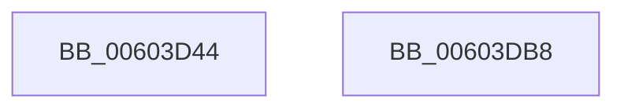

# RtlpHpVaMgrCtxCommit

- RVA: `0x00603D44`–`0x00603DB9` (길이 `117` bytes)
- VA: `0x0000000140603D44`
- 실행 섹션: `.text`
- PDB 이름 있음: `예`; PDB Function 태그: `아니요`
- unwind 정보 RVA: `0x00066400`
- 디코드: `31`개 명령, `117/117` bytes 표시
- 미해석 바이트: `0` (있으면 어셈블리에 `.byte`로 보존)

> 이 문서는 커널 이미지의 기계어와 PDB 기호를 분석해 생성했습니다. 4번과 5번은 함수 원형과 자료형을 바이너리 사용 방식에서 추정한 C 해석이며 원본 소스 복구 결과는 아닙니다.

## 1. Dependencies

- 직접 호출 지점: **2**; 고유 호출 대상: **2**
- 직접 호출자로 확인된 함수: **1**
- RIP 상대 이미지 참조: **0**

### Outgoing calls
- `0x00603D70` → [RtlSparseArrayElementAllocated](../32/RtlSparseArrayElementAllocated_function_00327364.md) (function, `0x00327364`)
- `0x00603D9E` → [RtlpHpVaMgrRangeCommit](RtlpHpVaMgrRangeCommit_function_00603EF8.md) (function, `0x00603EF8`)

### Direct callers
- [RtlpHpAllocVA](../32/RtlpHpAllocVA_function_003276A0.md) at `0x00327802`

### Static image references
- 디코드된 RIP-relative 메모리 참조가 없습니다.

## 2. Other-region calls and transfers

- 다른 실행 섹션으로 향하는 call: **0**
- 별도 외부 분기/꼬리 이동을 확인하지 못했습니다.

## 3. Assembly (complete function range)

```asm
00603D44  48 89 5C 24 08                  mov qword ptr [rsp + 8], rbx
00603D49  48 89 6C 24 10                  mov qword ptr [rsp + 0x10], rbp
00603D4E  48 89 74 24 18                  mov qword ptr [rsp + 0x18], rsi
00603D53  57                              push rdi
00603D54  48 83 EC 30                     sub rsp, 0x30
00603D58  48 8B FA                        mov rdi, rdx
00603D5B  48 8B D9                        mov rbx, rcx
00603D5E  48 2B 51 08                     sub rdx, qword ptr [rcx + 8]
00603D62  41 8B E9                        mov ebp, r9d
00603D65  48 C1 EA 14                     shr rdx, 0x14
00603D69  48 83 C1 10                     add rcx, 0x10
00603D6D  49 8B F0                        mov rsi, r8
00603D70  E8 EF 35 D2 FF                  call 0x140327364
00603D75  44 8B CD                        mov r9d, ebp
00603D78  48 89 7C 24 20                  mov qword ptr [rsp + 0x20], rdi
00603D7D  4C 8D 44 24 20                  lea r8, [rsp + 0x20]
00603D82  48 89 74 24 28                  mov qword ptr [rsp + 0x28], rsi
00603D87  48 8B D0                        mov rdx, rax
00603D8A  44 0F B6 50 01                  movzx r10d, byte ptr [rax + 1]
00603D8F  49 83 C2 2D                     add r10, 0x2d
00603D93  4B 8D 0C 52                     lea rcx, [r10 + r10*2]
00603D97  48 C1 E1 04                     shl rcx, 4
00603D9B  48 03 CB                        add rcx, rbx
00603D9E  E8 55 01 00 00                  call 0x140603ef8
00603DA3  48 8B 5C 24 40                  mov rbx, qword ptr [rsp + 0x40]
00603DA8  48 8B 6C 24 48                  mov rbp, qword ptr [rsp + 0x48]
00603DAD  48 8B 74 24 50                  mov rsi, qword ptr [rsp + 0x50]
00603DB2  48 83 C4 30                     add rsp, 0x30
00603DB6  5F                              pop rdi
00603DB7  C3                              ret
00603DB8  CC                              int3
```

## 4. C-style interpretation (structured pseudocode)

```c
__int64 __fastcall RtlpHpVaMgrCtxCommit(__int64 a1, __int64 a2, __int64 a3, int a4)
{
    __int64 result;
    __int64 v_r10;
    __int64 v_rsp;
    unsigned __int64 v_stack_m10;
    unsigned __int64 v_stack_m18;
    unsigned __int64 v_stack_p10;
    unsigned __int64 v_stack_p18;
    unsigned __int64 v_stack_p8;

    v_stack_p8 = v_rbx;
    v_stack_p10 = v_rbp;
    v_stack_p18 = v_rsi;
    v_rsp = (v_rsp) - (48);
    a2 = (a2) - (*(unsigned __int64 *)(a1 + 8));
    a2 = (a2) >> (20);
    a1 = (a1) + (16);
    result = RtlSparseArrayElementAllocated(a1, a2, a3, a4);
    v_stack_m18 = a2;
    v_stack_m10 = a3;
    v_r10 = (*(unsigned __int8 *)(result + 1)) + (45);
    a1 = (v_r10 + v_r10 * 2) << (4);
    a1 = (a1) + (a1);
    result = RtlpHpVaMgrRangeCommit(a1, result, v_stack_m18, (unsigned int)((unsigned int)((unsigned int)(a4))));
    v_rsp = (v_rsp) + (48);
    return result;
}
```

## 5. (Beta) C Style

```c
int64_t RtlpHpVaMgrCtxCommit(void *Arg1, int64_t Arg2, int64_t Arg3, int32_t Arg4)
{
    uint8_t *arg1 = (uint8_t *)Arg1;

    int64_t result;
    int64_t local_r10;
    int64_t local_rsp;
    uint64_t v_stack_m10;
    uint64_t v_stack_m18;
    uint64_t v_stack_p10;
    uint64_t v_stack_p18;
    uint64_t v_stack_p8;

    v_stack_p8 = local_rbx;
    v_stack_p10 = local_rbp;
    v_stack_p18 = local_rsi;
    local_rsp = (local_rsp) - (48);
    Arg2 = (Arg2) - (*(uint64_t *)(arg1 + 0x8));
    Arg2 = (Arg2) >> (20);
    Arg1 = (Arg1) + (16);
    result = RtlSparseArrayElementAllocated(Arg1, Arg2, Arg3, Arg4);
    v_stack_m18 = Arg2;
    v_stack_m10 = Arg3;
    local_r10 = (*(uint8_t *)(result + 0x1)) + (45);
    Arg1 = (local_r10 + local_r10 * 2) << (4);
    Arg1 = (Arg1) + (Arg1);
    result = RtlpHpVaMgrRangeCommit(Arg1, result, v_stack_m18, (uint32_t)((uint32_t)((uint32_t)(Arg4))));
    local_rsp = (local_rsp) + (48);
    return result;
}
```

### 관측된 메모리 오프셋

구조체 형식이 확인되지 않은 접근은 인자 기준의 오프셋으로만 기록했습니다.

| 기준 인자 | 오프셋 표현 | 폭 (bit) | 접근 |
|---|---:|---:|---|
| `Arg1` | `+ 0x8` | `64` | `R` |

## 6. Execution-region graph

[열기: 2D/3D 그래프와 함수 탐색 컨트롤 패널](../../../control-panel.html?section=text&rva=0x00603D44&view=graph)

- 2D 그래프는 위에서 아래로 흐르고, 3D 그래프는 빈 공간을 드래그해 회전합니다. Shift+드래그는 이동, 휠은 확대·축소, 함수 노드 선택은 대상 보고서 이동입니다.

### Static fallback


