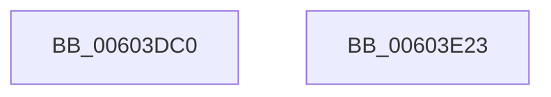

# RtlpHpVaMgrCtxDecommit

- RVA: `0x00603DC0`–`0x00603E24` (길이 `100` bytes)
- VA: `0x0000000140603DC0`
- 실행 섹션: `.text`
- PDB 이름 있음: `예`; PDB Function 태그: `아니요`
- unwind 정보 RVA: `0x000794E0`
- 디코드: `27`개 명령, `100/100` bytes 표시
- 미해석 바이트: `0` (있으면 어셈블리에 `.byte`로 보존)

> 이 문서는 커널 이미지의 기계어와 PDB 기호를 분석해 생성했습니다. 4번과 5번은 함수 원형과 자료형을 바이너리 사용 방식에서 추정한 C 해석이며 원본 소스 복구 결과는 아닙니다.

## 1. Dependencies

- 직접 호출 지점: **2**; 고유 호출 대상: **2**
- 직접 호출자로 확인된 함수: **2**
- RIP 상대 이미지 참조: **0**

### Outgoing calls
- `0x00603DE4` → [RtlSparseArrayElementAllocated](../32/RtlSparseArrayElementAllocated_function_00327364.md) (function, `0x00327364`)
- `0x00603E0E` → [RtlpHpVaMgrRangeDecommit](RtlpHpVaMgrRangeDecommit_function_00604040.md) (function, `0x00604040`)

### Direct callers
- [RtlpHpFreeVA](../2C/RtlpHpFreeVA_function_002C0FD4.md) at `0x002C1047`
- [RtlpHpSegMgrCommit](../32/RtlpHpSegMgrCommit_function_00326BE4.md) at `0x00326F7C`

### Static image references
- 디코드된 RIP-relative 메모리 참조가 없습니다.

## 2. Other-region calls and transfers

- 다른 실행 섹션으로 향하는 call: **0**
- 별도 외부 분기/꼬리 이동을 확인하지 못했습니다.

## 3. Assembly (complete function range)

```asm
00603DC0  48 89 5C 24 08                  mov qword ptr [rsp + 8], rbx
00603DC5  48 89 74 24 10                  mov qword ptr [rsp + 0x10], rsi
00603DCA  57                              push rdi
00603DCB  48 83 EC 30                     sub rsp, 0x30
00603DCF  48 8B DA                        mov rbx, rdx
00603DD2  48 8B F1                        mov rsi, rcx
00603DD5  48 2B 51 08                     sub rdx, qword ptr [rcx + 8]
00603DD9  49 8B F8                        mov rdi, r8
00603DDC  48 C1 EA 14                     shr rdx, 0x14
00603DE0  48 83 C1 10                     add rcx, 0x10
00603DE4  E8 7B 35 D2 FF                  call 0x140327364
00603DE9  4C 8D 44 24 20                  lea r8, [rsp + 0x20]
00603DEE  48 89 5C 24 20                  mov qword ptr [rsp + 0x20], rbx
00603DF3  48 89 7C 24 28                  mov qword ptr [rsp + 0x28], rdi
00603DF8  0F B6 50 01                     movzx edx, byte ptr [rax + 1]
00603DFC  48 83 C2 2D                     add rdx, 0x2d
00603E00  48 8D 0C 52                     lea rcx, [rdx + rdx*2]
00603E04  48 8B D0                        mov rdx, rax
00603E07  48 C1 E1 04                     shl rcx, 4
00603E0B  48 03 CE                        add rcx, rsi
00603E0E  E8 2D 02 00 00                  call 0x140604040
00603E13  48 8B 5C 24 40                  mov rbx, qword ptr [rsp + 0x40]
00603E18  48 8B 74 24 48                  mov rsi, qword ptr [rsp + 0x48]
00603E1D  48 83 C4 30                     add rsp, 0x30
00603E21  5F                              pop rdi
00603E22  C3                              ret
00603E23  CC                              int3
```

## 4. C-style interpretation (structured pseudocode)

```c
__int64 __fastcall RtlpHpVaMgrCtxDecommit(__int64 a1, __int64 a2, __int64 a3)
{
    __int64 result;
    __int64 v_rsp;
    unsigned __int64 v_stack_m10;
    unsigned __int64 v_stack_m18;
    unsigned __int64 v_stack_p10;
    unsigned __int64 v_stack_p8;

    v_stack_p8 = v_rbx;
    v_stack_p10 = v_rsi;
    v_rsp = (v_rsp) - (48);
    a2 = (a2) - (*(unsigned __int64 *)(a1 + 8));
    a2 = (a2) >> (20);
    a1 = (a1) + (16);
    result = RtlSparseArrayElementAllocated(a1, a2, a3, a4);
    v_stack_m18 = a2;
    v_stack_m10 = a3;
    a2 = (*(unsigned __int8 *)(result + 1)) + (45);
    a1 = (a2 + a2 * 2) << (4);
    a1 = (a1) + (a1);
    result = RtlpHpVaMgrRangeDecommit(a1, result, v_stack_m18, a4);
    v_rsp = (v_rsp) + (48);
    return result;
}
```

## 5. (Beta) C Style

```c
int64_t RtlpHpVaMgrCtxDecommit(void *Arg1, int64_t Arg2, int64_t Arg3)
{
    uint8_t *arg1 = (uint8_t *)Arg1;

    int64_t result;
    int64_t local_rsp;
    uint64_t v_stack_m10;
    uint64_t v_stack_m18;
    uint64_t v_stack_p10;
    uint64_t v_stack_p8;

    v_stack_p8 = local_rbx;
    v_stack_p10 = local_rsi;
    local_rsp = (local_rsp) - (48);
    Arg2 = (Arg2) - (*(uint64_t *)(arg1 + 0x8));
    Arg2 = (Arg2) >> (20);
    Arg1 = (Arg1) + (16);
    result = RtlSparseArrayElementAllocated(Arg1, Arg2, Arg3, a4);
    v_stack_m18 = Arg2;
    v_stack_m10 = Arg3;
    Arg2 = (*(uint8_t *)(result + 0x1)) + (45);
    Arg1 = (Arg2 + Arg2 * 2) << (4);
    Arg1 = (Arg1) + (Arg1);
    result = RtlpHpVaMgrRangeDecommit(Arg1, result, v_stack_m18, a4);
    local_rsp = (local_rsp) + (48);
    return result;
}
```

### 관측된 메모리 오프셋

구조체 형식이 확인되지 않은 접근은 인자 기준의 오프셋으로만 기록했습니다.

| 기준 인자 | 오프셋 표현 | 폭 (bit) | 접근 |
|---|---:|---:|---|
| `Arg1` | `+ 0x8` | `64` | `R` |

## 6. Execution-region graph

[열기: 2D/3D 그래프와 함수 탐색 컨트롤 패널](../../../control-panel.html?section=text&rva=0x00603DC0&view=graph)

- 2D 그래프는 위에서 아래로 흐르고, 3D 그래프는 빈 공간을 드래그해 회전합니다. Shift+드래그는 이동, 휠은 확대·축소, 함수 노드 선택은 대상 보고서 이동입니다.

### Static fallback


