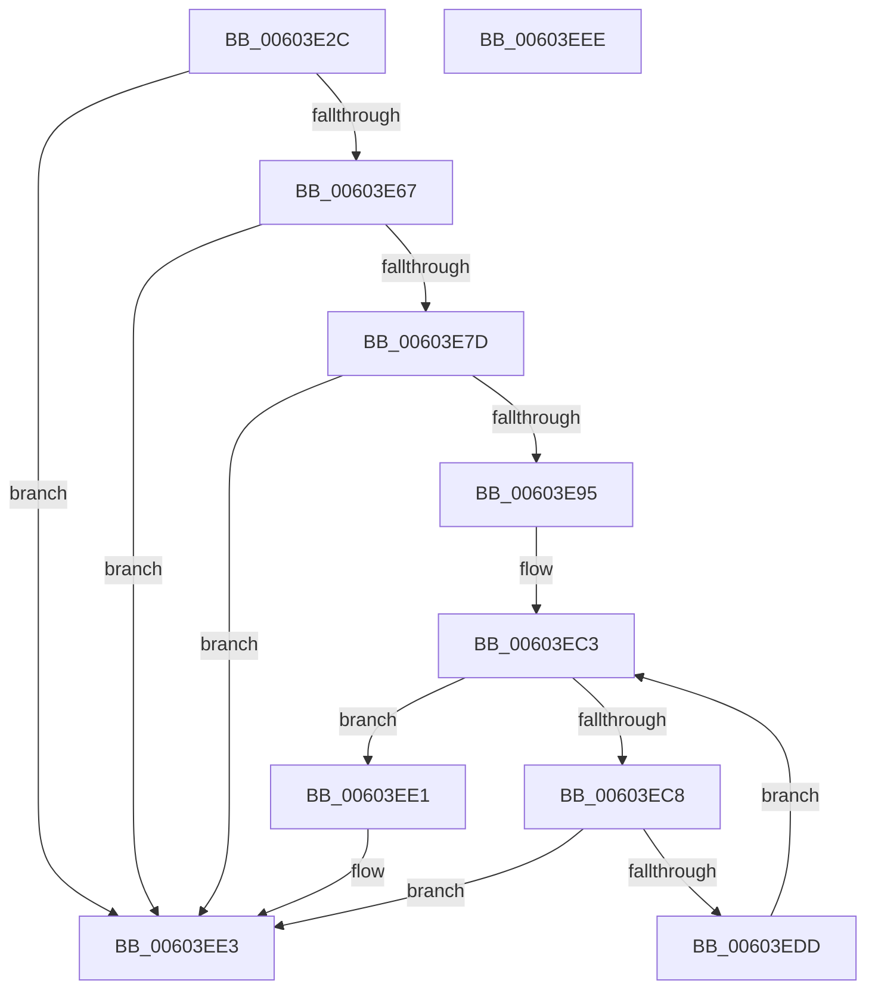

# RtlpHpVaMgrCtxStart

- RVA: `0x00603E2C`–`0x00603EEF` (길이 `195` bytes)
- VA: `0x0000000140603E2C`
- 실행 섹션: `.text`
- PDB 이름 있음: `예`; PDB Function 태그: `아니요`
- unwind 정보 RVA: `0x000C99AC`
- 디코드: `52`개 명령, `195/195` bytes 표시
- 미해석 바이트: `0` (있으면 어셈블리에 `.byte`로 보존)

> 이 문서는 커널 이미지의 기계어와 PDB 기호를 분석해 생성했습니다. 4번과 5번은 함수 원형과 자료형을 바이너리 사용 방식에서 추정한 C 해석이며 원본 소스 복구 결과는 아닙니다.

## 1. Dependencies

- 직접 호출 지점: **4**; 고유 호출 대상: **3**
- 직접 호출자로 확인된 함수: **1**
- RIP 상대 이미지 참조: **0**

### Outgoing calls
- `0x00603E5E` → [RtlULongLongMult](../43/RtlULongLongMult_function_0043E530.md) (function, `0x0043E530`)
- `0x00603E74` → [RtlULongLongMult](../43/RtlULongLongMult_function_0043E530.md) (function, `0x0043E530`)
- `0x00603E8C` → [RtlCSparseBitmapStart](RtlCSparseBitmapStart_function_00605338.md) (function, `0x00605338`)
- `0x00603ED4` → [RtlpHpVaMgrCtxAllocatorReference](RtlpHpVaMgrCtxAllocatorReference_function_00603BC0.md) (function, `0x00603BC0`)

### Direct callers
- [RtlHpKInitializeHeapManager](../65/RtlHpKInitializeHeapManager_function_0065C9A0.md) at `0x0065CA29`

### Static image references
- 디코드된 RIP-relative 메모리 참조가 없습니다.

## 2. Other-region calls and transfers

- 다른 실행 섹션으로 향하는 call: **0**
- 별도 외부 분기/꼬리 이동을 확인하지 못했습니다.

## 3. Assembly (complete function range)

```asm
00603E2C  4C 8B DC                        mov r11, rsp
00603E2F  49 89 5B 08                     mov qword ptr [r11 + 8], rbx
00603E33  4D 89 4B 20                     mov qword ptr [r11 + 0x20], r9
00603E37  57                              push rdi
00603E38  48 83 EC 40                     sub rsp, 0x40
00603E3C  49 83 63 20 00                  and qword ptr [r11 + 0x20], 0
00603E41  4D 8D 43 20                     lea r8, [r11 + 0x20]
00603E45  41 B9 20 00 00 00               mov r9d, 0x20
00603E4B  48 8B F9                        mov rdi, rcx
00603E4E  41 0F BC C1                     bsf eax, r9d
00603E52  41 8D 51 E8                     lea edx, [r9 - 0x18]
00603E56  89 41 18                        mov dword ptr [rcx + 0x18], eax
00603E59  B9 00 00 00 08                  mov ecx, 0x8000000
00603E5E  E8 CD A6 E3 FF                  call 0x14043e530
00603E63  85 C0                           test eax, eax
00603E65  78 7C                           js 0x140603ee3
00603E67  48 8B 4C 24 68                  mov rcx, qword ptr [rsp + 0x68]
00603E6C  4C 8D 44 24 68                  lea r8, [rsp + 0x68]
00603E71  41 8B D1                        mov edx, r9d
00603E74  E8 B7 A6 E3 FF                  call 0x14043e530
00603E79  85 C0                           test eax, eax
00603E7B  78 66                           js 0x140603ee3
00603E7D  48 8B 54 24 68                  mov rdx, qword ptr [rsp + 0x68]
00603E82  48 8D 4F 20                     lea rcx, [rdi + 0x20]
00603E86  41 B9 01 00 00 00               mov r9d, 1
00603E8C  E8 A7 14 00 00                  call 0x140605338
00603E91  85 C0                           test eax, eax
00603E93  78 4E                           js 0x140603ee3
00603E95  83 4C 24 20 FF                  or dword ptr [rsp + 0x20], 0xffffffff
00603E9A  48 B8 00 00 00 00 00 80 FF FF   movabs rax, 0xffff800000000000
00603EA4  0F 57 C0                        xorps xmm0, xmm0
00603EA7  48 89 47 08                     mov qword ptr [rdi + 8], rax
00603EAB  F3 0F 7F 44 24 28               movdqu xmmword ptr [rsp + 0x28], xmm0
00603EB1  33 DB                           xor ebx, ebx
00603EB3  C7 07 01 00 00 00               mov dword ptr [rdi], 1
00603EB9  C7 87 68 08 00 00 00 00 00 01   mov dword ptr [rdi + 0x868], 0x1000000
00603EC3  83 FB 06                        cmp ebx, 6
00603EC6  7D 19                           jge 0x140603ee1
00603EC8  48 8D 54 24 20                  lea rdx, [rsp + 0x20]
00603ECD  89 5C 24 24                     mov dword ptr [rsp + 0x24], ebx
00603ED1  48 8B CF                        mov rcx, rdi
00603ED4  E8 E7 FC FF FF                  call 0x140603bc0
00603ED9  85 C0                           test eax, eax
00603EDB  78 06                           js 0x140603ee3
00603EDD  FF C3                           inc ebx
00603EDF  EB E2                           jmp 0x140603ec3
00603EE1  33 C0                           xor eax, eax
00603EE3  48 8B 5C 24 50                  mov rbx, qword ptr [rsp + 0x50]
00603EE8  48 83 C4 40                     add rsp, 0x40
00603EEC  5F                              pop rdi
00603EED  C3                              ret
00603EEE  CC                              int3
```

## 4. C-style interpretation (structured pseudocode)

```c
__int64 __fastcall RtlpHpVaMgrCtxStart(__int64 a1, __int64 a2, __int64 a3, __int64 a4)
{
    __int64 result;
    __int64 v_rbx;
    __int64 v_rsp;
    unsigned __int64 v_stack_m20;
    unsigned int v_stack_m24;
    unsigned int v_stack_m28;
    unsigned __int64 v_stack_p20;
    unsigned __int64 v_stack_p8;

    *(unsigned __int64 *)(v_rsp + 8) = v_rbx;
    *(unsigned __int64 *)(v_rsp + 32) = a4;
    v_rsp = (v_rsp) - (64);
    *(unsigned int *)(a1 + 24) = (unsigned int)(result);
    result = RtlULongLongMult((unsigned int)(0x8000000ULL), 32 - 24, v_rsp + 32, 32);
    if (sign_flag) goto loc_00603EE3;
    result = RtlULongLongMult(v_stack_p20, 32, v_stack_p20, 32);
    if (sign_flag) goto loc_00603EE3;
    result = RtlCSparseBitmapStart(a1 + 32, v_stack_p20, v_stack_p20, 1);
    if (sign_flag) goto loc_00603EE3;
    *(unsigned __int64 *)(a1 + 8) = result;
    v_stack_m20 = v_xmm0;
    v_rbx = 0;
    *(unsigned int *)(a1) = 1;
    *(unsigned int *)(a1 + 2152) = 0x1000000ULL;
loc_00603EC3:
    if (0 >= 6) goto loc_00603EE1;
    v_stack_m24 = 0;
    result = RtlpHpVaMgrCtxAllocatorReference(a1, v_stack_m28, v_stack_p20, 1);
    if (sign_flag) goto loc_00603EE3;
    v_rbx = (unsigned int)((v_rbx) + 1);
    goto loc_00603EC3;
loc_00603EE1:
    result = 0;
loc_00603EE3:
    v_rsp = (v_rsp) + (64);
    return result;
}
```

## 5. (Beta) C Style

```c
int64_t RtlpHpVaMgrCtxStart(void *Arg1, int64_t Arg2, int64_t Arg3, int64_t Arg4)
{
    uint8_t *arg1 = (uint8_t *)Arg1;

    int64_t result;
    int64_t local_rbx;
    int64_t local_rsp;
    uint64_t v_stack_m20;
    uint32_t v_stack_m24;
    uint32_t v_stack_m28;
    uint64_t v_stack_p20;
    uint64_t v_stack_p8;

    *(uint64_t *)(local_rsp + 0x8) = local_rbx;
    *(uint64_t *)(local_rsp + 0x20) = Arg4;
    local_rsp = (local_rsp) - (64);
    *(uint32_t *)(arg1 + 0x18) = (uint32_t)(result);
    result = RtlULongLongMult((uint32_t)(0x8000000ULL), 32 - 24, local_rsp + 32, 32);
    if (sign_flag) goto loc_00603EE3;
    result = RtlULongLongMult(v_stack_p20, 32, v_stack_p20, 32);
    if (sign_flag) goto loc_00603EE3;
    result = RtlCSparseBitmapStart(Arg1 + 32, v_stack_p20, v_stack_p20, 1);
    if (sign_flag) goto loc_00603EE3;
    *(uint64_t *)(arg1 + 0x8) = result;
    v_stack_m20 = v_xmm0;
    local_rbx = 0;
    *(uint32_t *)(arg1) = 1;
    *(uint32_t *)(arg1 + 0x868) = 0x1000000ULL;
loc_00603EC3:
    if (0 >= 6) goto loc_00603EE1;
    v_stack_m24 = 0;
    result = RtlpHpVaMgrCtxAllocatorReference(Arg1, v_stack_m28, v_stack_p20, 1);
    if (sign_flag) goto loc_00603EE3;
    local_rbx = (uint32_t)((local_rbx) + 1);
    goto loc_00603EC3;
loc_00603EE1:
    result = 0;
loc_00603EE3:
    local_rsp = (local_rsp) + (64);
    return result;
}
```

### 관측된 메모리 오프셋

구조체 형식이 확인되지 않은 접근은 인자 기준의 오프셋으로만 기록했습니다.

| 기준 인자 | 오프셋 표현 | 폭 (bit) | 접근 |
|---|---:|---:|---|
| `Arg1` | `+ 0x0` | `32` | `W` |
| `Arg1` | `+ 0x8` | `64` | `W` |
| `Arg1` | `+ 0x18` | `32` | `W` |
| `Arg1` | `+ 0x20` | `64` | `R` |
| `Arg1` | `+ 0x868` | `32` | `W` |

## 6. Execution-region graph

[열기: 2D/3D 그래프와 함수 탐색 컨트롤 패널](../../../control-panel.html?section=text&rva=0x00603E2C&view=graph)

- 2D 그래프는 위에서 아래로 흐르고, 3D 그래프는 빈 공간을 드래그해 회전합니다. Shift+드래그는 이동, 휠은 확대·축소, 함수 노드 선택은 대상 보고서 이동입니다.

### Static fallback


