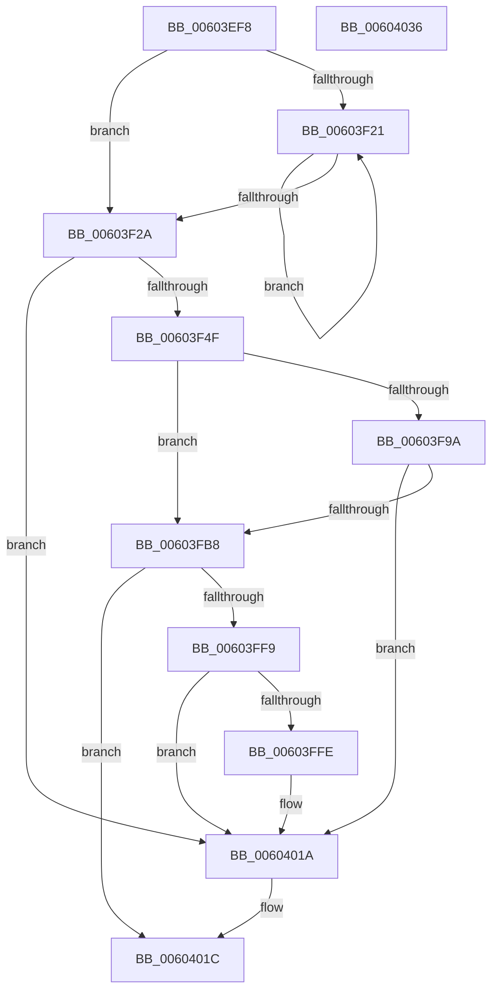

# RtlpHpVaMgrRangeCommit

- RVA: `0x00603EF8`–`0x00604037` (길이 `319` bytes)
- VA: `0x0000000140603EF8`
- 실행 섹션: `.text`
- PDB 이름 있음: `예`; PDB Function 태그: `아니요`
- unwind 정보 RVA: `0x0008CA40`
- 디코드: `90`개 명령, `319/319` bytes 표시
- 미해석 바이트: `0` (있으면 어셈블리에 `.byte`로 보존)

> 이 문서는 커널 이미지의 기계어와 PDB 기호를 분석해 생성했습니다. 4번과 5번은 함수 원형과 자료형을 바이너리 사용 방식에서 추정한 C 해석이며 원본 소스 복구 결과는 아닙니다.

## 1. Dependencies

- 직접 호출 지점: **3**; 고유 호출 대상: **2**
- 직접 호출자로 확인된 함수: **1**
- RIP 상대 이미지 참조: **1**

### Outgoing calls
- `0x00603FAE` → [RtlpHpVaMgrRangeCommitProcess](../49/RtlpHpVaMgrRangeCommitProcess_function_0049A444.md) (function, `0x0049A444`)
- `0x00603FF0` → [RtlpHpEnvAllocVA](../32/RtlpHpEnvAllocVA_function_00328F50.md) (function, `0x00328F50`)
- `0x00604015` → [RtlpHpVaMgrRangeCommitProcess](../49/RtlpHpVaMgrRangeCommitProcess_function_0049A444.md) (function, `0x0049A444`)

### Direct callers
- [RtlpHpVaMgrCtxCommit](RtlpHpVaMgrCtxCommit_function_00603D44.md) at `0x00603D9E`

### Static image references
- `0x00603F2E` → RVA `0x00000000` (`image boundary/outside`; read)

## 2. Other-region calls and transfers

- 다른 실행 섹션으로 향하는 call: **0**
- 별도 외부 분기/꼬리 이동을 확인하지 못했습니다.

## 3. Assembly (complete function range)

```asm
00603EF8  48 89 5C 24 08                  mov qword ptr [rsp + 8], rbx
00603EFD  48 89 6C 24 10                  mov qword ptr [rsp + 0x10], rbp
00603F02  48 89 74 24 18                  mov qword ptr [rsp + 0x18], rsi
00603F07  57                              push rdi
00603F08  41 56                           push r14
00603F0A  41 57                           push r15
00603F0C  48 83 EC 60                     sub rsp, 0x60
00603F10  F6 02 02                        test byte ptr [rdx], 2
00603F13  41 8B E9                        mov ebp, r9d
00603F16  49 8B F0                        mov rsi, r8
00603F19  48 8B DA                        mov rbx, rdx
00603F1C  48 8B F9                        mov rdi, rcx
00603F1F  74 09                           je 0x140603f2a
00603F21  48 83 EB 20                     sub rbx, 0x20
00603F25  F6 03 02                        test byte ptr [rbx], 2
00603F28  75 F7                           jne 0x140603f21
00603F2A  0F B6 41 2E                     movzx eax, byte ptr [rcx + 0x2e]
00603F2E  4C 8D 3D CB C0 9F FF            lea r15, [rip - 0x603f35]
00603F35  48 D1 E8                        shr rax, 1
00603F38  83 E0 07                        and eax, 7
00603F3B  41 8B 8C 87 20 A9 01 00         mov ecx, dword ptr [r15 + rax*4 + 0x1a920]
00603F43  81 F9 00 00 10 00               cmp ecx, 0x100000
00603F49  0F 87 CB 00 00 00               ja 0x14060401a
00603F4F  41 0F 28 00                     movaps xmm0, xmmword ptr [r8]
00603F53  B8 00 00 01 00                  mov eax, 0x10000
00603F58  3B C8                           cmp ecx, eax
00603F5A  0F 42 C8                        cmovb ecx, eax
00603F5D  44 8B C9                        mov r9d, ecx
00603F60  44 8B C1                        mov r8d, ecx
00603F63  66 48 0F 7E C1                  movq rcx, xmm0
00603F68  49 F7 D8                        neg r8
00603F6B  66 0F 73 D8 08                  psrldq xmm0, 8
00603F70  4C 23 C1                        and r8, rcx
00603F73  66 48 0F 7E C2                  movq rdx, xmm0
00603F78  48 FF CA                        dec rdx
00603F7B  4C 89 06                        mov qword ptr [rsi], r8
00603F7E  48 03 D1                        add rdx, rcx
00603F81  49 8D 41 FF                     lea rax, [r9 - 1]
00603F85  49 03 D1                        add rdx, r9
00603F88  48 F7 D0                        not rax
00603F8B  48 23 D0                        and rdx, rax
00603F8E  49 2B D0                        sub rdx, r8
00603F91  48 89 56 08                     mov qword ptr [rsi + 8], rdx
00603F95  F6 03 04                        test byte ptr [rbx], 4
00603F98  75 1E                           jne 0x140603fb8
00603F9A  0F 28 06                        movaps xmm0, xmmword ptr [rsi]
00603F9D  48 8D 54 24 50                  lea rdx, [rsp + 0x50]
00603FA2  45 33 C0                        xor r8d, r8d
00603FA5  66 0F 7F 44 24 50               movdqa xmmword ptr [rsp + 0x50], xmm0
00603FAB  48 8B CF                        mov rcx, rdi
00603FAE  E8 91 64 E9 FF                  call 0x14049a444
00603FB3  83 F8 01                        cmp eax, 1
00603FB6  75 62                           jne 0x14060401a
00603FB8  0F B6 4F 2E                     movzx ecx, byte ptr [rdi + 0x2e]
00603FBC  48 8D 56 08                     lea rdx, [rsi + 8]
00603FC0  8B C1                           mov eax, ecx
00603FC2  45 33 C0                        xor r8d, r8d
00603FC5  48 D1 E8                        shr rax, 1
00603FC8  83 E0 07                        and eax, 7
00603FCB  D1 E9                           shr ecx, 1
00603FCD  83 E1 07                        and ecx, 7
00603FD0  45 8B 8C 87 88 EE 01 00         mov r9d, dword ptr [r15 + rax*4 + 0x1ee88]
00603FD8  0F B6 47 2D                     movzx eax, byte ptr [rdi + 0x2d]
00603FDC  41 0F BA E9 0C                  bts r9d, 0xc
00603FE1  89 44 24 40                     mov dword ptr [rsp + 0x40], eax
00603FE5  89 4C 24 30                     mov dword ptr [rsp + 0x30], ecx
00603FE9  48 8B CE                        mov rcx, rsi
00603FEC  89 6C 24 20                     mov dword ptr [rsp + 0x20], ebp
00603FF0  E8 5B 4F D2 FF                  call 0x140328f50
00603FF5  85 C0                           test eax, eax
00603FF7  78 23                           js 0x14060401c
00603FF9  F6 03 04                        test byte ptr [rbx], 4
00603FFC  75 1C                           jne 0x14060401a
00603FFE  0F 28 06                        movaps xmm0, xmmword ptr [rsi]
00604001  48 8D 54 24 50                  lea rdx, [rsp + 0x50]
00604006  41 B8 01 00 00 00               mov r8d, 1
0060400C  66 0F 7F 44 24 50               movdqa xmmword ptr [rsp + 0x50], xmm0
00604012  48 8B CF                        mov rcx, rdi
00604015  E8 2A 64 E9 FF                  call 0x14049a444
0060401A  33 C0                           xor eax, eax
0060401C  4C 8D 5C 24 60                  lea r11, [rsp + 0x60]
00604021  49 8B 5B 20                     mov rbx, qword ptr [r11 + 0x20]
00604025  49 8B 6B 28                     mov rbp, qword ptr [r11 + 0x28]
00604029  49 8B 73 30                     mov rsi, qword ptr [r11 + 0x30]
0060402D  49 8B E3                        mov rsp, r11
00604030  41 5F                           pop r15
00604032  41 5E                           pop r14
00604034  5F                              pop rdi
00604035  C3                              ret
00604036  CC                              int3
```

## 4. C-style interpretation (structured pseudocode)

```c
__int64 __fastcall RtlpHpVaMgrRangeCommit(__int64 a1, __int64 a2, __int64 a3, int a4)
{
    __int64 result;
    __int64 v_rbx;
    __int64 v_rsp;
    unsigned __int64 v_stack_m18;
    unsigned __int64 v_stack_m28;
    unsigned int v_stack_m38;
    unsigned int v_stack_m48;
    unsigned int v_stack_m58;
    unsigned __int64 v_stack_p10;
    unsigned __int64 v_stack_p18;
    unsigned __int64 v_stack_p8;

    v_stack_p8 = v_rbx;
    v_stack_p10 = v_rbp;
    v_stack_p18 = v_rsi;
    v_rsp = (v_rsp) - (96);
    if (((*(unsigned __int8 *)(a2)) & (2)) == 0) goto loc_00603F2A;
loc_00603F21:
    v_rbx = (a2) - (32);
    if (((*(unsigned __int8 *)(v_rbx)) & (2)) != 0) goto loc_00603F21;
loc_00603F2A:
    result = (*(unsigned __int8 *)(a1 + 46)) >> (1);
    result = (unsigned int)((result) & (7));
    if (((unsigned int)((unsigned int)(*(unsigned int *)(v_rip - 6307637 + result * 4 + 108832)))) > 0x100000ULL) goto loc_0060401A;
    a1 = (unsigned int)(*(unsigned int *)(v_rip - 6307637 + result * 4 + 108832));
    if (((unsigned int)((unsigned int)(*(unsigned int *)(v_rip - 6307637 + result * 4 + 108832)))) < ((unsigned int)((unsigned int)(0x10000ULL)))) { a1 = (unsigned int)((unsigned int)(0x10000ULL)); }
    a3 = -((unsigned int)((unsigned int)(a1)));
    a3 = (a3) & (a1);
    a2 = (a2) - 1;
    *(unsigned __int64 *)(a3) = a3;
    a2 = (a2) + (a1);
    a2 = (a2) + ((unsigned int)((unsigned int)(a1)));
    result = ~((unsigned int)((unsigned int)(a1)) - 1);
    a2 = (a2) & (result);
    a2 = (a2) - (a3);
    *(unsigned __int64 *)(a3 + 8) = a2;
    if (((*(unsigned __int8 *)(v_rbx)) & (4)) != 0) goto loc_00603FB8;
    a3 = 0;
    v_stack_m28 = v_xmm0;
    result = RtlpHpVaMgrRangeCommitProcess(a1, v_stack_m28, a3, (unsigned int)((unsigned int)(a1)));
    if (((unsigned int)(result)) != 1) goto loc_0060401A;
loc_00603FB8:
    a3 = 0;
    result = ((unsigned int)((unsigned int)(*(unsigned __int8 *)(a1 + 46)))) >> (1);
    result = (unsigned int)((result) & (7));
    a1 = (unsigned int)((*(unsigned __int8 *)(a1 + 46)) >> (1));
    a1 = (unsigned int)((a1) & (7));
    v_stack_m38 = (unsigned int)(*(unsigned __int8 *)(a1 + 45));
    v_stack_m48 = (unsigned int)(a1);
    v_stack_m58 = (unsigned int)((unsigned int)(a4));
    result = RtlpHpEnvAllocVA(0, a3 + 8, a3, (unsigned int)(*(unsigned int *)(v_rip - 6307637 + result * 4 + 126600)));
    if (sign_flag) goto loc_0060401C;
    if (((*(unsigned __int8 *)(v_rbx)) & (4)) == 0) {
        a2 = v_stack_m28;
        a3 = 1;
        v_stack_m28 = v_xmm0;
        a1 = a1;
        result = RtlpHpVaMgrRangeCommitProcess(a1, a2, a3, (unsigned int)(*(unsigned int *)(v_rip - 6307637 + result * 4 + 126600)));
    }
    result = 0;
loc_0060401C:
    return result;
}
```

## 5. (Beta) C Style

```c
int64_t RtlpHpVaMgrRangeCommit(void *Arg1, void *Arg2, void *Arg3, int32_t Arg4)
{
    uint8_t *arg1 = (uint8_t *)Arg1;
    uint8_t *arg2 = (uint8_t *)Arg2;
    uint8_t *arg3 = (uint8_t *)Arg3;

    int64_t result;
    int64_t local_rbx;
    int64_t local_rsp;
    uint64_t v_stack_m18;
    uint64_t v_stack_m28;
    uint32_t v_stack_m38;
    uint32_t v_stack_m48;
    uint32_t v_stack_m58;
    uint64_t v_stack_p10;
    uint64_t v_stack_p18;
    uint64_t v_stack_p8;

    v_stack_p8 = local_rbx;
    v_stack_p10 = local_rbp;
    v_stack_p18 = local_rsi;
    local_rsp = (local_rsp) - (96);
    if (((*(uint8_t *)(arg2)) & (2)) == 0) goto loc_00603F2A;
loc_00603F21:
    local_rbx = (Arg2) - (32);
    if (((*(uint8_t *)(local_rbx)) & (2)) != 0) goto loc_00603F21;
loc_00603F2A:
    result = (*(uint8_t *)(arg1 + 0x2E)) >> (1);
    result = (uint32_t)((result) & (7));
    if (((uint32_t)((uint32_t)(*(uint32_t *)(v_rip - 0x603F35 + result * 4 + 0x1A920)))) > 0x100000ULL) goto loc_0060401A;
    Arg1 = (uint32_t)(*(uint32_t *)(v_rip - 0x603F35 + result * 4 + 0x1A920));
    if (((uint32_t)((uint32_t)(*(uint32_t *)(v_rip - 0x603F35 + result * 4 + 0x1A920)))) < ((uint32_t)((uint32_t)(0x10000ULL)))) { Arg1 = (uint32_t)((uint32_t)(0x10000ULL)); }
    Arg3 = -((uint32_t)((uint32_t)(Arg1)));
    Arg3 = (Arg3) & (Arg1);
    Arg2 = (Arg2) - 1;
    *(void **)(arg3) = Arg3;
    Arg2 = (Arg2) + (Arg1);
    Arg2 = (Arg2) + ((uint32_t)((uint32_t)(Arg1)));
    result = ~((uint32_t)((uint32_t)(Arg1)) - 1);
    Arg2 = (Arg2) & (result);
    Arg2 = (Arg2) - (Arg3);
    *(void **)(arg3 + 0x8) = Arg2;
    if (((*(uint8_t *)(local_rbx)) & (4)) != 0) goto loc_00603FB8;
    Arg3 = 0;
    v_stack_m28 = v_xmm0;
    result = RtlpHpVaMgrRangeCommitProcess(Arg1, v_stack_m28, Arg3, (uint32_t)((uint32_t)(Arg1)));
    if (((uint32_t)(result)) != 1) goto loc_0060401A;
loc_00603FB8:
    Arg3 = 0;
    result = ((uint32_t)((uint32_t)(*(uint8_t *)(arg1 + 0x2E)))) >> (1);
    result = (uint32_t)((result) & (7));
    Arg1 = (uint32_t)((*(uint8_t *)(arg1 + 0x2E)) >> (1));
    Arg1 = (uint32_t)((Arg1) & (7));
    v_stack_m38 = (uint32_t)(*(uint8_t *)(arg1 + 0x2D));
    v_stack_m48 = (uint32_t)(Arg1);
    v_stack_m58 = (uint32_t)((uint32_t)(Arg4));
    result = RtlpHpEnvAllocVA(0, Arg3 + 8, Arg3, (uint32_t)(*(uint32_t *)(v_rip - 0x603F35 + result * 4 + 0x1EE88)));
    if (sign_flag) goto loc_0060401C;
    if (((*(uint8_t *)(local_rbx)) & (4)) == 0) {
        Arg2 = v_stack_m28;
        Arg3 = 1;
        v_stack_m28 = v_xmm0;
        Arg1 = Arg1;
        result = RtlpHpVaMgrRangeCommitProcess(Arg1, Arg2, Arg3, (uint32_t)(*(uint32_t *)(v_rip - 0x603F35 + result * 4 + 0x1EE88)));
    }
    result = 0;
loc_0060401C:
    return result;
}
```

### 관측된 메모리 오프셋

구조체 형식이 확인되지 않은 접근은 인자 기준의 오프셋으로만 기록했습니다.

| 기준 인자 | 오프셋 표현 | 폭 (bit) | 접근 |
|---|---:|---:|---|
| `Arg1` | `+ 0x2D` | `8` | `R` |
| `Arg1` | `+ 0x2E` | `8` | `R` |
| `Arg2` | `+ 0x0` | `8` | `R` |
| `Arg3` | `+ 0x0` | `64` | `W` |
| `Arg3` | `+ 0x0` | `128` | `R` |
| `Arg3` | `+ 0x8` | `64` | `R` |
| `Arg3` | `+ 0x8` | `64` | `W` |

## 6. Execution-region graph

[열기: 2D/3D 그래프와 함수 탐색 컨트롤 패널](../../../control-panel.html?section=text&rva=0x00603EF8&view=graph)

- 2D 그래프는 위에서 아래로 흐르고, 3D 그래프는 빈 공간을 드래그해 회전합니다. Shift+드래그는 이동, 휠은 확대·축소, 함수 노드 선택은 대상 보고서 이동입니다.

### Static fallback


