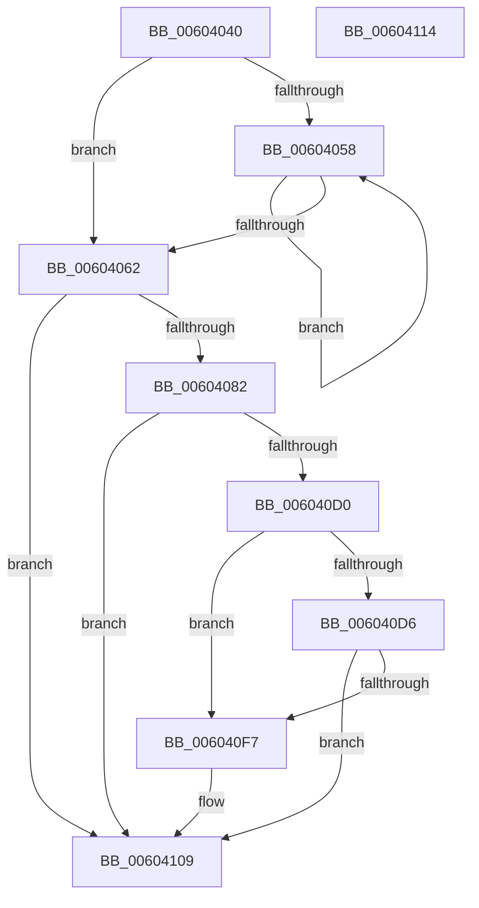

# RtlpHpVaMgrRangeDecommit

- RVA: `0x00604040`–`0x00604115` (길이 `213` bytes)
- VA: `0x0000000140604040`
- 실행 섹션: `.text`
- PDB 이름 있음: `예`; PDB Function 태그: `아니요`
- unwind 정보 RVA: `0x0006E5F8`
- 디코드: `60`개 명령, `213/213` bytes 표시
- 미해석 바이트: `0` (있으면 어셈블리에 `.byte`로 보존)

> 이 문서는 커널 이미지의 기계어와 PDB 기호를 분석해 생성했습니다. 4번과 5번은 함수 원형과 자료형을 바이너리 사용 방식에서 추정한 C 해석이며 원본 소스 복구 결과는 아닙니다.

## 1. Dependencies

- 직접 호출 지점: **2**; 고유 호출 대상: **2**
- 직접 호출자로 확인된 함수: **1**
- RIP 상대 이미지 참조: **1**

### Outgoing calls
- `0x006040ED` → [RtlpHpVaMgrRangeCommitProcess](../49/RtlpHpVaMgrRangeCommitProcess_function_0049A444.md) (function, `0x0049A444`)
- `0x00604104` → [MmFreePoolMemory](../2C/MmFreePoolMemory_function_002C1578.md) (function, `0x002C1578`)

### Direct callers
- [RtlpHpVaMgrCtxDecommit](RtlpHpVaMgrCtxDecommit_function_00603DC0.md) at `0x00603E0E`

### Static image references
- `0x00604066` → RVA `0x0001A920` (`.rdata`; read)

## 2. Other-region calls and transfers

- 다른 실행 섹션으로 향하는 call: **0**
- 별도 외부 분기/꼬리 이동을 확인하지 못했습니다.

## 3. Assembly (complete function range)

```asm
00604040  48 89 5C 24 08                  mov qword ptr [rsp + 8], rbx
00604045  57                              push rdi
00604046  48 83 EC 30                     sub rsp, 0x30
0060404A  F6 02 02                        test byte ptr [rdx], 2
0060404D  49 8B D8                        mov rbx, r8
00604050  4C 8B D2                        mov r10, rdx
00604053  4C 8B D9                        mov r11, rcx
00604056  74 0A                           je 0x140604062
00604058  49 83 EA 20                     sub r10, 0x20
0060405C  41 F6 02 02                     test byte ptr [r10], 2
00604060  75 F6                           jne 0x140604058
00604062  0F B6 41 2E                     movzx eax, byte ptr [rcx + 0x2e]
00604066  48 8D 0D B3 68 A1 FF            lea rcx, [rip - 0x5e974d]
0060406D  48 D1 E8                        shr rax, 1
00604070  83 E0 07                        and eax, 7
00604073  8B 0C 81                        mov ecx, dword ptr [rcx + rax*4]
00604076  81 F9 00 00 10 00               cmp ecx, 0x100000
0060407C  0F 87 87 00 00 00               ja 0x140604109
00604082  41 0F 28 00                     movaps xmm0, xmmword ptr [r8]
00604086  B8 00 00 01 00                  mov eax, 0x10000
0060408B  3B C8                           cmp ecx, eax
0060408D  0F 42 C8                        cmovb ecx, eax
00604090  8B C1                           mov eax, ecx
00604092  4C 8D 41 FF                     lea r8, [rcx - 1]
00604096  66 48 0F 7E C1                  movq rcx, xmm0
0060409B  49 F7 D0                        not r8
0060409E  66 0F 73 D8 08                  psrldq xmm0, 8
006040A3  66 48 0F 7E C2                  movq rdx, xmm0
006040A8  48 03 D1                        add rdx, rcx
006040AB  4C 8D 49 FF                     lea r9, [rcx - 1]
006040AF  49 23 D0                        and rdx, r8
006040B2  4C 03 C8                        add r9, rax
006040B5  48 8B C2                        mov rax, rdx
006040B8  4D 23 C8                        and r9, r8
006040BB  49 2B C1                        sub rax, r9
006040BE  4C 89 0B                        mov qword ptr [rbx], r9
006040C1  4C 3B CA                        cmp r9, rdx
006040C4  48 1B C9                        sbb rcx, rcx
006040C7  48 23 C8                        and rcx, rax
006040CA  48 89 4B 08                     mov qword ptr [rbx + 8], rcx
006040CE  74 39                           je 0x140604109
006040D0  41 F6 02 04                     test byte ptr [r10], 4
006040D4  75 21                           jne 0x1406040f7
006040D6  0F 28 03                        movaps xmm0, xmmword ptr [rbx]
006040D9  48 8D 54 24 20                  lea rdx, [rsp + 0x20]
006040DE  41 B8 02 00 00 00               mov r8d, 2
006040E4  66 0F 7F 44 24 20               movdqa xmmword ptr [rsp + 0x20], xmm0
006040EA  49 8B CB                        mov rcx, r11
006040ED  E8 52 63 E9 FF                  call 0x14049a444
006040F2  83 F8 02                        cmp eax, 2
006040F5  75 12                           jne 0x140604109
006040F7  41 B8 00 40 00 00               mov r8d, 0x4000
006040FD  48 8D 53 08                     lea rdx, [rbx + 8]
00604101  48 8B CB                        mov rcx, rbx
00604104  E8 6F D4 CB FF                  call 0x1402c1578
00604109  48 8B 5C 24 40                  mov rbx, qword ptr [rsp + 0x40]
0060410E  48 83 C4 30                     add rsp, 0x30
00604112  5F                              pop rdi
00604113  C3                              ret
00604114  CC                              int3
```

## 4. C-style interpretation (structured pseudocode)

```c
__int64 __fastcall RtlpHpVaMgrRangeDecommit(__int64 a1, __int64 a2, __int64 a3)
{
    __int64 result;
    __int64 v_r10;
    __int64 v_rsp;
    unsigned __int64 v_stack_m18;
    unsigned __int64 v_stack_p8;

    v_stack_p8 = v_rbx;
    v_rsp = (v_rsp) - (48);
    if (((*(unsigned __int8 *)(a2)) & (2)) == 0) goto loc_00604062;
loc_00604058:
    v_r10 = (a2) - (32);
    if (((*(unsigned __int8 *)(v_r10)) & (2)) != 0) goto loc_00604058;
loc_00604062:
    result = (*(unsigned __int8 *)(a1 + 46)) >> (1);
    result = (unsigned int)((result) & (7));
    if (((unsigned int)((unsigned int)(*(unsigned int *)(v_rip - 6199117 + result * 4)))) > 0x100000ULL) goto loc_00604109;
    a1 = (unsigned int)(*(unsigned int *)(v_rip - 6199117 + result * 4));
    if (((unsigned int)((unsigned int)(*(unsigned int *)(v_rip - 6199117 + result * 4)))) < ((unsigned int)((unsigned int)(0x10000ULL)))) { a1 = (unsigned int)((unsigned int)(0x10000ULL)); }
    a3 = ~(a1 - 1);
    a2 = (a2) + (a1);
    a2 = (a2) & (a3);
    a4 = (a1 - 1) + ((unsigned int)((unsigned int)(a1)));
    a4 = (a4) & (a3);
    result = (a2) - (a4);
    *(unsigned __int64 *)(a3) = a4;
    a1 = (a1) & (result);
    *(unsigned __int64 *)(a3 + 8) = a1;
    if (condition_is_equal) goto loc_00604109;
    if (((*(unsigned __int8 *)(v_r10)) & (4)) != 0) goto loc_006040F7;
    v_stack_m18 = v_xmm0;
    result = RtlpHpVaMgrRangeCommitProcess(a1, v_stack_m18, 2, a4);
    if (((unsigned int)(result)) == 2) {
        a3 = 0x4000ULL;
        a2 = a3 + 8;
        a1 = a3;
        result = MmFreePoolMemory(a1, a2, a3, a4);
    }
    v_rsp = (v_rsp) + (48);
    return result;
}
```

## 5. (Beta) C Style

```c
int64_t RtlpHpVaMgrRangeDecommit(void *Arg1, void *Arg2, void *Arg3)
{
    uint8_t *arg1 = (uint8_t *)Arg1;
    uint8_t *arg2 = (uint8_t *)Arg2;
    uint8_t *arg3 = (uint8_t *)Arg3;

    int64_t result;
    int64_t local_r10;
    int64_t local_rsp;
    uint64_t v_stack_m18;
    uint64_t v_stack_p8;

    v_stack_p8 = local_rbx;
    local_rsp = (local_rsp) - (48);
    if (((*(uint8_t *)(arg2)) & (2)) == 0) goto loc_00604062;
loc_00604058:
    local_r10 = (Arg2) - (32);
    if (((*(uint8_t *)(local_r10)) & (2)) != 0) goto loc_00604058;
loc_00604062:
    result = (*(uint8_t *)(arg1 + 0x2E)) >> (1);
    result = (uint32_t)((result) & (7));
    if (((uint32_t)((uint32_t)(*(uint32_t *)(v_rip - 0x5E974D + result * 4)))) > 0x100000ULL) goto loc_00604109;
    Arg1 = (uint32_t)(*(uint32_t *)(v_rip - 0x5E974D + result * 4));
    if (((uint32_t)((uint32_t)(*(uint32_t *)(v_rip - 0x5E974D + result * 4)))) < ((uint32_t)((uint32_t)(0x10000ULL)))) { Arg1 = (uint32_t)((uint32_t)(0x10000ULL)); }
    Arg3 = ~(Arg1 - 1);
    Arg2 = (Arg2) + (Arg1);
    Arg2 = (Arg2) & (Arg3);
    a4 = (Arg1 - 1) + ((uint32_t)((uint32_t)(Arg1)));
    a4 = (a4) & (Arg3);
    result = (Arg2) - (a4);
    *(uint64_t *)(arg3) = a4;
    Arg1 = (Arg1) & (result);
    *(void **)(arg3 + 0x8) = Arg1;
    if (condition_is_equal) goto loc_00604109;
    if (((*(uint8_t *)(local_r10)) & (4)) != 0) goto loc_006040F7;
    v_stack_m18 = v_xmm0;
    result = RtlpHpVaMgrRangeCommitProcess(Arg1, v_stack_m18, 2, a4);
    if (((uint32_t)(result)) == 2) {
        Arg3 = 0x4000ULL;
        Arg2 = Arg3 + 8;
        Arg1 = Arg3;
        result = MmFreePoolMemory(Arg1, Arg2, Arg3, a4);
    }
    local_rsp = (local_rsp) + (48);
    return result;
}
```

### 관측된 메모리 오프셋

구조체 형식이 확인되지 않은 접근은 인자 기준의 오프셋으로만 기록했습니다.

| 기준 인자 | 오프셋 표현 | 폭 (bit) | 접근 |
|---|---:|---:|---|
| `Arg1` | `+ 0x2E` | `8` | `R` |
| `Arg2` | `+ 0x0` | `8` | `R` |
| `Arg3` | `+ 0x0` | `64` | `W` |
| `Arg3` | `+ 0x0` | `128` | `R` |
| `Arg3` | `+ 0x8` | `64` | `R` |
| `Arg3` | `+ 0x8` | `64` | `W` |

## 6. Execution-region graph

[열기: 2D/3D 그래프와 함수 탐색 컨트롤 패널](../../../control-panel.html?section=text&rva=0x00604040&view=graph)

- 2D 그래프는 위에서 아래로 흐르고, 3D 그래프는 빈 공간을 드래그해 회전합니다. Shift+드래그는 이동, 휠은 확대·축소, 함수 노드 선택은 대상 보고서 이동입니다.

### Static fallback


