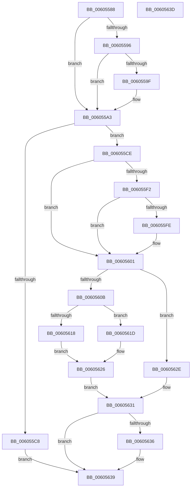

# RtlpHpVsChunkSize

- RVA: `0x00605588`–`0x0060563E` (길이 `182` bytes)
- VA: `0x0000000140605588`
- 실행 섹션: `.text`
- PDB 이름 있음: `예`; PDB Function 태그: `아니요`
- unwind 정보 RVA: `0x000DB714`
- 디코드: `55`개 명령, `182/182` bytes 표시
- 미해석 바이트: `0` (있으면 어셈블리에 `.byte`로 보존)

> 이 문서는 커널 이미지의 기계어와 PDB 기호를 분석해 생성했습니다. 4번과 5번은 함수 원형과 자료형을 바이너리 사용 방식에서 추정한 C 해석이며 원본 소스 복구 결과는 아닙니다.

## 1. Dependencies

- 직접 호출 지점: **0**; 고유 호출 대상: **0**
- 직접 호출자로 확인된 함수: **1**
- RIP 상대 이미지 참조: **2**

### Outgoing calls
- 직접 디코드된 call 명령이 없습니다.

### Direct callers
- [RtlpSizeHeapInternal](../5E/RtlpSizeHeapInternal_function_005EBAD0.md) at `0x005EBAF8`

### Static image references
- `0x006055A6` → RVA `0x00E28300` (`.data`; read)
- `0x006055DE` → RVA `0x00E28302` (`.data`; read)

## 2. Other-region calls and transfers

- 다른 실행 섹션으로 향하는 call: **0**
- 별도 외부 분기/꼬리 이동을 확인하지 못했습니다.

## 3. Assembly (complete function range)

```asm
00605588  44 8A 51 04                     mov r10b, byte ptr [rcx + 4]
0060558C  4C 8D 42 F0                     lea r8, [rdx - 0x10]
00605590  41 80 E2 01                     and r10b, 1
00605594  74 0D                           je 0x1406055a3
00605596  48 F7 C2 FF 0F 00 00            test rdx, 0xfff
0060559D  75 04                           jne 0x1406055a3
0060559F  49 83 C0 F0                     add r8, -0x10
006055A3  49 8B 08                        mov rcx, qword ptr [r8]
006055A6  48 8B 05 53 2D 82 00            mov rax, qword ptr [rip + 0x822d53]
006055AD  48 C1 E8 20                     shr rax, 0x20
006055B1  48 C1 E9 20                     shr rcx, 0x20
006055B5  33 C8                           xor ecx, eax
006055B7  49 8B C0                        mov rax, r8
006055BA  48 C1 E8 20                     shr rax, 0x20
006055BE  33 C8                           xor ecx, eax
006055C0  F7 C1 00 00 FF 00               test ecx, 0xff0000
006055C6  75 06                           jne 0x1406055ce
006055C8  48 83 C9 FF                     or rcx, 0xffffffffffffffff
006055CC  EB 6B                           jmp 0x140605639
006055CE  41 0F B7 48 02                  movzx ecx, word ptr [r8 + 2]
006055D3  41 8B C0                        mov eax, r8d
006055D6  C1 E8 10                        shr eax, 0x10
006055D9  45 33 DB                        xor r11d, r11d
006055DC  33 C8                           xor ecx, eax
006055DE  0F B7 05 1D 2D 82 00            movzx eax, word ptr [rip + 0x822d1d]
006055E5  33 C8                           xor ecx, eax
006055E7  C1 E1 04                        shl ecx, 4
006055EA  83 E9 10                        sub ecx, 0x10
006055ED  45 84 D2                        test r10b, r10b
006055F0  74 0F                           je 0x140605601
006055F2  49 8D 40 20                     lea rax, [r8 + 0x20]
006055F6  48 A9 FF 0F 00 00               test rax, 0xfff
006055FC  75 03                           jne 0x140605601
006055FE  83 C1 F0                        add ecx, -0x10
00605601  41 8B 40 08                     mov eax, dword ptr [r8 + 8]
00605605  0F BA E0 08                     bt eax, 8
00605609  73 23                           jae 0x14060562e
0060560B  0F B7 54 11 FE                  movzx edx, word ptr [rcx + rdx - 2]
00605610  0F B7 C2                        movzx eax, dx
00605613  66 85 D2                        test dx, dx
00605616  79 05                           jns 0x14060561d
00605618  48 FF C9                        dec rcx
0060561B  EB 09                           jmp 0x140605626
0060561D  81 E2 FF 1F 00 00               and edx, 0x1fff
00605623  48 2B CA                        sub rcx, rdx
00605626  C1 E8 0E                        shr eax, 0xe
00605629  83 E0 01                        and eax, 1
0060562C  EB 03                           jmp 0x140605631
0060562E  41 8B C3                        mov eax, r11d
00605631  4D 85 C9                        test r9, r9
00605634  74 03                           je 0x140605639
00605636  41 89 01                        mov dword ptr [r9], eax
00605639  48 8B C1                        mov rax, rcx
0060563C  C3                              ret
0060563D  CC                              int3
```

## 4. C-style interpretation (structured pseudocode)

```c
__int64 __fastcall RtlpHpVsChunkSize(__int64 a1, __int64 a2, __int64 a3, __int64 a4)
{
    __int64 result;
    __int64 v_r10;
    __int64 v_r11;

    v_r10 = (unsigned __int8)((*(unsigned __int8 *)(a1 + 4)) & (1));
    if (condition_is_equal) goto loc_006055A3;
    if (((a2) & (0xFFFULL)) == 0) {
        a3 = (a2 - 16) + (-16);
    }
    result = (*(unsigned __int64 *)(v_rip + 8531283)) >> (32);
    a1 = (*(unsigned __int64 *)(a3)) >> (32);
    a1 = (unsigned int)((a1) ^ ((unsigned int)(result)));
    result = (a3) >> (32);
    a1 = (unsigned int)((a1) ^ ((unsigned int)(result)));
    if ((((unsigned int)(a1)) & (0xFF0000ULL)) != 0) goto loc_006055CE;
    a1 = (a1) | (-1);
    goto loc_00605639;
loc_006055CE:
    result = (unsigned int)(((unsigned int)((unsigned int)(a3))) >> (16));
    v_r11 = 0;
    a1 = (unsigned int)((*(unsigned __int16 *)(a3 + 2)) ^ ((unsigned int)(result)));
    a1 = (unsigned int)((a1) ^ ((unsigned int)(*(unsigned __int16 *)(v_rip + 8531229))));
    a1 = (unsigned int)((a1) << (4));
    a1 = (unsigned int)((a1) - (16));
    if ((unsigned __int8)(v_r10) == 0) goto loc_00605601;
    if (((a3 + 32) & (0xFFFULL)) == 0) {
        a1 = (unsigned int)((a1) + (-16));
    }
    if (condition_is_above_or_equal) goto loc_0060562E;
    if (!sign_flag) goto loc_0060561D;
    a1 = (a1) - 1;
    goto loc_00605626;
loc_0060561D:
    a2 = (unsigned int)((*(unsigned __int16 *)(a1 + a2 * 1 - 2)) & (0x1FFFULL));
    a1 = (a1) - (a2);
loc_00605626:
    result = (unsigned int)(((unsigned __int16)(*(unsigned __int16 *)(a1 + a2 * 1 - 2))) >> (14));
    result = (unsigned int)((result) & (1));
    goto loc_00605631;
loc_0060562E:
loc_00605631:
    if (a4 != 0) {
        *(unsigned int *)(a4) = 0;
    }
    return a1;
}
```

## 5. (Beta) C Style

```c
void *RtlpHpVsChunkSize(void *Arg1, void *Arg2, int64_t Arg3, int64_t Arg4)
{
    uint8_t *arg1 = (uint8_t *)Arg1;
    uint8_t *arg2 = (uint8_t *)Arg2;

    int64_t result;
    int64_t local_r10;
    int64_t local_r11;

    local_r10 = (uint8_t)((*(uint8_t *)(arg1 + 0x4)) & (1));
    if (condition_is_equal) goto loc_006055A3;
    if (((Arg2) & (0xFFFULL)) == 0) {
        Arg3 = (Arg2 - 16) + (-16);
    }
    result = (*(uint64_t *)(v_rip + 0x822D53)) >> (32);
    Arg1 = (*(uint64_t *)(Arg3)) >> (32);
    Arg1 = (uint32_t)((Arg1) ^ ((uint32_t)(result)));
    result = (Arg3) >> (32);
    Arg1 = (uint32_t)((Arg1) ^ ((uint32_t)(result)));
    if ((((uint32_t)(Arg1)) & (0xFF0000ULL)) != 0) goto loc_006055CE;
    Arg1 = (Arg1) | (-1);
    goto loc_00605639;
loc_006055CE:
    result = (uint32_t)(((uint32_t)((uint32_t)(Arg3))) >> (16));
    local_r11 = 0;
    Arg1 = (uint32_t)((*(uint16_t *)(Arg3 + 0x2)) ^ ((uint32_t)(result)));
    Arg1 = (uint32_t)((Arg1) ^ ((uint32_t)(*(uint16_t *)(v_rip + 0x822D1D))));
    Arg1 = (uint32_t)((Arg1) << (4));
    Arg1 = (uint32_t)((Arg1) - (16));
    if ((uint8_t)(local_r10) == 0) goto loc_00605601;
    if (((Arg3 + 32) & (0xFFFULL)) == 0) {
        Arg1 = (uint32_t)((Arg1) + (-16));
    }
    if (condition_is_above_or_equal) goto loc_0060562E;
    if (!sign_flag) goto loc_0060561D;
    Arg1 = (Arg1) - 1;
    goto loc_00605626;
loc_0060561D:
    Arg2 = (uint32_t)((*(uint16_t *)(arg1 + arg2 * 1 - 0x2)) & (0x1FFFULL));
    Arg1 = (Arg1) - (Arg2);
loc_00605626:
    result = (uint32_t)(((uint16_t)(*(uint16_t *)(arg1 + arg2 * 1 - 0x2))) >> (14));
    result = (uint32_t)((result) & (1));
    goto loc_00605631;
loc_0060562E:
loc_00605631:
    if (Arg4 != 0) {
        *(uint32_t *)(Arg4) = 0;
    }
    return Arg1;
}
```

### 관측된 메모리 오프셋

구조체 형식이 확인되지 않은 접근은 인자 기준의 오프셋으로만 기록했습니다.

| 기준 인자 | 오프셋 표현 | 폭 (bit) | 접근 |
|---|---:|---:|---|
| `Arg1` | `+ 0x4` | `8` | `R` |
| `Arg2` | `- 0x10` | `64` | `R` |
| `Arg2` | `+ 0x0` | `64` | `R` |
| `Arg2` | `+ 0x2` | `16` | `R` |
| `Arg2` | `+ 0x8` | `32` | `R` |
| `Arg2` | `+ 0x20` | `64` | `R` |

## 6. Execution-region graph

[열기: 2D/3D 그래프와 함수 탐색 컨트롤 패널](../../../control-panel.html?section=text&rva=0x00605588&view=graph)

- 2D 그래프는 위에서 아래로 흐르고, 3D 그래프는 빈 공간을 드래그해 회전합니다. Shift+드래그는 이동, 휠은 확대·축소, 함수 노드 선택은 대상 보고서 이동입니다.

### Static fallback


