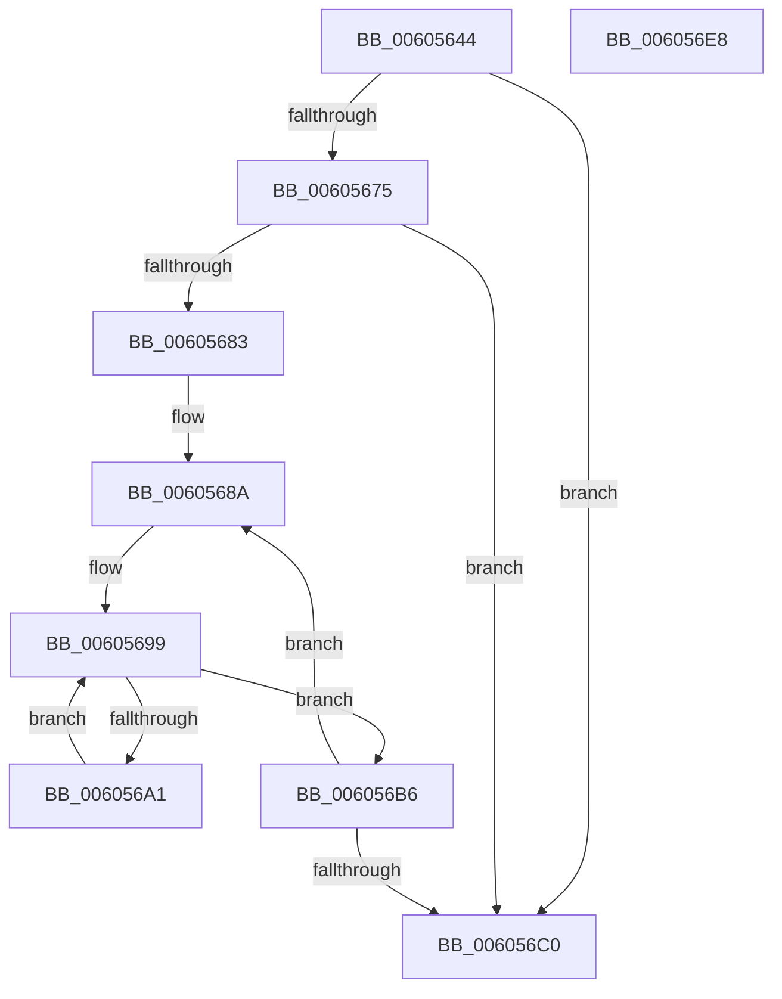

# RtlpHpVsContextCleanup

- RVA: `0x00605644`–`0x006056E9` (길이 `165` bytes)
- VA: `0x0000000140605644`
- 실행 섹션: `.text`
- PDB 이름 있음: `예`; PDB Function 태그: `아니요`
- unwind 정보 RVA: `0x000D0368`
- 디코드: `47`개 명령, `165/165` bytes 표시
- 미해석 바이트: `0` (있으면 어셈블리에 `.byte`로 보존)

> 이 문서는 커널 이미지의 기계어와 PDB 기호를 분석해 생성했습니다. 4번과 5번은 함수 원형과 자료형을 바이너리 사용 방식에서 추정한 C 해석이며 원본 소스 복구 결과는 아닙니다.

## 1. Dependencies

- 직접 호출 지점: **4**; 고유 호출 대상: **4**
- 직접 호출자로 확인된 함수: **1**
- RIP 상대 이미지 참조: **1**

### Outgoing calls
- `0x0060567A` → [RtlpHpVsContextGetSlotInfo](../2E/RtlpHpVsContextGetSlotInfo_function_002E7BB4.md) (function, `0x002E7BB4`)
- `0x006056A7` → [RtlpHpVsSubsegmentCleanup](../2E/RtlpHpVsSubsegmentCleanup_function_002E6DA8.md) (function, `0x002E6DA8`)
- `0x006056AF` → [RtlpHpVsSubsegmentFree](../2E/RtlpHpVsSubsegmentFree_function_002E7D9C.md) (function, `0x002E7D9C`)
- `0x006056CB` → [_security_check_cookie](../6A/_security_check_cookie_function_006AC640.md) (function, `0x006AC640`)

### Direct callers
- [RtlpHpHeapDestroy](RtlpHpHeapDestroy_function_006033AC.md) at `0x00603456`

### Static image references
- `0x00605659` → RVA `0x00E0A740` (`.data`; read)

## 2. Other-region calls and transfers

- 다른 실행 섹션으로 향하는 call: **0**
- 별도 외부 분기/꼬리 이동을 확인하지 못했습니다.

## 3. Assembly (complete function range)

```asm
00605644  48 89 5C 24 10                  mov qword ptr [rsp + 0x10], rbx
00605649  48 89 6C 24 18                  mov qword ptr [rsp + 0x18], rbp
0060564E  56                              push rsi
0060564F  57                              push rdi
00605650  41 56                           push r14
00605652  48 81 EC 30 01 00 00            sub rsp, 0x130
00605659  48 8B 05 E0 50 80 00            mov rax, qword ptr [rip + 0x8050e0]
00605660  48 33 C4                        xor rax, rsp
00605663  48 89 84 24 20 01 00 00         mov qword ptr [rsp + 0x120], rax
0060566B  33 ED                           xor ebp, ebp
0060566D  48 8B D9                        mov rbx, rcx
00605670  66 39 29                        cmp word ptr [rcx], bp
00605673  74 4B                           je 0x1406056c0
00605675  48 8D 54 24 20                  lea rdx, [rsp + 0x20]
0060567A  E8 35 25 CE FF                  call 0x1402e7bb4
0060567F  85 C0                           test eax, eax
00605681  74 3D                           je 0x1406056c0
00605683  48 8D 7C 24 20                  lea rdi, [rsp + 0x20]
00605688  8B F0                           mov esi, eax
0060568A  44 0F B7 37                     movzx r14d, word ptr [rdi]
0060568E  49 C1 E6 06                     shl r14, 6
00605692  49 83 C6 20                     add r14, 0x20
00605696  4C 03 F3                        add r14, rbx
00605699  49 8B 16                        mov rdx, qword ptr [r14]
0060569C  48 85 D2                        test rdx, rdx
0060569F  74 15                           je 0x1406056b6
006056A1  49 33 D6                        xor rdx, r14
006056A4  48 8B CB                        mov rcx, rbx
006056A7  E8 FC 16 CE FF                  call 0x1402e6da8
006056AC  48 8B CB                        mov rcx, rbx
006056AF  E8 E8 26 CE FF                  call 0x1402e7d9c
006056B4  EB E3                           jmp 0x140605699
006056B6  48 83 C7 04                     add rdi, 4
006056BA  48 83 EE 01                     sub rsi, 1
006056BE  75 CA                           jne 0x14060568a
006056C0  48 8B 8C 24 20 01 00 00         mov rcx, qword ptr [rsp + 0x120]
006056C8  48 33 CC                        xor rcx, rsp
006056CB  E8 70 6F 0A 00                  call 0x1406ac640
006056D0  4C 8D 9C 24 30 01 00 00         lea r11, [rsp + 0x130]
006056D8  49 8B 5B 28                     mov rbx, qword ptr [r11 + 0x28]
006056DC  49 8B 6B 30                     mov rbp, qword ptr [r11 + 0x30]
006056E0  49 8B E3                        mov rsp, r11
006056E3  41 5E                           pop r14
006056E5  5F                              pop rdi
006056E6  5E                              pop rsi
006056E7  C3                              ret
006056E8  CC                              int3
```

## 4. C-style interpretation (structured pseudocode)

```c
__int64 __fastcall RtlpHpVsContextCleanup(__int64 a1)
{
    __int64 result;
    __int64 v_r14;
    __int64 v_rbp;
    __int64 v_rdi;
    __int64 v_rsi;
    __int64 v_rsp;
    unsigned __int64 v_stack_m128;
    unsigned __int64 v_stack_m18;
    unsigned __int64 v_stack_m28;
    unsigned __int64 v_stack_p10;
    unsigned __int64 v_stack_p18;

    v_stack_p10 = v_rbx;
    v_stack_p18 = v_rbp;
    v_rsp = (v_rsp) - (304);
    result = (*(unsigned __int64 *)(v_rip + 8409312)) ^ (v_rsp);
    v_stack_m28 = result;
    v_rbp = 0;
    if ((*(unsigned __int16 *)(a1)) == 0) goto loc_006056C0;
    result = RtlpHpVsContextGetSlotInfo(a1, v_stack_m128, a3, a4);
    if ((unsigned int)(result) == 0) goto loc_006056C0;
loc_0060568A:
    v_r14 = (*(unsigned __int16 *)(v_stack_m128)) << (6);
    v_r14 = (v_r14) + (32);
    v_r14 = (v_r14) + (a1);
loc_00605699:
    if (*(unsigned __int64 *)(v_r14) == 0) goto loc_006056B6;
    a2 = (*(unsigned __int64 *)(v_r14)) ^ (v_r14);
    result = RtlpHpVsSubsegmentCleanup(a1, a2, a3, a4);
    result = RtlpHpVsSubsegmentFree(a1, a2, a3, a4);
    goto loc_00605699;
loc_006056B6:
    v_rdi = (v_stack_m128) + (4);
    v_rsi = ((unsigned int)((unsigned int)(result))) - (1);
    if (condition_is_not_equal) goto loc_0060568A;
loc_006056C0:
    a1 = (v_stack_m28) ^ (v_rsp);
    result = _security_check_cookie(a1, a2, a3, a4);
    return result;
}
```

## 5. (Beta) C Style

```c
int64_t RtlpHpVsContextCleanup(void *Arg1)
{
    uint8_t *arg1 = (uint8_t *)Arg1;

    int64_t result;
    int64_t local_r14;
    int64_t local_rbp;
    int64_t local_rdi;
    int64_t local_rsi;
    int64_t local_rsp;
    uint64_t v_stack_m128;
    uint64_t v_stack_m18;
    uint64_t v_stack_m28;
    uint64_t v_stack_p10;
    uint64_t v_stack_p18;

    v_stack_p10 = local_rbx;
    v_stack_p18 = local_rbp;
    local_rsp = (local_rsp) - (304);
    result = (*(uint64_t *)(v_rip + 0x8050E0)) ^ (local_rsp);
    v_stack_m28 = result;
    local_rbp = 0;
    if ((*(uint16_t *)(arg1)) == 0) goto loc_006056C0;
    result = RtlpHpVsContextGetSlotInfo(Arg1, v_stack_m128, a3, a4);
    if ((uint32_t)(result) == 0) goto loc_006056C0;
loc_0060568A:
    local_r14 = (*(uint16_t *)(v_stack_m128)) << (6);
    local_r14 = (local_r14) + (32);
    local_r14 = (local_r14) + (Arg1);
loc_00605699:
    if (*(uint64_t *)(local_r14) == 0) goto loc_006056B6;
    a2 = (*(uint64_t *)(local_r14)) ^ (local_r14);
    result = RtlpHpVsSubsegmentCleanup(Arg1, a2, a3, a4);
    result = RtlpHpVsSubsegmentFree(Arg1, a2, a3, a4);
    goto loc_00605699;
loc_006056B6:
    local_rdi = (v_stack_m128) + (4);
    local_rsi = ((uint32_t)((uint32_t)(result))) - (1);
    if (condition_is_not_equal) goto loc_0060568A;
loc_006056C0:
    Arg1 = (v_stack_m28) ^ (local_rsp);
    result = _security_check_cookie(Arg1, a2, a3, a4);
    return result;
}
```

### 관측된 메모리 오프셋

구조체 형식이 확인되지 않은 접근은 인자 기준의 오프셋으로만 기록했습니다.

| 기준 인자 | 오프셋 표현 | 폭 (bit) | 접근 |
|---|---:|---:|---|
| `Arg1` | `+ 0x0` | `16` | `R` |

## 6. Execution-region graph

[열기: 2D/3D 그래프와 함수 탐색 컨트롤 패널](../../../control-panel.html?section=text&rva=0x00605644&view=graph)

- 2D 그래프는 위에서 아래로 흐르고, 3D 그래프는 빈 공간을 드래그해 회전합니다. Shift+드래그는 이동, 휠은 확대·축소, 함수 노드 선택은 대상 보고서 이동입니다.

### Static fallback


