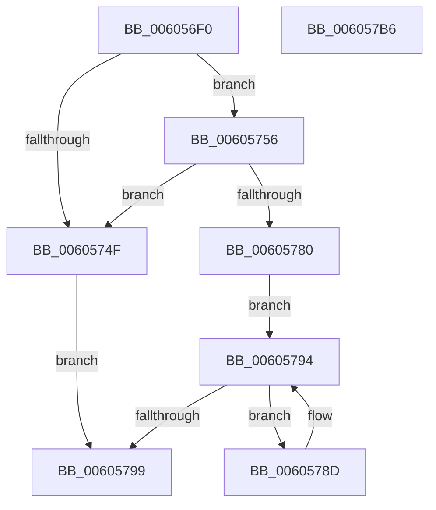

# RtlpHpVsContextStart

- RVA: `0x006056F0`–`0x006057B7` (길이 `199` bytes)
- VA: `0x00000001406056F0`
- 실행 섹션: `.text`
- PDB 이름 있음: `예`; PDB Function 태그: `아니요`
- unwind 정보 RVA: `0x0005E6B4`
- 디코드: `58`개 명령, `199/199` bytes 표시
- 미해석 바이트: `0` (있으면 어셈블리에 `.byte`로 보존)

> 이 문서는 커널 이미지의 기계어와 PDB 기호를 분석해 생성했습니다. 4번과 5번은 함수 원형과 자료형을 바이너리 사용 방식에서 추정한 C 해석이며 원본 소스 복구 결과는 아닙니다.

## 1. Dependencies

- 직접 호출 지점: **3**; 고유 호출 대상: **3**
- 직접 호출자로 확인된 함수: **2**
- RIP 상대 이미지 참조: **1**

### Outgoing calls
- `0x00605740` → [guard_dispatch_icall](../6B/guard_dispatch_icall_function_006BAAD0.md) (function, `0x006BAAD0`)
- `0x0060575E` → [memset](../6C/memset_function_006C6C40.md) (function, `0x006C6C40`)
- `0x00605773` → [RtlpHpVsSlotCreate](RtlpHpVsSlotCreate_function_006057C0.md) (function, `0x006057C0`)

### Direct callers
- [RtlpHpHeapCreate](RtlpHpHeapCreate_function_00602FDC.md) at `0x0060330E`
- [RtlpHpFixedHeapCreate](RtlpHpFixedHeapCreate_function_006038A0.md) at `0x00603AED`

### Static image references
- `0x0060571A` → RVA `0x00E28300` (`.data`; read)

## 2. Other-region calls and transfers

- 다른 실행 섹션으로 향하는 call: **0**
- 별도 외부 분기/꼬리 이동을 확인하지 못했습니다.

## 3. Assembly (complete function range)

```asm
006056F0  48 8B C4                        mov rax, rsp
006056F3  48 89 58 08                     mov qword ptr [rax + 8], rbx
006056F7  48 89 68 10                     mov qword ptr [rax + 0x10], rbp
006056FB  48 89 70 18                     mov qword ptr [rax + 0x18], rsi
006056FF  48 89 78 20                     mov qword ptr [rax + 0x20], rdi
00605703  41 56                           push r14
00605705  48 83 EC 20                     sub rsp, 0x20
00605709  0F B6 69 02                     movzx ebp, byte ptr [rcx + 2]
0060570D  48 8B F1                        mov rsi, rcx
00605710  48 33 49 08                     xor rcx, qword ptr [rcx + 8]
00605714  FF C5                           inc ebp
00605716  48 8B 46 30                     mov rax, qword ptr [rsi + 0x30]
0060571A  48 33 05 DF 2B 82 00            xor rax, qword ptr [rip + 0x822bdf]
00605721  44 8D 04 AD 00 00 00 00         lea r8d, [rbp*4]
00605729  41 8D 50 FF                     lea edx, [r8 - 1]
0060572D  48 33 C6                        xor rax, rsi
00605730  83 E2 3F                        and edx, 0x3f
00605733  44 2B C2                        sub r8d, edx
00605736  41 83 C0 3F                     add r8d, 0x3f
0060573A  41 8B D0                        mov edx, r8d
0060573D  45 8B F0                        mov r14d, r8d
00605740  E8 8B 53 0B 00                  call 0x1406baad0
00605745  33 FF                           xor edi, edi
00605747  48 8B D8                        mov rbx, rax
0060574A  48 85 C0                        test rax, rax
0060574D  75 07                           jne 0x140605756
0060574F  BF 9A 00 00 C0                  mov edi, 0xc000009a
00605754  EB 43                           jmp 0x140605799
00605756  4D 8B C6                        mov r8, r14
00605759  33 D2                           xor edx, edx
0060575B  48 8B CB                        mov rcx, rbx
0060575E  E8 DD 14 0C 00                  call 0x1406c6c40
00605763  48 8B C3                        mov rax, rbx
00605766  48 8B CE                        mov rcx, rsi
00605769  48 2B C6                        sub rax, rsi
0060576C  48 C1 E8 06                     shr rax, 6
00605770  66 89 06                        mov word ptr [rsi], ax
00605773  E8 48 00 00 00                  call 0x1406057c0
00605778  48 8B C8                        mov rcx, rax
0060577B  48 85 C0                        test rax, rax
0060577E  74 CF                           je 0x14060574f
00605780  48 2B CE                        sub rcx, rsi
00605783  48 8D 14 AB                     lea rdx, [rbx + rbp*4]
00605787  48 C1 E9 06                     shr rcx, 6
0060578B  EB 07                           jmp 0x140605794
0060578D  66 89 0B                        mov word ptr [rbx], cx
00605790  48 83 C3 04                     add rbx, 4
00605794  48 3B DA                        cmp rbx, rdx
00605797  72 F4                           jb 0x14060578d
00605799  48 8B 5C 24 30                  mov rbx, qword ptr [rsp + 0x30]
0060579E  8B C7                           mov eax, edi
006057A0  48 8B 7C 24 48                  mov rdi, qword ptr [rsp + 0x48]
006057A5  48 8B 6C 24 38                  mov rbp, qword ptr [rsp + 0x38]
006057AA  48 8B 74 24 40                  mov rsi, qword ptr [rsp + 0x40]
006057AF  48 83 C4 20                     add rsp, 0x20
006057B3  41 5E                           pop r14
006057B5  C3                              ret
006057B6  CC                              int3
```

## 4. C-style interpretation (structured pseudocode)

```c
__int64 __fastcall RtlpHpVsContextStart(__int64 a1)
{
    __int64 result;
    __int64 v_rbp;
    __int64 v_rbx;
    __int64 v_rdi;
    __int64 v_rsp;
    unsigned __int64 v_stack_p10;
    unsigned __int64 v_stack_p18;
    unsigned __int64 v_stack_p20;
    unsigned __int64 v_stack_p8;

    *(unsigned __int64 *)(v_rsp + 8) = v_rbx;
    *(unsigned __int64 *)(v_rsp + 16) = v_rbp;
    *(unsigned __int64 *)(v_rsp + 24) = v_rsi;
    *(unsigned __int64 *)(v_rsp + 32) = v_rdi;
    v_rsp = (v_rsp) - (32);
    a1 = (a1) ^ (*(unsigned __int64 *)(a1 + 8));
    v_rbp = (unsigned int)((*(unsigned __int8 *)(a1 + 2)) + 1);
    result = (*(unsigned __int64 *)(a1 + 48)) ^ (*(unsigned __int64 *)(v_rip + 8530911));
    result = (result) ^ (a1);
    a2 = (unsigned int)((v_rbp * 4 - 1) & (63));
    a3 = (unsigned int)((v_rbp * 4) - ((unsigned int)(a2)));
    a3 = (unsigned int)((a3) + (63));
    result = guard_dispatch_icall(a1, (unsigned int)((unsigned int)(a3)), a3, a4);
    v_rdi = 0;
    if (result != 0) goto loc_00605756;
loc_0060574F:
    goto loc_00605799;
loc_00605756:
    a2 = 0;
    result = memset(result, a2, (unsigned int)((unsigned int)(a3)), a4);
    result = (result) - (a1);
    result = (result) >> (6);
    *(unsigned __int16 *)(a1) = (unsigned __int16)(result);
    result = RtlpHpVsSlotCreate(a1, a2, (unsigned int)((unsigned int)(a3)), a4);
    if (result == 0) goto loc_0060574F;
    a1 = (result) - (a1);
    a1 = (a1) >> (6);
    goto loc_00605794;
loc_0060578D:
    *(unsigned __int16 *)(result) = (unsigned __int16)(a1);
    v_rbx = (result) + (4);
loc_00605794:
    if (v_rbx < (result + v_rbp * 4)) goto loc_0060578D;
loc_00605799:
    v_rsp = (v_rsp) + (32);
    return (unsigned int)((unsigned int)((unsigned int)(0xC000009AULL)));
}
```

## 5. (Beta) C Style

```c
int64_t RtlpHpVsContextStart(void *Arg1)
{
    uint8_t *arg1 = (uint8_t *)Arg1;

    int64_t result;
    int64_t local_rbp;
    int64_t local_rbx;
    int64_t local_rdi;
    int64_t local_rsp;
    uint64_t v_stack_p10;
    uint64_t v_stack_p18;
    uint64_t v_stack_p20;
    uint64_t v_stack_p8;

    *(uint64_t *)(local_rsp + 0x8) = local_rbx;
    *(uint64_t *)(local_rsp + 0x10) = local_rbp;
    *(uint64_t *)(local_rsp + 0x18) = local_rsi;
    *(uint64_t *)(local_rsp + 0x20) = local_rdi;
    local_rsp = (local_rsp) - (32);
    Arg1 = (Arg1) ^ (*(uint64_t *)(arg1 + 0x8));
    local_rbp = (uint32_t)((*(uint8_t *)(arg1 + 0x2)) + 1);
    result = (*(uint64_t *)(arg1 + 0x30)) ^ (*(uint64_t *)(v_rip + 0x822BDF));
    result = (result) ^ (Arg1);
    a2 = (uint32_t)((local_rbp * 4 - 1) & (63));
    a3 = (uint32_t)((local_rbp * 4) - ((uint32_t)(a2)));
    a3 = (uint32_t)((a3) + (63));
    result = guard_dispatch_icall(Arg1, (uint32_t)((uint32_t)(a3)), a3, a4);
    local_rdi = 0;
    if (result != 0) goto loc_00605756;
loc_0060574F:
    goto loc_00605799;
loc_00605756:
    a2 = 0;
    result = memset(result, a2, (uint32_t)((uint32_t)(a3)), a4);
    result = (result) - (Arg1);
    result = (result) >> (6);
    *(uint16_t *)(arg1) = (uint16_t)(result);
    result = RtlpHpVsSlotCreate(Arg1, a2, (uint32_t)((uint32_t)(a3)), a4);
    if (result == 0) goto loc_0060574F;
    Arg1 = (result) - (Arg1);
    Arg1 = (Arg1) >> (6);
    goto loc_00605794;
loc_0060578D:
    *(uint16_t *)(result) = (uint16_t)(Arg1);
    local_rbx = (result) + (4);
loc_00605794:
    if (local_rbx < (result + local_rbp * 4)) goto loc_0060578D;
loc_00605799:
    local_rsp = (local_rsp) + (32);
    return (uint32_t)((uint32_t)((uint32_t)(0xC000009AULL)));
}
```

### 관측된 메모리 오프셋

구조체 형식이 확인되지 않은 접근은 인자 기준의 오프셋으로만 기록했습니다.

| 기준 인자 | 오프셋 표현 | 폭 (bit) | 접근 |
|---|---:|---:|---|
| `Arg1` | `+ 0x0` | `16` | `W` |
| `Arg1` | `+ 0x2` | `8` | `R` |
| `Arg1` | `+ 0x8` | `64` | `R` |
| `Arg1` | `+ 0x30` | `64` | `R` |

## 6. Execution-region graph

[열기: 2D/3D 그래프와 함수 탐색 컨트롤 패널](../../../control-panel.html?section=text&rva=0x006056F0&view=graph)

- 2D 그래프는 위에서 아래로 흐르고, 3D 그래프는 빈 공간을 드래그해 회전합니다. Shift+드래그는 이동, 휠은 확대·축소, 함수 노드 선택은 대상 보고서 이동입니다.

### Static fallback


