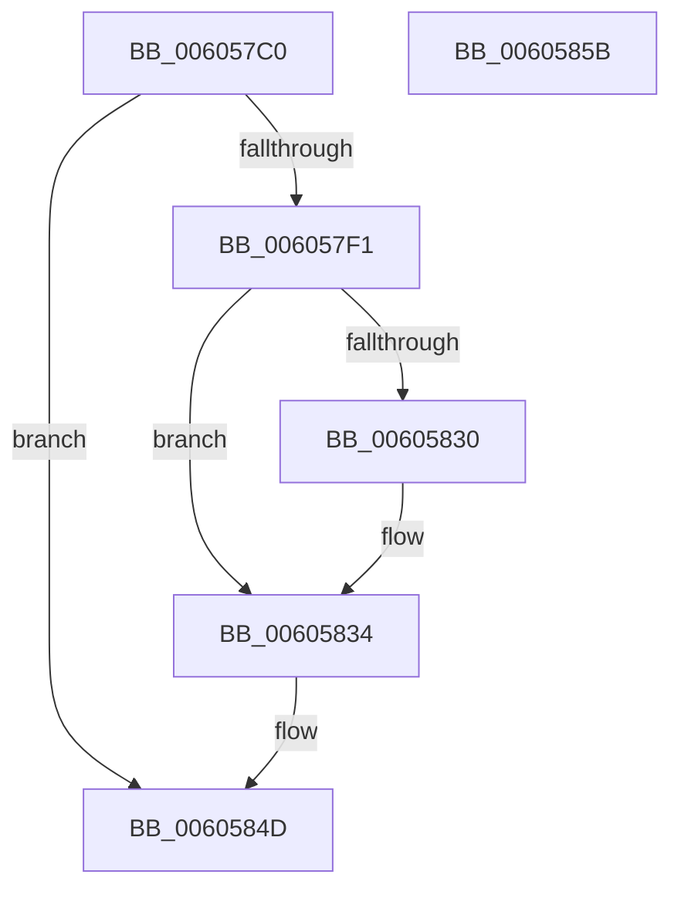

# RtlpHpVsSlotCreate

- RVA: `0x006057C0`–`0x0060585C` (길이 `156` bytes)
- VA: `0x00000001406057C0`
- 실행 섹션: `.text`
- PDB 이름 있음: `예`; PDB Function 태그: `아니요`
- unwind 정보 RVA: `0x00068D5C`
- 디코드: `41`개 명령, `156/156` bytes 표시
- 미해석 바이트: `0` (있으면 어셈블리에 `.byte`로 보존)

> 이 문서는 커널 이미지의 기계어와 PDB 기호를 분석해 생성했습니다. 4번과 5번은 함수 원형과 자료형을 바이너리 사용 방식에서 추정한 C 해석이며 원본 소스 복구 결과는 아닙니다.

## 1. Dependencies

- 직접 호출 지점: **4**; 고유 호출 대상: **4**
- 직접 호출자로 확인된 함수: **2**
- RIP 상대 이미지 참조: **1**

### Outgoing calls
- `0x006057E4` → [guard_dispatch_icall](../6B/guard_dispatch_icall_function_006BAAD0.md) (function, `0x006BAAD0`)
- `0x006057FB` → [memset](../6C/memset_function_006C6C40.md) (function, `0x006C6C40`)
- `0x00605811` → [RtlpHpInitializeLock](../2E/RtlpHpInitializeLock_function_002E8054.md) (function, `0x002E8054`)
- `0x00605848` → [InitializeSListHead](../46/InitializeSListHead_function_00468A90.md) (function, `0x00468A90`)

### Direct callers
- [RtlpHpVsContextHandleContention](../2E/RtlpHpVsContextHandleContention_function_002EB9D4.md) at `0x002EBAF3`
- [RtlpHpVsContextStart](RtlpHpVsContextStart_function_006056F0.md) at `0x00605773`

### Static image references
- `0x006057DA` → RVA `0x00E28300` (`.data`; read)

## 2. Other-region calls and transfers

- 다른 실행 섹션으로 향하는 call: **0**
- 별도 외부 분기/꼬리 이동을 확인하지 못했습니다.

## 3. Assembly (complete function range)

```asm
006057C0  48 89 5C 24 10                  mov qword ptr [rsp + 0x10], rbx
006057C5  57                              push rdi
006057C6  48 83 EC 20                     sub rsp, 0x20
006057CA  48 8B F9                        mov rdi, rcx
006057CD  BA 80 00 00 00                  mov edx, 0x80
006057D2  48 33 49 08                     xor rcx, qword ptr [rcx + 8]
006057D6  48 8B 47 30                     mov rax, qword ptr [rdi + 0x30]
006057DA  48 33 05 1F 2B 82 00            xor rax, qword ptr [rip + 0x822b1f]
006057E1  48 33 C7                        xor rax, rdi
006057E4  E8 E7 52 0B 00                  call 0x1406baad0
006057E9  48 8B D8                        mov rbx, rax
006057EC  48 85 C0                        test rax, rax
006057EF  74 5C                           je 0x14060584d
006057F1  33 D2                           xor edx, edx
006057F3  48 8D 48 08                     lea rcx, [rax + 8]
006057F7  44 8D 42 78                     lea r8d, [rdx + 0x78]
006057FB  E8 40 14 0C 00                  call 0x1406c6c40
00605800  48 8B C3                        mov rax, rbx
00605803  48 8D 4B 08                     lea rcx, [rbx + 8]
00605807  48 2B C7                        sub rax, rdi
0060580A  48 89 03                        mov qword ptr [rbx], rax
0060580D  0F B6 57 03                     movzx edx, byte ptr [rdi + 3]
00605811  E8 3E 28 CE FF                  call 0x1402e8054
00605816  0F B6 4F 05                     movzx ecx, byte ptr [rdi + 5]
0060581A  48 C7 43 10 00 00 00 00         mov qword ptr [rbx + 0x10], 0
00605822  48 C7 43 18 00 00 00 00         mov qword ptr [rbx + 0x18], 0
0060582A  0F BA E1 00                     bt ecx, 0
0060582E  73 04                           jae 0x140605834
00605830  C6 43 18 01                     mov byte ptr [rbx + 0x18], 1
00605834  48 83 63 28 00                  and qword ptr [rbx + 0x28], 0
00605839  48 8D 4B 40                     lea rcx, [rbx + 0x40]
0060583D  48 83 63 20 00                  and qword ptr [rbx + 0x20], 0
00605842  0F 57 C0                        xorps xmm0, xmm0
00605845  0F 29 01                        movaps xmmword ptr [rcx], xmm0
00605848  E8 43 32 E6 FF                  call 0x140468a90
0060584D  48 8B C3                        mov rax, rbx
00605850  48 8B 5C 24 38                  mov rbx, qword ptr [rsp + 0x38]
00605855  48 83 C4 20                     add rsp, 0x20
00605859  5F                              pop rdi
0060585A  C3                              ret
0060585B  CC                              int3
```

## 4. C-style interpretation (structured pseudocode)

```c
__int64 __fastcall RtlpHpVsSlotCreate(__int64 a1)
{
    __int64 result;
    __int64 v_rsp;
    unsigned __int64 v_stack_p10;

    v_stack_p10 = v_rbx;
    v_rsp = (v_rsp) - (32);
    a1 = (a1) ^ (*(unsigned __int64 *)(a1 + 8));
    result = (*(unsigned __int64 *)(a1 + 48)) ^ (*(unsigned __int64 *)(v_rip + 8530719));
    result = (result) ^ (a1);
    result = guard_dispatch_icall(a1, 128, a3, a4);
    if (result == 0) goto loc_0060584D;
    a2 = 0;
    result = memset(result + 8, a2, a2 + 120, a4);
    result = (result) - (a1);
    *(unsigned __int64 *)(result) = result;
    result = RtlpHpInitializeLock(result + 8, *(unsigned __int8 *)(a1 + 3), a2 + 120, a4);
    *(unsigned __int64 *)(result + 16) = 0;
    *(unsigned __int64 *)(result + 24) = 0;
    if (!(condition_is_above_or_equal)) {
        *(unsigned __int8 *)(result + 24) = 1;
    }
    *(unsigned __int64 *)(result + 64) = v_xmm0;
    result = InitializeSListHead(result + 64, *(unsigned __int8 *)(a1 + 3), a2 + 120, a4);
loc_0060584D:
    v_rsp = (v_rsp) + (32);
    return result;
}
```

## 5. (Beta) C Style

```c
int64_t RtlpHpVsSlotCreate(void *Arg1)
{
    uint8_t *arg1 = (uint8_t *)Arg1;

    int64_t result;
    int64_t local_rsp;
    uint64_t v_stack_p10;

    v_stack_p10 = local_rbx;
    local_rsp = (local_rsp) - (32);
    Arg1 = (Arg1) ^ (*(uint64_t *)(arg1 + 0x8));
    result = (*(uint64_t *)(arg1 + 0x30)) ^ (*(uint64_t *)(v_rip + 0x822B1F));
    result = (result) ^ (Arg1);
    result = guard_dispatch_icall(Arg1, 128, a3, a4);
    if (result == 0) goto loc_0060584D;
    a2 = 0;
    result = memset(result + 8, a2, a2 + 120, a4);
    result = (result) - (Arg1);
    *(uint64_t *)(result) = result;
    result = RtlpHpInitializeLock(result + 8, *(uint8_t *)(arg1 + 0x3), a2 + 120, a4);
    *(uint64_t *)(result + 0x10) = 0;
    *(uint64_t *)(result + 0x18) = 0;
    if (!(condition_is_above_or_equal)) {
        *(uint8_t *)(result + 0x18) = 1;
    }
    *(uint64_t *)(result + 0x40) = v_xmm0;
    result = InitializeSListHead(result + 64, *(uint8_t *)(arg1 + 0x3), a2 + 120, a4);
loc_0060584D:
    local_rsp = (local_rsp) + (32);
    return result;
}
```

### 관측된 메모리 오프셋

구조체 형식이 확인되지 않은 접근은 인자 기준의 오프셋으로만 기록했습니다.

| 기준 인자 | 오프셋 표현 | 폭 (bit) | 접근 |
|---|---:|---:|---|
| `Arg1` | `+ 0x3` | `8` | `R` |
| `Arg1` | `+ 0x5` | `8` | `R` |
| `Arg1` | `+ 0x8` | `64` | `R` |
| `Arg1` | `+ 0x30` | `64` | `R` |

## 6. Execution-region graph

[열기: 2D/3D 그래프와 함수 탐색 컨트롤 패널](../../../control-panel.html?section=text&rva=0x006057C0&view=graph)

- 2D 그래프는 위에서 아래로 흐르고, 3D 그래프는 빈 공간을 드래그해 회전합니다. Shift+드래그는 이동, 휠은 확대·축소, 함수 노드 선택은 대상 보고서 이동입니다.

### Static fallback


