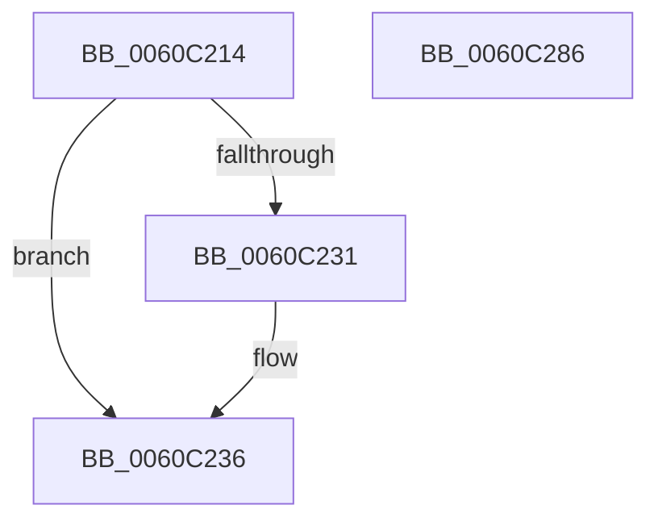

# SMKM_STORE_MGR&lt;SM_TRAITS&gt;::SmCleanup

- RVA: `0x0060C214`–`0x0060C287` (길이 `115` bytes)
- VA: `0x000000014060C214`
- 실행 섹션: `.text`
- PDB 이름 있음: `예`; PDB Function 태그: `아니요`
- unwind 정보 RVA: `0x0005CF00`
- 디코드: `27`개 명령, `115/115` bytes 표시
- 미해석 바이트: `0` (있으면 어셈블리에 `.byte`로 보존)

> 이 문서는 커널 이미지의 기계어와 PDB 기호를 분석해 생성했습니다. 4번과 5번은 함수 원형과 자료형을 바이너리 사용 방식에서 추정한 C 해석이며 원본 소스 복구 결과는 아닙니다.

## 1. Dependencies

- 직접 호출 지점: **7**; 고유 호출 대상: **6**
- 직접 호출자로 확인된 함수: **2**
- RIP 상대 이미지 참조: **0**

### Outgoing calls
- `0x0060C21D` → [SmKmCleanup](../../page/7A/SmKmCleanup_function_007A8108.md) (function, `0x007A8108`)
- `0x0060C231` → [B_TREE<_SM_PAGE_KEY,SMKM_STORE_MGR<SM_TRAITS>::SMKM_FRONTEND_ENTRY,4096,B_TREE_DUMMY_NODE_POOL,B_TREE_KEY_COMPARATOR<_SM_PAGE_KEY> >::BTreeNodeFree](B_TREE__SM_PAGE_KEY_SMKM_STORE_MGR_SM_TRAITS_SMKM_FRONTEND_ENTRY_4096_B_TREE_DUMMY_NODE_POOL_B_TREE__function_0060BC94.md) (function, `0x0060BC94`)
- `0x0060C23D` → [SmFpCleanup](../3B/SmFpCleanup_function_003B082C.md) (function, `0x003B082C`)
- `0x0060C249` → [SmFpCleanup](../3B/SmFpCleanup_function_003B082C.md) (function, `0x003B082C`)
- `0x0060C25A` → [SMKM_STORE_MGR<SM_TRAITS>::SmDrainSList](../47/SMKM_STORE_MGR_SM_TRAITS_SmDrainSList_function_0047204C.md) (function, `0x0047204C`)
- `0x0060C266` → [SMKM_STORE_MGR<SM_TRAITS>::SmCompressManagerCleanup](SMKM_STORE_MGR_SM_TRAITS_SmCompressManagerCleanup_function_0060C330.md) (function, `0x0060C330`)
- `0x0060C27B` → [KeDisableTimer2](../39/KeDisableTimer2_function_0039FD58.md) (function, `0x0039FD58`)

### Direct callers
- [SmFirstTimeInit](../4E/SmFirstTimeInit_function_004EA944.md) at `0x004EAC53`
- [SmPartitionCleanup](../../page/7A/SmPartitionCleanup_function_007A5C14.md) at `0x007A5C34`

### Static image references
- 디코드된 RIP-relative 메모리 참조가 없습니다.

## 2. Other-region calls and transfers

- 다른 실행 섹션으로 향하는 call: **1**
  - `0x0060C21D` → [SmKmCleanup](../../page/7A/SmKmCleanup_function_007A8108.md) (`.text` → `PAGE`)
- 별도 외부 분기/꼬리 이동을 확인하지 못했습니다.

## 3. Assembly (complete function range)

```asm
0060C214  40 53                           push rbx
0060C216  48 83 EC 20                     sub rsp, 0x20
0060C21A  48 8B D9                        mov rbx, rcx
0060C21D  E8 E6 BE 19 00                  call 0x1407a8108
0060C222  48 8D 8B C0 01 00 00            lea rcx, [rbx + 0x1c0]
0060C229  48 8B 11                        mov rdx, qword ptr [rcx]
0060C22C  48 85 D2                        test rdx, rdx
0060C22F  74 05                           je 0x14060c236
0060C231  E8 5E FA FF FF                  call 0x14060bc94
0060C236  48 8D 8B 30 06 00 00            lea rcx, [rbx + 0x630]
0060C23D  E8 EA 45 DA FF                  call 0x1403b082c
0060C242  48 8D 8B A8 06 00 00            lea rcx, [rbx + 0x6a8]
0060C249  E8 DE 45 DA FF                  call 0x1403b082c
0060C24E  48 8D 8B E0 04 00 00            lea rcx, [rbx + 0x4e0]
0060C255  BA 01 00 00 00                  mov edx, 1
0060C25A  E8 ED 5D E6 FF                  call 0x14047204c
0060C25F  48 8D 8B F0 04 00 00            lea rcx, [rbx + 0x4f0]
0060C266  E8 C5 00 00 00                  call 0x14060c330
0060C26B  41 B0 01                        mov r8b, 1
0060C26E  48 8D 8B 20 07 00 00            lea rcx, [rbx + 0x720]
0060C275  41 8A D0                        mov dl, r8b
0060C278  45 33 C9                        xor r9d, r9d
0060C27B  E8 D8 3A D9 FF                  call 0x14039fd58
0060C280  48 83 C4 20                     add rsp, 0x20
0060C284  5B                              pop rbx
0060C285  C3                              ret
0060C286  CC                              int3
```

## 4. C-style interpretation (structured pseudocode)

```c
__int64 __fastcall SMKM_STORE_MGR_SM_TRAITS___SmCleanup(__int64 a1, __int64 a2, __int64 a3, int a4)
{
    __int64 result;
    __int64 v_rsp;

    v_rsp = (v_rsp) - (32);
    result = SmKmCleanup(a1, a2, a3, a4);
    if (*(unsigned __int64 *)(a1 + 448) != 0) {
        result = B_TREE__SM_PAGE_KEY_SMKM_STORE_MGR_SM_TRAITS___SMKM_FRONTEND_ENTRY_4096_B_TREE_DUMMY_NODE_POOL_B_TRE(a1 + 448, *(unsigned __int64 *)(a1 + 448), a3, a4);
    }
    result = SmFpCleanup(a1 + 1584, *(unsigned __int64 *)(a1 + 448), a3, a4);
    result = SmFpCleanup(a1 + 1704, *(unsigned __int64 *)(a1 + 448), a3, a4);
    result = SMKM_STORE_MGR_SM_TRAITS___SmDrainSList(a1 + 1248, 1, a3, a4);
    result = SMKM_STORE_MGR_SM_TRAITS___SmCompressManagerCleanup(a1 + 1264, 1, a3, a4);
    a4 = 0;
    result = KeDisableTimer2(a1 + 1824, 1, 1, a4);
    v_rsp = (v_rsp) + (32);
    return result;
}
```

## 5. (Beta) C Style

```c
int64_t SMKM_STORE_MGR_SM_TRAITS___SmCleanup(void *Arg1, int64_t Arg2, int64_t Arg3, int32_t Arg4)
{
    uint8_t *arg1 = (uint8_t *)Arg1;

    int64_t result;
    int64_t local_rsp;

    local_rsp = (local_rsp) - (32);
    result = SmKmCleanup(Arg1, Arg2, Arg3, Arg4);
    if (*(uint64_t *)(arg1 + 0x1C0) != 0) {
        result = B_TREE__SM_PAGE_KEY_SMKM_STORE_MGR_SM_TRAITS___SMKM_FRONTEND_ENTRY_4096_B_TREE_DUMMY_NODE_POOL_B_TRE(Arg1 + 448, *(uint64_t *)(arg1 + 0x1C0), Arg3, Arg4);
    }
    result = SmFpCleanup(Arg1 + 1584, *(uint64_t *)(arg1 + 0x1C0), Arg3, Arg4);
    result = SmFpCleanup(Arg1 + 1704, *(uint64_t *)(arg1 + 0x1C0), Arg3, Arg4);
    result = SMKM_STORE_MGR_SM_TRAITS___SmDrainSList(Arg1 + 1248, 1, Arg3, Arg4);
    result = SMKM_STORE_MGR_SM_TRAITS___SmCompressManagerCleanup(Arg1 + 1264, 1, Arg3, Arg4);
    Arg4 = 0;
    result = KeDisableTimer2(Arg1 + 1824, 1, 1, Arg4);
    local_rsp = (local_rsp) + (32);
    return result;
}
```

### 관측된 메모리 오프셋

구조체 형식이 확인되지 않은 접근은 인자 기준의 오프셋으로만 기록했습니다.

| 기준 인자 | 오프셋 표현 | 폭 (bit) | 접근 |
|---|---:|---:|---|
| `Arg1` | `+ 0x0` | `64` | `R` |
| `Arg1` | `+ 0x1C0` | `64` | `R` |
| `Arg1` | `+ 0x4E0` | `64` | `R` |
| `Arg1` | `+ 0x4F0` | `64` | `R` |
| `Arg1` | `+ 0x630` | `64` | `R` |
| `Arg1` | `+ 0x6A8` | `64` | `R` |
| `Arg1` | `+ 0x720` | `64` | `R` |

## 6. Execution-region graph

[열기: 2D/3D 그래프와 함수 탐색 컨트롤 패널](../../../control-panel.html?section=text&rva=0x0060C214&view=graph)

- 2D 그래프는 위에서 아래로 흐르고, 3D 그래프는 빈 공간을 드래그해 회전합니다. Shift+드래그는 이동, 휠은 확대·축소, 함수 노드 선택은 대상 보고서 이동입니다.

### Static fallback


