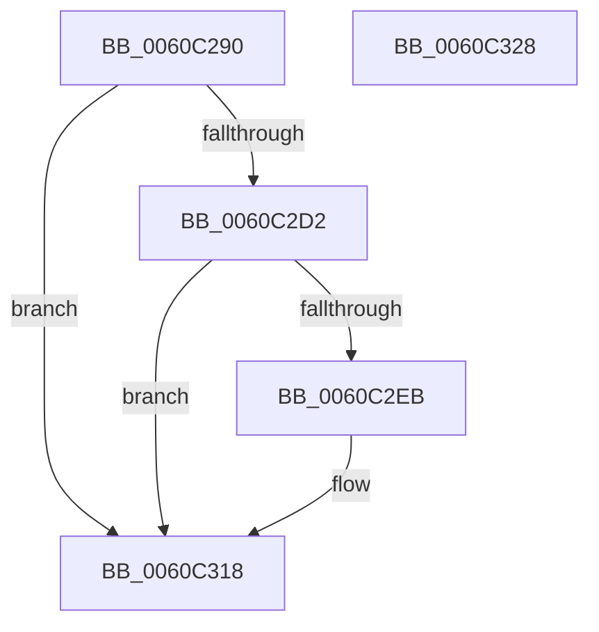

# SMKM_STORE_MGR&lt;SM_TRAITS&gt;::SmCompressCtxStart

- RVA: `0x0060C290`–`0x0060C329` (길이 `153` bytes)
- VA: `0x000000014060C290`
- 실행 섹션: `.text`
- PDB 이름 있음: `예`; PDB Function 태그: `아니요`
- unwind 정보 RVA: `0x000D1934`
- 디코드: `42`개 명령, `153/153` bytes 표시
- 미해석 바이트: `0` (있으면 어셈블리에 `.byte`로 보존)

> 이 문서는 커널 이미지의 기계어와 PDB 기호를 분석해 생성했습니다. 4번과 5번은 함수 원형과 자료형을 바이너리 사용 방식에서 추정한 C 해석이며 원본 소스 복구 결과는 아닙니다.

## 1. Dependencies

- 직접 호출 지점: **4**; 고유 호출 대상: **3**
- 직접 호출자로 확인된 함수: **1**
- RIP 상대 이미지 참조: **2**

### Outgoing calls
- `0x0060C2C9` → [RtlGetCompressionWorkSpaceSize](../3B/RtlGetCompressionWorkSpaceSize_function_003B2560.md) (function, `0x003B2560`)
- `0x0060C2E2` → [SMKM_STORE_MGR<SM_TRAITS>::SmCompressCtxCreateThread](../3B/SMKM_STORE_MGR_SM_TRAITS_SmCompressCtxCreateThread_function_003B2400.md) (function, `0x003B2400`)
- `0x0060C2F7` → [SMKM_STORE_MGR<SM_TRAITS>::SmCompressManagerGetIdealProcessor](../3B/SMKM_STORE_MGR_SM_TRAITS_SmCompressManagerGetIdealProcessor_function_003B21CC.md) (function, `0x003B21CC`)
- `0x0060C30E` → [SMKM_STORE_MGR<SM_TRAITS>::SmCompressCtxCreateThread](../3B/SMKM_STORE_MGR_SM_TRAITS_SmCompressCtxCreateThread_function_003B2400.md) (function, `0x003B2400`)

### Direct callers
- [SMKM_STORE_MGR&lt;SM_TRAITS&gt;::SmCompressManagerStart](SMKM_STORE_MGR_SM_TRAITS_SmCompressManagerStart_function_0060C418.md) at `0x0060C5BE`

### Static image references
- `0x0060C2BE` → RVA `0x00011C18` (`.rdata`; read)
- `0x0060C2D5` → RVA `0x003B22C0` (`SMKM_STORE_MGR<SM_TRAITS>::SmCompressCtxBalancerThread`; read)

## 2. Other-region calls and transfers

- 다른 실행 섹션으로 향하는 call: **0**
- 별도 외부 분기/꼬리 이동을 확인하지 못했습니다.

## 3. Assembly (complete function range)

```asm
0060C290  48 89 5C 24 18                  mov qword ptr [rsp + 0x18], rbx
0060C295  48 89 74 24 20                  mov qword ptr [rsp + 0x20], rsi
0060C29A  57                              push rdi
0060C29B  48 83 EC 20                     sub rsp, 0x20
0060C29F  48 8B 79 08                     mov rdi, qword ptr [rcx + 8]
0060C2A3  4C 8D 44 24 38                  lea r8, [rsp + 0x38]
0060C2A8  48 63 C2                        movsxd rax, edx
0060C2AB  48 8B D9                        mov rbx, rcx
0060C2AE  48 8D 91 A4 00 00 00            lea rdx, [rcx + 0xa4]
0060C2B5  33 F6                           xor esi, esi
0060C2B7  48 8B C8                        mov rcx, rax
0060C2BA  89 74 24 38                     mov dword ptr [rsp + 0x38], esi
0060C2BE  48 8D 05 53 59 A0 FF            lea rax, [rip - 0x5fa6ad]
0060C2C5  0F B7 0C 48                     movzx ecx, word ptr [rax + rcx*2]
0060C2C9  E8 92 62 DA FF                  call 0x1403b2560
0060C2CE  85 C0                           test eax, eax
0060C2D0  78 46                           js 0x14060c318
0060C2D2  48 8B 17                        mov rdx, qword ptr [rdi]
0060C2D5  4C 8D 0D E4 5F DA FF            lea r9, [rip - 0x25a01c]
0060C2DC  45 33 C0                        xor r8d, r8d
0060C2DF  48 8B CB                        mov rcx, rbx
0060C2E2  E8 19 61 DA FF                  call 0x1403b2400
0060C2E7  85 C0                           test eax, eax
0060C2E9  78 2D                           js 0x14060c318
0060C2EB  8B 93 A8 00 00 00               mov edx, dword ptr [rbx + 0xa8]
0060C2F1  45 33 C0                        xor r8d, r8d
0060C2F4  48 8B CF                        mov rcx, rdi
0060C2F7  E8 D0 5E DA FF                  call 0x1403b21cc
0060C2FC  48 8B 17                        mov rdx, qword ptr [rdi]
0060C2FF  4C 8D 44 24 30                  lea r8, [rsp + 0x30]
0060C304  45 33 C9                        xor r9d, r9d
0060C307  89 44 24 30                     mov dword ptr [rsp + 0x30], eax
0060C30B  48 8B CB                        mov rcx, rbx
0060C30E  E8 ED 60 DA FF                  call 0x1403b2400
0060C313  85 C0                           test eax, eax
0060C315  0F 49 C6                        cmovns eax, esi
0060C318  48 8B 5C 24 40                  mov rbx, qword ptr [rsp + 0x40]
0060C31D  48 8B 74 24 48                  mov rsi, qword ptr [rsp + 0x48]
0060C322  48 83 C4 20                     add rsp, 0x20
0060C326  5F                              pop rdi
0060C327  C3                              ret
0060C328  CC                              int3
```

## 4. C-style interpretation (structured pseudocode)

```c
__int64 __fastcall SMKM_STORE_MGR_SM_TRAITS___SmCompressCtxStart(__int64 a1, int a2)
{
    __int64 result;
    __int64 v_rsi;
    __int64 v_rsp;
    unsigned __int64 v_stack_p10;
    unsigned __int64 v_stack_p18;
    unsigned __int64 v_stack_p20;
    unsigned __int64 v_stack_p8;

    v_stack_p18 = v_rbx;
    v_stack_p20 = v_rsi;
    v_rsp = (v_rsp) - (32);
    v_rsi = 0;
    v_stack_p10 = 0;
    result = RtlGetCompressionWorkSpaceSize(*(unsigned __int16 *)(v_rip - 6268589 + (int)(a2) * 2), a1 + 164, v_stack_p10, a4);
    if (sign_flag) goto loc_0060C318;
    a3 = 0;
    result = SMKM_STORE_MGR_SM_TRAITS___SmCompressCtxCreateThread(a1, *(unsigned __int64 *)(*(unsigned __int64 *)(a1 + 8)), a3, v_rip - 2465820);
    if (!(sign_flag)) {
        a2 = *(unsigned int *)(a1 + 168);
        a3 = 0;
        a1 = *(unsigned __int64 *)(a1 + 8);
        result = SMKM_STORE_MGR_SM_TRAITS___SmCompressManagerGetIdealProcessor(a1, a2, a3, v_rip - 2465820);
        a2 = *(unsigned __int64 *)(*(unsigned __int64 *)(a1 + 8));
        a3 = v_stack_p8;
        a4 = 0;
        v_stack_p8 = (unsigned int)(result);
        a1 = a1;
        result = SMKM_STORE_MGR_SM_TRAITS___SmCompressCtxCreateThread(a1, a2, a3, a4);
        if (!sign_flag) { result = 0; }
    }
    v_rsp = (v_rsp) + (32);
    return result;
}
```

## 5. (Beta) C Style

```c
int64_t SMKM_STORE_MGR_SM_TRAITS___SmCompressCtxStart(void *Arg1, int32_t Arg2)
{
    uint8_t *arg1 = (uint8_t *)Arg1;

    int64_t result;
    int64_t local_rsi;
    int64_t local_rsp;
    uint64_t v_stack_p10;
    uint64_t v_stack_p18;
    uint64_t v_stack_p20;
    uint64_t v_stack_p8;

    v_stack_p18 = local_rbx;
    v_stack_p20 = local_rsi;
    local_rsp = (local_rsp) - (32);
    local_rsi = 0;
    v_stack_p10 = 0;
    result = RtlGetCompressionWorkSpaceSize(*(uint16_t *)(v_rip - 0x5FA6AD + (int32_t)(Arg2) * 2), Arg1 + 164, v_stack_p10, a4);
    if (sign_flag) goto loc_0060C318;
    a3 = 0;
    result = SMKM_STORE_MGR_SM_TRAITS___SmCompressCtxCreateThread(Arg1, *(uint64_t *)(*(uint64_t *)(arg1 + 0x8)), a3, v_rip - 2465820);
    if (!(sign_flag)) {
        Arg2 = *(uint32_t *)(arg1 + 0xA8);
        a3 = 0;
        Arg1 = *(uint64_t *)(arg1 + 0x8);
        result = SMKM_STORE_MGR_SM_TRAITS___SmCompressManagerGetIdealProcessor(Arg1, Arg2, a3, v_rip - 2465820);
        Arg2 = *(uint64_t *)(*(uint64_t *)(arg1 + 0x8));
        a3 = v_stack_p8;
        a4 = 0;
        v_stack_p8 = (uint32_t)(result);
        Arg1 = Arg1;
        result = SMKM_STORE_MGR_SM_TRAITS___SmCompressCtxCreateThread(Arg1, Arg2, a3, a4);
        if (!sign_flag) { result = 0; }
    }
    local_rsp = (local_rsp) + (32);
    return result;
}
```

### 관측된 메모리 오프셋

구조체 형식이 확인되지 않은 접근은 인자 기준의 오프셋으로만 기록했습니다.

| 기준 인자 | 오프셋 표현 | 폭 (bit) | 접근 |
|---|---:|---:|---|
| `Arg1` | `+ 0x8` | `64` | `R` |
| `Arg1` | `+ 0xA4` | `64` | `R` |
| `Arg1` | `+ 0xA8` | `32` | `R` |

## 6. Execution-region graph

[열기: 2D/3D 그래프와 함수 탐색 컨트롤 패널](../../../control-panel.html?section=text&rva=0x0060C290&view=graph)

- 2D 그래프는 위에서 아래로 흐르고, 3D 그래프는 빈 공간을 드래그해 회전합니다. Shift+드래그는 이동, 휠은 확대·축소, 함수 노드 선택은 대상 보고서 이동입니다.

### Static fallback


