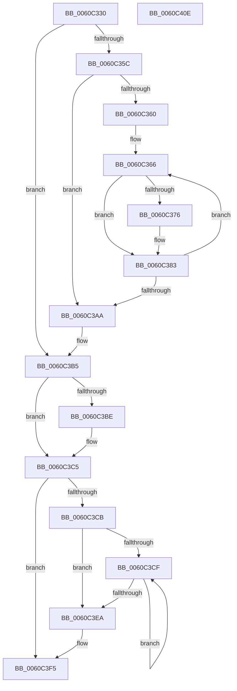

# SMKM_STORE_MGR&lt;SM_TRAITS&gt;::SmCompressManagerCleanup

- RVA: `0x0060C330`–`0x0060C40F` (길이 `223` bytes)
- VA: `0x000000014060C330`
- 실행 섹션: `.text`
- PDB 이름 있음: `예`; PDB Function 태그: `아니요`
- unwind 정보 RVA: `0x00060300`
- 디코드: `65`개 명령, `223/223` bytes 표시
- 미해석 바이트: `0` (있으면 어셈블리에 `.byte`로 보존)

> 이 문서는 커널 이미지의 기계어와 PDB 기호를 분석해 생성했습니다. 4번과 5번은 함수 원형과 자료형을 바이너리 사용 방식에서 추정한 C 해석이며 원본 소스 복구 결과는 아닙니다.

## 1. Dependencies

- 직접 호출 지점: **7**; 고유 호출 대상: **5**
- 직접 호출자로 확인된 함수: **1**
- RIP 상대 이미지 참조: **0**

### Outgoing calls
- `0x0060C37E` → [SMKM_STORE_MGR<SM_TRAITS>::SmCompressCtxUpdatePriority](../4B/SMKM_STORE_MGR_SM_TRAITS_SmCompressCtxUpdatePriority_function_004BD314.md) (function, `0x004BD314`)
- `0x0060C38C` → [KeSetEvent](../33/KeSetEvent_function_0033F310.md) (function, `0x0033F310`)
- `0x0060C398` → [ExWaitForRundownProtectionRelease](../2A/ExWaitForRundownProtectionRelease_function_002A4CB0.md) (function, `0x002A4CB0`)
- `0x0060C3B0` → [ExFreePoolWithTag](../../poolcode/B8/ExFreePoolWithTag_function_00B82870.md) (function, `0x00B82870`)
- `0x0060C3C0` → [ExFreePoolWithTag](../../poolcode/B8/ExFreePoolWithTag_function_00B82870.md) (function, `0x00B82870`)
- `0x0060C3DB` → [SMKM_STORE_MGR<SM_TRAITS>::SmDrainSList](../47/SMKM_STORE_MGR_SM_TRAITS_SmDrainSList_function_0047204C.md) (function, `0x0047204C`)
- `0x0060C3F0` → [ExFreePoolWithTag](../../poolcode/B8/ExFreePoolWithTag_function_00B82870.md) (function, `0x00B82870`)

### Direct callers
- [SMKM_STORE_MGR&lt;SM_TRAITS&gt;::SmCleanup](SMKM_STORE_MGR_SM_TRAITS_SmCleanup_function_0060C214.md) at `0x0060C266`

### Static image references
- 디코드된 RIP-relative 메모리 참조가 없습니다.

## 2. Other-region calls and transfers

- 다른 실행 섹션으로 향하는 call: **3**
  - `0x0060C3B0` → [ExFreePoolWithTag](../../poolcode/B8/ExFreePoolWithTag_function_00B82870.md) (`.text` → `POOLCODE`)
  - `0x0060C3C0` → [ExFreePoolWithTag](../../poolcode/B8/ExFreePoolWithTag_function_00B82870.md) (`.text` → `POOLCODE`)
  - `0x0060C3F0` → [ExFreePoolWithTag](../../poolcode/B8/ExFreePoolWithTag_function_00B82870.md) (`.text` → `POOLCODE`)
- 별도 외부 분기/꼬리 이동을 확인하지 못했습니다.

## 3. Assembly (complete function range)

```asm
0060C330  48 89 5C 24 08                  mov qword ptr [rsp + 8], rbx
0060C335  48 89 6C 24 10                  mov qword ptr [rsp + 0x10], rbp
0060C33A  48 89 74 24 18                  mov qword ptr [rsp + 0x18], rsi
0060C33F  57                              push rdi
0060C340  41 56                           push r14
0060C342  41 57                           push r15
0060C344  48 83 EC 20                     sub rsp, 0x20
0060C348  48 8B 01                        mov rax, qword ptr [rcx]
0060C34B  33 DB                           xor ebx, ebx
0060C34D  48 8B F9                        mov rdi, rcx
0060C350  8B B0 D4 07 00 00               mov esi, dword ptr [rax + 0x7d4]
0060C356  48 39 59 10                     cmp qword ptr [rcx + 0x10], rbx
0060C35A  74 59                           je 0x14060c3b5
0060C35C  85 F6                           test esi, esi
0060C35E  74 4A                           je 0x14060c3aa
0060C360  44 8B F3                        mov r14d, ebx
0060C363  44 8B FE                        mov r15d, esi
0060C366  48 8B 6F 10                     mov rbp, qword ptr [rdi + 0x10]
0060C36A  49 03 EE                        add rbp, r14
0060C36D  48 8D 45 68                     lea rax, [rbp + 0x68]
0060C371  48 39 00                        cmp qword ptr [rax], rax
0060C374  74 0D                           je 0x14060c383
0060C376  BA 0C 00 00 00                  mov edx, 0xc
0060C37B  48 8B CD                        mov rcx, rbp
0060C37E  E8 91 0F EB FF                  call 0x1404bd314
0060C383  48 8D 4D 50                     lea rcx, [rbp + 0x50]
0060C387  45 33 C0                        xor r8d, r8d
0060C38A  33 D2                           xor edx, edx
0060C38C  E8 7F 2F D3 FF                  call 0x14033f310
0060C391  48 8D 8D 90 00 00 00            lea rcx, [rbp + 0x90]
0060C398  E8 13 89 C9 FF                  call 0x1402a4cb0
0060C39D  49 81 C6 B0 00 00 00            add r14, 0xb0
0060C3A4  49 83 EF 01                     sub r15, 1
0060C3A8  75 BC                           jne 0x14060c366
0060C3AA  48 8B 4F 10                     mov rcx, qword ptr [rdi + 0x10]
0060C3AE  33 D2                           xor edx, edx
0060C3B0  E8 BB 64 57 00                  call 0x140b82870
0060C3B5  48 8B 4F 18                     mov rcx, qword ptr [rdi + 0x18]
0060C3B9  48 85 C9                        test rcx, rcx
0060C3BC  74 07                           je 0x14060c3c5
0060C3BE  33 D2                           xor edx, edx
0060C3C0  E8 AB 64 57 00                  call 0x140b82870
0060C3C5  48 39 5F 20                     cmp qword ptr [rdi + 0x20], rbx
0060C3C9  74 2A                           je 0x14060c3f5
0060C3CB  85 F6                           test esi, esi
0060C3CD  74 1B                           je 0x14060c3ea
0060C3CF  48 8B 4F 20                     mov rcx, qword ptr [rdi + 0x20]
0060C3D3  BA 01 00 00 00                  mov edx, 1
0060C3D8  48 03 CB                        add rcx, rbx
0060C3DB  E8 6C 5C E6 FF                  call 0x14047204c
0060C3E0  48 83 C3 10                     add rbx, 0x10
0060C3E4  48 83 EE 01                     sub rsi, 1
0060C3E8  75 E5                           jne 0x14060c3cf
0060C3EA  48 8B 4F 20                     mov rcx, qword ptr [rdi + 0x20]
0060C3EE  33 D2                           xor edx, edx
0060C3F0  E8 7B 64 57 00                  call 0x140b82870
0060C3F5  48 8B 5C 24 40                  mov rbx, qword ptr [rsp + 0x40]
0060C3FA  48 8B 6C 24 48                  mov rbp, qword ptr [rsp + 0x48]
0060C3FF  48 8B 74 24 50                  mov rsi, qword ptr [rsp + 0x50]
0060C404  48 83 C4 20                     add rsp, 0x20
0060C408  41 5F                           pop r15
0060C40A  41 5E                           pop r14
0060C40C  5F                              pop rdi
0060C40D  C3                              ret
0060C40E  CC                              int3
```

## 4. C-style interpretation (structured pseudocode)

```c
__int64 __fastcall SMKM_STORE_MGR_SM_TRAITS___SmCompressManagerCleanup(__int64 a1, __int64 a2, int a3)
{
    __int64 result;
    __int64 v_r14;
    __int64 v_r15;
    __int64 v_rbp;
    __int64 v_rbx;
    __int64 v_rsi;
    __int64 v_rsp;
    unsigned __int64 v_stack_p10;
    unsigned __int64 v_stack_p18;
    unsigned __int64 v_stack_p8;

    v_stack_p8 = v_rbx;
    v_stack_p10 = v_rbp;
    v_stack_p18 = v_rsi;
    v_rsp = (v_rsp) - (32);
    v_rbx = 0;
    if ((*(unsigned __int64 *)(a1 + 16)) == 0) goto loc_0060C3B5;
    if ((unsigned int)((unsigned int)(*(unsigned int *)(*(unsigned __int64 *)(a1) + 2004))) == 0) goto loc_0060C3AA;
loc_0060C366:
    v_rbp = (*(unsigned __int64 *)(a1 + 16)) + (0);
    result = v_rbp + 104;
    if ((*(unsigned __int64 *)(v_rbp + 104)) != (v_rbp + 104)) {
        a2 = 12;
        a1 = v_rbp;
        result = SMKM_STORE_MGR_SM_TRAITS___SmCompressCtxUpdatePriority(a1, a2, a3, a4);
    }
    a3 = 0;
    a2 = 0;
    result = KeSetEvent(v_rbp + 80, a2, a3, a4);
    result = ExWaitForRundownProtectionRelease(v_rbp + 144, a2, a3, a4);
    v_r14 = (0) + (176);
    v_r15 = ((unsigned int)((unsigned int)((unsigned int)(*(unsigned int *)(*(unsigned __int64 *)(a1) + 2004))))) - (1);
    if (condition_is_not_equal) goto loc_0060C366;
loc_0060C3AA:
    a2 = 0;
    result = ExFreePoolWithTag(*(unsigned __int64 *)(a1 + 16), a2, a3, a4);
loc_0060C3B5:
    if (*(unsigned __int64 *)(a1 + 24) != 0) {
        a2 = 0;
        result = ExFreePoolWithTag(*(unsigned __int64 *)(a1 + 24), a2, a3, a4);
    }
    if ((*(unsigned __int64 *)(a1 + 32)) == 0) goto loc_0060C3F5;
    if ((unsigned int)((unsigned int)(*(unsigned int *)(*(unsigned __int64 *)(a1) + 2004))) == 0) goto loc_0060C3EA;
loc_0060C3CF:
    a1 = (*(unsigned __int64 *)(a1 + 32)) + (0);
    result = SMKM_STORE_MGR_SM_TRAITS___SmDrainSList(a1, 1, a3, a4);
    v_rbx = (v_rbx) + (16);
    v_rsi = ((unsigned int)(*(unsigned int *)(*(unsigned __int64 *)(a1) + 2004))) - (1);
    if (condition_is_not_equal) goto loc_0060C3CF;
loc_0060C3EA:
    a2 = 0;
    result = ExFreePoolWithTag(*(unsigned __int64 *)(a1 + 32), a2, a3, a4);
loc_0060C3F5:
    v_rsp = (v_rsp) + (32);
    return result;
}
```

## 5. (Beta) C Style

```c
int64_t SMKM_STORE_MGR_SM_TRAITS___SmCompressManagerCleanup(void *Arg1, int64_t Arg2, int32_t Arg3)
{
    uint8_t *arg1 = (uint8_t *)Arg1;

    int64_t result;
    int64_t local_r14;
    int64_t local_r15;
    int64_t local_rbp;
    int64_t local_rbx;
    int64_t local_rsi;
    int64_t local_rsp;
    uint64_t v_stack_p10;
    uint64_t v_stack_p18;
    uint64_t v_stack_p8;

    v_stack_p8 = local_rbx;
    v_stack_p10 = local_rbp;
    v_stack_p18 = local_rsi;
    local_rsp = (local_rsp) - (32);
    local_rbx = 0;
    if ((*(uint64_t *)(arg1 + 0x10)) == 0) goto loc_0060C3B5;
    if ((uint32_t)((uint32_t)(*(uint32_t *)(*(uint64_t *)(arg1) + 0x7D4))) == 0) goto loc_0060C3AA;
loc_0060C366:
    local_rbp = (*(uint64_t *)(arg1 + 0x10)) + (0);
    result = local_rbp + 104;
    if ((*(uint64_t *)(local_rbp + 0x68)) != (local_rbp + 104)) {
        Arg2 = 12;
        Arg1 = local_rbp;
        result = SMKM_STORE_MGR_SM_TRAITS___SmCompressCtxUpdatePriority(Arg1, Arg2, Arg3, a4);
    }
    Arg3 = 0;
    Arg2 = 0;
    result = KeSetEvent(local_rbp + 80, Arg2, Arg3, a4);
    result = ExWaitForRundownProtectionRelease(local_rbp + 144, Arg2, Arg3, a4);
    local_r14 = (0) + (176);
    local_r15 = ((uint32_t)((uint32_t)((uint32_t)(*(uint32_t *)(*(uint64_t *)(arg1) + 0x7D4))))) - (1);
    if (condition_is_not_equal) goto loc_0060C366;
loc_0060C3AA:
    Arg2 = 0;
    result = ExFreePoolWithTag(*(uint64_t *)(arg1 + 0x10), Arg2, Arg3, a4);
loc_0060C3B5:
    if (*(uint64_t *)(arg1 + 0x18) != 0) {
        Arg2 = 0;
        result = ExFreePoolWithTag(*(uint64_t *)(arg1 + 0x18), Arg2, Arg3, a4);
    }
    if ((*(uint64_t *)(arg1 + 0x20)) == 0) goto loc_0060C3F5;
    if ((uint32_t)((uint32_t)(*(uint32_t *)(*(uint64_t *)(arg1) + 0x7D4))) == 0) goto loc_0060C3EA;
loc_0060C3CF:
    Arg1 = (*(uint64_t *)(arg1 + 0x20)) + (0);
    result = SMKM_STORE_MGR_SM_TRAITS___SmDrainSList(Arg1, 1, Arg3, a4);
    local_rbx = (local_rbx) + (16);
    local_rsi = ((uint32_t)(*(uint32_t *)(*(uint64_t *)(arg1) + 0x7D4))) - (1);
    if (condition_is_not_equal) goto loc_0060C3CF;
loc_0060C3EA:
    Arg2 = 0;
    result = ExFreePoolWithTag(*(uint64_t *)(arg1 + 0x20), Arg2, Arg3, a4);
loc_0060C3F5:
    local_rsp = (local_rsp) + (32);
    return result;
}
```

### 관측된 메모리 오프셋

구조체 형식이 확인되지 않은 접근은 인자 기준의 오프셋으로만 기록했습니다.

| 기준 인자 | 오프셋 표현 | 폭 (bit) | 접근 |
|---|---:|---:|---|
| `Arg1` | `+ 0x0` | `64` | `R` |
| `Arg1` | `+ 0x10` | `64` | `R` |
| `Arg1` | `+ 0x18` | `64` | `R` |
| `Arg1` | `+ 0x20` | `64` | `R` |

## 6. Execution-region graph

[열기: 2D/3D 그래프와 함수 탐색 컨트롤 패널](../../../control-panel.html?section=text&rva=0x0060C330&view=graph)

- 2D 그래프는 위에서 아래로 흐르고, 3D 그래프는 빈 공간을 드래그해 회전합니다. Shift+드래그는 이동, 휠은 확대·축소, 함수 노드 선택은 대상 보고서 이동입니다.

### Static fallback


