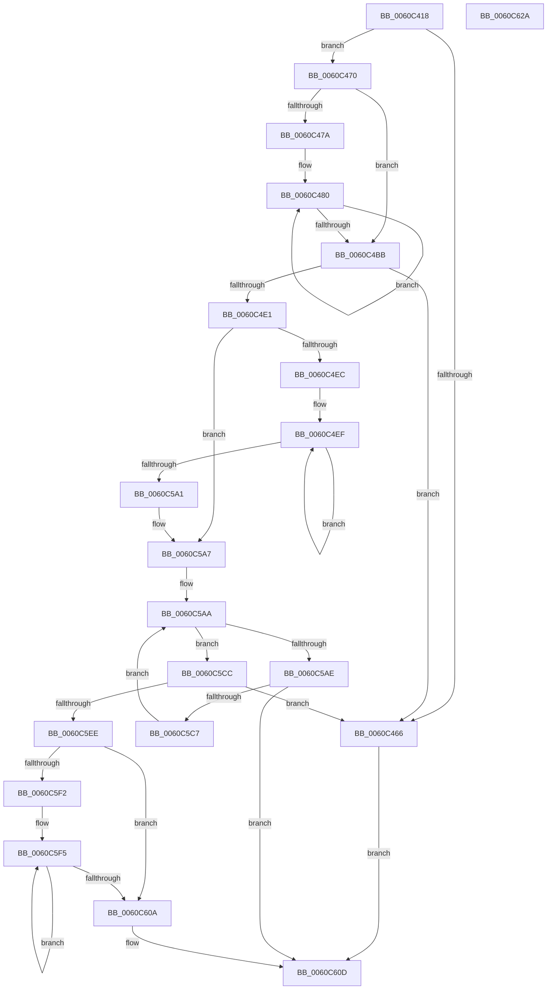

# SMKM_STORE_MGR&lt;SM_TRAITS&gt;::SmCompressManagerStart

- RVA: `0x0060C418`–`0x0060C62B` (길이 `531` bytes)
- VA: `0x000000014060C418`
- 실행 섹션: `.text`
- PDB 이름 있음: `예`; PDB Function 태그: `아니요`
- unwind 정보 RVA: `0x00075C18`
- 디코드: `140`개 명령, `531/531` bytes 표시
- 미해석 바이트: `0` (있으면 어셈블리에 `.byte`로 보존)

> 이 문서는 커널 이미지의 기계어와 PDB 기호를 분석해 생성했습니다. 4번과 5번은 함수 원형과 자료형을 바이너리 사용 방식에서 추정한 C 해석이며 원본 소스 복구 결과는 아닙니다.

## 1. Dependencies

- 직접 호출 지점: **8**; 고유 호출 대상: **5**
- 직접 호출자로 확인된 함수: **1**
- RIP 상대 이미지 참조: **1**

### Outgoing calls
- `0x0060C455` → [SmAllocEx](../34/SmAllocEx_function_0034C794.md) (function, `0x0034C794`)
- `0x0060C4AA` → [memset](../6C/memset_function_006C6C40.md) (function, `0x006C6C40`)
- `0x0060C4BE` → [SMKM_STORE_MGR<SM_TRAITS>::SmCompressManagerUpdateTopology](SMKM_STORE_MGR_SM_TRAITS_SmCompressManagerUpdateTopology_function_0060C634.md) (function, `0x0060C634`)
- `0x0060C4D3` → [SmAllocEx](../34/SmAllocEx_function_0034C794.md) (function, `0x0034C794`)
- `0x0060C501` → [memset](../6C/memset_function_006C6C40.md) (function, `0x006C6C40`)
- `0x0060C5BE` → [SMKM_STORE_MGR<SM_TRAITS>::SmCompressCtxStart](SMKM_STORE_MGR_SM_TRAITS_SmCompressCtxStart_function_0060C290.md) (function, `0x0060C290`)
- `0x0060C5DC` → [SmAllocEx](../34/SmAllocEx_function_0034C794.md) (function, `0x0034C794`)
- `0x0060C5FC` → [InitializeSListHead](../46/InitializeSListHead_function_00468A90.md) (function, `0x00468A90`)

### Direct callers
- [SmFirstTimeInit](../4E/SmFirstTimeInit_function_004EA944.md) at `0x004EABE3`

### Static image references
- `0x0060C486` → RVA `0x00FC5014` (`ALMOSTRO`; read)

## 2. Other-region calls and transfers

- 다른 실행 섹션으로 향하는 call: **0**
- 별도 외부 분기/꼬리 이동을 확인하지 못했습니다.

## 3. Assembly (complete function range)

```asm
0060C418  48 89 5C 24 08                  mov qword ptr [rsp + 8], rbx
0060C41D  48 89 6C 24 10                  mov qword ptr [rsp + 0x10], rbp
0060C422  48 89 74 24 18                  mov qword ptr [rsp + 0x18], rsi
0060C427  57                              push rdi
0060C428  41 54                           push r12
0060C42A  41 55                           push r13
0060C42C  41 56                           push r14
0060C42E  41 57                           push r15
0060C430  48 83 EC 20                     sub rsp, 0x20
0060C434  48 8B 01                        mov rax, qword ptr [rcx]
0060C437  48 8B F9                        mov rdi, rcx
0060C43A  44 8B E2                        mov r12d, edx
0060C43D  41 83 C8 FF                     or r8d, 0xffffffff
0060C441  BA 73 6D 43 6E                  mov edx, 0x6e436d73
0060C446  8B A8 D4 07 00 00               mov ebp, dword ptr [rax + 0x7d4]
0060C44C  48 69 CD 10 01 00 00            imul rcx, rbp, 0x110
0060C453  8B F5                           mov esi, ebp
0060C455  E8 3A 03 D4 FF                  call 0x14034c794
0060C45A  45 33 ED                        xor r13d, r13d
0060C45D  48 89 47 18                     mov qword ptr [rdi + 0x18], rax
0060C461  48 85 C0                        test rax, rax
0060C464  75 0A                           jne 0x14060c470
0060C466  B8 9A 00 00 C0                  mov eax, 0xc000009a
0060C46B  E9 9D 01 00 00                  jmp 0x14060c60d
0060C470  41 BF 01 00 00 00               mov r15d, 1
0060C476  85 ED                           test ebp, ebp
0060C478  74 41                           je 0x14060c4bb
0060C47A  49 8B DD                        mov rbx, r13
0060C47D  4C 8B F6                        mov r14, rsi
0060C480  48 8B 4F 18                     mov rcx, qword ptr [rdi + 0x18]
0060C484  33 D2                           xor edx, edx
0060C486  0F B7 05 87 8B 9B 00            movzx eax, word ptr [rip + 0x9b8b87]
0060C48D  44 8B C0                        mov r8d, eax
0060C490  49 C1 E0 03                     shl r8, 3
0060C494  66 44 89 3C 0B                  mov word ptr [rbx + rcx], r15w
0060C499  66 89 44 0B 02                  mov word ptr [rbx + rcx + 2], ax
0060C49E  44 89 6C 0B 04                  mov dword ptr [rbx + rcx + 4], r13d
0060C4A3  48 83 C1 08                     add rcx, 8
0060C4A7  48 03 CB                        add rcx, rbx
0060C4AA  E8 91 A7 0B 00                  call 0x1406c6c40
0060C4AF  48 81 C3 10 01 00 00            add rbx, 0x110
0060C4B6  4D 2B F7                        sub r14, r15
0060C4B9  75 C5                           jne 0x14060c480
0060C4BB  48 8B CF                        mov rcx, rdi
0060C4BE  E8 71 01 00 00                  call 0x14060c634
0060C4C3  48 69 CE B0 00 00 00            imul rcx, rsi, 0xb0
0060C4CA  41 83 C8 FF                     or r8d, 0xffffffff
0060C4CE  BA 73 6D 43 63                  mov edx, 0x63436d73
0060C4D3  E8 BC 02 D4 FF                  call 0x14034c794
0060C4D8  48 89 47 10                     mov qword ptr [rdi + 0x10], rax
0060C4DC  48 85 C0                        test rax, rax
0060C4DF  74 85                           je 0x14060c466
0060C4E1  45 8B F5                        mov r14d, r13d
0060C4E4  85 ED                           test ebp, ebp
0060C4E6  0F 84 BB 00 00 00               je 0x14060c5a7
0060C4EC  4D 8B FD                        mov r15, r13
0060C4EF  48 8B 5F 10                     mov rbx, qword ptr [rdi + 0x10]
0060C4F3  33 D2                           xor edx, edx
0060C4F5  49 03 DF                        add rbx, r15
0060C4F8  41 B8 B0 00 00 00               mov r8d, 0xb0
0060C4FE  48 8B CB                        mov rcx, rbx
0060C501  E8 3A A7 0B 00                  call 0x1406c6c40
0060C506  48 8D 43 10                     lea rax, [rbx + 0x10]
0060C50A  49 81 C7 B0 00 00 00            add r15, 0xb0
0060C511  48 89 40 08                     mov qword ptr [rax + 8], rax
0060C515  4C 89 28                        mov qword ptr [rax], r13
0060C518  48 8D 43 68                     lea rax, [rbx + 0x68]
0060C51C  48 89 40 08                     mov qword ptr [rax + 8], rax
0060C520  48 89 00                        mov qword ptr [rax], rax
0060C523  48 8D 43 28                     lea rax, [rbx + 0x28]
0060C527  66 C7 43 20 01 00               mov word ptr [rbx + 0x20], 1
0060C52D  C6 43 22 06                     mov byte ptr [rbx + 0x22], 6
0060C531  44 89 6B 24                     mov dword ptr [rbx + 0x24], r13d
0060C535  48 89 40 08                     mov qword ptr [rax + 8], rax
0060C539  48 89 00                        mov qword ptr [rax], rax
0060C53C  48 8D 43 40                     lea rax, [rbx + 0x40]
0060C540  66 44 89 6B 38                  mov word ptr [rbx + 0x38], r13w
0060C545  C6 43 3A 06                     mov byte ptr [rbx + 0x3a], 6
0060C549  44 89 6B 3C                     mov dword ptr [rbx + 0x3c], r13d
0060C54D  48 89 40 08                     mov qword ptr [rax + 8], rax
0060C551  48 89 00                        mov qword ptr [rax], rax
0060C554  48 8D 43 58                     lea rax, [rbx + 0x58]
0060C558  66 44 89 6B 50                  mov word ptr [rbx + 0x50], r13w
0060C55D  C6 43 52 06                     mov byte ptr [rbx + 0x52], 6
0060C561  44 89 6B 54                     mov dword ptr [rbx + 0x54], r13d
0060C565  48 89 40 08                     mov qword ptr [rax + 8], rax
0060C569  48 89 00                        mov qword ptr [rax], rax
0060C56C  48 8D 43 78                     lea rax, [rbx + 0x78]
0060C570  4C 89 AB 90 00 00 00            mov qword ptr [rbx + 0x90], r13
0060C577  48 89 40 08                     mov qword ptr [rax + 8], rax
0060C57B  4C 89 28                        mov qword ptr [rax], r13
0060C57E  8B 87 3C 01 00 00               mov eax, dword ptr [rdi + 0x13c]
0060C584  44 89 B3 A8 00 00 00            mov dword ptr [rbx + 0xa8], r14d
0060C58B  41 FF C6                        inc r14d
0060C58E  89 83 98 00 00 00               mov dword ptr [rbx + 0x98], eax
0060C594  48 89 7B 08                     mov qword ptr [rbx + 8], rdi
0060C598  44 3B F5                        cmp r14d, ebp
0060C59B  0F 82 4E FF FF FF               jb 0x14060c4ef
0060C5A1  41 BF 01 00 00 00               mov r15d, 1
0060C5A7  41 8B DD                        mov ebx, r13d
0060C5AA  3B DD                           cmp ebx, ebp
0060C5AC  73 1E                           jae 0x14060c5cc
0060C5AE  8B C3                           mov eax, ebx
0060C5B0  41 8B D4                        mov edx, r12d
0060C5B3  48 69 C8 B0 00 00 00            imul rcx, rax, 0xb0
0060C5BA  48 03 4F 10                     add rcx, qword ptr [rdi + 0x10]
0060C5BE  E8 CD FC FF FF                  call 0x14060c290
0060C5C3  85 C0                           test eax, eax
0060C5C5  78 46                           js 0x14060c60d
0060C5C7  41 03 DF                        add ebx, r15d
0060C5CA  EB DE                           jmp 0x14060c5aa
0060C5CC  48 8B CE                        mov rcx, rsi
0060C5CF  41 83 C8 FF                     or r8d, 0xffffffff
0060C5D3  48 C1 E1 04                     shl rcx, 4
0060C5D7  BA 73 6D 43 77                  mov edx, 0x77436d73
0060C5DC  E8 B3 01 D4 FF                  call 0x14034c794
0060C5E1  48 89 47 20                     mov qword ptr [rdi + 0x20], rax
0060C5E5  48 85 C0                        test rax, rax
0060C5E8  0F 84 78 FE FF FF               je 0x14060c466
0060C5EE  85 ED                           test ebp, ebp
0060C5F0  74 18                           je 0x14060c60a
0060C5F2  49 8B DD                        mov rbx, r13
0060C5F5  48 8B 4F 20                     mov rcx, qword ptr [rdi + 0x20]
0060C5F9  48 03 CB                        add rcx, rbx
0060C5FC  E8 8F C4 E5 FF                  call 0x140468a90
0060C601  48 83 C3 10                     add rbx, 0x10
0060C605  49 2B F7                        sub rsi, r15
0060C608  75 EB                           jne 0x14060c5f5
0060C60A  41 8B C5                        mov eax, r13d
0060C60D  48 8B 5C 24 50                  mov rbx, qword ptr [rsp + 0x50]
0060C612  48 8B 6C 24 58                  mov rbp, qword ptr [rsp + 0x58]
0060C617  48 8B 74 24 60                  mov rsi, qword ptr [rsp + 0x60]
0060C61C  48 83 C4 20                     add rsp, 0x20
0060C620  41 5F                           pop r15
0060C622  41 5E                           pop r14
0060C624  41 5D                           pop r13
0060C626  41 5C                           pop r12
0060C628  5F                              pop rdi
0060C629  C3                              ret
0060C62A  CC                              int3
```

## 4. C-style interpretation (structured pseudocode)

```c
__int64 __fastcall SMKM_STORE_MGR_SM_TRAITS___SmCompressManagerStart(__int64 a1, int a2, int a3)
{
    __int64 result;
    __int64 v_r13;
    __int64 v_r14;
    __int64 v_r15;
    __int64 v_rbx;
    __int64 v_rsi;
    __int64 v_rsp;
    unsigned __int64 v_stack_p10;
    unsigned __int64 v_stack_p18;
    unsigned __int64 v_stack_p8;

    v_stack_p8 = v_rbx;
    v_stack_p10 = v_rbp;
    v_stack_p18 = v_rsi;
    v_rsp = (v_rsp) - (32);
    a3 = (unsigned int)((a3) | (0xFFFFFFFFULL));
    a1 = (a1) * ((unsigned int)(*(unsigned int *)(*(unsigned __int64 *)(a1) + 2004)));
    result = SmAllocEx(a1, (unsigned int)(0x6E436D73ULL), a3, a4);
    v_r13 = 0;
    *(unsigned __int64 *)(a1 + 24) = result;
    if (result != 0) goto loc_0060C470;
loc_0060C466:
    goto loc_0060C60D;
loc_0060C470:
    if ((unsigned int)((unsigned int)(*(unsigned int *)(*(unsigned __int64 *)(a1) + 2004))) == 0) goto loc_0060C4BB;
loc_0060C480:
    a2 = 0;
    a3 = ((unsigned int)((unsigned int)(*(unsigned __int16 *)(v_rip + 10193799)))) << (3);
    *(unsigned __int16 *)(0 + *(unsigned __int64 *)(a1 + 24) * 1) = 1;
    *(unsigned __int16 *)(0 + *(unsigned __int64 *)(a1 + 24) * 1 + 2) = (unsigned __int16)(*(unsigned __int16 *)(v_rip + 10193799));
    *(unsigned int *)(0 + *(unsigned __int64 *)(a1 + 24) * 1 + 4) = 0;
    a1 = (*(unsigned __int64 *)(a1 + 24)) + (8);
    a1 = (a1) + (0);
    result = memset(a1, a2, a3, a4);
    v_rbx = (0) + (272);
    v_r14 = ((unsigned int)((unsigned int)((unsigned int)(*(unsigned int *)(*(unsigned __int64 *)(a1) + 2004))))) - (1);
    if (condition_is_not_equal) goto loc_0060C480;
loc_0060C4BB:
    result = SMKM_STORE_MGR_SM_TRAITS___SmCompressManagerUpdateTopology(a1, a2, a3, a4);
    a1 = (a1) * ((unsigned int)((unsigned int)((unsigned int)(*(unsigned int *)(*(unsigned __int64 *)(a1) + 2004)))));
    a3 = (unsigned int)((a3) | (0xFFFFFFFFULL));
    result = SmAllocEx(a1, (unsigned int)(0x63436D73ULL), a3, a4);
    *(unsigned __int64 *)(a1 + 16) = result;
    if (result == 0) goto loc_0060C466;
    if ((unsigned int)((unsigned int)(*(unsigned int *)(*(unsigned __int64 *)(a1) + 2004))) == 0) goto loc_0060C5A7;
loc_0060C4EF:
    a2 = 0;
    v_rbx = (*(unsigned __int64 *)(a1 + 16)) + (0);
    result = memset(v_rbx, a2, 176, a4);
    v_r15 = (0) + (176);
    *(unsigned __int64 *)(v_rbx + 16 + 8) = v_rbx + 16;
    *(unsigned __int64 *)(v_rbx + 16) = 0;
    *(unsigned __int64 *)(v_rbx + 104 + 8) = v_rbx + 104;
    *(unsigned __int64 *)(v_rbx + 104) = v_rbx + 104;
    *(unsigned __int16 *)(v_rbx + 32) = 1;
    *(unsigned __int8 *)(v_rbx + 34) = 6;
    *(unsigned int *)(v_rbx + 36) = 0;
    *(unsigned __int64 *)(v_rbx + 40 + 8) = v_rbx + 40;
    *(unsigned __int64 *)(v_rbx + 40) = v_rbx + 40;
    *(unsigned __int16 *)(v_rbx + 56) = 0;
    *(unsigned __int8 *)(v_rbx + 58) = 6;
    *(unsigned int *)(v_rbx + 60) = 0;
    *(unsigned __int64 *)(v_rbx + 64 + 8) = v_rbx + 64;
    *(unsigned __int64 *)(v_rbx + 64) = v_rbx + 64;
    *(unsigned __int16 *)(v_rbx + 80) = 0;
    *(unsigned __int8 *)(v_rbx + 82) = 6;
    *(unsigned int *)(v_rbx + 84) = 0;
    *(unsigned __int64 *)(v_rbx + 88 + 8) = v_rbx + 88;
    *(unsigned __int64 *)(v_rbx + 88) = v_rbx + 88;
    *(unsigned __int64 *)(v_rbx + 144) = 0;
    *(unsigned __int64 *)(v_rbx + 120 + 8) = v_rbx + 120;
    *(unsigned __int64 *)(v_rbx + 120) = 0;
    *(unsigned int *)(v_rbx + 168) = 0;
    v_r14 = (unsigned int)((0) + 1);
    *(unsigned int *)(v_rbx + 152) = (unsigned int)((unsigned int)(*(unsigned int *)(a1 + 316)));
    *(unsigned __int64 *)(v_rbx + 8) = a1;
    if (((unsigned int)(v_r14)) < ((unsigned int)((unsigned int)(*(unsigned int *)(*(unsigned __int64 *)(a1) + 2004))))) goto loc_0060C4EF;
loc_0060C5A7:
loc_0060C5AA:
    if (0 >= ((unsigned int)((unsigned int)(*(unsigned int *)(*(unsigned __int64 *)(a1) + 2004))))) goto loc_0060C5CC;
    a1 = (v_rbx) * (0);
    a1 = (a1) + (*(unsigned __int64 *)(a1 + 16));
    result = SMKM_STORE_MGR_SM_TRAITS___SmCompressCtxStart(a1, (unsigned int)((unsigned int)((unsigned int)(a2))), 176, a4);
    if (sign_flag) goto loc_0060C60D;
    v_rbx = (unsigned int)((0) + (1));
    goto loc_0060C5AA;
loc_0060C5CC:
    a3 = (unsigned int)((176) | (0xFFFFFFFFULL));
    a1 = ((unsigned int)((unsigned int)((unsigned int)(*(unsigned int *)(*(unsigned __int64 *)(a1) + 2004))))) << (4);
    result = SmAllocEx(a1, (unsigned int)(0x77436D73ULL), a3, a4);
    *(unsigned __int64 *)(a1 + 32) = result;
    if (result == 0) goto loc_0060C466;
    if ((unsigned int)((unsigned int)(*(unsigned int *)(*(unsigned __int64 *)(a1) + 2004))) == 0) goto loc_0060C60A;
loc_0060C5F5:
    a1 = (*(unsigned __int64 *)(a1 + 32)) + (0);
    result = InitializeSListHead(a1, (unsigned int)(0x77436D73ULL), a3, a4);
    v_rbx = (0) + (16);
    v_rsi = ((unsigned int)((unsigned int)((unsigned int)(*(unsigned int *)(*(unsigned __int64 *)(a1) + 2004))))) - (1);
    if (condition_is_not_equal) goto loc_0060C5F5;
loc_0060C60A:
loc_0060C60D:
    v_rsp = (v_rsp) + (32);
    return 0;
}
```

## 5. (Beta) C Style

```c
int64_t SMKM_STORE_MGR_SM_TRAITS___SmCompressManagerStart(void *Arg1, int32_t Arg2, int32_t Arg3)
{
    uint8_t *arg1 = (uint8_t *)Arg1;

    int64_t result;
    int64_t local_r13;
    int64_t local_r14;
    int64_t local_r15;
    int64_t local_rbx;
    int64_t local_rsi;
    int64_t local_rsp;
    uint64_t v_stack_p10;
    uint64_t v_stack_p18;
    uint64_t v_stack_p8;

    v_stack_p8 = local_rbx;
    v_stack_p10 = local_rbp;
    v_stack_p18 = local_rsi;
    local_rsp = (local_rsp) - (32);
    Arg3 = (uint32_t)((Arg3) | (0xFFFFFFFFULL));
    Arg1 = (Arg1) * ((uint32_t)(*(uint32_t *)(*(uint64_t *)(arg1) + 0x7D4)));
    result = SmAllocEx(Arg1, (uint32_t)(0x6E436D73ULL), Arg3, a4);
    local_r13 = 0;
    *(uint64_t *)(arg1 + 0x18) = result;
    if (result != 0) goto loc_0060C470;
loc_0060C466:
    goto loc_0060C60D;
loc_0060C470:
    if ((uint32_t)((uint32_t)(*(uint32_t *)(*(uint64_t *)(arg1) + 0x7D4))) == 0) goto loc_0060C4BB;
loc_0060C480:
    Arg2 = 0;
    Arg3 = ((uint32_t)((uint32_t)(*(uint16_t *)(v_rip + 0x9B8B87)))) << (3);
    *(uint16_t *)(0 + *(uint64_t *)(arg1 + 0x18) * 1) = 1;
    *(uint16_t *)(0 + *(uint64_t *)(arg1 + 0x18) * 1 + 0x2) = (uint16_t)(*(uint16_t *)(v_rip + 0x9B8B87));
    *(uint32_t *)(0 + *(uint64_t *)(arg1 + 0x18) * 1 + 0x4) = 0;
    Arg1 = (*(uint64_t *)(arg1 + 0x18)) + (8);
    Arg1 = (Arg1) + (0);
    result = memset(Arg1, Arg2, Arg3, a4);
    local_rbx = (0) + (272);
    local_r14 = ((uint32_t)((uint32_t)((uint32_t)(*(uint32_t *)(*(uint64_t *)(arg1) + 0x7D4))))) - (1);
    if (condition_is_not_equal) goto loc_0060C480;
loc_0060C4BB:
    result = SMKM_STORE_MGR_SM_TRAITS___SmCompressManagerUpdateTopology(Arg1, Arg2, Arg3, a4);
    Arg1 = (Arg1) * ((uint32_t)((uint32_t)((uint32_t)(*(uint32_t *)(*(uint64_t *)(arg1) + 0x7D4)))));
    Arg3 = (uint32_t)((Arg3) | (0xFFFFFFFFULL));
    result = SmAllocEx(Arg1, (uint32_t)(0x63436D73ULL), Arg3, a4);
    *(uint64_t *)(arg1 + 0x10) = result;
    if (result == 0) goto loc_0060C466;
    if ((uint32_t)((uint32_t)(*(uint32_t *)(*(uint64_t *)(arg1) + 0x7D4))) == 0) goto loc_0060C5A7;
loc_0060C4EF:
    Arg2 = 0;
    local_rbx = (*(uint64_t *)(arg1 + 0x10)) + (0);
    result = memset(local_rbx, Arg2, 176, a4);
    local_r15 = (0) + (176);
    *(uint64_t *)(local_rbx + 0x10 + 0x8) = local_rbx + 16;
    *(uint64_t *)(local_rbx + 0x10) = 0;
    *(uint64_t *)(local_rbx + 0x68 + 0x8) = local_rbx + 104;
    *(uint64_t *)(local_rbx + 0x68) = local_rbx + 104;
    *(uint16_t *)(local_rbx + 0x20) = 1;
    *(uint8_t *)(local_rbx + 0x22) = 6;
    *(uint32_t *)(local_rbx + 0x24) = 0;
    *(uint64_t *)(local_rbx + 0x28 + 0x8) = local_rbx + 40;
    *(uint64_t *)(local_rbx + 0x28) = local_rbx + 40;
    *(uint16_t *)(local_rbx + 0x38) = 0;
    *(uint8_t *)(local_rbx + 0x3A) = 6;
    *(uint32_t *)(local_rbx + 0x3C) = 0;
    *(uint64_t *)(local_rbx + 0x40 + 0x8) = local_rbx + 64;
    *(uint64_t *)(local_rbx + 0x40) = local_rbx + 64;
    *(uint16_t *)(local_rbx + 0x50) = 0;
    *(uint8_t *)(local_rbx + 0x52) = 6;
    *(uint32_t *)(local_rbx + 0x54) = 0;
    *(uint64_t *)(local_rbx + 0x58 + 0x8) = local_rbx + 88;
    *(uint64_t *)(local_rbx + 0x58) = local_rbx + 88;
    *(uint64_t *)(local_rbx + 0x90) = 0;
    *(uint64_t *)(local_rbx + 0x78 + 0x8) = local_rbx + 120;
    *(uint64_t *)(local_rbx + 0x78) = 0;
    *(uint32_t *)(local_rbx + 0xA8) = 0;
    local_r14 = (uint32_t)((0) + 1);
    *(uint32_t *)(local_rbx + 0x98) = (uint32_t)((uint32_t)(*(uint32_t *)(arg1 + 0x13C)));
    *(void **)(local_rbx + 0x8) = Arg1;
    if (((uint32_t)(local_r14)) < ((uint32_t)((uint32_t)(*(uint32_t *)(*(uint64_t *)(arg1) + 0x7D4))))) goto loc_0060C4EF;
loc_0060C5A7:
loc_0060C5AA:
    if (0 >= ((uint32_t)((uint32_t)(*(uint32_t *)(*(uint64_t *)(arg1) + 0x7D4))))) goto loc_0060C5CC;
    Arg1 = (local_rbx) * (0);
    Arg1 = (Arg1) + (*(uint64_t *)(arg1 + 0x10));
    result = SMKM_STORE_MGR_SM_TRAITS___SmCompressCtxStart(Arg1, (uint32_t)((uint32_t)((uint32_t)(Arg2))), 176, a4);
    if (sign_flag) goto loc_0060C60D;
    local_rbx = (uint32_t)((0) + (1));
    goto loc_0060C5AA;
loc_0060C5CC:
    Arg3 = (uint32_t)((176) | (0xFFFFFFFFULL));
    Arg1 = ((uint32_t)((uint32_t)((uint32_t)(*(uint32_t *)(*(uint64_t *)(arg1) + 0x7D4))))) << (4);
    result = SmAllocEx(Arg1, (uint32_t)(0x77436D73ULL), Arg3, a4);
    *(uint64_t *)(arg1 + 0x20) = result;
    if (result == 0) goto loc_0060C466;
    if ((uint32_t)((uint32_t)(*(uint32_t *)(*(uint64_t *)(arg1) + 0x7D4))) == 0) goto loc_0060C60A;
loc_0060C5F5:
    Arg1 = (*(uint64_t *)(arg1 + 0x20)) + (0);
    result = InitializeSListHead(Arg1, (uint32_t)(0x77436D73ULL), Arg3, a4);
    local_rbx = (0) + (16);
    local_rsi = ((uint32_t)((uint32_t)((uint32_t)(*(uint32_t *)(*(uint64_t *)(arg1) + 0x7D4))))) - (1);
    if (condition_is_not_equal) goto loc_0060C5F5;
loc_0060C60A:
loc_0060C60D:
    local_rsp = (local_rsp) + (32);
    return 0;
}
```

### 관측된 메모리 오프셋

구조체 형식이 확인되지 않은 접근은 인자 기준의 오프셋으로만 기록했습니다.

| 기준 인자 | 오프셋 표현 | 폭 (bit) | 접근 |
|---|---:|---:|---|
| `Arg1` | `+ 0x0` | `64` | `R` |
| `Arg1` | `+ 0x10` | `64` | `R` |
| `Arg1` | `+ 0x10` | `64` | `W` |
| `Arg1` | `+ 0x18` | `64` | `R` |
| `Arg1` | `+ 0x18` | `64` | `W` |
| `Arg1` | `+ 0x20` | `64` | `R` |
| `Arg1` | `+ 0x20` | `64` | `W` |
| `Arg1` | `+ 0x13C` | `32` | `R` |

## 6. Execution-region graph

[열기: 2D/3D 그래프와 함수 탐색 컨트롤 패널](../../../control-panel.html?section=text&rva=0x0060C418&view=graph)

- 2D 그래프는 위에서 아래로 흐르고, 3D 그래프는 빈 공간을 드래그해 회전합니다. Shift+드래그는 이동, 휠은 확대·축소, 함수 노드 선택은 대상 보고서 이동입니다.

### Static fallback


