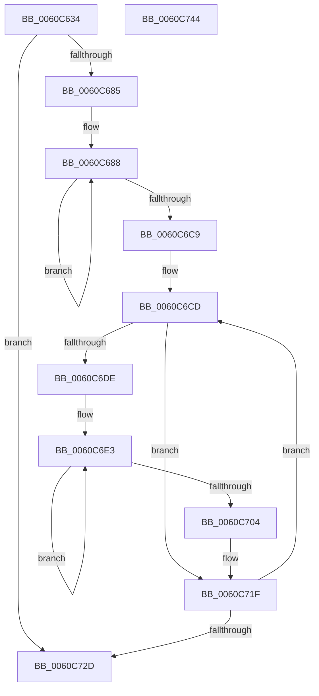

# SMKM_STORE_MGR&lt;SM_TRAITS&gt;::SmCompressManagerUpdateTopology

- RVA: `0x0060C634`–`0x0060C745` (길이 `273` bytes)
- VA: `0x000000014060C634`
- 실행 섹션: `.text`
- PDB 이름 있음: `예`; PDB Function 태그: `아니요`
- unwind 정보 RVA: `0x00083688`
- 디코드: `75`개 명령, `273/273` bytes 표시
- 미해석 바이트: `0` (있으면 어셈블리에 `.byte`로 보존)

> 이 문서는 커널 이미지의 기계어와 PDB 기호를 분석해 생성했습니다. 4번과 5번은 함수 원형과 자료형을 바이너리 사용 방식에서 추정한 C 해석이며 원본 소스 복구 결과는 아닙니다.

## 1. Dependencies

- 직접 호출 지점: **5**; 고유 호출 대상: **5**
- 직접 호출자로 확인된 함수: **1**
- RIP 상대 이미지 참조: **0**

### Outgoing calls
- `0x0060C670` → [memset](../6C/memset_function_006C6C40.md) (function, `0x006C6C40`)
- `0x0060C69F` → [KeQueryNodeActiveAffinityEx](../25/KeQueryNodeActiveAffinityEx_function_00256740.md) (function, `0x00256740`)
- `0x0060C6B6` → [KeOrAffinityEx2](../2C/KeOrAffinityEx2_function_002CF930.md) (function, `0x002CF930`)
- `0x0060C6EA` → [MmGetNextNode](../43/MmGetNextNode_function_00436620.md) (function, `0x00436620`)
- `0x0060C70E` → [KiCopyAffinityEx](../2C/KiCopyAffinityEx_function_002CE860.md) (function, `0x002CE860`)

### Direct callers
- [SMKM_STORE_MGR&lt;SM_TRAITS&gt;::SmCompressManagerStart](SMKM_STORE_MGR_SM_TRAITS_SmCompressManagerStart_function_0060C418.md) at `0x0060C4BE`

### Static image references
- 디코드된 RIP-relative 메모리 참조가 없습니다.

## 2. Other-region calls and transfers

- 다른 실행 섹션으로 향하는 call: **0**
- 별도 외부 분기/꼬리 이동을 확인하지 못했습니다.

## 3. Assembly (complete function range)

```asm
0060C634  48 89 5C 24 10                  mov qword ptr [rsp + 0x10], rbx
0060C639  48 89 6C 24 18                  mov qword ptr [rsp + 0x18], rbp
0060C63E  56                              push rsi
0060C63F  57                              push rdi
0060C640  41 54                           push r12
0060C642  41 56                           push r14
0060C644  41 57                           push r15
0060C646  48 83 EC 20                     sub rsp, 0x20
0060C64A  48 8B 01                        mov rax, qword ptr [rcx]
0060C64D  48 8D 71 30                     lea rsi, [rcx + 0x30]
0060C651  4C 8B F1                        mov r14, rcx
0060C654  33 D2                           xor edx, edx
0060C656  44 8B A0 D4 07 00 00            mov r12d, dword ptr [rax + 0x7d4]
0060C65D  83 A1 38 01 00 00 00            and dword ptr [rcx + 0x138], 0
0060C664  48 8D 4E 08                     lea rcx, [rsi + 8]
0060C668  44 0F B7 06                     movzx r8d, word ptr [rsi]
0060C66C  49 C1 E0 03                     shl r8, 3
0060C670  E8 CB A5 0B 00                  call 0x1406c6c40
0060C675  33 ED                           xor ebp, ebp
0060C677  66 C7 06 01 00                  mov word ptr [rsi], 1
0060C67C  45 85 E4                        test r12d, r12d
0060C67F  0F 84 A8 00 00 00               je 0x14060c72d
0060C685  45 33 FF                        xor r15d, r15d
0060C688  49 8B 7E 18                     mov rdi, qword ptr [r14 + 0x18]
0060C68C  0F B7 CD                        movzx ecx, bp
0060C68F  49 03 FF                        add rdi, r15
0060C692  48 8B D7                        mov rdx, rdi
0060C695  48 8D 9F 08 01 00 00            lea rbx, [rdi + 0x108]
0060C69C  4C 8B C3                        mov r8, rbx
0060C69F  E8 9C A0 C4 FF                  call 0x140256740
0060C6A4  8B 03                           mov eax, dword ptr [rbx]
0060C6A6  4C 8B C6                        mov r8, rsi
0060C6A9  41 01 86 38 01 00 00            add dword ptr [r14 + 0x138], eax
0060C6B0  48 8B D7                        mov rdx, rdi
0060C6B3  48 8B CE                        mov rcx, rsi
0060C6B6  E8 75 32 CC FF                  call 0x1402cf930
0060C6BB  FF C5                           inc ebp
0060C6BD  49 81 C7 10 01 00 00            add r15, 0x110
0060C6C4  41 3B EC                        cmp ebp, r12d
0060C6C7  72 BF                           jb 0x14060c688
0060C6C9  33 DB                           xor ebx, ebx
0060C6CB  33 FF                           xor edi, edi
0060C6CD  4D 8B 7E 18                     mov r15, qword ptr [r14 + 0x18]
0060C6D1  4A 8D 34 3F                     lea rsi, [rdi + r15]
0060C6D5  83 BE 08 01 00 00 00            cmp dword ptr [rsi + 0x108], 0
0060C6DC  75 41                           jne 0x14060c71f
0060C6DE  83 64 24 50 00                  and dword ptr [rsp + 0x50], 0
0060C6E3  48 8D 54 24 50                  lea rdx, [rsp + 0x50]
0060C6E8  8B CB                           mov ecx, ebx
0060C6EA  E8 31 9F E2 FF                  call 0x140436620
0060C6EF  8B C0                           mov eax, eax
0060C6F1  48 69 E8 10 01 00 00            imul rbp, rax, 0x110
0060C6F8  49 03 EF                        add rbp, r15
0060C6FB  83 BD 08 01 00 00 00            cmp dword ptr [rbp + 0x108], 0
0060C702  74 DF                           je 0x14060c6e3
0060C704  0F B7 56 02                     movzx edx, word ptr [rsi + 2]
0060C708  4C 8B C5                        mov r8, rbp
0060C70B  48 8B CE                        mov rcx, rsi
0060C70E  E8 4D 21 CC FF                  call 0x1402ce860
0060C713  8B 85 08 01 00 00               mov eax, dword ptr [rbp + 0x108]
0060C719  89 86 08 01 00 00               mov dword ptr [rsi + 0x108], eax
0060C71F  FF C3                           inc ebx
0060C721  48 81 C7 10 01 00 00            add rdi, 0x110
0060C728  41 3B DC                        cmp ebx, r12d
0060C72B  72 A0                           jb 0x14060c6cd
0060C72D  48 8B 5C 24 58                  mov rbx, qword ptr [rsp + 0x58]
0060C732  48 8B 6C 24 60                  mov rbp, qword ptr [rsp + 0x60]
0060C737  48 83 C4 20                     add rsp, 0x20
0060C73B  41 5F                           pop r15
0060C73D  41 5E                           pop r14
0060C73F  41 5C                           pop r12
0060C741  5F                              pop rdi
0060C742  5E                              pop rsi
0060C743  C3                              ret
0060C744  CC                              int3
```

## 4. C-style interpretation (structured pseudocode)

```c
__int64 __fastcall SMKM_STORE_MGR_SM_TRAITS___SmCompressManagerUpdateTopology(__int64 a1, int a2)
{
    __int64 result;
    __int64 v_r15;
    __int64 v_rbp;
    __int64 v_rbx;
    __int64 v_rdi;
    __int64 v_rsp;
    unsigned __int64 v_stack_p10;
    unsigned __int64 v_stack_p18;
    unsigned int v_stack_p8;

    v_stack_p10 = v_rbx;
    v_stack_p18 = v_rbp;
    v_rsp = (v_rsp) - (32);
    a2 = 0;
    a3 = (*(unsigned __int16 *)(a1 + 48)) << (3);
    result = memset(a1 + 48 + 8, a2, a3, a4);
    v_rbp = 0;
    *(unsigned __int16 *)(a1 + 48) = 1;
    if ((unsigned int)((unsigned int)(*(unsigned int *)(*(unsigned __int64 *)(a1) + 2004))) == 0) goto loc_0060C72D;
    v_r15 = 0;
loc_0060C688:
    v_rdi = (*(unsigned __int64 *)(a1 + 24)) + (0);
    result = KeQueryNodeActiveAffinityEx(0, v_rdi, v_rdi + 264, a4);
    result = KeOrAffinityEx2(a1 + 48, v_rdi, a1 + 48, a4);
    v_rbp = (unsigned int)((v_rbp) + 1);
    v_r15 = (v_r15) + (272);
    if (((unsigned int)(v_rbp)) < ((unsigned int)((unsigned int)(*(unsigned int *)(*(unsigned __int64 *)(a1) + 2004))))) goto loc_0060C688;
    v_rbx = 0;
    v_rdi = 0;
loc_0060C6CD:
    if ((*(unsigned int *)(v_rdi + *(unsigned __int64 *)(a1 + 24) * 1 + 264)) != 0) goto loc_0060C71F;
loc_0060C6E3:
    result = MmGetNextNode(0, v_stack_p8, a1 + 48, a4);
    v_rbp = (v_rbp) * ((unsigned int)((unsigned int)(result)));
    v_rbp = (v_rbp) + (*(unsigned __int64 *)(a1 + 24));
    if ((*(unsigned int *)(v_rbp + 264)) == 0) goto loc_0060C6E3;
    result = KiCopyAffinityEx(v_rdi + *(unsigned __int64 *)(a1 + 24) * 1, *(unsigned __int16 *)(v_rdi + *(unsigned __int64 *)(a1 + 24) * 1 + 2), v_rbp, a4);
    *(unsigned int *)(v_rdi + *(unsigned __int64 *)(a1 + 24) * 1 + 264) = (unsigned int)((unsigned int)(*(unsigned int *)(v_rbp + 264)));
loc_0060C71F:
    v_rbx = (unsigned int)((v_rbx) + 1);
    v_rdi = (v_rdi) + (272);
    if (((unsigned int)(v_rbx)) < ((unsigned int)((unsigned int)(*(unsigned int *)(*(unsigned __int64 *)(a1) + 2004))))) goto loc_0060C6CD;
loc_0060C72D:
    v_rsp = (v_rsp) + (32);
    return (unsigned int)(*(unsigned int *)(v_rbp + 264));
}
```

## 5. (Beta) C Style

```c
int64_t SMKM_STORE_MGR_SM_TRAITS___SmCompressManagerUpdateTopology(void *Arg1, int32_t Arg2)
{
    uint8_t *arg1 = (uint8_t *)Arg1;

    int64_t result;
    int64_t local_r15;
    int64_t local_rbp;
    int64_t local_rbx;
    int64_t local_rdi;
    int64_t local_rsp;
    uint64_t v_stack_p10;
    uint64_t v_stack_p18;
    uint32_t v_stack_p8;

    v_stack_p10 = local_rbx;
    v_stack_p18 = local_rbp;
    local_rsp = (local_rsp) - (32);
    Arg2 = 0;
    a3 = (*(uint16_t *)(arg1 + 0x30)) << (3);
    result = memset(Arg1 + 48 + 8, Arg2, a3, a4);
    local_rbp = 0;
    *(uint16_t *)(arg1 + 0x30) = 1;
    if ((uint32_t)((uint32_t)(*(uint32_t *)(*(uint64_t *)(arg1) + 0x7D4))) == 0) goto loc_0060C72D;
    local_r15 = 0;
loc_0060C688:
    local_rdi = (*(uint64_t *)(arg1 + 0x18)) + (0);
    result = KeQueryNodeActiveAffinityEx(0, local_rdi, local_rdi + 264, a4);
    result = KeOrAffinityEx2(Arg1 + 48, local_rdi, Arg1 + 48, a4);
    local_rbp = (uint32_t)((local_rbp) + 1);
    local_r15 = (local_r15) + (272);
    if (((uint32_t)(local_rbp)) < ((uint32_t)((uint32_t)(*(uint32_t *)(*(uint64_t *)(arg1) + 0x7D4))))) goto loc_0060C688;
    local_rbx = 0;
    local_rdi = 0;
loc_0060C6CD:
    if ((*(uint32_t *)(local_rdi + *(uint64_t *)(arg1 + 0x18) * 1 + 0x108)) != 0) goto loc_0060C71F;
loc_0060C6E3:
    result = MmGetNextNode(0, v_stack_p8, Arg1 + 48, a4);
    local_rbp = (local_rbp) * ((uint32_t)((uint32_t)(result)));
    local_rbp = (local_rbp) + (*(uint64_t *)(arg1 + 0x18));
    if ((*(uint32_t *)(local_rbp + 0x108)) == 0) goto loc_0060C6E3;
    result = KiCopyAffinityEx(local_rdi + *(uint64_t *)(arg1 + 0x18) * 1, *(uint16_t *)(local_rdi + *(uint64_t *)(arg1 + 0x18) * 1 + 0x2), local_rbp, a4);
    *(uint32_t *)(local_rdi + *(uint64_t *)(arg1 + 0x18) * 1 + 0x108) = (uint32_t)((uint32_t)(*(uint32_t *)(local_rbp + 0x108)));
loc_0060C71F:
    local_rbx = (uint32_t)((local_rbx) + 1);
    local_rdi = (local_rdi) + (272);
    if (((uint32_t)(local_rbx)) < ((uint32_t)((uint32_t)(*(uint32_t *)(*(uint64_t *)(arg1) + 0x7D4))))) goto loc_0060C6CD;
loc_0060C72D:
    local_rsp = (local_rsp) + (32);
    return (uint32_t)(*(uint32_t *)(local_rbp + 0x108));
}
```

### 관측된 메모리 오프셋

구조체 형식이 확인되지 않은 접근은 인자 기준의 오프셋으로만 기록했습니다.

| 기준 인자 | 오프셋 표현 | 폭 (bit) | 접근 |
|---|---:|---:|---|
| `Arg1` | `+ 0x0` | `16` | `R` |
| `Arg1` | `+ 0x0` | `16` | `W` |
| `Arg1` | `+ 0x0` | `64` | `R` |
| `Arg1` | `+ 0x8` | `64` | `R` |
| `Arg1` | `+ 0x18` | `64` | `R` |
| `Arg1` | `+ 0x30` | `64` | `R` |
| `Arg1` | `+ 0x138` | `32` | `R/W` |

## 6. Execution-region graph

[열기: 2D/3D 그래프와 함수 탐색 컨트롤 패널](../../../control-panel.html?section=text&rva=0x0060C634&view=graph)

- 2D 그래프는 위에서 아래로 흐르고, 3D 그래프는 빈 공간을 드래그해 회전합니다. Shift+드래그는 이동, 휠은 확대·축소, 함수 노드 선택은 대상 보고서 이동입니다.

### Static fallback


