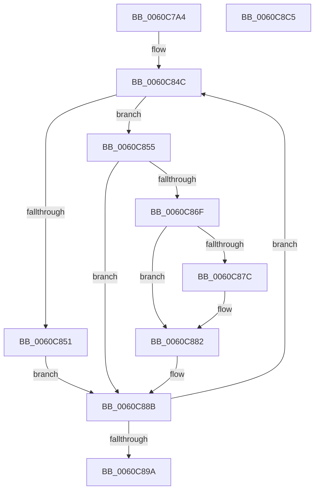

# SMKM_STORE_MGR&lt;SM_TRAITS&gt;::SmFeSetEvictFailed

- RVA: `0x0060C7A4`–`0x0060C8C6` (길이 `290` bytes)
- VA: `0x000000014060C7A4`
- 실행 섹션: `.text`
- PDB 이름 있음: `예`; PDB Function 태그: `아니요`
- unwind 정보 RVA: `0x000C5C6C`
- 디코드: `80`개 명령, `290/290` bytes 표시
- 미해석 바이트: `0` (있으면 어셈블리에 `.byte`로 보존)

> 이 문서는 커널 이미지의 기계어와 PDB 기호를 분석해 생성했습니다. 4번과 5번은 함수 원형과 자료형을 바이너리 사용 방식에서 추정한 C 해석이며 원본 소스 복구 결과는 아닙니다.

## 1. Dependencies

- 직접 호출 지점: **6**; 고유 호출 대상: **6**
- 직접 호출자로 확인된 함수: **1**
- RIP 상대 이미지 참조: **1**

### Outgoing calls
- `0x0060C7DE` → [memset](../6C/memset_function_006C6C40.md) (function, `0x006C6C40`)
- `0x0060C81B` → [StLockAcquireExclusive](../26/StLockAcquireExclusive_function_00266FF0.md) (function, `0x00266FF0`)
- `0x0060C82E` → [B_TREE<_SM_PAGE_KEY,SMKM_STORE_MGR<SM_TRAITS>::SMKM_FRONTEND_ENTRY,4096,B_TREE_DUMMY_NODE_POOL,B_TREE_KEY_COMPARATOR<_SM_PAGE_KEY> >::BTreeSearchKey](../26/B_TREE__SM_PAGE_KEY_SMKM_STORE_MGR_SM_TRAITS_SMKM_FRONTEND_ENTRY_4096_B_TREE_DUMMY_NODE_POOL_B_TREE__function_00266E10.md) (function, `0x00266E10`)
- `0x0060C83D` → [B_TREE<_SM_PAGE_KEY,SMKM_STORE_MGR<SM_TRAITS>::SMKM_FRONTEND_ENTRY,4096,B_TREE_DUMMY_NODE_POOL,B_TREE_KEY_COMPARATOR<_SM_PAGE_KEY> >::BTreeIteratorFromSearchResult](../2E/B_TREE__SM_PAGE_KEY_SMKM_STORE_MGR_SM_TRAITS_SMKM_FRONTEND_ENTRY_4096_B_TREE_DUMMY_NODE_POOL_B_TREE__function_002E07E0.md) (function, `0x002E07E0`)
- `0x0060C89D` → [StLockReleaseExclusive](../26/StLockReleaseExclusive_function_00267050.md) (function, `0x00267050`)
- `0x0060C8A9` → [_security_check_cookie](../6A/_security_check_cookie_function_006AC640.md) (function, `0x006AC640`)

### Direct callers
- [SMKM_STORE_MGR&lt;SM_TRAITS&gt;::SmpPageEvict](../24/SMKM_STORE_MGR_SM_TRAITS_SmpPageEvict_function_0024A5F4.md) at `0x0024A771`

### Static image references
- `0x0060C7BC` → RVA `0x00E0A740` (`.data`; read)

## 2. Other-region calls and transfers

- 다른 실행 섹션으로 향하는 call: **0**
- 별도 외부 분기/꼬리 이동을 확인하지 못했습니다.

## 3. Assembly (complete function range)

```asm
0060C7A4  48 89 5C 24 18                  mov qword ptr [rsp + 0x18], rbx
0060C7A9  55                              push rbp
0060C7AA  56                              push rsi
0060C7AB  57                              push rdi
0060C7AC  41 56                           push r14
0060C7AE  41 57                           push r15
0060C7B0  48 8D 6C 24 C9                  lea rbp, [rsp - 0x37]
0060C7B5  48 81 EC F0 00 00 00            sub rsp, 0xf0
0060C7BC  48 8B 05 7D DF 7F 00            mov rax, qword ptr [rip + 0x7fdf7d]
0060C7C3  48 33 C4                        xor rax, rsp
0060C7C6  48 89 45 27                     mov qword ptr [rbp + 0x27], rax
0060C7CA  8B 1A                           mov ebx, dword ptr [rdx]
0060C7CC  45 8B F8                        mov r15d, r8d
0060C7CF  48 8B F9                        mov rdi, rcx
0060C7D2  33 D2                           xor edx, edx
0060C7D4  41 B8 80 00 00 00               mov r8d, 0x80
0060C7DA  48 8D 4D 9F                     lea rcx, [rbp - 0x61]
0060C7DE  E8 5D A4 0B 00                  call 0x1406c6c40
0060C7E3  48 83 64 24 38 00               and qword ptr [rsp + 0x38], 0
0060C7E9  48 8D 45 9F                     lea rax, [rbp - 0x61]
0060C7ED  48 83 65 87 00                  and qword ptr [rbp - 0x79], 0
0060C7F2  4C 8D B7 B8 01 00 00            lea r14, [rdi + 0x1b8]
0060C7F9  48 83 65 97 00                  and qword ptr [rbp - 0x69], 0
0060C7FE  0F 57 C0                        xorps xmm0, xmm0
0060C801  83 65 8F 00                     and dword ptr [rbp - 0x71], 0
0060C805  49 8B CE                        mov rcx, r14
0060C808  0F 11 44 24 20                  movups xmmword ptr [rsp + 0x20], xmm0
0060C80D  48 89 44 24 30                  mov qword ptr [rsp + 0x30], rax
0060C812  33 F6                           xor esi, esi
0060C814  C7 45 93 08 00 00 00            mov dword ptr [rbp - 0x6d], 8
0060C81B  E8 D0 A7 C5 FF                  call 0x140266ff0
0060C820  48 8D 8F C0 01 00 00            lea rcx, [rdi + 0x1c0]
0060C827  8B D3                           mov edx, ebx
0060C829  4C 8D 44 24 30                  lea r8, [rsp + 0x30]
0060C82E  E8 DD A5 C5 FF                  call 0x140266e10
0060C833  4C 8D 44 24 30                  lea r8, [rsp + 0x30]
0060C838  48 8D 54 24 20                  lea rdx, [rsp + 0x20]
0060C83D  E8 9E 3F CD FF                  call 0x1402e07e0
0060C842  4C 8B 4C 24 28                  mov r9, qword ptr [rsp + 0x28]
0060C847  4C 8B 44 24 20                  mov r8, qword ptr [rsp + 0x20]
0060C84C  4D 85 C0                        test r8, r8
0060C84F  75 04                           jne 0x14060c855
0060C851  33 D2                           xor edx, edx
0060C853  EB 36                           jmp 0x14060c88b
0060C855  41 8B 00                        mov eax, dword ptr [r8]
0060C858  49 83 C1 08                     add r9, 8
0060C85C  0F B7 C0                        movzx eax, ax
0060C85F  49 8B D1                        mov rdx, r9
0060C862  48 83 C0 02                     add rax, 2
0060C866  49 8D 04 C0                     lea rax, [r8 + rax*8]
0060C86A  4C 3B C8                        cmp r9, rax
0060C86D  72 1C                           jb 0x14060c88b
0060C86F  49 8B 40 08                     mov rax, qword ptr [r8 + 8]
0060C873  48 8D 48 10                     lea rcx, [rax + 0x10]
0060C877  48 85 C0                        test rax, rax
0060C87A  74 06                           je 0x14060c882
0060C87C  4C 8B C0                        mov r8, rax
0060C87F  4C 8B C9                        mov r9, rcx
0060C882  48 F7 D8                        neg rax
0060C885  48 1B D2                        sbb rdx, rdx
0060C888  48 23 D1                        and rdx, rcx
0060C88B  80 4A 07 01                     or byte ptr [rdx + 7], 1
0060C88F  FF C6                           inc esi
0060C891  C6 42 06 03                     mov byte ptr [rdx + 6], 3
0060C895  41 3B F7                        cmp esi, r15d
0060C898  75 B2                           jne 0x14060c84c
0060C89A  49 8B CE                        mov rcx, r14
0060C89D  E8 AE A7 C5 FF                  call 0x140267050
0060C8A2  48 8B 4D 27                     mov rcx, qword ptr [rbp + 0x27]
0060C8A6  48 33 CC                        xor rcx, rsp
0060C8A9  E8 92 FD 09 00                  call 0x1406ac640
0060C8AE  48 8B 9C 24 30 01 00 00         mov rbx, qword ptr [rsp + 0x130]
0060C8B6  48 81 C4 F0 00 00 00            add rsp, 0xf0
0060C8BD  41 5F                           pop r15
0060C8BF  41 5E                           pop r14
0060C8C1  5F                              pop rdi
0060C8C2  5E                              pop rsi
0060C8C3  5D                              pop rbp
0060C8C4  C3                              ret
0060C8C5  CC                              int3
```

## 4. C-style interpretation (structured pseudocode)

```c
__int64 __fastcall SMKM_STORE_MGR_SM_TRAITS___SmFeSetEvictFailed(__int64 a1, __int64 a2, int a3)
{
    __int64 result;
    __int64 v_rsi;
    __int64 v_rsp;
    unsigned __int64 v_stack_m38;
    unsigned __int64 v_stack_m5F;
    unsigned __int64 v_stack_mC0;
    unsigned __int64 v_stack_mC8;
    unsigned int v_stack_mCC;
    unsigned int v_stack_mD0;
    unsigned __int64 v_stack_mD8;
    unsigned __int64 v_stack_mE0;
    unsigned __int64 v_stack_mE8;
    unsigned __int64 v_stack_mF0;
    unsigned __int64 v_stack_mF8;
    unsigned __int64 v_stack_p18;

    v_stack_p18 = v_rbx;
    v_rsp = (v_rsp) - (240);
    result = (*(unsigned __int64 *)(v_rip + 8380285)) ^ (v_rsp);
    v_stack_m38 = result;
    a2 = 0;
    result = memset(v_stack_mC0, a2, 128, a4);
    v_stack_mF8 = v_xmm0;
    v_stack_mE8 = v_stack_mC0;
    v_rsi = 0;
    v_stack_mCC = 8;
    result = StLockAcquireExclusive(a1 + 440, a2, 128, a4);
    result = B_TREE__SM_PAGE_KEY_SMKM_STORE_MGR_SM_TRAITS___SMKM_FRONTEND_ENTRY_4096_B_TREE_DUMMY_NODE_POOL_B_TRE(a1 + 448, (unsigned int)((unsigned int)((unsigned int)(*(unsigned int *)(a2)))), v_stack_mE8, a4);
    result = B_TREE__SM_PAGE_KEY_SMKM_STORE_MGR_SM_TRAITS___SMKM_FRONTEND_ENTRY_4096_B_TREE_DUMMY_NODE_POOL_B_TRE(a1 + 448, v_stack_mF8, v_stack_mE8, a4);
loc_0060C84C:
    if (v_stack_mF8 != 0) goto loc_0060C855;
    a2 = 0;
    goto loc_0060C88B;
loc_0060C855:
    a4 = (v_stack_mF0) + (8);
    result = ((unsigned __int16)((unsigned int)(*(unsigned int *)(v_stack_mF8)))) + (2);
    if (a4 < (v_stack_mF8 + result * 8)) goto loc_0060C88B;
    if (*(unsigned __int64 *)(v_stack_mF8 + 8) != 0) {
        a3 = *(unsigned __int64 *)(v_stack_mF8 + 8);
        a4 = *(unsigned __int64 *)(v_stack_mF8 + 8) + 16;
    }
    result = -(*(unsigned __int64 *)(v_stack_mF8 + 8));
    a2 = (a4) & (*(unsigned __int64 *)(v_stack_mF8 + 8) + 16);
loc_0060C88B:
    v_rsi = (unsigned int)((v_rsi) + 1);
    *(unsigned __int8 *)(a2 + 6) = 3;
    if (((unsigned int)(v_rsi)) != ((unsigned int)((unsigned int)(a3)))) goto loc_0060C84C;
    result = StLockReleaseExclusive(a1 + 440, a2, a3, a4);
    a1 = (v_stack_m38) ^ (v_rsp);
    result = _security_check_cookie(a1, a2, a3, a4);
    v_rsp = (v_rsp) + (240);
    return result;
}
```

## 5. (Beta) C Style

```c
int64_t SMKM_STORE_MGR_SM_TRAITS___SmFeSetEvictFailed(void *Arg1, void *Arg2, int32_t Arg3)
{
    uint8_t *arg1 = (uint8_t *)Arg1;
    uint8_t *arg2 = (uint8_t *)Arg2;

    int64_t result;
    int64_t local_rsi;
    int64_t local_rsp;
    uint64_t v_stack_m38;
    uint64_t v_stack_m5F;
    uint64_t v_stack_mC0;
    uint64_t v_stack_mC8;
    uint32_t v_stack_mCC;
    uint32_t v_stack_mD0;
    uint64_t v_stack_mD8;
    uint64_t v_stack_mE0;
    uint64_t v_stack_mE8;
    uint64_t v_stack_mF0;
    uint64_t v_stack_mF8;
    uint64_t v_stack_p18;

    v_stack_p18 = local_rbx;
    local_rsp = (local_rsp) - (240);
    result = (*(uint64_t *)(v_rip + 0x7FDF7D)) ^ (local_rsp);
    v_stack_m38 = result;
    Arg2 = 0;
    result = memset(v_stack_mC0, Arg2, 128, a4);
    v_stack_mF8 = v_xmm0;
    v_stack_mE8 = v_stack_mC0;
    local_rsi = 0;
    v_stack_mCC = 8;
    result = StLockAcquireExclusive(Arg1 + 440, Arg2, 128, a4);
    result = B_TREE__SM_PAGE_KEY_SMKM_STORE_MGR_SM_TRAITS___SMKM_FRONTEND_ENTRY_4096_B_TREE_DUMMY_NODE_POOL_B_TRE(Arg1 + 448, (uint32_t)((uint32_t)((uint32_t)(*(uint32_t *)(arg2)))), v_stack_mE8, a4);
    result = B_TREE__SM_PAGE_KEY_SMKM_STORE_MGR_SM_TRAITS___SMKM_FRONTEND_ENTRY_4096_B_TREE_DUMMY_NODE_POOL_B_TRE(Arg1 + 448, v_stack_mF8, v_stack_mE8, a4);
loc_0060C84C:
    if (v_stack_mF8 != 0) goto loc_0060C855;
    Arg2 = 0;
    goto loc_0060C88B;
loc_0060C855:
    a4 = (v_stack_mF0) + (8);
    result = ((uint16_t)((uint32_t)(*(uint32_t *)(v_stack_mF8)))) + (2);
    if (a4 < (v_stack_mF8 + result * 8)) goto loc_0060C88B;
    if (*(uint64_t *)(v_stack_mF8 + 0x8) != 0) {
        Arg3 = *(uint64_t *)(v_stack_mF8 + 0x8);
        a4 = *(uint64_t *)(v_stack_mF8 + 0x8) + 16;
    }
    result = -(*(uint64_t *)(v_stack_mF8 + 0x8));
    Arg2 = (a4) & (*(uint64_t *)(v_stack_mF8 + 0x8) + 16);
loc_0060C88B:
    local_rsi = (uint32_t)((local_rsi) + 1);
    *(uint8_t *)(arg2 + 0x6) = 3;
    if (((uint32_t)(local_rsi)) != ((uint32_t)((uint32_t)(Arg3)))) goto loc_0060C84C;
    result = StLockReleaseExclusive(Arg1 + 440, Arg2, Arg3, a4);
    Arg1 = (v_stack_m38) ^ (local_rsp);
    result = _security_check_cookie(Arg1, Arg2, Arg3, a4);
    local_rsp = (local_rsp) + (240);
    return result;
}
```

### 관측된 메모리 오프셋

구조체 형식이 확인되지 않은 접근은 인자 기준의 오프셋으로만 기록했습니다.

| 기준 인자 | 오프셋 표현 | 폭 (bit) | 접근 |
|---|---:|---:|---|
| `Arg1` | `+ 0x1B8` | `64` | `R` |
| `Arg1` | `+ 0x1C0` | `64` | `R` |
| `Arg2` | `+ 0x0` | `32` | `R` |

## 6. Execution-region graph

[열기: 2D/3D 그래프와 함수 탐색 컨트롤 패널](../../../control-panel.html?section=text&rva=0x0060C7A4&view=graph)

- 2D 그래프는 위에서 아래로 흐르고, 3D 그래프는 빈 공간을 드래그해 회전합니다. Shift+드래그는 이동, 휠은 확대·축소, 함수 노드 선택은 대상 보고서 이동입니다.

### Static fallback


