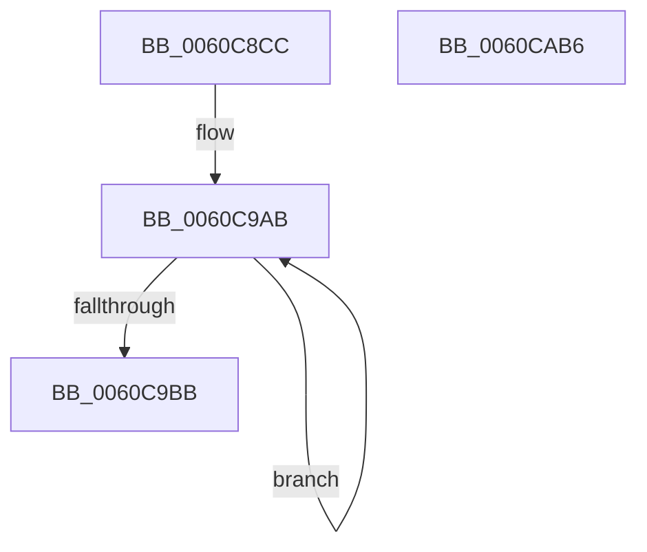

# SMKM_STORE_MGR&lt;SM_TRAITS&gt;::SmInitialize

- RVA: `0x0060C8CC`–`0x0060CAB7` (길이 `491` bytes)
- VA: `0x000000014060C8CC`
- 실행 섹션: `.text`
- PDB 이름 있음: `예`; PDB Function 태그: `아니요`
- unwind 정보 RVA: `0x000D1970`
- 디코드: `106`개 명령, `491/491` bytes 표시
- 미해석 바이트: `0` (있으면 어셈블리에 `.byte`로 보존)

> 이 문서는 커널 이미지의 기계어와 PDB 기호를 분석해 생성했습니다. 4번과 5번은 함수 원형과 자료형을 바이너리 사용 방식에서 추정한 C 해석이며 원본 소스 복구 결과는 아닙니다.

## 1. Dependencies

- 직접 호출 지점: **10**; 고유 호출 대상: **5**
- 직접 호출자로 확인된 함수: **2**
- RIP 상대 이미지 참조: **3**

### Outgoing calls
- `0x0060C8F5` → [memset](../6C/memset_function_006C6C40.md) (function, `0x006C6C40`)
- `0x0060C914` → [SmKmInitialize](../../page/7A/SmKmInitialize_function_007A8484.md) (function, `0x007A8484`)
- `0x0060C93A` → [memset](../6C/memset_function_006C6C40.md) (function, `0x006C6C40`)
- `0x0060C96E` → [memset](../6C/memset_function_006C6C40.md) (function, `0x006C6C40`)
- `0x0060C9A0` → [memset](../6C/memset_function_006C6C40.md) (function, `0x006C6C40`)
- `0x0060C9C9` → [InitializeSListHead](../46/InitializeSListHead_function_00468A90.md) (function, `0x00468A90`)
- `0x0060C9DD` → [memset](../6C/memset_function_006C6C40.md) (function, `0x006C6C40`)
- `0x0060CA1F` → [memset](../6C/memset_function_006C6C40.md) (function, `0x006C6C40`)
- `0x0060CA35` → [KeQueryPerformanceCounter](../37/KeQueryPerformanceCounter_function_0037E7E0.md) (function, `0x0037E7E0`)
- `0x0060CA7F` → [KiInitializeTimer2](../3A/KiInitializeTimer2_function_003A3288.md) (function, `0x003A3288`)

### Direct callers
- [SmFirstTimeInit](../4E/SmFirstTimeInit_function_004EA944.md) at `0x004EAC5F`
- [SmPartitionInitialize](../../page/7A/SmPartitionInitialize_function_007A5D04.md) at `0x007A5D51`

### Static image references
- `0x0060C9FC` → RVA `0x00FC5014` (`ALMOSTRO`; read)
- `0x0060CA74` → RVA `0x004C6560` (`SMKM_STORE_MGR<SM_TRAITS>::SmHighMemPriorityWatchdogTimerCallback`; read)
- `0x0060CA89` → RVA `0x0034C080` (`SMKM_STORE_MGR<SM_TRAITS>::SmHighMemPriorityWatchdogWorker`; read)

## 2. Other-region calls and transfers

- 다른 실행 섹션으로 향하는 call: **1**
  - `0x0060C914` → [SmKmInitialize](../../page/7A/SmKmInitialize_function_007A8484.md) (`.text` → `PAGE`)
- 별도 외부 분기/꼬리 이동을 확인하지 못했습니다.

## 3. Assembly (complete function range)

```asm
0060C8CC  48 8B C4                        mov rax, rsp
0060C8CF  48 89 58 10                     mov qword ptr [rax + 0x10], rbx
0060C8D3  48 89 68 18                     mov qword ptr [rax + 0x18], rbp
0060C8D7  48 89 78 20                     mov qword ptr [rax + 0x20], rdi
0060C8DB  41 56                           push r14
0060C8DD  48 83 EC 20                     sub rsp, 0x20
0060C8E1  48 8B DA                        mov rbx, rdx
0060C8E4  33 ED                           xor ebp, ebp
0060C8E6  33 D2                           xor edx, edx
0060C8E8  48 89 68 08                     mov qword ptr [rax + 8], rbp
0060C8EC  41 B8 00 08 00 00               mov r8d, 0x800
0060C8F2  48 8B F9                        mov rdi, rcx
0060C8F5  E8 46 A3 0B 00                  call 0x1406c6c40
0060C8FA  0F 10 03                        movups xmm0, xmmword ptr [rbx]
0060C8FD  48 8B CF                        mov rcx, rdi
0060C900  F2 0F 10 4B 10                  movsd xmm1, qword ptr [rbx + 0x10]
0060C905  0F 11 87 D0 07 00 00            movups xmmword ptr [rdi + 0x7d0], xmm0
0060C90C  F2 0F 11 8F E0 07 00 00         movsd qword ptr [rdi + 0x7e0], xmm1
0060C914  E8 6B BB 19 00                  call 0x1407a8484
0060C919  0F 57 C0                        xorps xmm0, xmm0
0060C91C  48 89 AF B8 01 00 00            mov qword ptr [rdi + 0x1b8], rbp
0060C923  48 8D 9F 30 06 00 00            lea rbx, [rdi + 0x630]
0060C92A  33 D2                           xor edx, edx
0060C92C  48 8B CB                        mov rcx, rbx
0060C92F  44 8D 45 78                     lea r8d, [rbp + 0x78]
0060C933  0F 11 87 C0 01 00 00            movups xmmword ptr [rdi + 0x1c0], xmm0
0060C93A  E8 01 A3 0B 00                  call 0x1406c6c40
0060C93F  C6 43 0A 06                     mov byte ptr [rbx + 0xa], 6
0060C943  48 8D 43 10                     lea rax, [rbx + 0x10]
0060C947  89 6B 0C                        mov dword ptr [rbx + 0xc], ebp
0060C94A  44 8D 75 01                     lea r14d, [rbp + 1]
0060C94E  66 44 89 73 08                  mov word ptr [rbx + 8], r14w
0060C953  44 8D 45 78                     lea r8d, [rbp + 0x78]
0060C957  48 89 40 08                     mov qword ptr [rax + 8], rax
0060C95B  33 D2                           xor edx, edx
0060C95D  48 89 00                        mov qword ptr [rax], rax
0060C960  48 89 7B 20                     mov qword ptr [rbx + 0x20], rdi
0060C964  48 8D 9F A8 06 00 00            lea rbx, [rdi + 0x6a8]
0060C96B  48 8B CB                        mov rcx, rbx
0060C96E  E8 CD A2 0B 00                  call 0x1406c6c40
0060C973  66 44 89 73 08                  mov word ptr [rbx + 8], r14w
0060C978  48 8D 43 10                     lea rax, [rbx + 0x10]
0060C97C  C6 43 0A 06                     mov byte ptr [rbx + 0xa], 6
0060C980  33 D2                           xor edx, edx
0060C982  89 6B 0C                        mov dword ptr [rbx + 0xc], ebp
0060C985  41 B8 08 03 00 00               mov r8d, 0x308
0060C98B  48 89 40 08                     mov qword ptr [rax + 8], rax
0060C98F  48 89 00                        mov qword ptr [rax], rax
0060C992  48 89 7B 20                     mov qword ptr [rbx + 0x20], rdi
0060C996  48 8D 9F D0 01 00 00            lea rbx, [rdi + 0x1d0]
0060C99D  48 8B CB                        mov rcx, rbx
0060C9A0  E8 9B A2 0B 00                  call 0x1406c6c40
0060C9A5  48 8B C3                        mov rax, rbx
0060C9A8  8D 4D 20                        lea ecx, [rbp + 0x20]
0060C9AB  48 89 40 08                     mov qword ptr [rax + 8], rax
0060C9AF  48 89 28                        mov qword ptr [rax], rbp
0060C9B2  48 83 C0 18                     add rax, 0x18
0060C9B6  49 2B CE                        sub rcx, r14
0060C9B9  75 F0                           jne 0x14060c9ab
0060C9BB  48 8D 8F E0 04 00 00            lea rcx, [rdi + 0x4e0]
0060C9C2  48 89 AB 00 03 00 00            mov qword ptr [rbx + 0x300], rbp
0060C9C9  E8 C2 C0 E5 FF                  call 0x140468a90
0060C9CE  48 8D 8F F8 04 00 00            lea rcx, [rdi + 0x4f8]
0060C9D5  33 D2                           xor edx, edx
0060C9D7  41 B8 38 01 00 00               mov r8d, 0x138
0060C9DD  E8 5E A2 0B 00                  call 0x1406c6c40
0060C9E2  48 89 BF F0 04 00 00            mov qword ptr [rdi + 0x4f0], rdi
0060C9E9  48 8D 8F 28 05 00 00            lea rcx, [rdi + 0x528]
0060C9F0  C7 87 2C 06 00 00 07 00 00 00   mov dword ptr [rdi + 0x62c], 7
0060C9FA  33 D2                           xor edx, edx
0060C9FC  0F B7 05 11 86 9B 00            movzx eax, word ptr [rip + 0x9b8611]
0060CA03  44 8B C0                        mov r8d, eax
0060CA06  66 44 89 B7 20 05 00 00         mov word ptr [rdi + 0x520], r14w
0060CA0E  49 C1 E0 03                     shl r8, 3
0060CA12  66 89 87 22 05 00 00            mov word ptr [rdi + 0x522], ax
0060CA19  89 AF 24 05 00 00               mov dword ptr [rdi + 0x524], ebp
0060CA1F  E8 1C A2 0B 00                  call 0x1406c6c40
0060CA24  8B 87 D4 07 00 00               mov eax, dword ptr [rdi + 0x7d4]
0060CA2A  48 8D 4C 24 30                  lea rcx, [rsp + 0x30]
0060CA2F  89 87 18 05 00 00               mov dword ptr [rdi + 0x518], eax
0060CA35  E8 A6 1D D7 FF                  call 0x14037e7e0
0060CA3A  48 69 4C 24 30 10 27 00 00      imul rcx, qword ptr [rsp + 0x30], 0x2710
0060CA43  48 B8 DB 34 B6 D7 82 DE 1B 43   movabs rax, 0x431bde82d7b634db
0060CA4D  41 B9 08 00 00 00               mov r9d, 8
0060CA53  48 F7 E9                        imul rcx
0060CA56  48 8D 8F 20 07 00 00            lea rcx, [rdi + 0x720]
0060CA5D  4C 8B C7                        mov r8, rdi
0060CA60  48 C1 FA 12                     sar rdx, 0x12
0060CA64  48 8B C2                        mov rax, rdx
0060CA67  48 C1 E8 3F                     shr rax, 0x3f
0060CA6B  48 03 D0                        add rdx, rax
0060CA6E  89 97 F0 07 00 00               mov dword ptr [rdi + 0x7f0], edx
0060CA74  48 8D 15 E5 9A EB FF            lea rdx, [rip - 0x14651b]
0060CA7B  66 89 69 02                     mov word ptr [rcx + 2], bp
0060CA7F  E8 04 68 D9 FF                  call 0x1403a3288
0060CA84  48 8B 5C 24 38                  mov rbx, qword ptr [rsp + 0x38]
0060CA89  48 8D 05 F0 F5 D3 FF            lea rax, [rip - 0x2c0a10]
0060CA90  48 89 AF C0 07 00 00            mov qword ptr [rdi + 0x7c0], rbp
0060CA97  48 89 AF A8 07 00 00            mov qword ptr [rdi + 0x7a8], rbp
0060CA9E  48 8B 6C 24 40                  mov rbp, qword ptr [rsp + 0x40]
0060CAA3  48 89 87 B8 07 00 00            mov qword ptr [rdi + 0x7b8], rax
0060CAAA  48 8B 7C 24 48                  mov rdi, qword ptr [rsp + 0x48]
0060CAAF  48 83 C4 20                     add rsp, 0x20
0060CAB3  41 5E                           pop r14
0060CAB5  C3                              ret
0060CAB6  CC                              int3
```

## 4. C-style interpretation (structured pseudocode)

```c
__int64 __fastcall SMKM_STORE_MGR_SM_TRAITS___SmInitialize(__int64 a1, __int64 a2)
{
    __int64 result;
    __int64 v_rbp;
    __int64 v_rsp;
    unsigned __int64 v_stack_p10;
    unsigned __int64 v_stack_p18;
    unsigned __int64 v_stack_p20;
    unsigned __int64 v_stack_p8;

    *(unsigned __int64 *)(v_rsp + 16) = v_rbx;
    *(unsigned __int64 *)(v_rsp + 24) = v_rbp;
    *(unsigned __int64 *)(v_rsp + 32) = v_rdi;
    v_rsp = (v_rsp) - (32);
    v_rbp = 0;
    a2 = 0;
    *(unsigned __int64 *)(v_rsp + 8) = 0;
    result = memset(a1, a2, (unsigned int)(0x800ULL), a4);
    *(unsigned __int64 *)(a1 + 2000) = v_xmm0;
    *(unsigned __int64 *)(a1 + 2016) = v_xmm1;
    result = SmKmInitialize(a1, a2, (unsigned int)(0x800ULL), a4);
    *(unsigned __int64 *)(a1 + 440) = 0;
    a2 = 0;
    *(unsigned __int64 *)(a1 + 448) = v_xmm0;
    result = memset(a1 + 1584, a2, v_rbp + 120, a4);
    *(unsigned __int8 *)(a1 + 1584 + 10) = 6;
    *(unsigned int *)(a1 + 1584 + 12) = 0;
    *(unsigned __int16 *)(a1 + 1584 + 8) = (unsigned __int16)(v_rbp + 1);
    *(unsigned __int64 *)(a1 + 1584 + 16 + 8) = a1 + 1584 + 16;
    a2 = 0;
    *(unsigned __int64 *)(a1 + 1584 + 16) = a1 + 1584 + 16;
    *(unsigned __int64 *)(a1 + 1584 + 32) = a1;
    result = memset(a1 + 1704, a2, v_rbp + 120, a4);
    *(unsigned __int16 *)(a1 + 1704 + 8) = (unsigned __int16)(v_rbp + 1);
    *(unsigned __int8 *)(a1 + 1704 + 10) = 6;
    a2 = 0;
    *(unsigned int *)(a1 + 1704 + 12) = 0;
    *(unsigned __int64 *)(a1 + 1704 + 16 + 8) = a1 + 1704 + 16;
    *(unsigned __int64 *)(a1 + 1704 + 16) = a1 + 1704 + 16;
    *(unsigned __int64 *)(a1 + 1704 + 32) = a1;
    result = memset(a1 + 464, a2, 776, a4);
loc_0060C9AB:
    *(unsigned __int64 *)(a1 + 464 + 8) = a1 + 464;
    *(unsigned __int64 *)(a1 + 464) = 0;
    result = (a1 + 464) + (24);
    a1 = (v_rbp + 32) - (v_rbp + 1);
    if (condition_is_not_equal) goto loc_0060C9AB;
    *(unsigned __int64 *)(a1 + 464 + 768) = 0;
    result = InitializeSListHead(a1 + 1248, a2, 776, a4);
    a2 = 0;
    result = memset(a1 + 1272, a2, 312, a4);
    *(unsigned __int64 *)(a1 + 1264) = a1;
    *(unsigned int *)(a1 + 1580) = 7;
    a2 = 0;
    *(unsigned __int16 *)(a1 + 1312) = (unsigned __int16)(v_rbp + 1);
    a3 = ((unsigned int)((unsigned int)(*(unsigned __int16 *)(v_rip + 10192401)))) << (3);
    *(unsigned __int16 *)(a1 + 1314) = (unsigned __int16)(*(unsigned __int16 *)(v_rip + 10192401));
    *(unsigned int *)(a1 + 1316) = 0;
    result = memset(a1 + 1320, a2, a3, a4);
    *(unsigned int *)(a1 + 1304) = (unsigned int)((unsigned int)(*(unsigned int *)(a1 + 2004)));
    result = KeQueryPerformanceCounter(v_stack_p8, a2, a3, a4);
    a1 = (v_stack_p8) * (v_stack_p8);
    a2 = (a2) >> (18);
    result = (a2) >> (63);
    a2 = (a2) + (result);
    *(unsigned int *)(a1 + 2032) = (unsigned int)(a2);
    *(unsigned __int16 *)(a1 + 1824 + 2) = 0;
    result = KiInitializeTimer2(a1 + 1824, v_rip - 1336603, a1, 8);
    *(unsigned __int64 *)(a1 + 1984) = 0;
    *(unsigned __int64 *)(a1 + 1960) = 0;
    *(unsigned __int64 *)(a1 + 1976) = v_rip - 2886160;
    v_rsp = (v_rsp) + (32);
    return v_rip - 2886160;
}
```

## 5. (Beta) C Style

```c
int64_t SMKM_STORE_MGR_SM_TRAITS___SmInitialize(void *Arg1, void *Arg2)
{
    uint8_t *arg1 = (uint8_t *)Arg1;
    uint8_t *arg2 = (uint8_t *)Arg2;

    int64_t result;
    int64_t local_rbp;
    int64_t local_rsp;
    uint64_t v_stack_p10;
    uint64_t v_stack_p18;
    uint64_t v_stack_p20;
    uint64_t v_stack_p8;

    *(uint64_t *)(local_rsp + 0x10) = local_rbx;
    *(uint64_t *)(local_rsp + 0x18) = local_rbp;
    *(uint64_t *)(local_rsp + 0x20) = local_rdi;
    local_rsp = (local_rsp) - (32);
    local_rbp = 0;
    Arg2 = 0;
    *(uint64_t *)(local_rsp + 0x8) = 0;
    result = memset(Arg1, Arg2, (uint32_t)(0x800ULL), a4);
    *(uint64_t *)(arg1 + 0x7D0) = v_xmm0;
    *(uint64_t *)(arg1 + 0x7E0) = v_xmm1;
    result = SmKmInitialize(Arg1, Arg2, (uint32_t)(0x800ULL), a4);
    *(uint64_t *)(arg1 + 0x1B8) = 0;
    Arg2 = 0;
    *(uint64_t *)(arg1 + 0x1C0) = v_xmm0;
    result = memset(Arg1 + 1584, Arg2, local_rbp + 120, a4);
    *(uint8_t *)(arg1 + 0x630 + 0xA) = 6;
    *(uint32_t *)(arg1 + 0x630 + 0xC) = 0;
    *(uint16_t *)(arg1 + 0x630 + 0x8) = (uint16_t)(local_rbp + 1);
    *(void **)(arg1 + 0x630 + 0x10 + 0x8) = Arg1 + 1584 + 16;
    Arg2 = 0;
    *(void **)(arg1 + 0x630 + 0x10) = Arg1 + 1584 + 16;
    *(void **)(arg1 + 0x630 + 0x20) = Arg1;
    result = memset(Arg1 + 1704, Arg2, local_rbp + 120, a4);
    *(uint16_t *)(arg1 + 0x6A8 + 0x8) = (uint16_t)(local_rbp + 1);
    *(uint8_t *)(arg1 + 0x6A8 + 0xA) = 6;
    Arg2 = 0;
    *(uint32_t *)(arg1 + 0x6A8 + 0xC) = 0;
    *(void **)(arg1 + 0x6A8 + 0x10 + 0x8) = Arg1 + 1704 + 16;
    *(void **)(arg1 + 0x6A8 + 0x10) = Arg1 + 1704 + 16;
    *(void **)(arg1 + 0x6A8 + 0x20) = Arg1;
    result = memset(Arg1 + 464, Arg2, 776, a4);
loc_0060C9AB:
    *(void **)(arg1 + 0x1D0 + 0x8) = Arg1 + 464;
    *(uint64_t *)(arg1 + 0x1D0) = 0;
    result = (Arg1 + 464) + (24);
    Arg1 = (local_rbp + 32) - (local_rbp + 1);
    if (condition_is_not_equal) goto loc_0060C9AB;
    *(uint64_t *)(arg1 + 0x1D0 + 0x300) = 0;
    result = InitializeSListHead(Arg1 + 1248, Arg2, 776, a4);
    Arg2 = 0;
    result = memset(Arg1 + 1272, Arg2, 312, a4);
    *(void **)(arg1 + 0x4F0) = Arg1;
    *(uint32_t *)(arg1 + 0x62C) = 7;
    Arg2 = 0;
    *(uint16_t *)(arg1 + 0x520) = (uint16_t)(local_rbp + 1);
    a3 = ((uint32_t)((uint32_t)(*(uint16_t *)(v_rip + 0x9B8611)))) << (3);
    *(uint16_t *)(arg1 + 0x522) = (uint16_t)(*(uint16_t *)(v_rip + 0x9B8611));
    *(uint32_t *)(arg1 + 0x524) = 0;
    result = memset(Arg1 + 1320, Arg2, a3, a4);
    *(uint32_t *)(arg1 + 0x518) = (uint32_t)((uint32_t)(*(uint32_t *)(arg1 + 0x7D4)));
    result = KeQueryPerformanceCounter(v_stack_p8, Arg2, a3, a4);
    Arg1 = (v_stack_p8) * (v_stack_p8);
    Arg2 = (Arg2) >> (18);
    result = (Arg2) >> (63);
    Arg2 = (Arg2) + (result);
    *(uint32_t *)(arg1 + 0x7F0) = (uint32_t)(Arg2);
    *(uint16_t *)(arg1 + 0x720 + 0x2) = 0;
    result = KiInitializeTimer2(Arg1 + 1824, v_rip - 1336603, Arg1, 8);
    *(uint64_t *)(arg1 + 0x7C0) = 0;
    *(uint64_t *)(arg1 + 0x7A8) = 0;
    *(uint64_t *)(arg1 + 0x7B8) = v_rip - 2886160;
    local_rsp = (local_rsp) + (32);
    return v_rip - 2886160;
}
```

### 관측된 메모리 오프셋

구조체 형식이 확인되지 않은 접근은 인자 기준의 오프셋으로만 기록했습니다.

| 기준 인자 | 오프셋 표현 | 폭 (bit) | 접근 |
|---|---:|---:|---|
| `Arg1` | `+ 0x0` | `64` | `W` |
| `Arg1` | `+ 0x2` | `16` | `W` |
| `Arg1` | `+ 0x8` | `16` | `W` |
| `Arg1` | `+ 0x8` | `64` | `W` |
| `Arg1` | `+ 0xA` | `8` | `W` |
| `Arg1` | `+ 0xC` | `32` | `W` |
| `Arg1` | `+ 0x10` | `64` | `R` |
| `Arg1` | `+ 0x20` | `64` | `W` |
| `Arg1` | `+ 0x1B8` | `64` | `W` |
| `Arg1` | `+ 0x1C0` | `128` | `R` |
| `Arg1` | `+ 0x1D0` | `64` | `R` |
| `Arg1` | `+ 0x300` | `64` | `W` |
| `Arg1` | `+ 0x4E0` | `64` | `R` |
| `Arg1` | `+ 0x4F0` | `64` | `W` |
| `Arg1` | `+ 0x4F8` | `64` | `R` |
| `Arg1` | `+ 0x518` | `32` | `W` |
| `Arg1` | `+ 0x520` | `16` | `W` |
| `Arg1` | `+ 0x522` | `16` | `W` |
| `Arg1` | `+ 0x524` | `32` | `W` |
| `Arg1` | `+ 0x528` | `64` | `R` |
| `Arg1` | `+ 0x62C` | `32` | `W` |
| `Arg1` | `+ 0x630` | `64` | `R` |
| `Arg1` | `+ 0x6A8` | `64` | `R` |
| `Arg1` | `+ 0x720` | `64` | `R` |
| `Arg1` | `+ 0x7A8` | `64` | `W` |
| `Arg1` | `+ 0x7B8` | `64` | `W` |
| `Arg1` | `+ 0x7C0` | `64` | `W` |
| `Arg1` | `+ 0x7D0` | `128` | `R` |
| `Arg1` | `+ 0x7D4` | `32` | `R` |
| `Arg1` | `+ 0x7E0` | `64` | `W` |
| `Arg1` | `+ 0x7F0` | `32` | `W` |
| `Arg2` | `+ 0x0` | `128` | `R` |

추가 오프셋 1개는 표에서 생략했습니다.

## 6. Execution-region graph

[열기: 2D/3D 그래프와 함수 탐색 컨트롤 패널](../../../control-panel.html?section=text&rva=0x0060C8CC&view=graph)

- 2D 그래프는 위에서 아래로 흐르고, 3D 그래프는 빈 공간을 드래그해 회전합니다. Shift+드래그는 이동, 휠은 확대·축소, 함수 노드 선택은 대상 보고서 이동입니다.

### Static fallback


