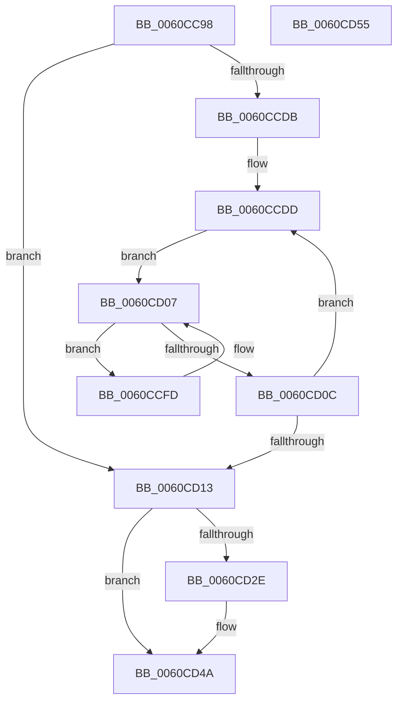

# SMKM_STORE_MGR&lt;SM_TRAITS&gt;::SmStorePrepare

- RVA: `0x0060CC98`–`0x0060CD56` (길이 `190` bytes)
- VA: `0x000000014060CC98`
- 실행 섹션: `.text`
- PDB 이름 있음: `예`; PDB Function 태그: `아니요`
- unwind 정보 RVA: `0x0006E5F8`
- 디코드: `50`개 명령, `190/190` bytes 표시
- 미해석 바이트: `0` (있으면 어셈블리에 `.byte`로 보존)

> 이 문서는 커널 이미지의 기계어와 PDB 기호를 분석해 생성했습니다. 4번과 5번은 함수 원형과 자료형을 바이너리 사용 방식에서 추정한 C 해석이며 원본 소스 복구 결과는 아닙니다.

## 1. Dependencies

- 직접 호출 지점: **2**; 고유 호출 대상: **1**
- 직접 호출자로 확인된 함수: **1**
- RIP 상대 이미지 참조: **0**

### Outgoing calls
- `0x0060CD25` → [SmFpPreAllocate](../4C/SmFpPreAllocate_function_004CF32C.md) (function, `0x004CF32C`)
- `0x0060CD40` → [SmFpPreAllocate](../4C/SmFpPreAllocate_function_004CF32C.md) (function, `0x004CF32C`)

### Direct callers
- [SmFirstTimeInit](../4E/SmFirstTimeInit_function_004EA944.md) at `0x004EABC4`

### Static image references
- 디코드된 RIP-relative 메모리 참조가 없습니다.

## 2. Other-region calls and transfers

- 다른 실행 섹션으로 향하는 call: **0**
- 별도 외부 분기/꼬리 이동을 확인하지 못했습니다.

## 3. Assembly (complete function range)

```asm
0060CC98  48 89 5C 24 08                  mov qword ptr [rsp + 8], rbx
0060CC9D  57                              push rdi
0060CC9E  48 83 EC 30                     sub rsp, 0x30
0060CCA2  48 8B D9                        mov rbx, rcx
0060CCA5  C7 44 24 28 00 01 10 00         mov dword ptr [rsp + 0x28], 0x100100
0060CCAD  B9 81 02 10 00                  mov ecx, 0x100281
0060CCB2  B8 15 00 00 00                  mov eax, 0x15
0060CCB7  89 4C 24 20                     mov dword ptr [rsp + 0x20], ecx
0060CCBB  89 4C 24 2C                     mov dword ptr [rsp + 0x2c], ecx
0060CCBF  B9 15 00 10 00                  mov ecx, 0x100015
0060CCC4  8B 93 D0 07 00 00               mov edx, dword ptr [rbx + 0x7d0]
0060CCCA  F6 C2 02                        test dl, 2
0060CCCD  0F 45 C1                        cmovne eax, ecx
0060CCD0  33 FF                           xor edi, edi
0060CCD2  89 44 24 24                     mov dword ptr [rsp + 0x24], eax
0060CCD6  F6 C2 01                        test dl, 1
0060CCD9  75 38                           jne 0x14060cd13
0060CCDB  8B CF                           mov ecx, edi
0060CCDD  85 C9                           test ecx, ecx
0060CCDF  48 8D 44 24 28                  lea rax, [rsp + 0x28]
0060CCE4  48 8D 54 24 30                  lea rdx, [rsp + 0x30]
0060CCE9  48 0F 44 D0                     cmove rdx, rax
0060CCED  4C 8D 44 24 20                  lea r8, [rsp + 0x20]
0060CCF2  48 8D 44 24 28                  lea rax, [rsp + 0x28]
0060CCF7  49 0F 44 C0                     cmove rax, r8
0060CCFB  EB 0A                           jmp 0x14060cd07
0060CCFD  81 20 FF FF 0F F0               and dword ptr [rax], 0xf00fffff
0060CD03  48 83 C0 04                     add rax, 4
0060CD07  48 3B C2                        cmp rax, rdx
0060CD0A  72 F1                           jb 0x14060ccfd
0060CD0C  FF C1                           inc ecx
0060CD0E  83 F9 02                        cmp ecx, 2
0060CD11  72 CA                           jb 0x14060ccdd
0060CD13  48 8D 8B A8 06 00 00            lea rcx, [rbx + 0x6a8]
0060CD1A  41 B8 02 00 00 00               mov r8d, 2
0060CD20  48 8D 54 24 20                  lea rdx, [rsp + 0x20]
0060CD25  E8 02 26 EC FF                  call 0x1404cf32c
0060CD2A  85 C0                           test eax, eax
0060CD2C  78 1C                           js 0x14060cd4a
0060CD2E  48 8D 8B 30 06 00 00            lea rcx, [rbx + 0x630]
0060CD35  41 B8 02 00 00 00               mov r8d, 2
0060CD3B  48 8D 54 24 28                  lea rdx, [rsp + 0x28]
0060CD40  E8 E7 25 EC FF                  call 0x1404cf32c
0060CD45  85 C0                           test eax, eax
0060CD47  0F 49 C7                        cmovns eax, edi
0060CD4A  48 8B 5C 24 40                  mov rbx, qword ptr [rsp + 0x40]
0060CD4F  48 83 C4 30                     add rsp, 0x30
0060CD53  5F                              pop rdi
0060CD54  C3                              ret
0060CD55  CC                              int3
```

## 4. C-style interpretation (structured pseudocode)

```c
__int64 __fastcall SMKM_STORE_MGR_SM_TRAITS___SmStorePrepare(__int64 a1)
{
    __int64 result;
    __int64 v_rdi;
    __int64 v_rsp;
    unsigned int v_stack_m10;
    unsigned int v_stack_m14;
    unsigned int v_stack_m18;
    unsigned __int64 v_stack_m8;
    unsigned int v_stack_mC;
    unsigned __int64 v_stack_p8;

    v_stack_p8 = v_rbx;
    v_rsp = (v_rsp) - (48);
    v_stack_m10 = 0x100100ULL;
    v_stack_m18 = (unsigned int)((unsigned int)(0x100281ULL));
    v_stack_mC = (unsigned int)((unsigned int)(0x100281ULL));
    result = 21;
    if ((((unsigned __int8)((unsigned int)(*(unsigned int *)(a1 + 2000)))) & (2)) != 0) { result = (unsigned int)((unsigned int)(0x100015ULL)); }
    v_rdi = 0;
    v_stack_m14 = (unsigned int)(result);
    if ((((unsigned __int8)((unsigned int)(*(unsigned int *)(a1 + 2000)))) & (1)) != 0) goto loc_0060CD13;
loc_0060CCDD:
    a2 = v_stack_m8;
    if (0 == 0) { a2 = v_stack_m10; }
    result = v_stack_m10;
    if (0 == 0) { result = v_stack_m18; }
    goto loc_0060CD07;
loc_0060CCFD:
    result = (result) + (4);
loc_0060CD07:
    if (result < a2) goto loc_0060CCFD;
    a1 = (unsigned int)((0) + 1);
    if (((unsigned int)(a1)) < 2) goto loc_0060CCDD;
loc_0060CD13:
    result = SmFpPreAllocate(a1 + 1704, v_stack_m18, 2, a4);
    if (!(sign_flag)) {
        a1 = a1 + 1584;
        a3 = 2;
        a2 = v_stack_m10;
        result = SmFpPreAllocate(a1, a2, a3, a4);
        if (!sign_flag) { result = 0; }
    }
    v_rsp = (v_rsp) + (48);
    return result;
}
```

## 5. (Beta) C Style

```c
int64_t SMKM_STORE_MGR_SM_TRAITS___SmStorePrepare(void *Arg1)
{
    uint8_t *arg1 = (uint8_t *)Arg1;

    int64_t result;
    int64_t local_rdi;
    int64_t local_rsp;
    uint32_t v_stack_m10;
    uint32_t v_stack_m14;
    uint32_t v_stack_m18;
    uint64_t v_stack_m8;
    uint32_t v_stack_mC;
    uint64_t v_stack_p8;

    v_stack_p8 = local_rbx;
    local_rsp = (local_rsp) - (48);
    v_stack_m10 = 0x100100ULL;
    v_stack_m18 = (uint32_t)((uint32_t)(0x100281ULL));
    v_stack_mC = (uint32_t)((uint32_t)(0x100281ULL));
    result = 21;
    if ((((uint8_t)((uint32_t)(*(uint32_t *)(arg1 + 0x7D0)))) & (2)) != 0) { result = (uint32_t)((uint32_t)(0x100015ULL)); }
    local_rdi = 0;
    v_stack_m14 = (uint32_t)(result);
    if ((((uint8_t)((uint32_t)(*(uint32_t *)(arg1 + 0x7D0)))) & (1)) != 0) goto loc_0060CD13;
loc_0060CCDD:
    a2 = v_stack_m8;
    if (0 == 0) { a2 = v_stack_m10; }
    result = v_stack_m10;
    if (0 == 0) { result = v_stack_m18; }
    goto loc_0060CD07;
loc_0060CCFD:
    result = (result) + (4);
loc_0060CD07:
    if (result < a2) goto loc_0060CCFD;
    Arg1 = (uint32_t)((0) + 1);
    if (((uint32_t)(Arg1)) < 2) goto loc_0060CCDD;
loc_0060CD13:
    result = SmFpPreAllocate(Arg1 + 1704, v_stack_m18, 2, a4);
    if (!(sign_flag)) {
        Arg1 = Arg1 + 1584;
        a3 = 2;
        a2 = v_stack_m10;
        result = SmFpPreAllocate(Arg1, a2, a3, a4);
        if (!sign_flag) { result = 0; }
    }
    local_rsp = (local_rsp) + (48);
    return result;
}
```

### 관측된 메모리 오프셋

구조체 형식이 확인되지 않은 접근은 인자 기준의 오프셋으로만 기록했습니다.

| 기준 인자 | 오프셋 표현 | 폭 (bit) | 접근 |
|---|---:|---:|---|
| `Arg1` | `+ 0x630` | `64` | `R` |
| `Arg1` | `+ 0x6A8` | `64` | `R` |
| `Arg1` | `+ 0x7D0` | `32` | `R` |

## 6. Execution-region graph

[열기: 2D/3D 그래프와 함수 탐색 컨트롤 패널](../../../control-panel.html?section=text&rva=0x0060CC98&view=graph)

- 2D 그래프는 위에서 아래로 흐르고, 3D 그래프는 빈 공간을 드래그해 회전합니다. Shift+드래그는 이동, 휠은 확대·축소, 함수 노드 선택은 대상 보고서 이동입니다.

### Static fallback


