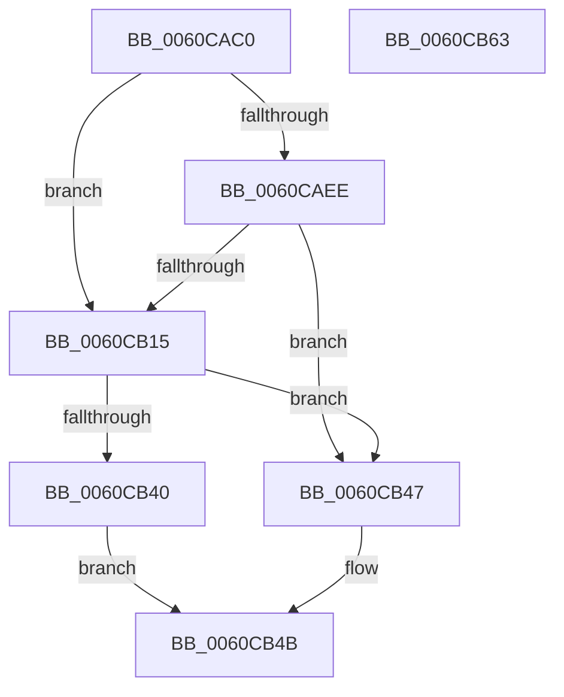

# SMKM_STORE&lt;SM_TRAITS&gt;::SmStAllocatePhysicalRegion

- RVA: `0x0060CAC0`–`0x0060CB64` (길이 `164` bytes)
- VA: `0x000000014060CAC0`
- 실행 섹션: `.text`
- PDB 이름 있음: `예`; PDB Function 태그: `아니요`
- unwind 정보 RVA: `0x000C82A0`
- 디코드: `42`개 명령, `164/164` bytes 표시
- 미해석 바이트: `0` (있으면 어셈블리에 `.byte`로 보존)

> 이 문서는 커널 이미지의 기계어와 PDB 기호를 분석해 생성했습니다. 4번과 5번은 함수 원형과 자료형을 바이너리 사용 방식에서 추정한 C 해석이며 원본 소스 복구 결과는 아닙니다.

## 1. Dependencies

- 직접 호출 지점: **2**; 고유 호출 대상: **1**
- 직접 호출자로 확인된 함수: **1**
- RIP 상대 이미지 참조: **0**

### Outgoing calls
- `0x0060CB0B` → [MmAllocatePagesForMdlEx](../3E/MmAllocatePagesForMdlEx_function_003EA8C0.md) (function, `0x003EA8C0`)
- `0x0060CB36` → [MmAllocatePagesForMdlEx](../3E/MmAllocatePagesForMdlEx_function_003EA8C0.md) (function, `0x003EA8C0`)

### Direct callers
- [ST_STORE&lt;SM_TRAITS&gt;::StMapAndLockRegion](../4E/ST_STORE_SM_TRAITS_StMapAndLockRegion_function_004EC090.md) at `0x004EC0EE`

### Static image references
- 디코드된 RIP-relative 메모리 참조가 없습니다.

## 2. Other-region calls and transfers

- 다른 실행 섹션으로 향하는 call: **0**
- 별도 외부 분기/꼬리 이동을 확인하지 못했습니다.

## 3. Assembly (complete function range)

```asm
0060CAC0  48 8B C4                        mov rax, rsp
0060CAC3  48 89 58 08                     mov qword ptr [rax + 8], rbx
0060CAC7  48 89 68 10                     mov qword ptr [rax + 0x10], rbp
0060CACB  48 89 70 18                     mov qword ptr [rax + 0x18], rsi
0060CACF  41 56                           push r14
0060CAD1  48 83 EC 30                     sub rsp, 0x30
0060CAD5  4C 8B B1 68 1B 00 00            mov r14, qword ptr [rcx + 0x1b68]
0060CADC  48 8B F1                        mov rsi, rcx
0060CADF  8B 89 60 1B 00 00               mov ecx, dword ptr [rcx + 0x1b60]
0060CAE5  33 DB                           xor ebx, ebx
0060CAE7  8B EA                           mov ebp, edx
0060CAE9  66 85 C9                        test cx, cx
0060CAEC  75 27                           jne 0x14060cb15
0060CAEE  44 8B C9                        mov r9d, ecx
0060CAF1  C7 40 F0 4D 00 00 00            mov dword ptr [rax - 0x10], 0x4d
0060CAF8  8B CB                           mov ecx, ebx
0060CAFA  C7 40 E8 01 00 00 00            mov dword ptr [rax - 0x18], 1
0060CB01  41 B8 00 00 01 00               mov r8d, 0x10000
0060CB07  48 83 CA FF                     or rdx, 0xffffffffffffffff
0060CB0B  E8 B0 DD DD FF                  call 0x1403ea8c0
0060CB10  48 85 C0                        test rax, rax
0060CB13  75 32                           jne 0x14060cb47
0060CB15  44 8B 8E 60 1B 00 00            mov r9d, dword ptr [rsi + 0x1b60]
0060CB1C  4C 8B C3                        mov r8, rbx
0060CB1F  C7 44 24 28 0D 00 00 00         mov dword ptr [rsp + 0x28], 0xd
0060CB27  48 83 CA FF                     or rdx, 0xffffffffffffffff
0060CB2B  48 8B CB                        mov rcx, rbx
0060CB2E  C7 44 24 20 01 00 00 00         mov dword ptr [rsp + 0x20], 1
0060CB36  E8 85 DD DD FF                  call 0x1403ea8c0
0060CB3B  48 85 C0                        test rax, rax
0060CB3E  75 07                           jne 0x14060cb47
0060CB40  BB 9A 00 00 C0                  mov ebx, 0xc000009a
0060CB45  EB 04                           jmp 0x14060cb4b
0060CB47  49 89 04 EE                     mov qword ptr [r14 + rbp*8], rax
0060CB4B  48 8B 6C 24 48                  mov rbp, qword ptr [rsp + 0x48]
0060CB50  8B C3                           mov eax, ebx
0060CB52  48 8B 5C 24 40                  mov rbx, qword ptr [rsp + 0x40]
0060CB57  48 8B 74 24 50                  mov rsi, qword ptr [rsp + 0x50]
0060CB5C  48 83 C4 30                     add rsp, 0x30
0060CB60  41 5E                           pop r14
0060CB62  C3                              ret
0060CB63  CC                              int3
```

## 4. C-style interpretation (structured pseudocode)

```c
__int64 __fastcall SMKM_STORE_SM_TRAITS___SmStAllocatePhysicalRegion(__int64 a1, __int64 a2)
{
    __int64 result;
    __int64 v_rbx;
    __int64 v_rsp;
    unsigned int v_stack_m10;
    unsigned int v_stack_m18;
    unsigned __int64 v_stack_p10;
    unsigned __int64 v_stack_p18;
    unsigned __int64 v_stack_p8;

    *(unsigned __int64 *)(v_rsp + 8) = v_rbx;
    *(unsigned __int64 *)(v_rsp + 16) = v_rbp;
    *(unsigned __int64 *)(v_rsp + 24) = v_rsi;
    v_rsp = (v_rsp) - (48);
    v_rbx = 0;
    if ((unsigned __int16)((unsigned int)(*(unsigned int *)(a1 + 7008))) != 0) goto loc_0060CB15;
    *(unsigned int *)(v_rsp - 16) = 77;
    *(unsigned int *)(v_rsp - 24) = 1;
    a2 = (a2) | (-1);
    result = MmAllocatePagesForMdlEx(0, a2, (unsigned int)(0x10000ULL), (unsigned int)((unsigned int)((unsigned int)(*(unsigned int *)(a1 + 7008)))));
    if (result != 0) goto loc_0060CB47;
loc_0060CB15:
    v_stack_m10 = 13;
    a2 = (a2) | (-1);
    v_stack_m18 = 1;
    result = MmAllocatePagesForMdlEx(0, a2, 0, (unsigned int)(*(unsigned int *)(a1 + 7008)));
    if (result != 0) goto loc_0060CB47;
    goto loc_0060CB4B;
loc_0060CB47:
    *(unsigned __int64 *)(*(unsigned __int64 *)(a1 + 7016) + (unsigned int)((unsigned int)(a2)) * 8) = result;
loc_0060CB4B:
    v_rsp = (v_rsp) + (48);
    return (unsigned int)((unsigned int)((unsigned int)(0xC000009AULL)));
}
```

## 5. (Beta) C Style

```c
int64_t SMKM_STORE_SM_TRAITS___SmStAllocatePhysicalRegion(void *Arg1, int64_t Arg2)
{
    uint8_t *arg1 = (uint8_t *)Arg1;

    int64_t result;
    int64_t local_rbx;
    int64_t local_rsp;
    uint32_t v_stack_m10;
    uint32_t v_stack_m18;
    uint64_t v_stack_p10;
    uint64_t v_stack_p18;
    uint64_t v_stack_p8;

    *(uint64_t *)(local_rsp + 0x8) = local_rbx;
    *(uint64_t *)(local_rsp + 0x10) = local_rbp;
    *(uint64_t *)(local_rsp + 0x18) = local_rsi;
    local_rsp = (local_rsp) - (48);
    local_rbx = 0;
    if ((uint16_t)((uint32_t)(*(uint32_t *)(arg1 + 0x1B60))) != 0) goto loc_0060CB15;
    *(uint32_t *)(local_rsp - 0x10) = 77;
    *(uint32_t *)(local_rsp - 0x18) = 1;
    Arg2 = (Arg2) | (-1);
    result = MmAllocatePagesForMdlEx(0, Arg2, (uint32_t)(0x10000ULL), (uint32_t)((uint32_t)((uint32_t)(*(uint32_t *)(arg1 + 0x1B60)))));
    if (result != 0) goto loc_0060CB47;
loc_0060CB15:
    v_stack_m10 = 13;
    Arg2 = (Arg2) | (-1);
    v_stack_m18 = 1;
    result = MmAllocatePagesForMdlEx(0, Arg2, 0, (uint32_t)(*(uint32_t *)(arg1 + 0x1B60)));
    if (result != 0) goto loc_0060CB47;
    goto loc_0060CB4B;
loc_0060CB47:
    *(uint64_t *)(*(uint64_t *)(arg1 + 0x1B68) + (uint32_t)((uint32_t)(Arg2)) * 8) = result;
loc_0060CB4B:
    local_rsp = (local_rsp) + (48);
    return (uint32_t)((uint32_t)((uint32_t)(0xC000009AULL)));
}
```

### 관측된 메모리 오프셋

구조체 형식이 확인되지 않은 접근은 인자 기준의 오프셋으로만 기록했습니다.

| 기준 인자 | 오프셋 표현 | 폭 (bit) | 접근 |
|---|---:|---:|---|
| `Arg1` | `+ 0x1B60` | `32` | `R` |
| `Arg1` | `+ 0x1B68` | `64` | `R` |

## 6. Execution-region graph

[열기: 2D/3D 그래프와 함수 탐색 컨트롤 패널](../../../control-panel.html?section=text&rva=0x0060CAC0&view=graph)

- 2D 그래프는 위에서 아래로 흐르고, 3D 그래프는 빈 공간을 드래그해 회전합니다. Shift+드래그는 이동, 휠은 확대·축소, 함수 노드 선택은 대상 보고서 이동입니다.

### Static fallback


