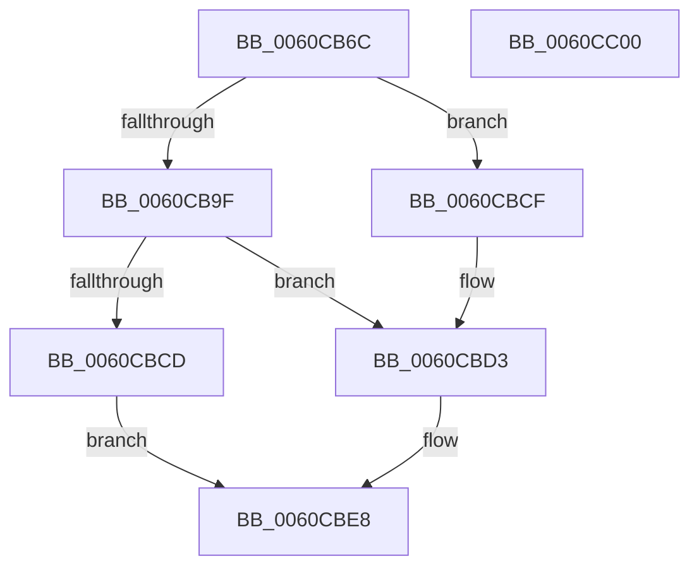

# SMKM_STORE&lt;SM_TRAITS&gt;::SmStMapPhysicalRegion

- RVA: `0x0060CB6C`–`0x0060CC01` (길이 `149` bytes)
- VA: `0x000000014060CB6C`
- 실행 섹션: `.text`
- PDB 이름 있음: `예`; PDB Function 태그: `아니요`
- unwind 정보 RVA: `0x00066400`
- 디코드: `42`개 명령, `149/149` bytes 표시
- 미해석 바이트: `0` (있으면 어셈블리에 `.byte`로 보존)

> 이 문서는 커널 이미지의 기계어와 PDB 기호를 분석해 생성했습니다. 4번과 5번은 함수 원형과 자료형을 바이너리 사용 방식에서 추정한 C 해석이며 원본 소스 복구 결과는 아닙니다.

## 1. Dependencies

- 직접 호출 지점: **1**; 고유 호출 대상: **1**
- 직접 호출자로 확인된 함수: **2**
- RIP 상대 이미지 참조: **0**

### Outgoing calls
- `0x0060CBC0` → [SmFpAllocate](../31/SmFpAllocate_function_00317D10.md) (function, `0x00317D10`)

### Direct callers
- [SMKM_STORE&lt;SM_TRAITS&gt;::SmStCompareRegionDataCallback](../34/SMKM_STORE_SM_TRAITS_SmStCompareRegionDataCallback_function_0034D390.md) at `0x0034D727`
- [SMKM_STORE&lt;SM_TRAITS&gt;::SmStMapRegion](../34/SMKM_STORE_SM_TRAITS_SmStMapRegion_function_0034D738.md) at `0x0034D758`

### Static image references
- 디코드된 RIP-relative 메모리 참조가 없습니다.

## 2. Other-region calls and transfers

- 다른 실행 섹션으로 향하는 call: **0**
- 별도 외부 분기/꼬리 이동을 확인하지 못했습니다.

## 3. Assembly (complete function range)

```asm
0060CB6C  48 89 5C 24 08                  mov qword ptr [rsp + 8], rbx
0060CB71  48 89 6C 24 10                  mov qword ptr [rsp + 0x10], rbp
0060CB76  48 89 74 24 18                  mov qword ptr [rsp + 0x18], rsi
0060CB7B  57                              push rdi
0060CB7C  48 83 EC 30                     sub rsp, 0x30
0060CB80  48 8B B1 68 1B 00 00            mov rsi, qword ptr [rcx + 0x1b68]
0060CB87  8B 5C 24 60                     mov ebx, dword ptr [rsp + 0x60]
0060CB8B  8B FA                           mov edi, edx
0060CB8D  41 8B E8                        mov ebp, r8d
0060CB90  48 8B 04 FE                     mov rax, qword ptr [rsi + rdi*8]
0060CB94  48 8B D0                        mov rdx, rax
0060CB97  48 83 E2 F8                     and rdx, 0xfffffffffffffff8
0060CB9B  A8 03                           test al, 3
0060CB9D  75 30                           jne 0x14060cbcf
0060CB9F  65 4C 8B 04 25 88 01 00 00      mov r8, qword ptr gs:[0x188]
0060CBA8  8B C3                           mov eax, ebx
0060CBAA  83 E0 01                        and eax, 1
0060CBAD  4C 8B CA                        mov r9, rdx
0060CBB0  48 81 C1 18 1D 00 00            add rcx, 0x1d18
0060CBB7  89 44 24 20                     mov dword ptr [rsp + 0x20], eax
0060CBBB  BA 05 00 00 00                  mov edx, 5
0060CBC0  E8 4B B1 D0 FF                  call 0x140317d10
0060CBC5  48 8B C8                        mov rcx, rax
0060CBC8  48 85 C0                        test rax, rax
0060CBCB  75 06                           jne 0x14060cbd3
0060CBCD  EB 19                           jmp 0x14060cbe8
0060CBCF  48 8B 4A 18                     mov rcx, qword ptr [rdx + 0x18]
0060CBD3  80 E3 10                        and bl, 0x10
0060CBD6  F6 DB                           neg bl
0060CBD8  48 1B C0                        sbb rax, rax
0060CBDB  48 F7 D8                        neg rax
0060CBDE  48 FF C0                        inc rax
0060CBE1  48 09 04 FE                     or qword ptr [rsi + rdi*8], rax
0060CBE5  48 03 CD                        add rcx, rbp
0060CBE8  48 8B 5C 24 40                  mov rbx, qword ptr [rsp + 0x40]
0060CBED  48 8B C1                        mov rax, rcx
0060CBF0  48 8B 6C 24 48                  mov rbp, qword ptr [rsp + 0x48]
0060CBF5  48 8B 74 24 50                  mov rsi, qword ptr [rsp + 0x50]
0060CBFA  48 83 C4 30                     add rsp, 0x30
0060CBFE  5F                              pop rdi
0060CBFF  C3                              ret
0060CC00  CC                              int3
```

## 4. C-style interpretation (structured pseudocode)

```c
__int64 __fastcall SMKM_STORE_SM_TRAITS___SmStMapPhysicalRegion(__int64 a1, int a2, int a3, __int64 a4, unsigned int a5)
{
    __int64 result;
    __int64 v_rbx;
    __int64 v_rsp;
    unsigned int v_stack_m18;
    unsigned __int64 v_stack_p10;
    unsigned __int64 v_stack_p18;
    unsigned __int64 v_stack_p8;

    v_stack_p8 = v_rbx;
    v_stack_p10 = v_rbp;
    v_stack_p18 = v_rsi;
    v_rsp = (v_rsp) - (48);
    a2 = (*(unsigned __int64 *)(*(unsigned __int64 *)(a1 + 7016) + (unsigned int)(a2) * 8)) & (-8);
    if ((((unsigned __int8)(*(unsigned __int64 *)(*(unsigned __int64 *)(a1 + 7016) + (unsigned int)(a2) * 8))) & (3)) != 0) goto loc_0060CBCF;
    result = (unsigned int)(((unsigned int)((unsigned int)((unsigned int)(a5)))) & (1));
    a1 = (a1) + (0x1D18ULL);
    v_stack_m18 = (unsigned int)(result);
    result = SmFpAllocate(a1, 5, *(unsigned __int64 *)(gs_base + (0 + 392)), a2);
    if (result != 0) goto loc_0060CBD3;
    goto loc_0060CBE8;
loc_0060CBCF:
loc_0060CBD3:
    v_rbx = (unsigned __int8)(((unsigned int)(a5)) & (16));
    v_rbx = (unsigned __int8)(-(v_rbx));
    result = -(result);
    result = (result) + 1;
    a1 = (*(unsigned __int64 *)(5 + 24)) + ((unsigned int)(a3));
loc_0060CBE8:
    v_rsp = (v_rsp) + (48);
    return a1;
}
```

## 5. (Beta) C Style

```c
void *SMKM_STORE_SM_TRAITS___SmStMapPhysicalRegion(void *Arg1, int32_t Arg2, int32_t Arg3, int64_t Arg4, uint32_t Arg5)
{
    uint8_t *arg1 = (uint8_t *)Arg1;

    int64_t result;
    int64_t local_rbx;
    int64_t local_rsp;
    uint32_t v_stack_m18;
    uint64_t v_stack_p10;
    uint64_t v_stack_p18;
    uint64_t v_stack_p8;

    v_stack_p8 = local_rbx;
    v_stack_p10 = local_rbp;
    v_stack_p18 = local_rsi;
    local_rsp = (local_rsp) - (48);
    Arg2 = (*(uint64_t *)(*(uint64_t *)(arg1 + 0x1B68) + (uint32_t)(Arg2) * 8)) & (-8);
    if ((((uint8_t)(*(uint64_t *)(*(uint64_t *)(arg1 + 0x1B68) + (uint32_t)(Arg2) * 8))) & (3)) != 0) goto loc_0060CBCF;
    result = (uint32_t)(((uint32_t)((uint32_t)((uint32_t)(Arg5)))) & (1));
    Arg1 = (Arg1) + (0x1D18ULL);
    v_stack_m18 = (uint32_t)(result);
    result = SmFpAllocate(Arg1, 5, *(uint64_t *)(gs_base + (0 + 0x188)), Arg2);
    if (result != 0) goto loc_0060CBD3;
    goto loc_0060CBE8;
loc_0060CBCF:
loc_0060CBD3:
    local_rbx = (uint8_t)(((uint32_t)(Arg5)) & (16));
    local_rbx = (uint8_t)(-(local_rbx));
    result = -(result);
    result = (result) + 1;
    Arg1 = (*(uint64_t *)(5 + 0x18)) + ((uint32_t)(Arg3));
loc_0060CBE8:
    local_rsp = (local_rsp) + (48);
    return Arg1;
}
```

### 관측된 메모리 오프셋

구조체 형식이 확인되지 않은 접근은 인자 기준의 오프셋으로만 기록했습니다.

| 기준 인자 | 오프셋 표현 | 폭 (bit) | 접근 |
|---|---:|---:|---|
| `Arg1` | `+ 0x1B68` | `64` | `R` |

## 6. Execution-region graph

[열기: 2D/3D 그래프와 함수 탐색 컨트롤 패널](../../../control-panel.html?section=text&rva=0x0060CB6C&view=graph)

- 2D 그래프는 위에서 아래로 흐르고, 3D 그래프는 빈 공간을 드래그해 회전합니다. Shift+드래그는 이동, 휠은 확대·축소, 함수 노드 선택은 대상 보고서 이동입니다.

### Static fallback


