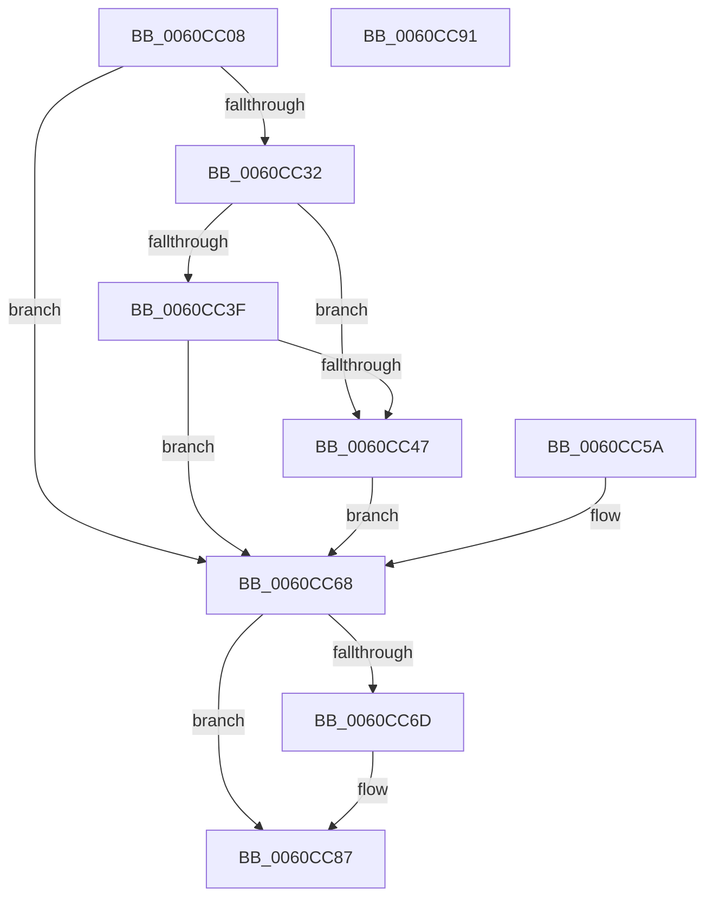

# SMKM_STORE&lt;SM_TRAITS&gt;::SmStUnhandledExceptionFilter

- RVA: `0x0060CC08`–`0x0060CC92` (길이 `138` bytes)
- VA: `0x000000014060CC08`
- 실행 섹션: `.text`
- PDB 이름 있음: `예`; PDB Function 태그: `아니요`
- unwind 정보 RVA: `0x000D1948`
- 디코드: `42`개 명령, `138/138` bytes 표시
- 미해석 바이트: `0` (있으면 어셈블리에 `.byte`로 보존)

> 이 문서는 커널 이미지의 기계어와 PDB 기호를 분석해 생성했습니다. 4번과 5번은 함수 원형과 자료형을 바이너리 사용 방식에서 추정한 C 해석이며 원본 소스 복구 결과는 아닙니다.

## 1. Dependencies

- 직접 호출 지점: **2**; 고유 호출 대상: **2**
- 직접 호출자로 확인된 함수: **4**
- RIP 상대 이미지 참조: **0**

### Outgoing calls
- `0x0060CC53` → [SmHpChunkHeapProtect](../3A/SmHpChunkHeapProtect_function_003AFD8C.md) (function, `0x003AFD8C`)
- `0x0060CC81` → [KeBugCheckEx](../4F/KeBugCheckEx_function_004FD660.md) (function, `0x004FD660`)

### Direct callers
- [`SMKM_STORE&lt;SM_TRAITS&gt;::SmStDirectReadIssue&#x27;::`1&#x27;::filt$0](../6D/_SMKM_STORE_SM_TRAITS_SmStDirectReadIssue_1_filt_0_function_006D1960.md) at `0x006D197D`
- [`SMKM_STORE&lt;SM_TRAITS&gt;::SmStDirectReadComplete&#x27;::`1&#x27;::filt$0](../6D/_SMKM_STORE_SM_TRAITS_SmStDirectReadComplete_1_filt_0_function_006D1990.md) at `0x006D19A6`
- [`SMKM_STORE&lt;SM_TRAITS&gt;::SmStCompareRegionDataCallback&#x27;::`1&#x27;::filt$1](../6D/_SMKM_STORE_SM_TRAITS_SmStCompareRegionDataCallback_1_filt_1_function_006D21DA.md) at `0x006D21FA`
- [`SMKM_STORE&lt;SM_TRAITS&gt;::SmStWorkerThread&#x27;::`1&#x27;::filt$0](../6D/_SMKM_STORE_SM_TRAITS_SmStWorkerThread_1_filt_0_function_006D49CD.md) at `0x006D49E3`

### Static image references
- 디코드된 RIP-relative 메모리 참조가 없습니다.

## 2. Other-region calls and transfers

- 다른 실행 섹션으로 향하는 call: **0**
- 별도 외부 분기/꼬리 이동을 확인하지 못했습니다.

## 3. Assembly (complete function range)

```asm
0060CC08  44 89 44 24 18                  mov dword ptr [rsp + 0x18], r8d
0060CC0D  48 89 54 24 10                  mov qword ptr [rsp + 0x10], rdx
0060CC12  48 89 4C 24 08                  mov qword ptr [rsp + 8], rcx
0060CC17  53                              push rbx
0060CC18  56                              push rsi
0060CC19  57                              push rdi
0060CC1A  48 83 EC 30                     sub rsp, 0x30
0060CC1E  41 8B F0                        mov esi, r8d
0060CC21  48 8B DA                        mov rbx, rdx
0060CC24  48 8B F9                        mov rdi, rcx
0060CC27  41 B8 01 00 00 00               mov r8d, 1
0060CC2D  41 3B F0                        cmp esi, r8d
0060CC30  75 36                           jne 0x14060cc68
0060CC32  48 8B 02                        mov rax, qword ptr [rdx]
0060CC35  8B 08                           mov ecx, dword ptr [rax]
0060CC37  81 F9 05 00 00 C0               cmp ecx, 0xc0000005
0060CC3D  74 08                           je 0x14060cc47
0060CC3F  81 F9 20 04 00 C0               cmp ecx, 0xc0000420
0060CC45  75 21                           jne 0x14060cc68
0060CC47  48 8D 8F 10 01 00 00            lea rcx, [rdi + 0x110]
0060CC4E  BA 02 00 00 00                  mov edx, 2
0060CC53  E8 34 31 DA FF                  call 0x1403afd8c
0060CC58  EB 0E                           jmp 0x14060cc68
0060CC5A  8B 74 24 60                     mov esi, dword ptr [rsp + 0x60]
0060CC5E  48 8B 5C 24 58                  mov rbx, qword ptr [rsp + 0x58]
0060CC63  48 8B 7C 24 50                  mov rdi, qword ptr [rsp + 0x50]
0060CC68  48 85 DB                        test rbx, rbx
0060CC6B  74 1A                           je 0x14060cc87
0060CC6D  4C 63 CE                        movsxd r9, esi
0060CC70  48 83 64 24 20 00               and qword ptr [rsp + 0x20], 0
0060CC76  4C 8B C3                        mov r8, rbx
0060CC79  48 8B D7                        mov rdx, rdi
0060CC7C  B9 54 01 00 00                  mov ecx, 0x154
0060CC81  E8 DA 09 EF FF                  call 0x1404fd660
0060CC86  CC                              int3
0060CC87  33 C0                           xor eax, eax
0060CC89  48 83 C4 30                     add rsp, 0x30
0060CC8D  5F                              pop rdi
0060CC8E  5E                              pop rsi
0060CC8F  5B                              pop rbx
0060CC90  C3                              ret
0060CC91  CC                              int3
```

## 4. C-style interpretation (structured pseudocode)

```c
__int64 __fastcall SMKM_STORE_SM_TRAITS___SmStUnhandledExceptionFilter(__int64 a1, __int64 a2, int a3)
{
    __int64 result;
    __int64 v_rsp;
    unsigned __int64 v_stack_m28;
    unsigned __int64 v_stack_p10;
    unsigned int v_stack_p18;
    unsigned __int64 v_stack_p8;

    v_stack_p18 = a3;
    v_stack_p10 = a2;
    v_stack_p8 = a1;
    v_rsp = (v_rsp) - (48);
    if (((unsigned int)((unsigned int)(a3))) != 1) goto loc_0060CC68;
    if (((unsigned int)((unsigned int)(*(unsigned int *)(*(unsigned __int64 *)(a2))))) == 0xC0000005ULL) goto loc_0060CC47;
    if (((unsigned int)((unsigned int)(*(unsigned int *)(*(unsigned __int64 *)(a2))))) != 0xC0000420ULL) goto loc_0060CC68;
loc_0060CC47:
    result = SmHpChunkHeapProtect(a1 + 272, 2, 1, a4);
    goto loc_0060CC68;
loc_0060CC68:
    if (a2 != 0) {
        a4 = (int)((unsigned int)((unsigned int)(a3)));
        a3 = a2;
        a2 = a1;
        a1 = 340;
        result = KeBugCheckEx(a1, a2, a3, a4);
    }
    result = 0;
    v_rsp = (v_rsp) + (48);
    return result;
}
```

## 5. (Beta) C Style

```c
int64_t SMKM_STORE_SM_TRAITS___SmStUnhandledExceptionFilter(void *Arg1, void *Arg2, int32_t Arg3)
{
    uint8_t *arg1 = (uint8_t *)Arg1;
    uint8_t *arg2 = (uint8_t *)Arg2;

    int64_t result;
    int64_t local_rsp;
    uint64_t v_stack_m28;
    uint64_t v_stack_p10;
    uint32_t v_stack_p18;
    uint64_t v_stack_p8;

    v_stack_p18 = Arg3;
    v_stack_p10 = Arg2;
    v_stack_p8 = Arg1;
    local_rsp = (local_rsp) - (48);
    if (((uint32_t)((uint32_t)(Arg3))) != 1) goto loc_0060CC68;
    if (((uint32_t)((uint32_t)(*(uint32_t *)(*(uint64_t *)(arg2))))) == 0xC0000005ULL) goto loc_0060CC47;
    if (((uint32_t)((uint32_t)(*(uint32_t *)(*(uint64_t *)(arg2))))) != 0xC0000420ULL) goto loc_0060CC68;
loc_0060CC47:
    result = SmHpChunkHeapProtect(Arg1 + 272, 2, 1, a4);
    goto loc_0060CC68;
loc_0060CC68:
    if (Arg2 != NULL) {
        a4 = (int32_t)((uint32_t)((uint32_t)(Arg3)));
        Arg3 = Arg2;
        Arg2 = Arg1;
        Arg1 = 340;
        result = KeBugCheckEx(Arg1, Arg2, Arg3, a4);
    }
    result = 0;
    local_rsp = (local_rsp) + (48);
    return result;
}
```

### 관측된 메모리 오프셋

구조체 형식이 확인되지 않은 접근은 인자 기준의 오프셋으로만 기록했습니다.

| 기준 인자 | 오프셋 표현 | 폭 (bit) | 접근 |
|---|---:|---:|---|
| `Arg1` | `+ 0x110` | `64` | `R` |
| `Arg2` | `+ 0x0` | `64` | `R` |

## 6. Execution-region graph

[열기: 2D/3D 그래프와 함수 탐색 컨트롤 패널](../../../control-panel.html?section=text&rva=0x0060CC08&view=graph)

- 2D 그래프는 위에서 아래로 흐르고, 3D 그래프는 빈 공간을 드래그해 회전합니다. Shift+드래그는 이동, 휠은 확대·축소, 함수 노드 선택은 대상 보고서 이동입니다.

### Static fallback


