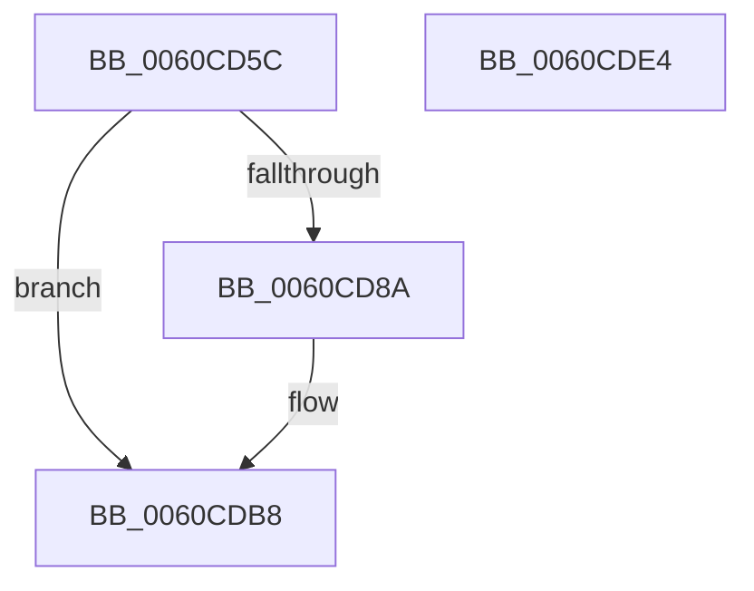

# ST_STORE&lt;SM_TRAITS&gt;::StCopyIoStats

- RVA: `0x0060CD5C`–`0x0060CDE5` (길이 `137` bytes)
- VA: `0x000000014060CD5C`
- 실행 섹션: `.text`
- PDB 이름 있음: `예`; PDB Function 태그: `아니요`
- unwind 정보 RVA: `0x00060BC4`
- 디코드: `42`개 명령, `137/137` bytes 표시
- 미해석 바이트: `0` (있으면 어셈블리에 `.byte`로 보존)

> 이 문서는 커널 이미지의 기계어와 PDB 기호를 분석해 생성했습니다. 4번과 5번은 함수 원형과 자료형을 바이너리 사용 방식에서 추정한 C 해석이며 원본 소스 복구 결과는 아닙니다.

## 1. Dependencies

- 직접 호출 지점: **2**; 고유 호출 대상: **1**
- 직접 호출자로 확인된 함수: **2**
- RIP 상대 이미지 참조: **0**

### Outgoing calls
- `0x0060CDB0` → [memcpy](../6C/memcpy_function_006C6840.md) (function, `0x006C6840`)
- `0x0060CDCF` → [memcpy](../6C/memcpy_function_006C6840.md) (function, `0x006C6840`)

### Direct callers
- [ST_STORE&lt;SM_TRAITS&gt;::StGetStatsWorker](../43/ST_STORE_SM_TRAITS_StGetStatsWorker_function_00433C80.md) at `0x00433EE5`
- [SMKM_STORE&lt;SM_TRAITS&gt;::SmStEtwFillStoreStatsEvent](../61/SMKM_STORE_SM_TRAITS_SmStEtwFillStoreStatsEvent_function_006109A4.md) at `0x00610A3D`

### Static image references
- 디코드된 RIP-relative 메모리 참조가 없습니다.

## 2. Other-region calls and transfers

- 다른 실행 섹션으로 향하는 call: **0**
- 별도 외부 분기/꼬리 이동을 확인하지 못했습니다.

## 3. Assembly (complete function range)

```asm
0060CD5C  48 89 5C 24 08                  mov qword ptr [rsp + 8], rbx
0060CD61  48 89 74 24 10                  mov qword ptr [rsp + 0x10], rsi
0060CD66  57                              push rdi
0060CD67  48 83 EC 20                     sub rsp, 0x20
0060CD6B  8B 42 08                        mov eax, dword ptr [rdx + 8]
0060CD6E  48 8D 71 04                     lea rsi, [rcx + 4]
0060CD72  FF C0                           inc eax
0060CD74  48 8B FA                        mov rdi, rdx
0060CD77  BA 40 00 00 00                  mov edx, 0x40
0060CD7C  3B C2                           cmp eax, edx
0060CD7E  0F 47 C2                        cmova eax, edx
0060CD81  89 01                           mov dword ptr [rcx], eax
0060CD83  8B 4F 08                        mov ecx, dword ptr [rdi + 8]
0060CD86  3B CA                           cmp ecx, edx
0060CD88  72 2E                           jb 0x14060cdb8
0060CD8A  FF C1                           inc ecx
0060CD8C  83 E1 3F                        and ecx, 0x3f
0060CD8F  2B D1                           sub edx, ecx
0060CD91  8B C1                           mov eax, ecx
0060CD93  48 8D 0C 8D 06 00 00 00         lea rcx, [rcx*4 + 6]
0060CD9B  48 03 C8                        add rcx, rax
0060CD9E  48 8D 1C 92                     lea rbx, [rdx + rdx*4]
0060CDA2  48 C1 E3 02                     shl rbx, 2
0060CDA6  4C 8B C3                        mov r8, rbx
0060CDA9  48 8D 14 8F                     lea rdx, [rdi + rcx*4]
0060CDAD  48 8B CE                        mov rcx, rsi
0060CDB0  E8 8B 9A 0B 00                  call 0x1406c6840
0060CDB5  48 03 F3                        add rsi, rbx
0060CDB8  8B 47 08                        mov eax, dword ptr [rdi + 8]
0060CDBB  48 8D 57 18                     lea rdx, [rdi + 0x18]
0060CDBF  FF C0                           inc eax
0060CDC1  48 8B CE                        mov rcx, rsi
0060CDC4  83 E0 3F                        and eax, 0x3f
0060CDC7  4C 8D 04 80                     lea r8, [rax + rax*4]
0060CDCB  49 C1 E0 02                     shl r8, 2
0060CDCF  E8 6C 9A 0B 00                  call 0x1406c6840
0060CDD4  48 8B 5C 24 30                  mov rbx, qword ptr [rsp + 0x30]
0060CDD9  48 8B 74 24 38                  mov rsi, qword ptr [rsp + 0x38]
0060CDDE  48 83 C4 20                     add rsp, 0x20
0060CDE2  5F                              pop rdi
0060CDE3  C3                              ret
0060CDE4  CC                              int3
```

## 4. C-style interpretation (structured pseudocode)

```c
__int64 __fastcall ST_STORE_SM_TRAITS___StCopyIoStats(__int64 a1, __int64 a2)
{
    __int64 result;
    __int64 v_rbx;
    __int64 v_rsi;
    __int64 v_rsp;
    unsigned __int64 v_stack_p10;
    unsigned __int64 v_stack_p8;

    v_stack_p8 = v_rbx;
    v_stack_p10 = v_rsi;
    v_rsp = (v_rsp) - (32);
    result = (unsigned int)(((unsigned int)(*(unsigned int *)(a2 + 8))) + 1);
    if (((unsigned int)(result)) > 64) { result = 64; }
    *(unsigned int *)(a1) = (unsigned int)(result);
    v_rsi = a1 + 4;
    if (((unsigned int)((unsigned int)(*(unsigned int *)(a2 + 8)))) >= 64) {
        a1 = (unsigned int)(((unsigned int)(*(unsigned int *)(a2 + 8))) + 1);
        a1 = (unsigned int)((a1) & (63));
        a2 = (unsigned int)((64) - ((unsigned int)(a1)));
        result = (unsigned int)(a1);
        a1 = a1 * 4 + 6;
        a1 = (a1) + (result);
        v_rbx = a2 + a2 * 4;
        v_rbx = (v_rbx) << (2);
        a3 = v_rbx;
        a2 = a2 + a1 * 4;
        a1 = a1 + 4;
        result = memcpy(a1, a2, a3, a4);
        v_rsi = (a1 + 4) + (v_rbx);
    }
    result = (unsigned int)(((unsigned int)(*(unsigned int *)(a2 + 8))) + 1);
    result = (unsigned int)((result) & (63));
    a3 = (result + result * 4) << (2);
    result = memcpy(v_rsi, a2 + 24, a3, a4);
    v_rsp = (v_rsp) + (32);
    return result;
}
```

## 5. (Beta) C Style

```c
int64_t ST_STORE_SM_TRAITS___StCopyIoStats(void *Arg1, void *Arg2)
{
    uint8_t *arg1 = (uint8_t *)Arg1;
    uint8_t *arg2 = (uint8_t *)Arg2;

    int64_t result;
    int64_t local_rbx;
    int64_t local_rsi;
    int64_t local_rsp;
    uint64_t v_stack_p10;
    uint64_t v_stack_p8;

    v_stack_p8 = local_rbx;
    v_stack_p10 = local_rsi;
    local_rsp = (local_rsp) - (32);
    result = (uint32_t)(((uint32_t)(*(uint32_t *)(arg2 + 0x8))) + 1);
    if (((uint32_t)(result)) > 64) { result = 64; }
    *(uint32_t *)(arg1) = (uint32_t)(result);
    local_rsi = Arg1 + 4;
    if (((uint32_t)((uint32_t)(*(uint32_t *)(arg2 + 0x8)))) >= 64) {
        Arg1 = (uint32_t)(((uint32_t)(*(uint32_t *)(arg2 + 0x8))) + 1);
        Arg1 = (uint32_t)((Arg1) & (63));
        Arg2 = (uint32_t)((64) - ((uint32_t)(Arg1)));
        result = (uint32_t)(Arg1);
        Arg1 = Arg1 * 4 + 6;
        Arg1 = (Arg1) + (result);
        local_rbx = Arg2 + Arg2 * 4;
        local_rbx = (local_rbx) << (2);
        a3 = local_rbx;
        Arg2 = Arg2 + Arg1 * 4;
        Arg1 = Arg1 + 4;
        result = memcpy(Arg1, Arg2, a3, a4);
        local_rsi = (Arg1 + 4) + (local_rbx);
    }
    result = (uint32_t)(((uint32_t)(*(uint32_t *)(arg2 + 0x8))) + 1);
    result = (uint32_t)((result) & (63));
    a3 = (result + result * 4) << (2);
    result = memcpy(local_rsi, Arg2 + 24, a3, a4);
    local_rsp = (local_rsp) + (32);
    return result;
}
```

### 관측된 메모리 오프셋

구조체 형식이 확인되지 않은 접근은 인자 기준의 오프셋으로만 기록했습니다.

| 기준 인자 | 오프셋 표현 | 폭 (bit) | 접근 |
|---|---:|---:|---|
| `Arg1` | `+ 0x0` | `32` | `W` |
| `Arg1` | `+ 0x4` | `64` | `R` |
| `Arg2` | `+ 0x0 + rcx*4` | `64` | `R` |
| `Arg2` | `+ 0x8` | `32` | `R` |
| `Arg2` | `+ 0x18` | `64` | `R` |

## 6. Execution-region graph

[열기: 2D/3D 그래프와 함수 탐색 컨트롤 패널](../../../control-panel.html?section=text&rva=0x0060CD5C&view=graph)

- 2D 그래프는 위에서 아래로 흐르고, 3D 그래프는 빈 공간을 드래그해 회전합니다. Shift+드래그는 이동, 휠은 확대·축소, 함수 노드 선택은 대상 보고서 이동입니다.

### Static fallback


