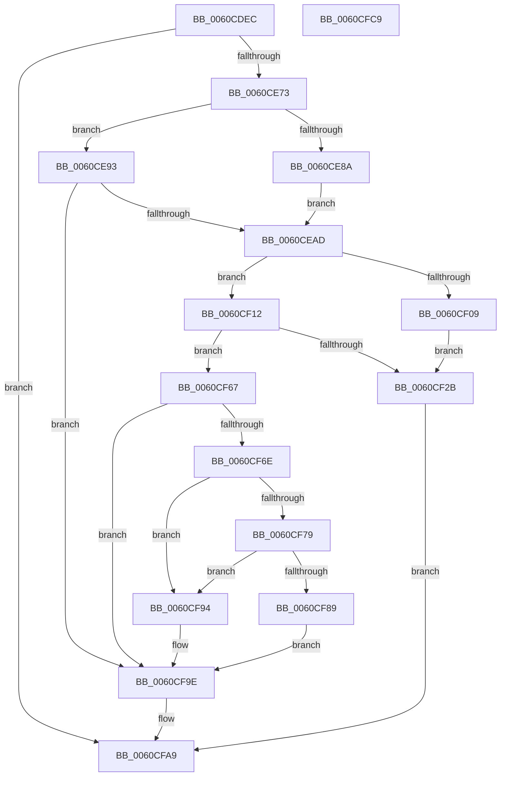

# ST_STORE&lt;SM_TRAITS&gt;::StDeviceIoBuild

- RVA: `0x0060CDEC`–`0x0060CFCA` (길이 `478` bytes)
- VA: `0x000000014060CDEC`
- 실행 섹션: `.text`
- PDB 이름 있음: `예`; PDB Function 태그: `아니요`
- unwind 정보 RVA: `0x00075C18`
- 디코드: `132`개 명령, `478/478` bytes 표시
- 미해석 바이트: `0` (있으면 어셈블리에 `.byte`로 보존)

> 이 문서는 커널 이미지의 기계어와 PDB 기호를 분석해 생성했습니다. 4번과 5번은 함수 원형과 자료형을 바이너리 사용 방식에서 추정한 C 해석이며 원본 소스 복구 결과는 아닙니다.

## 1. Dependencies

- 직접 호출 지점: **7**; 고유 호출 대상: **6**
- 직접 호출자로 확인된 함수: **2**
- RIP 상대 이미지 참조: **0**

### Outgoing calls
- `0x0060CE66` → [ST_STORE<SM_TRAITS>::StRegionReadReference](ST_STORE_SM_TRAITS_StRegionReadReference_function_0060E970.md) (function, `0x0060E970`)
- `0x0060CE9C` → [SmAllocEx](../34/SmAllocEx_function_0034C794.md) (function, `0x0034C794`)
- `0x0060CEF5` → [SmCalcIoWorkItemSize](../61/SmCalcIoWorkItemSize_function_00610E14.md) (function, `0x00610E14`)
- `0x0060CF1E` → [SmAllocEx](../34/SmAllocEx_function_0034C794.md) (function, `0x0034C794`)
- `0x0060CF33` → [memset](../6C/memset_function_006C6C40.md) (function, `0x006C6C40`)
- `0x0060CF99` → [ExFreePoolWithTag](../../poolcode/B8/ExFreePoolWithTag_function_00B82870.md) (function, `0x00B82870`)
- `0x0060CFA4` → [ST_STORE<SM_TRAITS>::StRegionReadDereference](../4F/ST_STORE_SM_TRAITS_StRegionReadDereference_function_004F68A4.md) (function, `0x004F68A4`)

### Direct callers
- [ST_STORE&lt;SM_TRAITS&gt;::StDmEtaPerformIo](ST_STORE_SM_TRAITS_StDmEtaPerformIo_function_0060D448.md) at `0x0060D48F`
- [ST_STORE&lt;SM_TRAITS&gt;::StDmSinglePageRetrieveSync](ST_STORE_SM_TRAITS_StDmSinglePageRetrieveSync_function_0060E414.md) at `0x0060E493`

### Static image references
- 디코드된 RIP-relative 메모리 참조가 없습니다.

## 2. Other-region calls and transfers

- 다른 실행 섹션으로 향하는 call: **1**
  - `0x0060CF99` → [ExFreePoolWithTag](../../poolcode/B8/ExFreePoolWithTag_function_00B82870.md) (`.text` → `POOLCODE`)
- 별도 외부 분기/꼬리 이동을 확인하지 못했습니다.

## 3. Assembly (complete function range)

```asm
0060CDEC  48 89 5C 24 08                  mov qword ptr [rsp + 8], rbx
0060CDF1  48 89 6C 24 10                  mov qword ptr [rsp + 0x10], rbp
0060CDF6  48 89 74 24 18                  mov qword ptr [rsp + 0x18], rsi
0060CDFB  57                              push rdi
0060CDFC  41 54                           push r12
0060CDFE  41 55                           push r13
0060CE00  41 56                           push r14
0060CE02  41 57                           push r15
0060CE04  48 83 EC 20                     sub rsp, 0x20
0060CE08  44 8B 91 28 03 00 00            mov r10d, dword ptr [rcx + 0x328]
0060CE0F  48 8B D9                        mov rbx, rcx
0060CE12  44 8B 3A                        mov r15d, dword ptr [rdx]
0060CE15  4C 8B E2                        mov r12, rdx
0060CE18  44 0F B7 5A 04                  movzx r11d, word ptr [rdx + 4]
0060CE1D  45 23 D7                        and r10d, r15d
0060CE20  44 03 99 38 03 00 00            add r11d, dword ptr [rcx + 0x338]
0060CE27  4D 8B E9                        mov r13, r9
0060CE2A  8B 89 2C 03 00 00               mov ecx, dword ptr [rcx + 0x32c]
0060CE30  33 FF                           xor edi, edi
0060CE32  44 8B 83 18 03 00 00            mov r8d, dword ptr [rbx + 0x318]
0060CE39  41 D3 EF                        shr r15d, cl
0060CE3C  41 C1 E2 04                     shl r10d, 4
0060CE40  41 8D 4B FF                     lea ecx, [r11 - 1]
0060CE44  41 8D 6B FF                     lea ebp, [r11 - 1]
0060CE48  41 8D 50 FF                     lea edx, [r8 - 1]
0060CE4C  44 23 D2                        and r10d, edx
0060CE4F  43 8D 04 02                     lea eax, [r10 + r8]
0060CE53  03 C8                           add ecx, eax
0060CE55  23 CA                           and ecx, edx
0060CE57  41 8B D7                        mov edx, r15d
0060CE5A  44 2B D1                        sub r10d, ecx
0060CE5D  48 8B CB                        mov rcx, rbx
0060CE60  45 03 D0                        add r10d, r8d
0060CE63  41 03 EA                        add ebp, r10d
0060CE66  E8 05 1B 00 00                  call 0x14060e970
0060CE6B  85 C0                           test eax, eax
0060CE6D  0F 84 36 01 00 00               je 0x14060cfa9
0060CE73  8B 8B 18 03 00 00               mov ecx, dword ptr [rbx + 0x318]
0060CE79  48 8B B3 80 08 00 00            mov rsi, qword ptr [rbx + 0x880]
0060CE80  83 C1 28                        add ecx, 0x28
0060CE83  03 CD                           add ecx, ebp
0060CE85  48 85 F6                        test rsi, rsi
0060CE88  74 09                           je 0x14060ce93
0060CE8A  83 8B 80 08 00 00 01            or dword ptr [rbx + 0x880], 1
0060CE91  EB 1A                           jmp 0x14060cead
0060CE93  41 83 C8 FF                     or r8d, 0xffffffff
0060CE97  BA 73 6D 53 74                  mov edx, 0x74536d73
0060CE9C  E8 F3 F8 D3 FF                  call 0x14034c794
0060CEA1  48 8B F0                        mov rsi, rax
0060CEA4  48 85 C0                        test rax, rax
0060CEA7  0F 84 F1 00 00 00               je 0x14060cf9e
0060CEAD  33 C0                           xor eax, eax
0060CEAF  0F 57 C0                        xorps xmm0, xmm0
0060CEB2  0F 11 06                        movups xmmword ptr [rsi], xmm0
0060CEB5  44 8B C5                        mov r8d, ebp
0060CEB8  0F 11 46 10                     movups xmmword ptr [rsi + 0x10], xmm0
0060CEBC  48 89 46 20                     mov qword ptr [rsi + 0x20], rax
0060CEC0  C7 06 01 00 00 00               mov dword ptr [rsi], 1
0060CEC6  41 0F 10 04 24                  movups xmm0, xmmword ptr [r12]
0060CECB  0F 11 46 10                     movups xmmword ptr [rsi + 0x10], xmm0
0060CECF  F2 41 0F 10 4C 24 10            movsd xmm1, qword ptr [r12 + 0x10]
0060CED6  F2 0F 11 4E 20                  movsd qword ptr [rsi + 0x20], xmm1
0060CEDB  8B 83 18 03 00 00               mov eax, dword ptr [rbx + 0x318]
0060CEE1  48 8B 8B 20 03 00 00            mov rcx, qword ptr [rbx + 0x320]
0060CEE8  48 8D 50 27                     lea rdx, [rax + 0x27]
0060CEEC  48 F7 D8                        neg rax
0060CEEF  48 03 D6                        add rdx, rsi
0060CEF2  48 23 D0                        and rdx, rax
0060CEF5  E8 1A 3F 00 00                  call 0x140610e14
0060CEFA  48 8B BB 88 08 00 00            mov rdi, qword ptr [rbx + 0x888]
0060CF01  44 8B F0                        mov r14d, eax
0060CF04  48 85 FF                        test rdi, rdi
0060CF07  74 09                           je 0x14060cf12
0060CF09  83 8B 88 08 00 00 01            or dword ptr [rbx + 0x888], 1
0060CF10  EB 19                           jmp 0x14060cf2b
0060CF12  41 83 C8 FF                     or r8d, 0xffffffff
0060CF16  BA 73 6D 53 74                  mov edx, 0x74536d73
0060CF1B  49 8B CE                        mov rcx, r14
0060CF1E  E8 71 F8 D3 FF                  call 0x14034c794
0060CF23  48 8B F8                        mov rdi, rax
0060CF26  48 85 C0                        test rax, rax
0060CF29  74 3C                           je 0x14060cf67
0060CF2B  4D 8B C6                        mov r8, r14
0060CF2E  33 D2                           xor edx, edx
0060CF30  48 8B CF                        mov rcx, rdi
0060CF33  E8 08 9D 0B 00                  call 0x1406c6c40
0060CF38  83 0F 07                        or dword ptr [rdi], 7
0060CF3B  4C 89 6F 08                     mov qword ptr [rdi + 8], r13
0060CF3F  48 89 77 10                     mov qword ptr [rdi + 0x10], rsi
0060CF43  41 8B 04 24                     mov eax, dword ptr [r12]
0060CF47  89 47 18                        mov dword ptr [rdi + 0x18], eax
0060CF4A  8B 47 1C                        mov eax, dword ptr [rdi + 0x1c]
0060CF4D  8B C8                           mov ecx, eax
0060CF4F  33 8B 40 03 00 00               xor ecx, dword ptr [rbx + 0x340]
0060CF55  83 E1 02                        and ecx, 2
0060CF58  C1 E5 05                        shl ebp, 5
0060CF5B  33 C8                           xor ecx, eax
0060CF5D  83 E1 1F                        and ecx, 0x1f
0060CF60  0B CD                           or ecx, ebp
0060CF62  89 4F 1C                        mov dword ptr [rdi + 0x1c], ecx
0060CF65  EB 42                           jmp 0x14060cfa9
0060CF67  33 FF                           xor edi, edi
0060CF69  48 85 F6                        test rsi, rsi
0060CF6C  74 30                           je 0x14060cf9e
0060CF6E  8B 8B 80 08 00 00               mov ecx, dword ptr [rbx + 0x880]
0060CF74  F6 C1 01                        test cl, 1
0060CF77  74 1B                           je 0x14060cf94
0060CF79  48 8B C6                        mov rax, rsi
0060CF7C  48 83 C8 01                     or rax, 1
0060CF80  48 3B 83 80 08 00 00            cmp rax, qword ptr [rbx + 0x880]
0060CF87  75 0B                           jne 0x14060cf94
0060CF89  83 E1 FE                        and ecx, 0xfffffffe
0060CF8C  89 8B 80 08 00 00               mov dword ptr [rbx + 0x880], ecx
0060CF92  EB 0A                           jmp 0x14060cf9e
0060CF94  33 D2                           xor edx, edx
0060CF96  48 8B CE                        mov rcx, rsi
0060CF99  E8 D2 58 57 00                  call 0x140b82870
0060CF9E  41 8B D7                        mov edx, r15d
0060CFA1  48 8B CB                        mov rcx, rbx
0060CFA4  E8 FB 98 EE FF                  call 0x1404f68a4
0060CFA9  48 8B 5C 24 50                  mov rbx, qword ptr [rsp + 0x50]
0060CFAE  48 8B C7                        mov rax, rdi
0060CFB1  48 8B 6C 24 58                  mov rbp, qword ptr [rsp + 0x58]
0060CFB6  48 8B 74 24 60                  mov rsi, qword ptr [rsp + 0x60]
0060CFBB  48 83 C4 20                     add rsp, 0x20
0060CFBF  41 5F                           pop r15
0060CFC1  41 5E                           pop r14
0060CFC3  41 5D                           pop r13
0060CFC5  41 5C                           pop r12
0060CFC7  5F                              pop rdi
0060CFC8  C3                              ret
0060CFC9  CC                              int3
```

## 4. C-style interpretation (structured pseudocode)

```c
__int64 __fastcall ST_STORE_SM_TRAITS___StDeviceIoBuild(__int64 a1, __int64 a2, __int64 a3, __int64 a4)
{
    __int64 result;
    __int64 v_r10;
    __int64 v_r11;
    __int64 v_r15;
    __int64 v_rbp;
    __int64 v_rdi;
    __int64 v_rsp;
    unsigned __int64 v_stack_p10;
    unsigned __int64 v_stack_p18;
    unsigned __int64 v_stack_p8;

    v_stack_p8 = v_rbx;
    v_stack_p10 = v_rbp;
    v_stack_p18 = v_rsi;
    v_rsp = (v_rsp) - (32);
    v_r10 = (unsigned int)(((unsigned int)(*(unsigned int *)(a1 + 808))) & ((unsigned int)((unsigned int)(*(unsigned int *)(a2)))));
    v_r11 = (unsigned int)((*(unsigned __int16 *)(a2 + 4)) + (*(unsigned int *)(a1 + 824)));
    v_rdi = 0;
    v_r15 = (unsigned int)(((unsigned int)(*(unsigned int *)(a2))) >> ((unsigned __int8)((unsigned int)(*(unsigned int *)(a1 + 812)))));
    v_r10 = (unsigned int)((v_r10) << (4));
    v_r10 = (unsigned int)((v_r10) & ((unsigned int)((unsigned int)(*(unsigned int *)(a1 + 792)) - 1)));
    a1 = (unsigned int)((v_r11 - 1) + ((unsigned int)(v_r10 + (unsigned int)(*(unsigned int *)(a1 + 792)) * 1)));
    a1 = (unsigned int)((a1) & ((unsigned int)((unsigned int)(*(unsigned int *)(a1 + 792)) - 1)));
    v_r10 = (unsigned int)((v_r10) - ((unsigned int)(a1)));
    v_r10 = (unsigned int)((v_r10) + ((unsigned int)((unsigned int)(*(unsigned int *)(a1 + 792)))));
    v_rbp = (unsigned int)((v_r11 - 1) + ((unsigned int)(v_r10)));
    result = ST_STORE_SM_TRAITS___StRegionReadReference(a1, (unsigned int)((unsigned int)(v_r15)), (unsigned int)(*(unsigned int *)(a1 + 792)), a4);
    if ((unsigned int)(result) == 0) goto loc_0060CFA9;
    a1 = (unsigned int)(((unsigned int)(*(unsigned int *)(a1 + 792))) + (40));
    a1 = (unsigned int)((a1) + ((unsigned int)(v_rbp)));
    if (*(unsigned __int64 *)(a1 + 2176) == 0) goto loc_0060CE93;
    goto loc_0060CEAD;
loc_0060CE93:
    a3 = (unsigned int)(((unsigned int)(*(unsigned int *)(a1 + 792))) | (0xFFFFFFFFULL));
    result = SmAllocEx(a1, (unsigned int)(0x74536D73ULL), a3, a4);
    if (result == 0) goto loc_0060CF9E;
loc_0060CEAD:
    result = 0;
    *(unsigned __int64 *)(result) = v_xmm0;
    *(unsigned __int64 *)(result + 16) = v_xmm0;
    *(unsigned __int64 *)(result + 32) = 0;
    *(unsigned int *)(result) = 1;
    *(unsigned __int64 *)(result + 16) = v_xmm0;
    *(unsigned __int64 *)(result + 32) = v_xmm1;
    result = -((unsigned int)(*(unsigned int *)(a1 + 792)));
    a2 = ((unsigned int)(*(unsigned int *)(a1 + 792)) + 39) + (result);
    a2 = (a2) & (result);
    result = SmCalcIoWorkItemSize(*(unsigned __int64 *)(a1 + 800), a2, (unsigned int)((unsigned int)(v_rbp)), a4);
    if (*(unsigned __int64 *)(a1 + 2184) == 0) goto loc_0060CF12;
    goto loc_0060CF2B;
loc_0060CF12:
    a3 = (unsigned int)(((unsigned int)((unsigned int)(v_rbp))) | (0xFFFFFFFFULL));
    result = SmAllocEx((unsigned int)((unsigned int)(result)), (unsigned int)(0x74536D73ULL), a3, a4);
    if (result == 0) goto loc_0060CF67;
loc_0060CF2B:
    a2 = 0;
    result = memset(result, a2, (unsigned int)((unsigned int)(result)), a4);
    *(unsigned __int64 *)(result + 8) = a4;
    *(unsigned __int64 *)(result + 16) = result;
    *(unsigned int *)(result + 24) = (unsigned int)((unsigned int)(*(unsigned int *)(a2)));
    a1 = (unsigned int)(((unsigned int)((unsigned int)((unsigned int)(*(unsigned int *)(result + 28))))) ^ (*(unsigned int *)(a1 + 832)));
    a1 = (unsigned int)((a1) & (2));
    v_rbp = (unsigned int)((v_rbp) << (5));
    a1 = (unsigned int)((a1) ^ ((unsigned int)((unsigned int)(*(unsigned int *)(result + 28)))));
    a1 = (unsigned int)((a1) & (31));
    a1 = (unsigned int)((a1) | ((unsigned int)(v_rbp)));
    *(unsigned int *)(result + 28) = (unsigned int)(a1);
    goto loc_0060CFA9;
loc_0060CF67:
    v_rdi = 0;
    if (result == 0) goto loc_0060CF9E;
    if ((((unsigned __int8)((unsigned int)(*(unsigned int *)(a1 + 2176)))) & (1)) == 0) goto loc_0060CF94;
    result = (result) | (1);
    if (result != (*(unsigned __int64 *)(a1 + 2176))) goto loc_0060CF94;
    a1 = (unsigned int)(((unsigned int)(*(unsigned int *)(a1 + 2176))) & (0xFFFFFFFEULL));
    *(unsigned int *)(a1 + 2176) = (unsigned int)(a1);
    goto loc_0060CF9E;
loc_0060CF94:
    a2 = 0;
    result = ExFreePoolWithTag(result, a2, (unsigned int)((unsigned int)(result)), a4);
loc_0060CF9E:
    result = ST_STORE_SM_TRAITS___StRegionReadDereference(a1, (unsigned int)((unsigned int)(v_r15)), (unsigned int)((unsigned int)(result)), a4);
loc_0060CFA9:
    v_rsp = (v_rsp) + (32);
    return 0;
}
```

## 5. (Beta) C Style

```c
int64_t ST_STORE_SM_TRAITS___StDeviceIoBuild(void *Arg1, void *Arg2, int64_t Arg3, int64_t Arg4)
{
    uint8_t *arg1 = (uint8_t *)Arg1;
    uint8_t *arg2 = (uint8_t *)Arg2;

    int64_t result;
    int64_t local_r10;
    int64_t local_r11;
    int64_t local_r15;
    int64_t local_rbp;
    int64_t local_rdi;
    int64_t local_rsp;
    uint64_t v_stack_p10;
    uint64_t v_stack_p18;
    uint64_t v_stack_p8;

    v_stack_p8 = local_rbx;
    v_stack_p10 = local_rbp;
    v_stack_p18 = local_rsi;
    local_rsp = (local_rsp) - (32);
    local_r10 = (uint32_t)(((uint32_t)(*(uint32_t *)(arg1 + 0x328))) & ((uint32_t)((uint32_t)(*(uint32_t *)(arg2)))));
    local_r11 = (uint32_t)((*(uint16_t *)(arg2 + 0x4)) + (*(uint32_t *)(arg1 + 0x338)));
    local_rdi = 0;
    local_r15 = (uint32_t)(((uint32_t)(*(uint32_t *)(arg2))) >> ((uint8_t)((uint32_t)(*(uint32_t *)(arg1 + 0x32C)))));
    local_r10 = (uint32_t)((local_r10) << (4));
    local_r10 = (uint32_t)((local_r10) & ((uint32_t)((uint32_t)(*(uint32_t *)(arg1 + 0x318)) - 1)));
    Arg1 = (uint32_t)((local_r11 - 1) + ((uint32_t)(local_r10 + (uint32_t)(*(uint32_t *)(arg1 + 0x318)) * 1)));
    Arg1 = (uint32_t)((Arg1) & ((uint32_t)((uint32_t)(*(uint32_t *)(arg1 + 0x318)) - 1)));
    local_r10 = (uint32_t)((local_r10) - ((uint32_t)(Arg1)));
    local_r10 = (uint32_t)((local_r10) + ((uint32_t)((uint32_t)(*(uint32_t *)(arg1 + 0x318)))));
    local_rbp = (uint32_t)((local_r11 - 1) + ((uint32_t)(local_r10)));
    result = ST_STORE_SM_TRAITS___StRegionReadReference(Arg1, (uint32_t)((uint32_t)(local_r15)), (uint32_t)(*(uint32_t *)(arg1 + 0x318)), Arg4);
    if ((uint32_t)(result) == 0) goto loc_0060CFA9;
    Arg1 = (uint32_t)(((uint32_t)(*(uint32_t *)(arg1 + 0x318))) + (40));
    Arg1 = (uint32_t)((Arg1) + ((uint32_t)(local_rbp)));
    if (*(uint64_t *)(arg1 + 0x880) == 0) goto loc_0060CE93;
    goto loc_0060CEAD;
loc_0060CE93:
    Arg3 = (uint32_t)(((uint32_t)(*(uint32_t *)(arg1 + 0x318))) | (0xFFFFFFFFULL));
    result = SmAllocEx(Arg1, (uint32_t)(0x74536D73ULL), Arg3, Arg4);
    if (result == 0) goto loc_0060CF9E;
loc_0060CEAD:
    result = 0;
    *(uint64_t *)(result) = v_xmm0;
    *(uint64_t *)(result + 0x10) = v_xmm0;
    *(uint64_t *)(result + 0x20) = 0;
    *(uint32_t *)(result) = 1;
    *(uint64_t *)(result + 0x10) = v_xmm0;
    *(uint64_t *)(result + 0x20) = v_xmm1;
    result = -((uint32_t)(*(uint32_t *)(arg1 + 0x318)));
    Arg2 = ((uint32_t)(*(uint32_t *)(arg1 + 0x318)) + 39) + (result);
    Arg2 = (Arg2) & (result);
    result = SmCalcIoWorkItemSize(*(uint64_t *)(arg1 + 0x320), Arg2, (uint32_t)((uint32_t)(local_rbp)), Arg4);
    if (*(uint64_t *)(arg1 + 0x888) == 0) goto loc_0060CF12;
    goto loc_0060CF2B;
loc_0060CF12:
    Arg3 = (uint32_t)(((uint32_t)((uint32_t)(local_rbp))) | (0xFFFFFFFFULL));
    result = SmAllocEx((uint32_t)((uint32_t)(result)), (uint32_t)(0x74536D73ULL), Arg3, Arg4);
    if (result == 0) goto loc_0060CF67;
loc_0060CF2B:
    Arg2 = 0;
    result = memset(result, Arg2, (uint32_t)((uint32_t)(result)), Arg4);
    *(uint64_t *)(result + 0x8) = Arg4;
    *(uint64_t *)(result + 0x10) = result;
    *(uint32_t *)(result + 0x18) = (uint32_t)((uint32_t)(*(uint32_t *)(arg2)));
    Arg1 = (uint32_t)(((uint32_t)((uint32_t)((uint32_t)(*(uint32_t *)(result + 0x1C))))) ^ (*(uint32_t *)(arg1 + 0x340)));
    Arg1 = (uint32_t)((Arg1) & (2));
    local_rbp = (uint32_t)((local_rbp) << (5));
    Arg1 = (uint32_t)((Arg1) ^ ((uint32_t)((uint32_t)(*(uint32_t *)(result + 0x1C)))));
    Arg1 = (uint32_t)((Arg1) & (31));
    Arg1 = (uint32_t)((Arg1) | ((uint32_t)(local_rbp)));
    *(uint32_t *)(result + 0x1C) = (uint32_t)(Arg1);
    goto loc_0060CFA9;
loc_0060CF67:
    local_rdi = 0;
    if (result == 0) goto loc_0060CF9E;
    if ((((uint8_t)((uint32_t)(*(uint32_t *)(arg1 + 0x880)))) & (1)) == 0) goto loc_0060CF94;
    result = (result) | (1);
    if (result != (*(uint64_t *)(arg1 + 0x880))) goto loc_0060CF94;
    Arg1 = (uint32_t)(((uint32_t)(*(uint32_t *)(arg1 + 0x880))) & (0xFFFFFFFEULL));
    *(uint32_t *)(arg1 + 0x880) = (uint32_t)(Arg1);
    goto loc_0060CF9E;
loc_0060CF94:
    Arg2 = 0;
    result = ExFreePoolWithTag(result, Arg2, (uint32_t)((uint32_t)(result)), Arg4);
loc_0060CF9E:
    result = ST_STORE_SM_TRAITS___StRegionReadDereference(Arg1, (uint32_t)((uint32_t)(local_r15)), (uint32_t)((uint32_t)(result)), Arg4);
loc_0060CFA9:
    local_rsp = (local_rsp) + (32);
    return 0;
}
```

### 관측된 메모리 오프셋

구조체 형식이 확인되지 않은 접근은 인자 기준의 오프셋으로만 기록했습니다.

| 기준 인자 | 오프셋 표현 | 폭 (bit) | 접근 |
|---|---:|---:|---|
| `Arg1` | `+ 0x318` | `32` | `R` |
| `Arg1` | `+ 0x320` | `64` | `R` |
| `Arg1` | `+ 0x328` | `32` | `R` |
| `Arg1` | `+ 0x32C` | `32` | `R` |
| `Arg1` | `+ 0x338` | `32` | `R` |
| `Arg1` | `+ 0x340` | `32` | `R` |
| `Arg1` | `+ 0x880` | `32` | `R` |
| `Arg1` | `+ 0x880` | `32` | `R/W` |
| `Arg1` | `+ 0x880` | `32` | `W` |
| `Arg1` | `+ 0x880` | `64` | `R` |
| `Arg1` | `+ 0x888` | `32` | `R/W` |
| `Arg1` | `+ 0x888` | `64` | `R` |
| `Arg2` | `+ 0x0` | `32` | `R` |
| `Arg2` | `+ 0x0` | `128` | `R` |
| `Arg2` | `+ 0x4` | `16` | `R` |
| `Arg2` | `+ 0x10` | `64` | `R` |

## 6. Execution-region graph

[열기: 2D/3D 그래프와 함수 탐색 컨트롤 패널](../../../control-panel.html?section=text&rva=0x0060CDEC&view=graph)

- 2D 그래프는 위에서 아래로 흐르고, 3D 그래프는 빈 공간을 드래그해 회전합니다. Shift+드래그는 이동, 휠은 확대·축소, 함수 노드 선택은 대상 보고서 이동입니다.

### Static fallback


