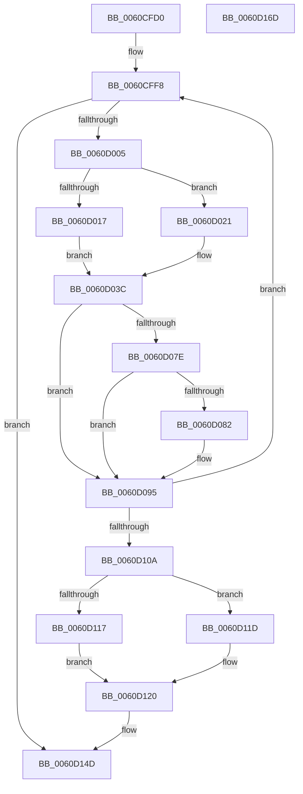

# ST_STORE&lt;SM_TRAITS&gt;::StDeviceIoIssue

- RVA: `0x0060CFD0`–`0x0060D16E` (길이 `414` bytes)
- VA: `0x000000014060CFD0`
- 실행 섹션: `.text`
- PDB 이름 있음: `예`; PDB Function 태그: `아니요`
- unwind 정보 RVA: `0x0008C20C`
- 디코드: `116`개 명령, `414/414` bytes 표시
- 미해석 바이트: `0` (있으면 어셈블리에 `.byte`로 보존)

> 이 문서는 커널 이미지의 기계어와 PDB 기호를 분석해 생성했습니다. 4번과 5번은 함수 원형과 자료형을 바이너리 사용 방식에서 추정한 C 해석이며 원본 소스 복구 결과는 아닙니다.

## 1. Dependencies

- 직접 호출 지점: **3**; 고유 호출 대상: **3**
- 직접 호출자로 확인된 함수: **2**
- RIP 상대 이미지 참조: **0**

### Outgoing calls
- `0x0060D084` → [KeQueryPerformanceCounter](../37/KeQueryPerformanceCounter_function_0037E7E0.md) (function, `0x0037E7E0`)
- `0x0060D0B1` → [StEtaIoStart](StEtaIoStart_function_0060EF3C.md) (function, `0x0060EF3C`)
- `0x0060D0FA` → [SmIssueIo](../61/SmIssueIo_function_00610F90.md) (function, `0x00610F90`)

### Direct callers
- [ST_STORE&lt;SM_TRAITS&gt;::StDmEtaPerformIo](ST_STORE_SM_TRAITS_StDmEtaPerformIo_function_0060D448.md) at `0x0060D4E4`
- [ST_STORE&lt;SM_TRAITS&gt;::StDmSinglePageRetrieveSync](ST_STORE_SM_TRAITS_StDmSinglePageRetrieveSync_function_0060E414.md) at `0x0060E4EE`

### Static image references
- 디코드된 RIP-relative 메모리 참조가 없습니다.

## 2. Other-region calls and transfers

- 다른 실행 섹션으로 향하는 call: **0**
- 별도 외부 분기/꼬리 이동을 확인하지 못했습니다.

## 3. Assembly (complete function range)

```asm
0060CFD0  48 89 5C 24 08                  mov qword ptr [rsp + 8], rbx
0060CFD5  48 89 6C 24 10                  mov qword ptr [rsp + 0x10], rbp
0060CFDA  48 89 74 24 18                  mov qword ptr [rsp + 0x18], rsi
0060CFDF  57                              push rdi
0060CFE0  41 54                           push r12
0060CFE2  41 55                           push r13
0060CFE4  41 56                           push r14
0060CFE6  41 57                           push r15
0060CFE8  48 83 EC 30                     sub rsp, 0x30
0060CFEC  48 8B DA                        mov rbx, rdx
0060CFEF  4C 8B F1                        mov r14, rcx
0060CFF2  41 B8 0E 00 00 80               mov r8d, 0x8000000e
0060CFF8  48 8B 53 08                     mov rdx, qword ptr [rbx + 8]
0060CFFC  48 3B D3                        cmp rdx, rbx
0060CFFF  0F 84 48 01 00 00               je 0x14060d14d
0060D005  48 8B 3B                        mov rdi, qword ptr [rbx]
0060D008  48 8B 07                        mov rax, qword ptr [rdi]
0060D00B  48 83 E0 F8                     and rax, 0xfffffffffffffff8
0060D00F  48 89 03                        mov qword ptr [rbx], rax
0060D012  48 3B FA                        cmp rdi, rdx
0060D015  75 0A                           jne 0x14060d021
0060D017  48 83 23 00                     and qword ptr [rbx], 0
0060D01B  48 89 5B 08                     mov qword ptr [rbx + 8], rbx
0060D01F  EB 1B                           jmp 0x14060d03c
0060D021  48 8B 0A                        mov rcx, qword ptr [rdx]
0060D024  48 8B C1                        mov rax, rcx
0060D027  83 E1 07                        and ecx, 7
0060D02A  48 C1 E8 03                     shr rax, 3
0060D02E  48 8D 04 C5 F8 FF FF FF         lea rax, [rax*8 - 8]
0060D036  48 0B C1                        or rax, rcx
0060D039  48 89 02                        mov qword ptr [rdx], rax
0060D03C  41 8B AE 28 03 00 00            mov ebp, dword ptr [r14 + 0x328]
0060D043  48 8D 77 08                     lea rsi, [rdi + 8]
0060D047  44 8B 66 10                     mov r12d, dword ptr [rsi + 0x10]
0060D04B  41 23 EC                        and ebp, r12d
0060D04E  41 8B 86 18 03 00 00            mov eax, dword ptr [r14 + 0x318]
0060D055  41 8B 8E 2C 03 00 00            mov ecx, dword ptr [r14 + 0x32c]
0060D05C  F7 D8                           neg eax
0060D05E  4C 8B 7E 08                     mov r15, qword ptr [rsi + 8]
0060D062  C1 E5 04                        shl ebp, 4
0060D065  23 E8                           and ebp, eax
0060D067  41 D3 EC                        shr r12d, cl
0060D06A  8B 46 14                        mov eax, dword ptr [rsi + 0x14]
0060D06D  44 8B E8                        mov r13d, eax
0060D070  41 C1 ED 05                     shr r13d, 5
0060D074  49 83 BE 90 08 00 00 00         cmp qword ptr [r14 + 0x890], 0
0060D07C  74 17                           je 0x14060d095
0060D07E  A8 04                           test al, 4
0060D080  75 13                           jne 0x14060d095
0060D082  33 C9                           xor ecx, ecx
0060D084  E8 57 17 D7 FF                  call 0x14037e7e0
0060D089  41 89 47 04                     mov dword ptr [r15 + 4], eax
0060D08D  48 C1 E8 20                     shr rax, 0x20
0060D091  41 89 47 08                     mov dword ptr [r15 + 8], eax
0060D095  44 8B 4E 14                     mov r9d, dword ptr [rsi + 0x14]
0060D099  45 33 C0                        xor r8d, r8d
0060D09C  49 8B 8E 58 05 00 00            mov rcx, qword ptr [r14 + 0x558]
0060D0A3  41 8B D5                        mov edx, r13d
0060D0A6  49 C1 E9 03                     shr r9, 3
0060D0AA  41 83 E1 01                     and r9d, 1
0060D0AE  4C 0B CE                        or r9, rsi
0060D0B1  E8 86 1E 00 00                  call 0x14060ef3c
0060D0B6  83 4E 14 08                     or dword ptr [rsi + 0x14], 8
0060D0BA  45 8B CD                        mov r9d, r13d
0060D0BD  45 8B 96 18 03 00 00            mov r10d, dword ptr [r14 + 0x318]
0060D0C4  44 8B C5                        mov r8d, ebp
0060D0C7  41 8B 07                        mov eax, dword ptr [r15]
0060D0CA  41 8B D4                        mov edx, r12d
0060D0CD  4D 8D 5A 0F                     lea r11, [r10 + 0xf]
0060D0D1  49 F7 DA                        neg r10
0060D0D4  48 8D 0C 40                     lea rcx, [rax + rax*2]
0060D0D8  48 8B C7                        mov rax, rdi
0060D0DB  4D 8D 1C CB                     lea r11, [r11 + rcx*8]
0060D0DF  48 83 C8 01                     or rax, 1
0060D0E3  49 8B 8E 20 03 00 00            mov rcx, qword ptr [r14 + 0x320]
0060D0EA  4D 03 DF                        add r11, r15
0060D0ED  4D 23 DA                        and r11, r10
0060D0F0  48 89 44 24 28                  mov qword ptr [rsp + 0x28], rax
0060D0F5  4C 89 5C 24 20                  mov qword ptr [rsp + 0x20], r11
0060D0FA  E8 91 3E 00 00                  call 0x140610f90
0060D0FF  44 8B C0                        mov r8d, eax
0060D102  85 C0                           test eax, eax
0060D104  0F 89 EE FE FF FF               jns 0x14060cff8
0060D10A  83 4E 14 01                     or dword ptr [rsi + 0x14], 1
0060D10E  48 8B 46 08                     mov rax, qword ptr [rsi + 8]
0060D112  48 85 C0                        test rax, rax
0060D115  74 06                           je 0x14060d11d
0060D117  44 89 40 04                     mov dword ptr [rax + 4], r8d
0060D11B  EB 03                           jmp 0x14060d120
0060D11D  44 89 06                        mov dword ptr [rsi], r8d
0060D120  48 8B 43 08                     mov rax, qword ptr [rbx + 8]
0060D124  48 8B 08                        mov rcx, qword ptr [rax]
0060D127  8B 07                           mov eax, dword ptr [rdi]
0060D129  48 83 E1 F8                     and rcx, 0xfffffffffffffff8
0060D12D  83 E0 07                        and eax, 7
0060D130  48 83 C1 08                     add rcx, 8
0060D134  48 0B C8                        or rcx, rax
0060D137  48 89 0F                        mov qword ptr [rdi], rcx
0060D13A  48 8B 4B 08                     mov rcx, qword ptr [rbx + 8]
0060D13E  8B 01                           mov eax, dword ptr [rcx]
0060D140  83 E0 07                        and eax, 7
0060D143  48 0B C7                        or rax, rdi
0060D146  48 89 01                        mov qword ptr [rcx], rax
0060D149  48 89 7B 08                     mov qword ptr [rbx + 8], rdi
0060D14D  48 8B 5C 24 60                  mov rbx, qword ptr [rsp + 0x60]
0060D152  41 8B C0                        mov eax, r8d
0060D155  48 8B 6C 24 68                  mov rbp, qword ptr [rsp + 0x68]
0060D15A  48 8B 74 24 70                  mov rsi, qword ptr [rsp + 0x70]
0060D15F  48 83 C4 30                     add rsp, 0x30
0060D163  41 5F                           pop r15
0060D165  41 5E                           pop r14
0060D167  41 5D                           pop r13
0060D169  41 5C                           pop r12
0060D16B  5F                              pop rdi
0060D16C  C3                              ret
0060D16D  CC                              int3
```

## 4. C-style interpretation (structured pseudocode)

```c
__int64 __fastcall ST_STORE_SM_TRAITS___StDeviceIoIssue(__int64 a1, __int64 a2)
{
    __int64 result;
    __int64 v_r10;
    __int64 v_r11;
    __int64 v_r12;
    __int64 v_r13;
    __int64 v_rbp;
    __int64 v_rsp;
    unsigned __int64 v_stack_m30;
    unsigned __int64 v_stack_m38;
    unsigned __int64 v_stack_p10;
    unsigned __int64 v_stack_p18;
    unsigned __int64 v_stack_p8;

    v_stack_p8 = v_rbx;
    v_stack_p10 = v_rbp;
    v_stack_p18 = v_rsi;
    v_rsp = (v_rsp) - (48);
loc_0060CFF8:
    if ((*(unsigned __int64 *)(a2 + 8)) == a2) goto loc_0060D14D;
    result = (*(unsigned __int64 *)(*(unsigned __int64 *)(a2))) & (-8);
    *(unsigned __int64 *)(a2) = result;
    if ((*(unsigned __int64 *)(a2)) != (*(unsigned __int64 *)(a2 + 8))) goto loc_0060D021;
    *(unsigned __int64 *)(a2 + 8) = a2;
    goto loc_0060D03C;
loc_0060D021:
    a1 = (unsigned int)((*(unsigned __int64 *)(*(unsigned __int64 *)(a2 + 8))) & (7));
    result = (*(unsigned __int64 *)(*(unsigned __int64 *)(a2 + 8))) >> (3);
    result = (result * 8 - 8) | (a1);
    *(unsigned __int64 *)(*(unsigned __int64 *)(a2 + 8)) = result;
loc_0060D03C:
    v_rbp = (unsigned int)(((unsigned int)(*(unsigned int *)(a1 + 808))) & ((unsigned int)((unsigned int)(*(unsigned int *)(*(unsigned __int64 *)(a2) + 8 + 16)))));
    result = (unsigned int)(-((unsigned int)(*(unsigned int *)(a1 + 792))));
    v_rbp = (unsigned int)((v_rbp) << (4));
    v_rbp = (unsigned int)((v_rbp) & ((unsigned int)(result)));
    v_r12 = (unsigned int)(((unsigned int)(*(unsigned int *)(*(unsigned __int64 *)(a2) + 8 + 16))) >> ((unsigned __int8)((unsigned int)(*(unsigned int *)(a1 + 812)))));
    v_r13 = (unsigned int)(((unsigned int)((unsigned int)((unsigned int)(*(unsigned int *)(*(unsigned __int64 *)(a2) + 8 + 20))))) >> (5));
    if ((*(unsigned __int64 *)(a1 + 2192)) == 0) goto loc_0060D095;
    result = (unsigned int)(*(unsigned int *)(*(unsigned __int64 *)(a2) + 8 + 20));
    if ((((unsigned __int8)((unsigned int)(*(unsigned int *)(*(unsigned __int64 *)(a2) + 8 + 20)))) & (4)) == 0) {
        a1 = 0;
        result = KeQueryPerformanceCounter(a1, *(unsigned __int64 *)(a2 + 8), (unsigned int)(0x8000000EULL), a4);
        *(unsigned int *)(*(unsigned __int64 *)(*(unsigned __int64 *)(a2) + 8 + 8) + 4) = (unsigned int)(result);
        result = (result) >> (32);
        *(unsigned int *)(*(unsigned __int64 *)(*(unsigned __int64 *)(a2) + 8 + 8) + 8) = (unsigned int)(result);
    }
    a3 = 0;
    a4 = ((unsigned int)(*(unsigned int *)(*(unsigned __int64 *)(a2) + 8 + 20))) >> (3);
    a4 = (unsigned int)((a4) & (1));
    a4 = (a4) | (*(unsigned __int64 *)(a2) + 8);
    result = StEtaIoStart(*(unsigned __int64 *)(a1 + 1368), (unsigned int)((unsigned int)(v_r13)), a3, a4);
    v_r10 = -((unsigned int)(*(unsigned int *)(a1 + 792)));
    result = (*(unsigned __int64 *)(a2)) | (1);
    v_r11 = ((unsigned int)(*(unsigned int *)(a1 + 792)) + 15 + (unsigned int)(*(unsigned int *)(*(unsigned __int64 *)(*(unsigned __int64 *)(a2) + 8 + 8))) + (unsigned int)(*(unsigned int *)(*(unsigned __int64 *)(*(unsigned __int64 *)(a2) + 8 + 8))) * 2 * 8) + (*(unsigned __int64 *)(*(unsigned __int64 *)(a2) + 8 + 8));
    v_r11 = (v_r11) & (v_r10);
    v_stack_m30 = result;
    v_stack_m38 = v_r11;
    result = SmIssueIo(*(unsigned __int64 *)(a1 + 800), (unsigned int)((unsigned int)(v_r12)), (unsigned int)((unsigned int)(v_rbp)), (unsigned int)((unsigned int)(v_r13)));
    if (!sign_flag) goto loc_0060CFF8;
    if (*(unsigned __int64 *)(*(unsigned __int64 *)(a2) + 8 + 8) == 0) goto loc_0060D11D;
    *(unsigned int *)(*(unsigned __int64 *)(*(unsigned __int64 *)(a2) + 8 + 8) + 4) = (unsigned int)((unsigned int)((unsigned int)(result)));
    goto loc_0060D120;
loc_0060D11D:
    *(unsigned int *)(*(unsigned __int64 *)(a2) + 8) = (unsigned int)((unsigned int)((unsigned int)(result)));
loc_0060D120:
    a1 = (*(unsigned __int64 *)(*(unsigned __int64 *)(a2 + 8))) & (-8);
    result = (unsigned int)(((unsigned int)(*(unsigned int *)(*(unsigned __int64 *)(a2)))) & (7));
    a1 = (a1) + (8);
    a1 = (a1) | (result);
    *(unsigned __int64 *)(*(unsigned __int64 *)(a2)) = a1;
    result = (unsigned int)(((unsigned int)(*(unsigned int *)(*(unsigned __int64 *)(a2 + 8)))) & (7));
    result = (result) | (*(unsigned __int64 *)(a2));
    *(unsigned __int64 *)(*(unsigned __int64 *)(a2 + 8)) = result;
    *(unsigned __int64 *)(a2 + 8) = *(unsigned __int64 *)(a2);
loc_0060D14D:
    v_rsp = (v_rsp) + (48);
    return (unsigned int)((unsigned int)((unsigned int)((unsigned int)(result))));
}
```

## 5. (Beta) C Style

```c
int64_t ST_STORE_SM_TRAITS___StDeviceIoIssue(void *Arg1, void *Arg2)
{
    uint8_t *arg1 = (uint8_t *)Arg1;
    uint8_t *arg2 = (uint8_t *)Arg2;

    int64_t result;
    int64_t local_r10;
    int64_t local_r11;
    int64_t local_r12;
    int64_t local_r13;
    int64_t local_rbp;
    int64_t local_rsp;
    uint64_t v_stack_m30;
    uint64_t v_stack_m38;
    uint64_t v_stack_p10;
    uint64_t v_stack_p18;
    uint64_t v_stack_p8;

    v_stack_p8 = local_rbx;
    v_stack_p10 = local_rbp;
    v_stack_p18 = local_rsi;
    local_rsp = (local_rsp) - (48);
loc_0060CFF8:
    if ((*(uint64_t *)(arg2 + 0x8)) == Arg2) goto loc_0060D14D;
    result = (*(uint64_t *)(*(uint64_t *)(arg2))) & (-8);
    *(uint64_t *)(arg2) = result;
    if ((*(uint64_t *)(arg2)) != (*(uint64_t *)(arg2 + 0x8))) goto loc_0060D021;
    *(void **)(arg2 + 0x8) = Arg2;
    goto loc_0060D03C;
loc_0060D021:
    Arg1 = (uint32_t)((*(uint64_t *)(*(uint64_t *)(arg2 + 0x8))) & (7));
    result = (*(uint64_t *)(*(uint64_t *)(arg2 + 0x8))) >> (3);
    result = (result * 8 - 8) | (Arg1);
    *(uint64_t *)(*(uint64_t *)(arg2 + 0x8)) = result;
loc_0060D03C:
    local_rbp = (uint32_t)(((uint32_t)(*(uint32_t *)(arg1 + 0x328))) & ((uint32_t)((uint32_t)(*(uint32_t *)(*(uint64_t *)(arg2) + 0x8 + 0x10)))));
    result = (uint32_t)(-((uint32_t)(*(uint32_t *)(arg1 + 0x318))));
    local_rbp = (uint32_t)((local_rbp) << (4));
    local_rbp = (uint32_t)((local_rbp) & ((uint32_t)(result)));
    local_r12 = (uint32_t)(((uint32_t)(*(uint32_t *)(*(uint64_t *)(arg2) + 0x8 + 0x10))) >> ((uint8_t)((uint32_t)(*(uint32_t *)(arg1 + 0x32C)))));
    local_r13 = (uint32_t)(((uint32_t)((uint32_t)((uint32_t)(*(uint32_t *)(*(uint64_t *)(arg2) + 0x8 + 0x14))))) >> (5));
    if ((*(uint64_t *)(arg1 + 0x890)) == 0) goto loc_0060D095;
    result = (uint32_t)(*(uint32_t *)(*(uint64_t *)(arg2) + 0x8 + 0x14));
    if ((((uint8_t)((uint32_t)(*(uint32_t *)(*(uint64_t *)(arg2) + 0x8 + 0x14)))) & (4)) == 0) {
        Arg1 = 0;
        result = KeQueryPerformanceCounter(Arg1, *(uint64_t *)(arg2 + 0x8), (uint32_t)(0x8000000EULL), a4);
        *(uint32_t *)(*(uint64_t *)(*(uint64_t *)(arg2) + 0x8 + 0x8) + 0x4) = (uint32_t)(result);
        result = (result) >> (32);
        *(uint32_t *)(*(uint64_t *)(*(uint64_t *)(arg2) + 0x8 + 0x8) + 0x8) = (uint32_t)(result);
    }
    a3 = 0;
    a4 = ((uint32_t)(*(uint32_t *)(*(uint64_t *)(arg2) + 0x8 + 0x14))) >> (3);
    a4 = (uint32_t)((a4) & (1));
    a4 = (a4) | (*(uint64_t *)(arg2) + 8);
    result = StEtaIoStart(*(uint64_t *)(arg1 + 0x558), (uint32_t)((uint32_t)(local_r13)), a3, a4);
    local_r10 = -((uint32_t)(*(uint32_t *)(arg1 + 0x318)));
    result = (*(uint64_t *)(arg2)) | (1);
    local_r11 = ((uint32_t)(*(uint32_t *)(arg1 + 0x318)) + 15 + (uint32_t)(*(uint32_t *)(*(uint64_t *)(*(uint64_t *)(arg2) + 0x8 + 0x8))) + (uint32_t)(*(uint32_t *)(*(uint64_t *)(*(uint64_t *)(arg2) + 0x8 + 0x8))) * 2 * 8) + (*(uint64_t *)(*(uint64_t *)(arg2) + 0x8 + 0x8));
    local_r11 = (local_r11) & (local_r10);
    v_stack_m30 = result;
    v_stack_m38 = local_r11;
    result = SmIssueIo(*(uint64_t *)(arg1 + 0x320), (uint32_t)((uint32_t)(local_r12)), (uint32_t)((uint32_t)(local_rbp)), (uint32_t)((uint32_t)(local_r13)));
    if (!sign_flag) goto loc_0060CFF8;
    if (*(uint64_t *)(*(uint64_t *)(arg2) + 0x8 + 0x8) == 0) goto loc_0060D11D;
    *(uint32_t *)(*(uint64_t *)(*(uint64_t *)(arg2) + 0x8 + 0x8) + 0x4) = (uint32_t)((uint32_t)((uint32_t)(result)));
    goto loc_0060D120;
loc_0060D11D:
    *(uint32_t *)(*(uint64_t *)(arg2) + 0x8) = (uint32_t)((uint32_t)((uint32_t)(result)));
loc_0060D120:
    Arg1 = (*(uint64_t *)(*(uint64_t *)(arg2 + 0x8))) & (-8);
    result = (uint32_t)(((uint32_t)(*(uint32_t *)(*(uint64_t *)(arg2)))) & (7));
    Arg1 = (Arg1) + (8);
    Arg1 = (Arg1) | (result);
    *(void **)(*(uint64_t *)(arg2)) = Arg1;
    result = (uint32_t)(((uint32_t)(*(uint32_t *)(*(uint64_t *)(arg2 + 0x8)))) & (7));
    result = (result) | (*(uint64_t *)(arg2));
    *(uint64_t *)(*(uint64_t *)(arg2 + 0x8)) = result;
    *(uint64_t *)(arg2 + 0x8) = *(uint64_t *)(arg2);
loc_0060D14D:
    local_rsp = (local_rsp) + (48);
    return (uint32_t)((uint32_t)((uint32_t)((uint32_t)(result))));
}
```

### 관측된 메모리 오프셋

구조체 형식이 확인되지 않은 접근은 인자 기준의 오프셋으로만 기록했습니다.

| 기준 인자 | 오프셋 표현 | 폭 (bit) | 접근 |
|---|---:|---:|---|
| `Arg1` | `+ 0x318` | `32` | `R` |
| `Arg1` | `+ 0x320` | `64` | `R` |
| `Arg1` | `+ 0x328` | `32` | `R` |
| `Arg1` | `+ 0x32C` | `32` | `R` |
| `Arg1` | `+ 0x558` | `64` | `R` |
| `Arg1` | `+ 0x890` | `64` | `R` |
| `Arg2` | `+ 0x0` | `64` | `R` |
| `Arg2` | `+ 0x0` | `64` | `R/W` |
| `Arg2` | `+ 0x0` | `64` | `W` |
| `Arg2` | `+ 0x8` | `64` | `R` |
| `Arg2` | `+ 0x8` | `64` | `W` |

## 6. Execution-region graph

[열기: 2D/3D 그래프와 함수 탐색 컨트롤 패널](../../../control-panel.html?section=text&rva=0x0060CFD0&view=graph)

- 2D 그래프는 위에서 아래로 흐르고, 3D 그래프는 빈 공간을 드래그해 회전합니다. Shift+드래그는 이동, 휠은 확대·축소, 함수 노드 선택은 대상 보고서 이동입니다.

### Static fallback


