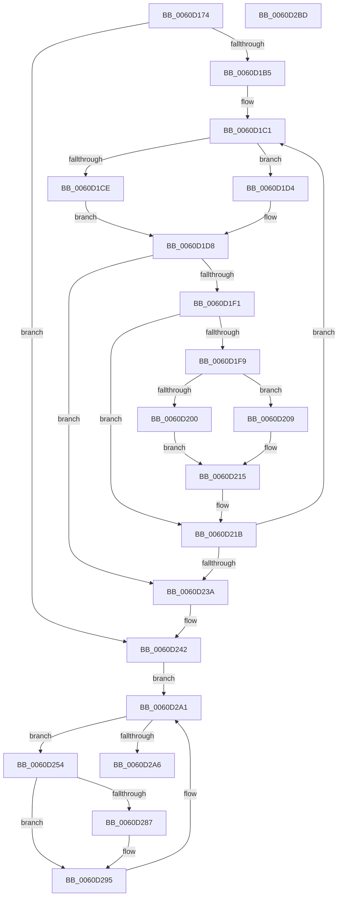

# ST_STORE&lt;SM_TRAITS&gt;::StDmCompletePendingReads

- RVA: `0x0060D174`–`0x0060D2BE` (길이 `330` bytes)
- VA: `0x000000014060D174`
- 실행 섹션: `.text`
- PDB 이름 있음: `예`; PDB Function 태그: `아니요`
- unwind 정보 RVA: `0x00097FE8`
- 디코드: `95`개 명령, `330/330` bytes 표시
- 미해석 바이트: `0` (있으면 어셈블리에 `.byte`로 보존)

> 이 문서는 커널 이미지의 기계어와 PDB 기호를 분석해 생성했습니다. 4번과 5번은 함수 원형과 자료형을 바이너리 사용 방식에서 추정한 C 해석이며 원본 소스 복구 결과는 아닙니다.

## 1. Dependencies

- 직접 호출 지점: **2**; 고유 호출 대상: **2**
- 직접 호출자로 확인된 함수: **1**
- RIP 상대 이미지 참조: **0**

### Outgoing calls
- `0x0060D1E5` → [SmStoreCompletePendingDecompress](../4D/SmStoreCompletePendingDecompress_function_004D7824.md) (function, `0x004D7824`)
- `0x0060D27E` → [ST_STORE<SM_TRAITS>::StDmFinishPageRetrieve](../34/ST_STORE_SM_TRAITS_StDmFinishPageRetrieve_function_0034CB10.md) (function, `0x0034CB10`)

### Direct callers
- [sub_006EDA08](../6E/Unknown_function_006EDA08.md) at `0x006EDA48`

### Static image references
- 디코드된 RIP-relative 메모리 참조가 없습니다.

## 2. Other-region calls and transfers

- 다른 실행 섹션으로 향하는 call: **0**
- 별도 외부 분기/꼬리 이동을 확인하지 못했습니다.

## 3. Assembly (complete function range)

```asm
0060D174  48 89 5C 24 08                  mov qword ptr [rsp + 8], rbx
0060D179  4C 89 4C 24 20                  mov qword ptr [rsp + 0x20], r9
0060D17E  55                              push rbp
0060D17F  56                              push rsi
0060D180  57                              push rdi
0060D181  41 54                           push r12
0060D183  41 55                           push r13
0060D185  41 56                           push r14
0060D187  41 57                           push r15
0060D189  48 83 EC 30                     sub rsp, 0x30
0060D18D  4C 8B B4 24 98 00 00 00         mov r14, qword ptr [rsp + 0x98]
0060D195  49 8D 78 18                     lea rdi, [r8 + 0x18]
0060D199  33 F6                           xor esi, esi
0060D19B  49 8B E8                        mov rbp, r8
0060D19E  48 21 74 24 78                  and qword ptr [rsp + 0x78], rsi
0060D1A3  4C 8B E2                        mov r12, rdx
0060D1A6  4C 8B E9                        mov r13, rcx
0060D1A9  41 21 36                        and dword ptr [r14], esi
0060D1AC  48 3B FA                        cmp rdi, rdx
0060D1AF  0F 87 8D 00 00 00               ja 0x14060d242
0060D1B5  44 8B BC 24 90 00 00 00         mov r15d, dword ptr [rsp + 0x90]
0060D1BD  48 8D 5F 08                     lea rbx, [rdi + 8]
0060D1C1  41 F7 85 08 03 00 00 00 00 20 00  test dword ptr [r13 + 0x308], 0x200000
0060D1CC  74 06                           je 0x14060d1d4
0060D1CE  41 83 C9 FF                     or r9d, 0xffffffff
0060D1D2  EB 04                           jmp 0x14060d1d8
0060D1D4  44 8B 4B 08                     mov r9d, dword ptr [rbx + 8]
0060D1D8  48 8B 13                        mov rdx, qword ptr [rbx]
0060D1DB  4C 8B C6                        mov r8, rsi
0060D1DE  49 8B 8D 20 03 00 00            mov rcx, qword ptr [r13 + 0x320]
0060D1E5  E8 3A A6 EC FF                  call 0x1404d7824
0060D1EA  3D 02 01 00 00                  cmp eax, 0x102
0060D1EF  74 49                           je 0x14060d23a
0060D1F1  48 83 23 00                     and qword ptr [rbx], 0
0060D1F5  85 C0                           test eax, eax
0060D1F7  79 22                           jns 0x14060d21b
0060D1F9  3D 40 02 00 C0                  cmp eax, 0xc0000240
0060D1FE  75 09                           jne 0x14060d209
0060D200  48 C7 03 02 00 00 00            mov qword ptr [rbx], 2
0060D207  EB 0C                           jmp 0x14060d215
0060D209  8B 43 0C                        mov eax, dword ptr [rbx + 0xc]
0060D20C  83 E0 F7                        and eax, 0xfffffff7
0060D20F  83 C8 04                        or eax, 4
0060D212  89 43 0C                        mov dword ptr [rbx + 0xc], eax
0060D215  33 F6                           xor esi, esi
0060D217  44 8D 7E 01                     lea r15d, [rsi + 1]
0060D21B  41 FF 06                        inc dword ptr [r14]
0060D21E  48 8D 44 24 78                  lea rax, [rsp + 0x78]
0060D223  45 85 FF                        test r15d, r15d
0060D226  48 0F 45 C6                     cmovne rax, rsi
0060D22A  48 83 C3 18                     add rbx, 0x18
0060D22E  48 8B F0                        mov rsi, rax
0060D231  48 8D 43 F8                     lea rax, [rbx - 8]
0060D235  49 3B C4                        cmp rax, r12
0060D238  76 87                           jbe 0x14060d1c1
0060D23A  4C 8B 8C 24 88 00 00 00         mov r9, qword ptr [rsp + 0x88]
0060D242  41 8B 1E                        mov ebx, dword ptr [r14]
0060D245  33 F6                           xor esi, esi
0060D247  48 FF CB                        dec rbx
0060D24A  48 8D 1C 5B                     lea rbx, [rbx + rbx*2]
0060D24E  48 8D 1C DF                     lea rbx, [rdi + rbx*8]
0060D252  EB 4D                           jmp 0x14060d2a1
0060D254  48 8B 8D A0 01 00 00            mov rcx, qword ptr [rbp + 0x1a0]
0060D25B  4C 8B C5                        mov r8, rbp
0060D25E  41 8B 41 18                     mov eax, dword ptr [r9 + 0x18]
0060D262  48 8B D3                        mov rdx, rbx
0060D265  83 64 24 20 00                  and dword ptr [rsp + 0x20], 0
0060D26A  89 41 10                        mov dword ptr [rcx + 0x10], eax
0060D26D  48 8B 8D A0 01 00 00            mov rcx, qword ptr [rbp + 0x1a0]
0060D274  0F B7 43 06                     movzx eax, word ptr [rbx + 6]
0060D278  01 41 10                        add dword ptr [rcx + 0x10], eax
0060D27B  49 8B CD                        mov rcx, r13
0060D27E  E8 8D F8 D3 FF                  call 0x14034cb10
0060D283  85 C0                           test eax, eax
0060D285  79 0E                           jns 0x14060d295
0060D287  48 8B 95 A0 01 00 00            mov rdx, qword ptr [rbp + 0x1a0]
0060D28E  8B F0                           mov esi, eax
0060D290  8A 4B 06                        mov cl, byte ptr [rbx + 6]
0060D293  88 0A                           mov byte ptr [rdx], cl
0060D295  4C 8B 8C 24 88 00 00 00         mov r9, qword ptr [rsp + 0x88]
0060D29D  48 83 EB 18                     sub rbx, 0x18
0060D2A1  48 3B DF                        cmp rbx, rdi
0060D2A4  73 AE                           jae 0x14060d254
0060D2A6  48 8B 5C 24 70                  mov rbx, qword ptr [rsp + 0x70]
0060D2AB  8B C6                           mov eax, esi
0060D2AD  48 83 C4 30                     add rsp, 0x30
0060D2B1  41 5F                           pop r15
0060D2B3  41 5E                           pop r14
0060D2B5  41 5D                           pop r13
0060D2B7  41 5C                           pop r12
0060D2B9  5F                              pop rdi
0060D2BA  5E                              pop rsi
0060D2BB  5D                              pop rbp
0060D2BC  C3                              ret
0060D2BD  CC                              int3
```

## 4. C-style interpretation (structured pseudocode)

```c
__int64 __fastcall ST_STORE_SM_TRAITS___StDmCompletePendingReads(__int64 a1, __int64 a2, __int64 a3, __int64 a4, unsigned int a5, __int64 a6)
{
    __int64 result;
    __int64 v_rbx;
    __int64 v_rsi;
    __int64 v_rsp;
    unsigned int v_stack_m48;
    unsigned __int64 v_stack_p10;
    unsigned __int64 v_stack_p20;
    unsigned __int64 v_stack_p8;

    v_stack_p8 = v_rbx;
    v_stack_p20 = a4;
    v_rsp = (v_rsp) - (48);
    v_rsi = 0;
    if ((a3 + 24) > a2) goto loc_0060D242;
loc_0060D1C1:
    if (((*(unsigned int *)(a1 + 776)) & (0x200000ULL)) == 0) goto loc_0060D1D4;
    a4 = (unsigned int)((a4) | (0xFFFFFFFFULL));
    goto loc_0060D1D8;
loc_0060D1D4:
loc_0060D1D8:
    result = SmStoreCompletePendingDecompress(*(unsigned __int64 *)(a1 + 800), *(unsigned __int64 *)(a3 + 24 + 8), 0, (unsigned int)(*(unsigned int *)(a3 + 24 + 8 + 8)));
    if (((unsigned int)(result)) == 258) goto loc_0060D23A;
    if (!sign_flag) goto loc_0060D21B;
    if (((unsigned int)(result)) != 0xC0000240ULL) goto loc_0060D209;
    *(unsigned __int64 *)(a3 + 24 + 8) = 2;
    goto loc_0060D215;
loc_0060D209:
    result = (unsigned int)(((unsigned int)(*(unsigned int *)(a3 + 24 + 8 + 12))) & (0xFFFFFFF7ULL));
    result = (unsigned int)((result) | (4));
    *(unsigned int *)(a3 + 24 + 8 + 12) = (unsigned int)(result);
loc_0060D215:
    v_rsi = 0;
loc_0060D21B:
    result = v_stack_p10;
    if ((unsigned int)(v_rsi + 1) != 0) { result = 0; }
    v_rbx = (a3 + 24 + 8) + (24);
    if ((v_rbx - 8) <= a2) goto loc_0060D1C1;
loc_0060D23A:
loc_0060D242:
    v_rsi = 0;
    v_rbx = ((unsigned int)(*(unsigned int *)(a6))) - 1;
    goto loc_0060D2A1;
loc_0060D254:
    *(unsigned int *)(*(unsigned __int64 *)(a3 + 416) + 16) = (unsigned int)((unsigned int)(*(unsigned int *)(v_stack_p20 + 24)));
    result = ST_STORE_SM_TRAITS___StDmFinishPageRetrieve(a1, a3 + 24 + v_rbx + v_rbx * 2 * 8, a3, v_stack_p20);
    if (sign_flag) {
        a2 = *(unsigned __int64 *)(a3 + 416);
        v_rsi = (unsigned int)(result);
        a1 = *(unsigned __int8 *)(a3 + 24 + v_rbx + v_rbx * 2 * 8 + 6);
        *(unsigned __int8 *)(a2) = (unsigned __int8)(a1);
    }
    v_rbx = (a3 + 24 + v_rbx + v_rbx * 2 * 8) - (24);
loc_0060D2A1:
    if (v_rbx >= (a3 + 24)) goto loc_0060D254;
    v_rsp = (v_rsp) + (48);
    return (unsigned int)((unsigned int)(v_rsi));
}
```

## 5. (Beta) C Style

```c
int64_t ST_STORE_SM_TRAITS___StDmCompletePendingReads(void *Arg1, int64_t Arg2, void *Arg3, int64_t Arg4, uint32_t Arg5, void *Arg6)
{
    uint8_t *arg1 = (uint8_t *)Arg1;
    uint8_t *arg3 = (uint8_t *)Arg3;
    uint8_t *arg6 = (uint8_t *)Arg6;

    int64_t result;
    int64_t local_rbx;
    int64_t local_rsi;
    int64_t local_rsp;
    uint32_t v_stack_m48;
    uint64_t v_stack_p10;
    uint64_t v_stack_p20;
    uint64_t v_stack_p8;

    v_stack_p8 = local_rbx;
    v_stack_p20 = Arg4;
    local_rsp = (local_rsp) - (48);
    local_rsi = 0;
    if ((Arg3 + 24) > Arg2) goto loc_0060D242;
loc_0060D1C1:
    if (((*(uint32_t *)(arg1 + 0x308)) & (0x200000ULL)) == 0) goto loc_0060D1D4;
    Arg4 = (uint32_t)((Arg4) | (0xFFFFFFFFULL));
    goto loc_0060D1D8;
loc_0060D1D4:
loc_0060D1D8:
    result = SmStoreCompletePendingDecompress(*(uint64_t *)(arg1 + 0x320), *(uint64_t *)(arg3 + 0x18 + 0x8), 0, (uint32_t)(*(uint32_t *)(arg3 + 0x18 + 0x8 + 0x8)));
    if (((uint32_t)(result)) == 258) goto loc_0060D23A;
    if (!sign_flag) goto loc_0060D21B;
    if (((uint32_t)(result)) != 0xC0000240ULL) goto loc_0060D209;
    *(uint64_t *)(arg3 + 0x18 + 0x8) = 2;
    goto loc_0060D215;
loc_0060D209:
    result = (uint32_t)(((uint32_t)(*(uint32_t *)(arg3 + 0x18 + 0x8 + 0xC))) & (0xFFFFFFF7ULL));
    result = (uint32_t)((result) | (4));
    *(uint32_t *)(arg3 + 0x18 + 0x8 + 0xC) = (uint32_t)(result);
loc_0060D215:
    local_rsi = 0;
loc_0060D21B:
    result = v_stack_p10;
    if ((uint32_t)(local_rsi + 1) != 0) { result = 0; }
    local_rbx = (Arg3 + 24 + 8) + (24);
    if ((local_rbx - 8) <= Arg2) goto loc_0060D1C1;
loc_0060D23A:
loc_0060D242:
    local_rsi = 0;
    local_rbx = ((uint32_t)(*(uint32_t *)(arg6))) - 1;
    goto loc_0060D2A1;
loc_0060D254:
    *(uint32_t *)(*(uint64_t *)(arg3 + 0x1A0) + 0x10) = (uint32_t)((uint32_t)(*(uint32_t *)(v_stack_p20 + 0x18)));
    result = ST_STORE_SM_TRAITS___StDmFinishPageRetrieve(Arg1, Arg3 + 24 + local_rbx + local_rbx * 2 * 8, Arg3, v_stack_p20);
    if (sign_flag) {
        Arg2 = *(uint64_t *)(arg3 + 0x1A0);
        local_rsi = (uint32_t)(result);
        Arg1 = *(uint8_t *)(arg3 + 0x18 + local_rbx + local_rbx * 2 * 8 + 0x6);
        *(uint8_t *)(Arg2) = (uint8_t)(Arg1);
    }
    local_rbx = (Arg3 + 24 + local_rbx + local_rbx * 2 * 8) - (24);
loc_0060D2A1:
    if (local_rbx >= (Arg3 + 24)) goto loc_0060D254;
    local_rsp = (local_rsp) + (48);
    return (uint32_t)((uint32_t)(local_rsi));
}
```

### 관측된 메모리 오프셋

구조체 형식이 확인되지 않은 접근은 인자 기준의 오프셋으로만 기록했습니다.

| 기준 인자 | 오프셋 표현 | 폭 (bit) | 접근 |
|---|---:|---:|---|
| `Arg1` | `+ 0x308` | `32` | `R` |
| `Arg1` | `+ 0x320` | `64` | `R` |
| `Arg3` | `+ 0x18` | `64` | `R` |
| `Arg3` | `+ 0x1A0` | `64` | `R` |
| `Arg6` | `+ 0x0` | `32` | `R` |
| `Arg6` | `+ 0x0` | `32` | `R/W` |

## 6. Execution-region graph

[열기: 2D/3D 그래프와 함수 탐색 컨트롤 패널](../../../control-panel.html?section=text&rva=0x0060D174&view=graph)

- 2D 그래프는 위에서 아래로 흐르고, 3D 그래프는 빈 공간을 드래그해 회전합니다. Shift+드래그는 이동, 휠은 확대·축소, 함수 노드 선택은 대상 보고서 이동입니다.

### Static fallback


