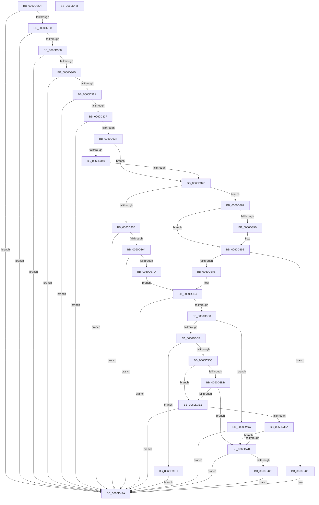

# ST_STORE&lt;SM_TRAITS&gt;::StDmDeviceError

- RVA: `0x0060D2C4`–`0x0060D440` (길이 `380` bytes)
- VA: `0x000000014060D2C4`
- 실행 섹션: `.text`
- PDB 이름 있음: `예`; PDB Function 태그: `아니요`
- unwind 정보 RVA: `0x0006C8E8`
- 디코드: `101`개 명령, `380/380` bytes 표시
- 미해석 바이트: `0` (있으면 어셈블리에 `.byte`로 보존)

> 이 문서는 커널 이미지의 기계어와 PDB 기호를 분석해 생성했습니다. 4번과 5번은 함수 원형과 자료형을 바이너리 사용 방식에서 추정한 C 해석이며 원본 소스 복구 결과는 아닙니다.

## 1. Dependencies

- 직접 호출 지점: **4**; 고유 호출 대상: **4**
- 직접 호출자로 확인된 함수: **1**
- RIP 상대 이미지 참조: **0**

### Outgoing calls
- `0x0060D384` → [KiQueryUnbiasedInterruptTime](../42/KiQueryUnbiasedInterruptTime_function_0042D180.md) (function, `0x0042D180`)
- `0x0060D3F1` → [SMKM_STORE_MGR<SM_TRAITS>::SmStoreTerminate](../61/SMKM_STORE_MGR_SM_TRAITS_SmStoreTerminate_function_00610BD4.md) (function, `0x00610BD4`)
- `0x0060D405` → [SmKmStoreDereference](../20/SmKmStoreDereference_function_00206574.md) (function, `0x00206574`)
- `0x0060D415` → [SmKmStoreReference](../34/SmKmStoreReference_function_0034BFB0.md) (function, `0x0034BFB0`)

### Direct callers
- [ST_STORE&lt;SM_TRAITS&gt;::StDmDeviceIoCompletion](../4B/ST_STORE_SM_TRAITS_StDmDeviceIoCompletion_function_004BBB70.md) at `0x004BBC12`
- [ST_STORE&lt;SM_TRAITS&gt;::StDmDeviceIoCompletion](../4B/ST_STORE_SM_TRAITS_StDmDeviceIoCompletion_function_004BBB70.md) at `0x004BBD80`

### Static image references
- 디코드된 RIP-relative 메모리 참조가 없습니다.

## 2. Other-region calls and transfers

- 다른 실행 섹션으로 향하는 call: **0**
- 별도 외부 분기/꼬리 이동을 확인하지 못했습니다.

## 3. Assembly (complete function range)

```asm
0060D2C4  48 89 5C 24 10                  mov qword ptr [rsp + 0x10], rbx
0060D2C9  48 89 6C 24 18                  mov qword ptr [rsp + 0x18], rbp
0060D2CE  48 89 74 24 20                  mov qword ptr [rsp + 0x20], rsi
0060D2D3  57                              push rdi
0060D2D4  48 83 EC 20                     sub rsp, 0x20
0060D2D8  48 8B 99 90 08 00 00            mov rbx, qword ptr [rcx + 0x890]
0060D2DF  45 8B D8                        mov r11d, r8d
0060D2E2  8B F2                           mov esi, edx
0060D2E4  48 8B F9                        mov rdi, rcx
0060D2E7  48 85 DB                        test rbx, rbx
0060D2EA  0F 84 3A 01 00 00               je 0x14060d42a
0060D2F0  41 8D 80 ED FE FF 3F            lea eax, [r8 + 0x3ffffeed]
0060D2F7  83 F8 01                        cmp eax, 1
0060D2FA  0F 86 2A 01 00 00               jbe 0x14060d42a
0060D300  41 81 F8 9A 00 00 C0            cmp r8d, 0xc000009a
0060D307  0F 84 1D 01 00 00               je 0x14060d42a
0060D30D  41 81 F8 85 00 00 C0            cmp r8d, 0xc0000085
0060D314  0F 84 10 01 00 00               je 0x14060d42a
0060D31A  41 81 F8 17 00 00 C0            cmp r8d, 0xc0000017
0060D321  0F 84 03 01 00 00               je 0x14060d42a
0060D327  41 81 F8 FE 02 00 C0            cmp r8d, 0xc00002fe
0060D32E  0F 84 F6 00 00 00               je 0x14060d42a
0060D334  F7 81 08 03 00 00 00 20 00 00   test dword ptr [rcx + 0x308], 0x2000
0060D33E  74 0D                           je 0x14060d34d
0060D340  41 81 F8 16 00 00 80            cmp r8d, 0x80000016
0060D347  0F 84 DD 00 00 00               je 0x14060d42a
0060D34D  BD 07 00 00 00                  mov ebp, 7
0060D352  85 F6                           test esi, esi
0060D354  75 2C                           jne 0x14060d382
0060D356  FF 43 04                        inc dword ptr [rbx + 4]
0060D359  8B 43 04                        mov eax, dword ptr [rbx + 4]
0060D35C  A8 0F                           test al, 0xf
0060D35E  0F 85 C6 00 00 00               jne 0x14060d42a
0060D364  8B 03                           mov eax, dword ptr [rbx]
0060D366  8B C8                           mov ecx, eax
0060D368  2B 4B 08                        sub ecx, dword ptr [rbx + 8]
0060D36B  83 E1 E0                        and ecx, 0xffffffe0
0060D36E  89 43 08                        mov dword ptr [rbx + 8], eax
0060D371  81 F9 00 02 00 00               cmp ecx, 0x200
0060D377  0F 87 AD 00 00 00               ja 0x14060d42a
0060D37D  8D 4D FC                        lea ecx, [rbp - 4]
0060D380  EB 32                           jmp 0x14060d3b4
0060D382  B1 01                           mov cl, 1
0060D384  E8 F7 FD E1 FF                  call 0x14042d180
0060D389  8B 13                           mov edx, dword ptr [rbx]
0060D38B  48 8D 4B 0C                     lea rcx, [rbx + 0xc]
0060D38F  48 C1 E8 17                     shr rax, 0x17
0060D393  3B 53 10                        cmp edx, dword ptr [rbx + 0x10]
0060D396  89 53 10                        mov dword ptr [rbx + 0x10], edx
0060D399  74 03                           je 0x14060d39e
0060D39B  83 21 00                        and dword ptr [rcx], 0
0060D39E  8B 11                           mov edx, dword ptr [rcx]
0060D3A0  85 D2                           test edx, edx
0060D3A2  0F 84 80 00 00 00               je 0x14060d428
0060D3A8  2B C2                           sub eax, edx
0060D3AA  B9 04 00 00 00                  mov ecx, 4
0060D3AF  3B C5                           cmp eax, ebp
0060D3B1  0F 46 CD                        cmovbe ecx, ebp
0060D3B4  3B CD                           cmp ecx, ebp
0060D3B6  74 72                           je 0x14060d42a
0060D3B8  48 8B 97 20 03 00 00            mov rdx, qword ptr [rdi + 0x320]
0060D3BF  44 8B C1                        mov r8d, ecx
0060D3C2  4C 8B 92 90 1D 00 00            mov r10, qword ptr [rdx + 0x1d90]
0060D3C9  41 83 E8 01                     sub r8d, 1
0060D3CD  74 3D                           je 0x14060d40c
0060D3CF  41 83 E8 01                     sub r8d, 1
0060D3D3  74 27                           je 0x14060d3fc
0060D3D5  41 83 E8 01                     sub r8d, 1
0060D3D9  74 06                           je 0x14060d3e1
0060D3DB  41 83 F8 01                     cmp r8d, 1
0060D3DF  75 3E                           jne 0x14060d41f
0060D3E1  45 33 C0                        xor r8d, r8d
0060D3E4  45 8B CB                        mov r9d, r11d
0060D3E7  83 F9 03                        cmp ecx, 3
0060D3EA  49 8B CA                        mov rcx, r10
0060D3ED  41 0F 95 C0                     setne r8b
0060D3F1  E8 DE 37 00 00                  call 0x140610bd4
0060D3F6  85 C0                           test eax, eax
0060D3F8  79 30                           jns 0x14060d42a
0060D3FA  EB 23                           jmp 0x14060d41f
0060D3FC  8B 92 90 1A 00 00               mov edx, dword ptr [rdx + 0x1a90]
0060D402  49 8B CA                        mov rcx, r10
0060D405  E8 6A 91 BF FF                  call 0x140206574
0060D40A  EB 1E                           jmp 0x14060d42a
0060D40C  8B 92 90 1A 00 00               mov edx, dword ptr [rdx + 0x1a90]
0060D412  49 8B CA                        mov rcx, r10
0060D415  E8 96 EB D3 FF                  call 0x14034bfb0
0060D41A  48 85 C0                        test rax, rax
0060D41D  75 0B                           jne 0x14060d42a
0060D41F  85 F6                           test esi, esi
0060D421  75 07                           jne 0x14060d42a
0060D423  FF 4B 04                        dec dword ptr [rbx + 4]
0060D426  EB 02                           jmp 0x14060d42a
0060D428  89 01                           mov dword ptr [rcx], eax
0060D42A  48 8B 5C 24 38                  mov rbx, qword ptr [rsp + 0x38]
0060D42F  48 8B 6C 24 40                  mov rbp, qword ptr [rsp + 0x40]
0060D434  48 8B 74 24 48                  mov rsi, qword ptr [rsp + 0x48]
0060D439  48 83 C4 20                     add rsp, 0x20
0060D43D  5F                              pop rdi
0060D43E  C3                              ret
0060D43F  CC                              int3
```

## 4. C-style interpretation (structured pseudocode)

```c
__int64 __fastcall ST_STORE_SM_TRAITS___StDmDeviceError(__int64 a1, int a2, __int64 a3)
{
    __int64 result;
    __int64 v_rsp;
    unsigned __int64 v_stack_p10;
    unsigned __int64 v_stack_p18;
    unsigned __int64 v_stack_p20;

    v_stack_p10 = v_rbx;
    v_stack_p18 = v_rbp;
    v_stack_p20 = v_rsi;
    v_rsp = (v_rsp) - (32);
    if (*(unsigned __int64 *)(a1 + 2192) == 0) goto loc_0060D42A;
    if (((unsigned int)(a3 + 1073741549)) <= 1) goto loc_0060D42A;
    if (((unsigned int)(a3)) == 0xC000009AULL) goto loc_0060D42A;
    if (((unsigned int)(a3)) == 0xC0000085ULL) goto loc_0060D42A;
    if (((unsigned int)(a3)) == 0xC0000017ULL) goto loc_0060D42A;
    if (((unsigned int)(a3)) == 0xC00002FEULL) goto loc_0060D42A;
    if (((*(unsigned int *)(a1 + 776)) & (0x2000ULL)) == 0) goto loc_0060D34D;
    if (((unsigned int)(a3)) == 0x80000016ULL) goto loc_0060D42A;
loc_0060D34D:
    if ((unsigned int)((unsigned int)(a2)) != 0) goto loc_0060D382;
    if ((((unsigned __int8)((unsigned int)(*(unsigned int *)(*(unsigned __int64 *)(a1 + 2192) + 4)))) & (15)) != 0) goto loc_0060D42A;
    a1 = (unsigned int)(((unsigned int)((unsigned int)((unsigned int)(*(unsigned int *)(*(unsigned __int64 *)(a1 + 2192)))))) - (*(unsigned int *)(*(unsigned __int64 *)(a1 + 2192) + 8)));
    a1 = (unsigned int)((a1) & (0xFFFFFFE0ULL));
    *(unsigned int *)(*(unsigned __int64 *)(a1 + 2192) + 8) = (unsigned int)((unsigned int)(*(unsigned int *)(*(unsigned __int64 *)(a1 + 2192))));
    if (((unsigned int)(a1)) > 512) goto loc_0060D42A;
    goto loc_0060D3B4;
loc_0060D382:
    result = KiQueryUnbiasedInterruptTime(1, a2, a3, a4);
    result = (result) >> (23);
    *(unsigned int *)(*(unsigned __int64 *)(a1 + 2192) + 16) = (unsigned int)((unsigned int)(*(unsigned int *)(*(unsigned __int64 *)(a1 + 2192))));
    if (((unsigned int)((unsigned int)(*(unsigned int *)(*(unsigned __int64 *)(a1 + 2192))))) != (*(unsigned int *)(*(unsigned __int64 *)(a1 + 2192) + 16))) {
    }
    if ((unsigned int)((unsigned int)(*(unsigned int *)(*(unsigned __int64 *)(a1 + 2192) + 12))) == 0) goto loc_0060D428;
    result = (unsigned int)((result) - ((unsigned int)((unsigned int)(*(unsigned int *)(*(unsigned __int64 *)(a1 + 2192) + 12)))));
    a1 = 4;
    if (((unsigned int)(result)) <= 7) { a1 = 7; }
loc_0060D3B4:
    if (((unsigned int)(a1)) == 7) goto loc_0060D42A;
    a3 = (unsigned int)(((unsigned int)((unsigned int)(a1))) - (1));
    if (condition_is_equal) goto loc_0060D40C;
    a3 = (unsigned int)((a3) - (1));
    if (condition_is_equal) goto loc_0060D3FC;
    a3 = (unsigned int)((a3) - (1));
    if (condition_is_equal) goto loc_0060D3E1;
    if (((unsigned int)(a3)) != 1) goto loc_0060D41F;
loc_0060D3E1:
    a3 = 0;
    a3 = (((unsigned int)(a1)) != 3) ? 1 : 0;
    result = SMKM_STORE_MGR_SM_TRAITS___SmStoreTerminate(*(unsigned __int64 *)(*(unsigned __int64 *)(a1 + 800) + 7568), *(unsigned __int64 *)(a1 + 800), a3, (unsigned int)((unsigned int)((unsigned int)((unsigned int)(a3)))));
    if (!sign_flag) goto loc_0060D42A;
    goto loc_0060D41F;
loc_0060D3FC:
    result = SmKmStoreDereference(*(unsigned __int64 *)(*(unsigned __int64 *)(a1 + 800) + 7568), (unsigned int)(*(unsigned int *)(*(unsigned __int64 *)(a1 + 800) + 6800)), a3, (unsigned int)((unsigned int)((unsigned int)((unsigned int)(a3)))));
    goto loc_0060D42A;
loc_0060D40C:
    result = SmKmStoreReference(*(unsigned __int64 *)(*(unsigned __int64 *)(a1 + 800) + 7568), (unsigned int)(*(unsigned int *)((unsigned int)(*(unsigned int *)(*(unsigned __int64 *)(a1 + 800) + 6800)) + 6800)), a3, (unsigned int)((unsigned int)((unsigned int)((unsigned int)(a3)))));
    if (result != 0) goto loc_0060D42A;
loc_0060D41F:
    if ((unsigned int)((unsigned int)(a2)) != 0) goto loc_0060D42A;
    goto loc_0060D42A;
loc_0060D428:
    *(unsigned int *)(*(unsigned __int64 *)(*(unsigned __int64 *)(a1 + 800) + 7568)) = (unsigned int)(result);
loc_0060D42A:
    v_rsp = (v_rsp) + (32);
    return result;
}
```

## 5. (Beta) C Style

```c
int64_t ST_STORE_SM_TRAITS___StDmDeviceError(void *Arg1, int32_t Arg2, void *Arg3)
{
    uint8_t *arg1 = (uint8_t *)Arg1;
    uint8_t *arg3 = (uint8_t *)Arg3;

    int64_t result;
    int64_t local_rsp;
    uint64_t v_stack_p10;
    uint64_t v_stack_p18;
    uint64_t v_stack_p20;

    v_stack_p10 = local_rbx;
    v_stack_p18 = local_rbp;
    v_stack_p20 = local_rsi;
    local_rsp = (local_rsp) - (32);
    if (*(uint64_t *)(arg1 + 0x890) == 0) goto loc_0060D42A;
    if (((uint32_t)(Arg3 + 1073741549)) <= 1) goto loc_0060D42A;
    if (((uint32_t)(Arg3)) == 0xC000009AULL) goto loc_0060D42A;
    if (((uint32_t)(Arg3)) == 0xC0000085ULL) goto loc_0060D42A;
    if (((uint32_t)(Arg3)) == 0xC0000017ULL) goto loc_0060D42A;
    if (((uint32_t)(Arg3)) == 0xC00002FEULL) goto loc_0060D42A;
    if (((*(uint32_t *)(arg1 + 0x308)) & (0x2000ULL)) == 0) goto loc_0060D34D;
    if (((uint32_t)(Arg3)) == 0x80000016ULL) goto loc_0060D42A;
loc_0060D34D:
    if ((uint32_t)((uint32_t)(Arg2)) != 0) goto loc_0060D382;
    if ((((uint8_t)((uint32_t)(*(uint32_t *)(*(uint64_t *)(arg1 + 0x890) + 0x4)))) & (15)) != 0) goto loc_0060D42A;
    Arg1 = (uint32_t)(((uint32_t)((uint32_t)((uint32_t)(*(uint32_t *)(*(uint64_t *)(arg1 + 0x890)))))) - (*(uint32_t *)(*(uint64_t *)(arg1 + 0x890) + 0x8)));
    Arg1 = (uint32_t)((Arg1) & (0xFFFFFFE0ULL));
    *(uint32_t *)(*(uint64_t *)(arg1 + 0x890) + 0x8) = (uint32_t)((uint32_t)(*(uint32_t *)(*(uint64_t *)(arg1 + 0x890))));
    if (((uint32_t)(Arg1)) > 512) goto loc_0060D42A;
    goto loc_0060D3B4;
loc_0060D382:
    result = KiQueryUnbiasedInterruptTime(1, Arg2, Arg3, a4);
    result = (result) >> (23);
    *(uint32_t *)(*(uint64_t *)(arg1 + 0x890) + 0x10) = (uint32_t)((uint32_t)(*(uint32_t *)(*(uint64_t *)(arg1 + 0x890))));
    if (((uint32_t)((uint32_t)(*(uint32_t *)(*(uint64_t *)(arg1 + 0x890))))) != (*(uint32_t *)(*(uint64_t *)(arg1 + 0x890) + 0x10))) {
    }
    if ((uint32_t)((uint32_t)(*(uint32_t *)(*(uint64_t *)(arg1 + 0x890) + 0xC))) == 0) goto loc_0060D428;
    result = (uint32_t)((result) - ((uint32_t)((uint32_t)(*(uint32_t *)(*(uint64_t *)(arg1 + 0x890) + 0xC)))));
    Arg1 = 4;
    if (((uint32_t)(result)) <= 7) { Arg1 = 7; }
loc_0060D3B4:
    if (((uint32_t)(Arg1)) == 7) goto loc_0060D42A;
    Arg3 = (uint32_t)(((uint32_t)((uint32_t)(Arg1))) - (1));
    if (condition_is_equal) goto loc_0060D40C;
    Arg3 = (uint32_t)((Arg3) - (1));
    if (condition_is_equal) goto loc_0060D3FC;
    Arg3 = (uint32_t)((Arg3) - (1));
    if (condition_is_equal) goto loc_0060D3E1;
    if (((uint32_t)(Arg3)) != 1) goto loc_0060D41F;
loc_0060D3E1:
    Arg3 = 0;
    Arg3 = (((uint32_t)(Arg1)) != 3) ? 1 : 0;
    result = SMKM_STORE_MGR_SM_TRAITS___SmStoreTerminate(*(uint64_t *)(*(uint64_t *)(arg1 + 0x320) + 0x1D90), *(uint64_t *)(arg1 + 0x320), Arg3, (uint32_t)((uint32_t)((uint32_t)((uint32_t)(Arg3)))));
    if (!sign_flag) goto loc_0060D42A;
    goto loc_0060D41F;
loc_0060D3FC:
    result = SmKmStoreDereference(*(uint64_t *)(*(uint64_t *)(arg1 + 0x320) + 0x1D90), (uint32_t)(*(uint32_t *)(*(uint64_t *)(arg1 + 0x320) + 0x1A90)), Arg3, (uint32_t)((uint32_t)((uint32_t)((uint32_t)(Arg3)))));
    goto loc_0060D42A;
loc_0060D40C:
    result = SmKmStoreReference(*(uint64_t *)(*(uint64_t *)(arg1 + 0x320) + 0x1D90), (uint32_t)(*(uint32_t *)((uint32_t)(*(uint32_t *)(*(uint64_t *)(arg1 + 0x320) + 0x1A90)) + 0x1A90)), Arg3, (uint32_t)((uint32_t)((uint32_t)((uint32_t)(Arg3)))));
    if (result != 0) goto loc_0060D42A;
loc_0060D41F:
    if ((uint32_t)((uint32_t)(Arg2)) != 0) goto loc_0060D42A;
    goto loc_0060D42A;
loc_0060D428:
    *(uint32_t *)(*(uint64_t *)(*(uint64_t *)(arg1 + 0x320) + 0x1D90)) = (uint32_t)(result);
loc_0060D42A:
    local_rsp = (local_rsp) + (32);
    return result;
}
```

### 관측된 메모리 오프셋

구조체 형식이 확인되지 않은 접근은 인자 기준의 오프셋으로만 기록했습니다.

| 기준 인자 | 오프셋 표현 | 폭 (bit) | 접근 |
|---|---:|---:|---|
| `Arg1` | `+ 0x308` | `32` | `R` |
| `Arg1` | `+ 0x320` | `64` | `R` |
| `Arg1` | `+ 0x890` | `64` | `R` |
| `Arg3` | `+ 0x3FFFFEED` | `32` | `R` |

## 6. Execution-region graph

[열기: 2D/3D 그래프와 함수 탐색 컨트롤 패널](../../../control-panel.html?section=text&rva=0x0060D2C4&view=graph)

- 2D 그래프는 위에서 아래로 흐르고, 3D 그래프는 빈 공간을 드래그해 회전합니다. Shift+드래그는 이동, 휠은 확대·축소, 함수 노드 선택은 대상 보고서 이동입니다.

### Static fallback


